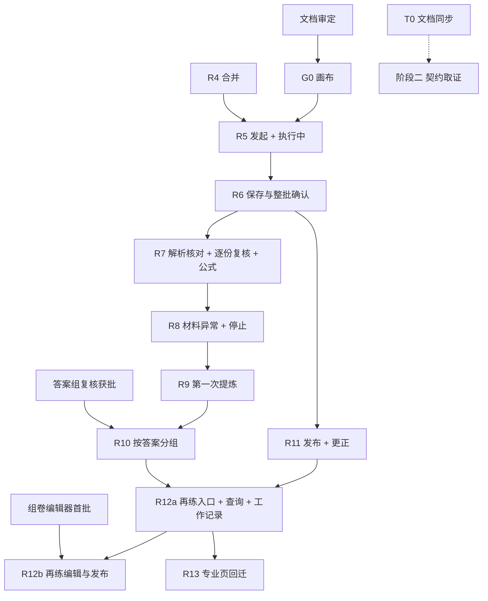

# AI 解析批阅 × Agent「解析到批阅」· 实施规划

版本：v0.3.2 · 实施规划（纳入 v0.2 审核、v0.3 复审两轮 REWORK 与 v0.3.1 审核细节的修订，待 Product Owner 审定）
日期：2026-10-16
作者：Claude Code（Supervisor）
配套：[设计文档 v0.3.3](AI解析批阅-Agent解析到批阅-设计-v0.3.md)（画面编号 A/P/B/M/C/G/E/D/U/R/X/Q/F 与之对应）

2026-10-25 配套同步：仅更新设计版本引用、R5 承载路径与 R12 的分析／输出依赖，轮次及原门禁保持。F05 批准状态统一见设计文档文首；设置表单、扫描接续、完整分析、套打／文件服务的 Agent 嵌入待实施，不以本规划登记或学情两区参考视为交付。下表依赖状态仍为 2026-10-16 历史盘点。

本规划只组织范围、顺序、交付标准与门禁；交互细则以设计文档为准，冲突时以设计文档及其上位规范为准。本规划所列工作在本机原型与 Mock 夹具上完成，不构成真实服务接入或业务闭环验收。

---

## 1. 目标与阶段划分

| 阶段 | 目标 | 产出 | 本规划是否覆盖 |
|---|---|---|---|
| 一 · UI 原型 | Agent 页完成设计文档全部画面，与专业页共用同一本机对象与资格函数 | Workspace 页面 + Prism 组件 + 夹具 | 覆盖（§4–§6） |
| 二 · 契约取证 | 13 项能力的 Owner 映射、接口证据与登记（体系规划 §2.1/§2.3、蓝图 §13.4 步骤 1）；公式 Top100 真实样本 | 能力登记项、服务样本、签认记录、公式样本记录 | 列工作项与收口条件（§7），不排期 |
| 三 · 真实链路 | 按蓝图 §13.4 步骤 3 接入并验收 | 真实闭环验收记录 | 不覆盖 |

阶段一与阶段二可以并行；阶段一完成不解除任何流量门禁。

**完成的定义**：一个画面只有在设计文档对应小节的全部行为、本规划对应验收用例全部通过时记为“完成”；只交付其中一部分记为“部分交付”，报告中写明缺什么、等什么、由哪一轮补齐。

---

## 2. 前提与依赖

| # | 前提 | 当前状态（2026-10-16） | 影响 |
|---|---|---|---|
| P1 | Workspace R4（W193/W194）合并 | `feat/agent-blueprint-r4` 进行中，未合并 | R5 在 R4 合并后开始 |
| P2 | Prism Blueprint 线当前分支（`feat/blueprint-nav-folio`，P77/P78）合并；P79/P80 状态以 Blueprint 线为准 | 工作树有未提交改动，与本线共用 Prism 工作树 | 本线 Prism 任务排在其后；同一时间本地只一个 Prism 任务分支（AGENTS §3） |
| P3 | 设计文档（本轮配套 v0.3.3，批准状态见文首）与本规划经 PO 审定 | 待审 | G0 画布在审定后开始 |
| P4 | 冻结文档修订授权（设计文档 §1.3） | 待 PO 授权 | T0；不阻塞 UI 原型，阻塞阶段二的契约取证口径 |
| P5 | 组卷首批编辑器 | 组卷基线已定，编辑器未实现 | 阻塞 X 的完整交付（R12b） |
| P6 | 新组件“答案组复核”经 PO 批准 | 已批准立项（PO 2026-10-16） | R10 可按 G0 冻结画布开工 |
| P7 | 公式样本来源（真实高中题库） | 未指派 | 阻塞阶段二公式收口；R7 先用覆盖蓝图 §8.5 类别的夹具公式 |

---

## 3. 工作轨道

| 轨道 | 内容 | 负责 | 产出 |
|---|---|---|---|
| T0 文档 | 起草设计文档 §1.3 所列修订补丁（冻结文档 5 处：蓝图 3 处、体系规划 1 处、组卷基线 1 处）；更新 Workspace《Agent 页面蓝图实施规划》改为引用本规划 | Supervisor 起草，Codex 修改，独立审查 | 各仓库分开的文档 PR |
| T1 夹具 | 一套数据结构、两个规模：蓝图 §15 按路径 B 改写后的小夹具，以及 45 人班级场景（§3.1） | Codex | Workspace DEV 评审工具场景 |
| T2 Prism 组件 | CI-15 旋转 + 缩放；答案组复核（批准后）；必要扩展与蓝图主题适配 | Codex | Prism PR + 组件文档 + 示例 |
| T3 Workspace 宿主 | 各画面组合、状态投影、共用资格函数、双入口同步、深链接、原因码模板 | Codex | Workspace PR |
| T4 契约取证 | 13 项能力登记、Owner 映射、服务样本；公式样本 | 各 Owner；Supervisor 汇总 | 登记记录（阶段二） |

规则：组件缺口在同一轮先修 Prism，再按来源清单同步到 Workspace；Workspace 只写布局，不覆盖组件视觉；新增组件须 PO 认可。

### 3.1 夹具清单（T1）

全部夹具使用设计文档 §4.6 的计数口径；推进动作只在 DEV 评审工具，产品界面不出现模拟动作。

| 编号 | 场景 | 用于 |
|---|---|---|
| FX-01 | 整班 45 人：43 份提交、2 人未交、1 份无法识别被剔除、有效 42 份；含 1 份未知学生（后指定）、1 份疑似重复 | 主场景 |
| FX-02 | 外部纸质试卷：等待解析 → 3 题解析待核对 → 修正后受影响题重新批阅 | P |
| FX-03 | 复核已提交、未合并 | §4.7 条件 4 |
| FX-04 | 质检进行中；质检失败（含服务给出的出口） | §4.7 条件 6 |
| FX-05 | 保存 V1 后又提交 2 处处理 | §4.7 条件 7 失效 |
| FX-06 | 停止：留有 12 份未批；服务支持 / 不支持继续批阅；合批未知 | E |
| FX-07 | 停止：请求时 41/42，最终 42/42 且仍有待处理项；服务判定“已完成”与“已停止不可处理”两种 | E 的 N=0 分支 |
| FX-08 | 答案分组：选择/填空题 4 组 + 4 份逐份；过程题按评分点一致分组 1 组；成员加载失败 1 组；服务重新分组导致成员变化 | G |
| FX-09 | 发布：全部成功；部分发布（40 成功 / 1 失败 / 1 未处理）；发布请求未知 | U |
| FX-10 | 更正：V1 已发布后更正为 V2；V1 部分发布时更正；V1 发布未知时更正 | R、§4.8 |
| FX-11 | 再练：V1 已确认、统计已覆盖；统计未覆盖 V2；草稿创建后来源被更正；创建请求在来源使用前 / 使用后 / 回执未知时来源被更正；依据已被取代的草稿尝试发布 | X、§4.8 |
| FX-12 | 迟交：原任务 2 人本轮未交，附加 2 份作答新建批阅（目标学生 2 人），其中 1 份身份无法识别；之后在原任务发起更正，尝试改动迟交目标学生 | §5.14 |
| FX-13 | 查询：完整结果；批阅进行中；无权限；读取超时 | Q |
| FX-14 | 公式：覆盖蓝图 §8.5 列出的类别（矩阵、分段、上下标、根式、分式、积分/求和、向量、不等式、多行、不支持语法） | P、C 的公式显示与编辑 |

---

## 4. 分轮计划

沿用 Workspace 实施规划的 R5–R9，并为新增范围补 R10–R13。每完成 3 轮做一次完整回归与独立综合审查（R6、R9、R12），高风险轮提前。一轮可以包含多个 Builder 任务，任务编号按当时顺序取（P／W 编号）。

### G0 · 设计画布（本规划与设计文档审定后）

| 项 | 内容 |
|---|---|
| 范围 | 13 块板：A、P、B（42 份）、M、C、G、E（含 N=0）、D（含 blocked 原因）、U（含部分发布与版本失效）、R、X、Q、F；每块 1440 主状态，关键板补 1280 与窄屏 |
| 规则 | 配色用 Prism 蓝图令牌；冻结框架处写“调用现有框架”，只画右功能区新内容；按 7 点设计自查后再给 PO |
| 产出 | 画布 Artifact；PO 审定后冻结快照 |
| 门禁 | PO 审定画布前不派 Builder 实现 A、M、G、U、R、X 的新增画面 |

### T0 · 文档同步（可与 G0 并行）

范围见 §3；冻结文档修订须 PO 授权；体系规划位于 open-learning-engine，单独 PR。

### R5 · A 发起与受理 + B 执行中

| 项 | 内容 |
|---|---|
| Builder 任务 1（A） | 快捷入口填入请求；≤3 项澄清与依赖顺序；任务摘要（目标学生、试卷、作答份数、D8 提示）；当前会话右栏完整设置（同一任务草稿、原表单与保存回执，主区摘要据此更新）；数据站扫描接续（仍需实体设备，已接通时在右栏／专注态复用原工作面；未接步骤登记待实施，导航交接按实际受理状态呈现，同一任务草稿回链）；受理失败/未知/无权限 |
| Builder 任务 2（B） | 任务条折叠/展开、按份计数、“可以先离开”提示、展开态按份分项、质检状态、已批学生进冻结框架、停止三阶段、暂无更新、连接提示 |
| 夹具 | FX-01、FX-02（等待解析部分） |
| 验收路径 | ① 新会话 → 快捷入口 → 澄清 3 项 → 摘要 → 开始批阅 → 同一任务出现在任务条与工作记录；② 摘要 → 修改设置 → 同一会话右栏编辑原草稿 → 保存回执后摘要更新，失败／未知保留草稿，收起重开仍为原对象；③ 选数据站 → 同一草稿扫描接续（嵌入待实施；未接时仅按实际能力导航）→ 开始 AI 批阅 → 原受理回执后显示同一任务，不产生第二个任务；④ 受理未知只查询 |
| 验收重点 | 计数与专业页同一事实；B 屏无百分比；停止不伪造 |

### R6 · D 保存修订与整批确认

| 项 | 内容 |
|---|---|
| Workspace | 共用资格函数（专业页与 Agent 同一个，补“已合并”“质检”两项）；资格原因列表；确认六态、结果四态、unknown 只查询、双入口锁定；保存与确认分为两个共享命令（O7）；保存后修改使待确认失效 |
| 旧入口最低适配 | 专业页现有 `task.complete` 调用（`SmartGradingMonitor`、`SmartGradingResults`、DEV 评审工具）改为只保存、不自动确认；`result.publish` 增加“已确认、未被取代、无未决确认请求”校验；整体分析等现有门槛不变。专业页本轮不加新界面，只保证任何入口都不能绕过确认规则 |
| 夹具 | FX-01、FX-03、FX-04、FX-05 |
| 验收重点 | 设计文档 §4.7 七条逐条有用例；一处确认另一处只读；保存后修改后确认按钮 blocked 且原因准确；质检中/失败不出现保存；AC-14、AC-15 |
| 回归 | **完整回归 + 独立综合审查**（R4–R6 周期） |

### R7 · P 解析核对 + C 逐份复核 + 公式

| 项 | 内容 |
|---|---|
| Prism | CI-15：DocumentRegionViewer 旋转后继续缩放、页列表、键盘平移 |
| Workspace | 原件对照与同步/解除同步；C 屏队列五类顺序；冻结批阅功能区接入；修改任意作答；已提交/已合并两步显示；对话定位与预填；重新 AI 批阅范围回显；P 屏解析核对（专注模式 + 冻结试卷框架 + 区域调整）；离开保护 |
| 公式 | 用 FX-14 按蓝图 §8.5 第 2–4 项验收：逐项记录正确渲染 / 原文回退 / 需修正；不支持或超限保留 TeX 与原件入口；编辑绑定 formulaId/baseVersion；IME、粘贴、撤销/重做、焦点返回 |
| 夹具 | FX-01、FX-02、FX-14 |
| 验收重点 | 冻结框架零改动（左栏、中区、顶栏、工具）；90°/180°/270° + 缩放 + 翻页 + 返回同题；预填不提交；夹具公式逐项有记录；AC-16 |
| 部分交付说明 | 公式 Top100 真实样本（蓝图 §8.5 第 1 项）属阶段二，R7 报告写明未覆盖 |

### R8 · M 材料异常与未交 + E 停止

| 项 | 内容 |
|---|---|
| Workspace | 材料九态与宿主组合；M 屏队列项与处置对话框（复用 Dialog Layout 与专业页对话框），含未交；E 屏路径 B 只读、继续批阅（服务支持时）、N=0 分支；资源与产出浮层、题篮、Token 用量（Mock） |
| 夹具 | FX-01、FX-06、FX-07 |
| 验收重点 | 未知学生不可接受；指定学生只列目标学生中无可用作答的；计数与分母变化说明；停止留有未批时无处理/保存/确认/发布入口；N=0 时不出现“继续批阅 0 份”，两种服务判定各有合法出口 |

### R9 · 第一次提炼

| 项 | 内容 |
|---|---|
| Prism + Workspace | 稳定交互提炼回 Prism（组件文档与蓝图页），按来源清单同步 |
| 回归 | **完整回归 + 独立综合审查**（R7–R9 周期） |

### R10 · G 按答案分组

| 项 | 内容 |
|---|---|
| 前提 | P6；G0 中 G 板已冻结 |
| Prism | 新组件“答案组复核”：两步流程、成员全部显示后才可确认分组、移出/移组、组评分（组合 ScoreReview 评分点）、组错因、已单独修改成员的排除、成员变化失效、过程题成员评分点显示 |
| Workspace | 冻结题目框架接入；可分组题在队列中的呈现；逐组两步确认 |
| 夹具 | FX-08 |
| 验收重点 | 没有全部组一起确认的入口；成员未全部显示或加载失败时不能确认分组；组内单独修改不被覆盖；成员变化后旧确认失效；过程题只有评分点一致的成员同组 |

### R11 · U 发布 + R 更正

| 项 | 内容 |
|---|---|
| Workspace | 发布确认面板；执行时复核（stale / target conflict 回到 ready）；发布记录三态与成功/失败/未处理人数；继续发布剩余子集（仅当前版本）；未知只查询；更正流程（理由必选 → V2 → 取代 V1 → 确认 V2）；发布更正版本；V1 未决时禁止发布 V2 |
| 夹具 | FX-09、FX-10 |
| 验收重点 | §5.5 AC-01—AC-08、AC-17 全部通过 |

### R12 · X 结果再练 + Q 查询 + F 工作记录扩展

| 项 | 内容 |
|---|---|
| R12a（不依赖编辑器） | 再练准入与原因回复；澄清（对象、时间预算、额外限制）；依据展示与依据失效提示；创建草稿成果行与只读预览；查询（有界读取、权限、版本完整性、进度回答、失败刷新）；工作记录三维度状态、去重计数、通知；迟交作答新建批阅 |
| F05 承载依赖（不视为已交付） | 按设计 §5.12／§6，整体分析达到原处理资格后主区给事实摘要与必要图表、右栏展开同版分析和证据；套打／文件输出在同一任务右栏／专注态提供参数、预览和真实输出状态，保留结果版本保存等原门槛。完整分析与输出服务嵌入待实施，逐项宿主适配、资格与真实回执验收后开放；未接步骤登记待实施，导航交接按实际受理状态呈现。具体接线轮次待后续实施派单，不改变 R5–R13 原顺序 |
| R12b（依赖 P5） | 打开组卷编辑器编辑草稿；基于新版本重新生成；练习发布确认与回执 |
| 夹具 | FX-11、FX-12、FX-13 |
| 验收重点 | 未确认或已取代的结果不出现再练入口；统计未覆盖时提示等待；部分批完时查询只回答进度；迟交任务的资格与发布只针对选定学生；AC-09—AC-13 |
| 交付状态 | 仅完成 R12a 时，X 记为“部分交付”，R12b 在组卷编辑器首批可用后的第一轮补齐；X 只有 R12b 完成才记为完成 |
| 回归 | **完整回归 + 独立综合审查**（R10–R12 周期） |

### R13 · 专业页回迁

| 项 | 内容 |
|---|---|
| Workspace | 专业页第三步接入答案组复核（O2）；“补交学生试卷”按 O4 改为新建批阅；专业页显式“确认这一版”面板等完整界面回迁（共享命令与规则已在 R6 完成，O7）；“在 Agent 中讨论”入口 |
| 验收重点 | 专业页四步原有流程与已冻结框架无回归；两入口资格、版本、发布记录一致 |

---

## 5. 每轮交付标准

### 5.1 流程（AGENTS §2、§3）

1. Supervisor 写任务单：范围、依据条款、文件清单、验收清单（含本节用例编号）、未验范围。
2. Codex 从最新 `main` 开任务分支实现并自测；Prism 工作树与 Blueprint 线共用，只提交 Builder 报告的文件，不用 `git add -A`。
3. 独立 Review（新会话、只读），结论只有 `PASS / PASS WITH NOTES / REWORK / ESCALATE`。
4. Supervisor 浏览器验收。
5. PO 确认后合并（merge commit），删除已合并分支。

### 5.2 工程检查

| 仓库 | 命令 |
|---|---|
| Prism | 按 README「Windows 本地验证」所列环境变量（macOS 以 POSIX 设置同名变量）执行：`node scripts/check-math-font.mjs`；`node scripts/check-typography.mjs`；`node node_modules/vinext/dist/cli.js build`；`node --test tests/*.test.mjs`；`node node_modules/typescript/bin/tsc --noEmit`（先构建再测试） |
| Workspace | `npm run typecheck`；`npm test`；`npm run build -- --outDir <tmp> --emptyOutDir`；`python3 scripts/check-prism-sources.py`；`python3 scripts/check-workspace-layout.py`；`git diff --check` |

小轮按影响范围执行；完整回归轮执行全部。报告写实际命令与数字，不沿用旧结果。

### 5.3 浏览器验收（Supervisor）

- 视口：1440×900、1280×720、320px 代表窄屏；P/C/G 额外检查 976 净宽两侧（真 Tabs 切换）。
- 主题：蓝图只在 Agent 页生效；抽查其他教师页面与核心三主题不变；组件轮检查嵌套预览隔离。
- 键盘：每屏主键盘路径（设计文档 §5 各节）。
- 状态：每屏至少主状态 + 一个空态 + 一个错误态 + unknown（有写操作的屏）。
- 冻结框架：P/C/G 与专业页同一框架逐元素比对。
- 证据：页面、操作路径、看到的文案或状态；PO 看实时页面，报告给 URL 与观察点。

### 5.4 未验范围（每轮报告必写）

真实服务、读屏器、真机（含 Android 边缘设备）、实体打印、跨设备同步、真实发布送达、公式 Top100 真实样本（阶段二完成前）。

### 5.5 版本绑定与失效验收用例（设计文档 §4.8）

| 编号 | 前置 | 操作 | 期望 |
|---|---|---|---|
| AC-01 | V1 待确认，确认请求发出期间服务端生成新版本 | 等待回执 | 返回 stale；面板回到 ready，显示差异；不显示已确认 |
| AC-02 | V1 确认回执未知 | 尝试再次确认或保存新版本 | 两者都不可用；只有“核对确认结果” |
| AC-03 | V1 保存后又提交 2 处处理 | 打开确认面板 | blocked：“保存后又有 2 处新处理，请重新保存” |
| AC-04 | V1 部分发布（成功 40 / 失败 1 / 未处理 1） | 继续发布剩余 | 只对 2 人发起，幂等；成功的 40 人不重复 |
| AC-05 | V1 部分发布后更正为 V2 并确认 | 查看 V1 发布记录 | V1 不再出现“继续发布剩余”；原因“V1 已被 V2 取代”；已成功记录只读保留 |
| AC-06 | V1 发布请求未知，此时更正为 V2 并确认 | 尝试发布 V2 | 不可用：“V1 的发布结果待核对，查清后才能发布 V2”；V1 只按原键查询 |
| AC-07 | V1 已发布 40 人后 V2 确认 | 发布更正版本 V2 | 面板列出已收到 V1 的 40 人与未收到的 2 人；新业务键；回执前不写已发布 |
| AC-08 | 发布面板打开期间发布对象变化（例如一份作答被更正剔除） | 点击发布 | 执行时返回 target conflict；回到 ready 并显示变化 |
| AC-09 | V1 已确认，统计水位未覆盖 | 请求再练 | 入口不出现；回复“统计正在更新，稍后可生成练习” |
| AC-10 | 基于 V1 的练习草稿已创建，之后更正为 V2 | 打开草稿 | 草稿内容不变；依据显示“基于 V1（已被 V2 取代）”；提供“基于 V2 重新生成” |
| AC-11a | 练习创建请求已发出，服务校验或使用来源之前 V1 被 V2 取代 | 等待回执 | 服务拒绝（`SOURCE_STALE`），不生成草稿；回到再练澄清并以 V2 重新预检；不出现基于 V1 的草稿 |
| AC-11b | 服务已合法使用 V1 之后，V1 才被 V2 取代 | 等待回执 | 按原键取得草稿；依据显示“基于 V1（已被 V2 取代）”，处理同 AC-10 |
| AC-11c | 练习创建回执未知期间 V1 被取代 | 尝试以 V2 再次发起 | 不可用；只按原键查询；查清后按 AC-11a 或 AC-11b 显示 |
| AC-12 | 已生成整体分析基于 V1，之后 V2 确认 | 打开分析入口 | 提示“分析基于 V1，可基于 V2 重新生成”；分析内容不变 |
| AC-13 | 依据为 V1 的练习草稿，V1 已被 V2 取代 | 点击发布练习 | 执行时阻断（`SOURCE_STALE`），提示依据已被取代；“基于 V2 重新生成”后新草稿重新预检并确认，才能发布；已发布的旧练习不受影响 |
| AC-14 | 专业页批阅结果页或监控页执行原“完成”动作 | 查看结果状态 | 只生成已保存待确认的版本，不自动确认；Agent 同时显示“V1 · 待确认” |
| AC-15 | 某版本在 Agent 中确认请求未决 | 在专业页或任一旧入口发布、保存新版本 | 均被拒绝并说明“确认结果待核对”；不存在绕过路径 |
| AC-16 | 第 3 题已发起一次重新 AI 批阅并完成；教师又修改了第 3 题的解析 | 再次对第 3 题发起重新 AI 批阅；同时对第 5 题发起 | 两次请求都被受理，业务键因 `trigger_revision` 与 `scope_target_digest` 不同而互不冲突；同一目标、同一修订号的重复点击只受理一次 |
| AC-17 | 原任务 V1 已确认，张同学记为本轮未交，且已是迟交任务的目标学生 | 在原任务发起更正，尝试指定未知学生作答给张同学或恢复其剔除作答 | 更正选择列表不列出张同学并说明“已在迟交批阅中处理”；服务端同样拒绝；张同学在两个任务中最多一个有效成绩 |

---

## 6. 关键路径

- R11 只依赖 R6；Builder 资源允许时可在 R9 后与 R10 交替，但同一仓库同一时间只有一个任务分支。
- R12b 等组卷编辑器；在此之前 X 保持“部分交付”。

---

## 7. 阶段二：契约取证工作项（不排期）

### 7.1 写能力（12 项）

每项须提供：业务键受理与同键同摘要返回、异摘要拒绝、可核验受理回执与原键查询、键级终结与迟到请求封闭、§8.5 `resolveByKey` 自动核定、本地人工核查出口（列表/命令、具名承办人、接单与老化告警）。缺任何一项，该能力保持 `CLOSED_TO_TRAFFIC`。

| 能力组 | 额外证据 | Owner |
|---|---|---|
| 创建、停止、重新批阅（1、5、6） | 停止取消合同；新尝试与旧尝试关系；停止后合批规则；停止生效前全部完成时的状态 | 批阅 Owner / Orchestrator |
| 材料处置、解析核对（2、3） | 处置动作与撤销期限；重新上传的采用/排除回执；解析更正与受影响题范围 | 批阅 Owner / 解析 Owner |
| 复核与分组（4） | 单项与组复核命令；合并完成事实；可分组题型标记；成员清单绑定；重新分组失效；逐成员来源记录 | 批阅 Owner |
| 保存、确认（7、8） | M71a/M71b 分别签认；服务端资格（含合并与质检）；版本 CAS；保存后变化的失效 | 批阅 Owner |
| 发布、更正（9、10） | 发布幂等与成功/失败/未处理计数；首次发布唯一；执行时版本与对象复核；更正生成新版本与取代关系；更正版本发布的业务键；旧版本未决请求的查询 | 发布 Owner / 批阅 Owner |
| 练习草稿与发布（11、12） | 草稿创建唯一性；来源结果版本引用；单班首次发布 | 产物 Owner / 发布 Owner |

### 7.2 读能力（1 项）

`assessment.result.query` 不建 HANDOFF、不需要业务键与核定协议。需要的证据：

- 当前授权与字段范围过滤的真实拒绝/成功样本；
- STRICT_WATERMARK：结果版本、范围完成状态（如 expected/graded 计数、completion_state）与 applied_watermark；
- 有界读取的截止与超时行为；失败的显示与显式刷新；
- 结果治理与自身容量（体系规划 WB-Gate 1a）。

无法取得可靠版本与完整性状态时，该能力关闭。

### 7.3 公式 Top100

| 项 | 内容 |
|---|---|
| 要求 | 蓝图 §8.5 第 1 项：真实高中题库按频率取前 100 个不同公式表达式（不足全量），补列出的类别；留题目 ID/版本、TeX、截图；第 2–4 项按 R7 的方法逐项复验 |
| 负责 | 样本提供：题库 / EDU Owner（待指派，P7）；验收组织：Supervisor；实现与修复：Codex |
| 样本分组 | 正向集 = Top100（不足全量）+ 蓝图 §8.5 列出的核心结构；负向集 = 明确不支持或超限的表达式。分组在测试前由 QA 锁定清单、题目/版本、频率口径与文件摘要 |
| 收口（全部满足） | ① 正向集 100% 正确呈现，无丢字符、错层级或遮挡；② 负向集 100% 原位保留原文并说明原因，降级比例另报；③ **Top100 中失败的表达式不得挪入负向集**；④ 蓝图 §8.5 第 3、4 项（编辑绑定、IME、粘贴、撤销/重做、焦点、虚拟化不卸载）逐项通过；⑤ 截图、TeX、环境与失败记录留档 |
| 未通过 | 任何一条不满足即保持“未收口”，“需修正”项只有修复并重测通过才计入①；有处理结论但未修复不算通过 |
| 缩小范围 | 只能按蓝图 §8.5：EDU/CMP/FE 记录例外与影响，经产品确认后，对新范围重新测试；不得事后缩小范围来达到 100% |

---

## 8. 风险与应对

| 风险 | 应对 |
|---|---|
| 范围扩大（D1）使轮次增多 | 严格按关键路径；每轮范围以任务单为准，不顺手扩展 |
| Prism 工作树与 Blueprint 线共用 | 本线 Prism 任务排在 Blueprint 线当前分支合并后；只提交本轮文件 |
| 冻结框架被改动 | 任务单写明“左栏、中区、顶栏、工具保持原样”；验收逐元素比对 |
| 两入口资格不一致 | 资格函数只有一个（R6），专业页与 Agent 共用；R13 复核 |
| 按组确认误判 | 两步流程、可分组题型限制、成员全部显示门槛、组内单独修改不被覆盖 |
| 版本失效规则遗漏 | AC-01—AC-17 进入 R6、R7、R11、R12 任务单 |
| 组卷编辑器延迟 | R12 拆 a/b；X 在 R12b 前记为部分交付 |
| 夹具冒充服务 | 产品界面不出现模拟推进；推进只在 DEV 评审工具；报告写明未接服务 |
| 开发服务热更新干扰 PO 审阅 | PO 审阅期间不派 Builder 改同一仓库 |

---

## 9. 交付物清单

| 交付物 | 位置 |
|---|---|
| 设计文档、实施规划 | 本仓库 `docs/` |
| G0 画布 | Artifact（链接写入设计文档） |
| 文档修订补丁 | 本仓库、Workspace、open-learning-engine 各自 PR |
| Prism 组件与文档 | `components/prism-next/**`、`docs/<component>.md`、组件示例页 |
| Workspace 页面与夹具 | `src/features/teacher/agent-workspace-page/**`、共用资格函数、DEV 评审工具场景 FX-01—FX-14 |
| 每轮报告 | 由 Supervisor 按派单收取；需公开交付的证据使用 PR 链接或仓库内文件 |
| PO 规则 | D1–D8 及 O1–O7 的决定登记见[设计文档 §1.2、§10](AI解析批阅-Agent解析到批阅-设计-v0.3.md) |

---

## 10. PO 检查点

| 时点 | PO 审阅内容 |
|---|---|
| 2026-10-16（已完成） | 设计文档与本规划经两轮审核后 PASS；O1–O7 按默认批准；AnswerGroupReview 批准立项 |
| G0 完成 | 13 块画布；“答案组复核”的 G 板 |
| R6、R9、R12 完成 | 完整回归报告与实时页面（URL 与观察点） |
| R11 前 | 学生可见内容清单（O1）最终确认 |
| R13 前 | 专业页回迁范围（O2、O4、O7） |

---

## 11. 审核与处置记录

v0.2 独立审核结论 REWORK（2026-10-16，PO 转交）。本规划相关的处置：

| # | 审核意见 | 处置 | 位置 |
|---|---|---|---|
| 1 | 整批资格漏合并与质检 | 补共用资格函数与夹具 FX-03、FX-04、FX-05 | R6、§3.1 |
| 3 | 更正与后续动作缺失效规则与验收标准 | 新增 AC-01—AC-12 | §5.5、R11、R12 |
| 4 | A 发起没有实施轮次 | 并入 R5 为单独 Builder 任务，给出四条验收路径 | R5 |
| 5 | 查询误套写操作门禁 | 写能力与读能力分列 | §7.1、§7.2 |
| 6 | 阶段完成条件不完整；公式 Top100 未排入 | 新增“完成 / 部分交付”定义；R12 拆 a/b；公式排入 R7 与 §7.3 | §1、R7、R12、§7.3 |
| 边界 1 | 停止时最后一份恰好完成 | 夹具 FX-07 与 R8 验收 | §3.1、R8 |
| 边界 2 | 过程题分组 | 夹具 FX-08 与 R10 验收 | §3.1、R10 |

意见 2（计数口径）与设计文档 §4.6 一并处理，夹具统一使用该口径（FX-01、FX-12）。另有 Supervisor 自审 12 条，见设计文档 §13.4；本规划对应改动：R4 未合并的前提（P1）、Prism 检查命令的环境变量说明（§5.2）、P79/P80 状态改为以 Blueprint 线为准（P2）。

v0.3 复审结论 REWORK（3 处定向修订，2026-10-16，PO 转交）。本规划相关的处置：

| # | 复审意见 | 处置 | 位置 |
|---|---|---|---|
| 1 | 再练创建中来源被更正的分支错误；缺旧来源草稿发布的阻断与恢复 | AC-11 拆为 AC-11a/11b/11c；新增 AC-13；FX-11 补对应场景 | §5.5、§3.1 |
| 2 | R6 与 R13 对保存/确认拆分的安排冲突 | R6 增加“旧入口最低适配”（三处 `task.complete` 调用只保存、`result.publish` 校验已确认与未决请求）与 AC-14、AC-15；R13 只回迁完整界面 | R6、R13、§5.5 |
| 3 | 公式 Top100 收口条件偏松 | §7.3 写入蓝图 §8.5 门槛：正向集 100%、负向集 100%、失败不得挪入负向集、未修复不算通过、缩范围须批准并重测 | §7.3 |

v0.3.1 审核（原审核者 PASS；另一份 PASS WITH NOTES，2026-10-16，PO 转交）。本规划相关的处置：

| # | 意见 | 处置 | 位置 |
|---|---|---|---|
| 2 | 重新 AI 批阅业务键缺具体目标与触发修订号 | 新增 AC-16，进入 R7 | §5.5、R7 |
| 3 | 更正可能把迟交任务的学生转回原任务 | 新增 AC-17，进入 R11；FX-12 补场景 | §5.5、R11、§3.1 |
| 4 | 关键路径图横向过宽 | 改为纵向 | §6 |

意见 1A（组卷版本号）核对不成立，未改；1B 在设计文档 §1.3 处理。详见设计文档 §13.3。
