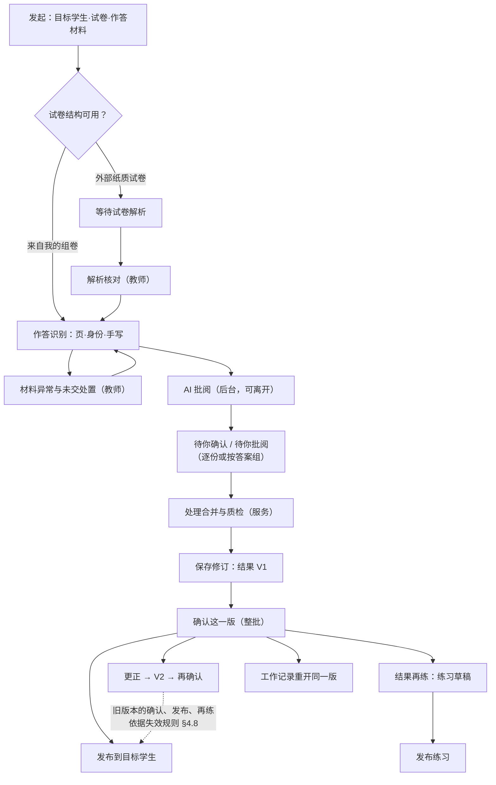

# AI 解析批阅 × Agent「解析到批阅」· 设计文档

版本：v0.3.3 · 设计文档（纳入 Agent 业务承载 §9 F05；保留 v0.3.2 既有决定，设计修订已获 PO 批准）
日期：2026-10-25
作者：Claude Code（Supervisor）
配套：[实施规划 v0.3](AI解析批阅-Agent解析到批阅-实施规划-v0.3.md)（画面编号 A/P/B/M/C/G/E/D/U/R/X/Q/F 与之对应）
适用：OLE 教师工作台 `/teacher/agent/workspace`（业务组装 `ole-school-workbench`）与智能曜彩组件（`intelligence-prism-ui`）

v0.3.3 状态：设计修订，已获 PO Ashrum 于 2026-10-25 批准；v0.3.2 的既有决定继续有效。

工程准入：未开始。

**两条主线：界面以《OLE Agent 前端界面设计规范·蓝图 v1.0》为准，体系以《OLE 教师工作台 Agent 体系规划与设计 v1.0》为准。** 本文把这两份已定稿文档落到“解析 → 批阅 → 确认 → 发布 → 再练”这条路径上。PO 本次决定改变了两份文档的部分范围，改动点集中列在 §1.3；本文不直接修改冻结文档。

状态边界：本文是设计，不是实现记录或验收结论。真实解析、识别、批阅、发布服务均未接入；体系规划中的能力均为 `CLOSED_TO_TRAFFIC`，蓝图第 14 章 SERVICE-GAP 门禁继续有效。界面先以本机原型和 Mock 夹具实现，不宣称接入真实服务。

---

## 0. 设计结论

1. **一件事，两个入口。** 解析与批阅只有一个业务对象：批阅任务及其结果版本。智能批阅专业页（`/teacher/grading/*`）与 Agent 页共享任务、成果、复核状态与本地编辑态（蓝图 §3.2）。Agent 不另建批阅逻辑、状态机、资格判断或结果副本。
2. **首期范围包含全部（D1）。** 批阅闭环（解析 → 批阅 → 复核 → 保存 → 确认）、结果发布与更正、结果查询、结果再练（练习草稿与发布）。
3. **整批确认（D3，蓝图路径 B）。** 资格由服务返回（§4.7）：目标学生全部有结论、异常与复核全部处理且已合并、质检通过，才能保存并确认。停止后留有未批作答时，结果只读。
4. **版本绑定（§4.8）。** 确认、发布、再练都绑定准确的结果版本与范围；版本被更正取代或内容在保存后变化，旧的确认和未执行的请求失效，需重新核对。未知回执只查原请求。
5. **Agent 内处理全部异常（D5、D6）。** 试卷解析核对、材料异常、未交、识别与评分复核都可在 Agent 内完成；“在教学数据站重新扫描”仍需实体设备；扫描接续按 §5.1 的接通状态在同一工作面承载或导航到扫描页。
6. **按答案分组确认（D7），两步走。** 先核对分组成员，再给组评分；只在服务标记为可分组的题上出现（§5.6）。不是“一键全部采纳”。
7. **不支持“补充本任务”（D8）。** 批阅开始后不能再向同一任务加入作答；迟交作答新建一次只针对这些学生的批阅（§5.14）。
8. **教师可见文案：** 只说“AI 正在批阅 / 待你确认 / 待你批阅”，不出现“规则引擎 / 大模型 / 降级 / 题次 / 置信度 / 聚类 / 相似度”。AI 不做最终决策，“确认这一版”是教师的最终认定。
9. **能力全部登记（D2）。** 13 项能力登记为提案（§7.2）：12 项写能力走交接与核定协议，查询只读、不建交接记录。Owner 接口证据齐备前全部关闭。

---

## 1. 依据、优先级与 PO 决定

### 1.1 依据

| 序 | 依据 | 本文使用范围 |
|---|---|---|
| 1 | 体系规划 v1.0（open-learning-engine `stages/OLE-Step1/engineering/`，2026-10-15 批准） | 分流方式、能力登记（§2.1/§2.3）、来源策略与 STRICT_WATERMARK（§7）、接管协议（§8）、等待人工与部分恢复（§8.4）、自动核定与人工核查（§8.5）、原因码（§6.5）、证据回流（§6.3） |
| 1 | 蓝图 v1.0（本仓库 `docs/OLE_Agent_Frontend_Blueprint_v1.0.md`） | 四类对象、布局与断点、统一输入器、状态分维度、确认六态与结果四态、原件对照（§8.3）、公式验收（§8.5）、门禁（§13.4）、M 表、B/C/E 脚本（§15）、CI-01—16 |
| 2 | Outline P0-B01/B02/B03/B03-01（Workspace `docs/design-sources/`） | GradingTask（含 QUALITY_CHECKING）、CaptureSession、GradingUnit、ReviewRecord、GradingResultVersion（ACTIVE/SUPERSEDED）、PublicationRecord（UNPUBLISHED/PARTIALLY_PUBLISHED/PUBLISHED，发布幂等并返回成功/失败/未处理数量）、CorrectionRecord（OPEN/APPLIED/REJECTED） |
| 2 | Outline P0-B04-05 | 再练只能来自已确认结果；内容型行动先形成可编辑草稿，教师确认后才发布 |
| 2 | PO 智能批阅规则汇编（至 2026-10-16；决定摘要见本文 §1.2、§10） | 四步流程、异常处置、异步批阅、文案禁用词、预览框架冻结、套打条件、错误率三分法、练习时间预算、D1–D8 |
| 2 | 组卷一体化设计基线 v1.0（`ole-paper-redesign-research-2026-10-16/`） | 结果再练情境 C、同一份卷的编辑器、版本 CAS |
| 3 | Agent 组件规范 v0.2.1、Workspace Agent 框架 v0.3.20 | 与 1 冲突时让位（PO 2026-10-16） |
| 4 | 现有代码 | Workspace `e6474f1`（分支 `feat/agent-blueprint-r4`，R4 未合并）；Prism 当前 `feat/blueprint-nav-folio`（P77/P78 在途） |

### 1.2 PO 2026-10-16 决定

| # | 决定 | 本文落点 |
|---|---|---|
| D1 | 首期范围包含全部：批阅闭环、结果查询、练习草稿、发布 | §5 全部画面；发布与更正 §5.9–§5.10；再练 §5.11；查询 §5.12 |
| D2 | 能力全部登记 | §7.2 共 13 项 |
| D3 | 蓝图路径 B：整批确认 | §4.7 资格；§5.7 停止；§5.8 |
| D4 | 主计数用“份”，页数只在展开详情 | §4.5、§4.6 |
| D5 | Agent 内处理材料异常 | §4.4、§5.4 |
| D6 | 解析核对放进 Agent | §5.2 |
| D7 | 做按答案分组确认 | §5.6；新组件提案 §9.2 |
| D8 | 不支持补充本任务 | §5.14 |

### 1.3 决定带来的规范修订需求

下表中的冻结文档（蓝图、体系规划、组卷基线）本文不直接改写，修订须另开文档轮并经 PO 授权（AGENTS §8）。两条 PO 规则的变化保留在下表及 §1.2、§10 的决定登记中。

| 文档与条款 | 现行内容 | 与决定的差异 | 修订建议 |
|---|---|---|---|
| 蓝图 §1.3 | 首期到“确认这一版”结束，不含发布 | D1 首期含发布、更正、再练、查询 | 首期终点改为“确认 → 发布记录 → 工作记录重开”；补 M44/M45 服务事实与版本绑定规则（本文 §4.8） |
| 蓝图 §1.5、§15 | 夹具按路径 A（8/12 页，01/02 两份部分确认） | D3 选路径 B | 按 §1.5 路径 B 改写 §15：正向夹具全部作答完成、质检通过后整批保存与确认；停止留有未批作答时只读，无确认按钮；补“停止生效前全部批完”分支 |
| 蓝图 §15.2.2 | 页数为主要计数 | D4 份为主 | 主文案改为份，页数进入展开详情；补本文 §4.6 计数口径 |
| 体系规划 §2 | 首期三项能力；改分不在 P0 | D1/D2 增加 10 项批阅能力，含批阅结果更正 | 新增批阅能力登记；“改分不在 P0”限定为已发布练习的修改，不适用于批阅复核与批阅结果更正（§10 O5） |
| 组卷基线 §6、§10 | Agent 从第二批起逐项准入；结果再练属第三批；§6.2 情境 C 允许“按 28 份已确认结果”部分范围再练 | D1 首期 Agent 含练习草稿；D3 路径 B 整批确认后才可再练 | Agent 首期只做“结果再练 → 创建草稿 → 打开组卷编辑器”这一入口，编辑能力仍是组卷首批编辑器。情境 C 补注：上游批阅采用路径 B 时，“已确认结果”指该任务全部目标学生都有结论且已整批确认（如有效作答 28 份）；整批确认前不开放部分结果再练，两边对 STRICT_WATERMARK 的解释一致 |
| PO 规则 2026-10-04 | 默认按题逐份确认，不提供一键全部采纳 | D7 按组确认 | 按组确认是逐组两步操作，未分组作答仍逐份；“不一键全部采纳”继续有效 |
| PO 规则 2026-10-05 | 补交先在 Agent 完成交互再迁移 | D8 不支持补充本任务 | 迟交作答新建批阅；专业页“补交学生试卷”按钮去留见 §10 O4 |

---

## 2. 现状盘点

### 2.1 专业页（已合并）

现有页面与事实沿用 2026-10-16 盘点；下表第三列为 v0.3.3 承载设计，实施增量另见 §2.4，不以专业页已有能力推定 Agent 已接通。

| 阶段 | 现有页面与事实 | 与本设计的关系 |
|---|---|---|
| 1 设置任务 | `/teacher/grading/new`；班级、试卷、批阅方式、身份识别 | Agent 发起只问 ≤3 项，其余沿用默认；完整任务设置在当前会话右栏继续编辑同一任务草稿，保存后主区摘要按原回执更新（§5.1） |
| 2 扫描学生试卷 | 数据站持续接收 + Web 上传；四类模板层面异常 + 未知学生；处置为重扫/重传、剔除、接受异常并记理由；并卷；指定学生；未交从名单处置 | Agent 复用同样的分类、处置方式与理由选项（D5） |
| 3 AI 批阅 | 异步可先离开；“已批 n / m · 等待 k · 待你处理 x 项”；暂停项·解析核对排最前；按题逐份确认；改分必选理由；可改任意作答；重新 AI 批阅（单份作答/整份/整题）；学生预览走冻结框架 | Agent B/C/P/G 的数据与动作合法性取自这一层 |
| 4 整体分析 | 全部批完且处理完才显示 | 达到原处理资格后，主区给事实摘要与必要图表，右栏展开同版分析和证据（§5.12、§6） |
| 套打与文件输出 | 套打仅限已保存结果版本的学生；文件服务不由套打入口推定已接入 | 同一任务工作面提供参数、预览和真实输出状态，沿用结果版本保存等原门槛（§6）；Agent 嵌入待实施 |

### 2.2 结果版本与完成门槛的现有实现

- `task.complete` 只在完成门槛 `gradingCompletionReason` 全部满足后执行，生成 `version: 1` 的结果版本，界面提示“已确认结果”；更正生成 `version + 1`。**复核期间没有结果版本。**
- 完成门槛检查：解析暂停、重新批阅中、批阅服务状态、材料异常、未交（`MISSING`）、未匹配、待确认、待人工批阅、分数完整性。未交的处置是剔除并记“本轮未交”。
- 本机门槛**不检查质检（QUALITY_CHECKING）与复核合并**，这两项在 P0-B 合同中存在，原型需补夹具（§4.7）。
- 保存与确认在本机是同一个命令；蓝图 M71a/M71b 要求分开签认（§10 O7）。
- 本地 `ResultVersion` 有 `published` 布尔与更正理由字段，只是本机状态，不是发布或更正服务（蓝图 M44/M45）。

### 2.3 解析（另一条线）

`/teacher/grading/parse/:id`：`MATERIAL_PENDING → MATERIAL_REVIEW → RECOGNIZING → PROOFREADING → IMPORT_PENDING → COMPLETED`（另有 `NEEDS_ACTION / FAILED`）。没有识别请求回执不得显示“识别中”。这是资料解析入库；与批阅的交点是外部纸质试卷的“等待试卷解析”。

### 2.4 Agent 页

以下两项保留 2026-10-16 的历史盘点，不代表本轮现状复验：

- R1–R3 已合并（WS #141、#143）：蓝图主题作用域、三模式布局、阅读版心、AppBar 并入。R4（新会话、消息载体、唯一输入器、工作记录行；W193/W194）在分支 `feat/agent-blueprint-r4` 实现，尚未合并。
- 本机原型代码：`CreateGradingTask`、`RecordGradingTask`、`paper-grading.ts`（本地 `task.*` 命令与回执投影）、`MaterialExtractionView`、`P04ImportAction`。不是服务证据。

**2026-10-25 F05 增量。** 本轮只修订设计。下列状态依据 §12 的固定来源及 PO 派单登记；没有批阅侧设置表单、扫描接续、整体分析完整内容、套打／文件服务 Agent 嵌入的实施 PR。

| 项目 | 已有依据与适用范围 | 批阅侧实施现状 |
|---|---|---|
| 学情两区 | W294b／W294c（[工作台 #232](https://github.com/Ashrum/ole-school-workbench/pull/232)、[#233](https://github.com/Ashrum/ole-school-workbench/pull/233)）仅提供宿主组合与状态表达参考 | 不能作为批阅设置、分析或输出闭环证据 |
| 完整专业操作承载 | 工作台框架 v0.3.24（[#239](https://github.com/Ashrum/ole-school-workbench/pull/239)）已批准右栏／专注态承接完整专业操作的总规则 | 总规则不是批阅编辑器的接线交付 |
| UC-01／03／06 | S1 业务流程版 v1.2（[#240](https://github.com/Ashrum/ole-school-workbench/pull/240)；按 PO 2026-10-25 派单登记）已登记主区进度与结果、右栏任务证据／原作答复核改分／解析校对入口及未实施状态 | 完整批阅线仍待实施，沿原读取、处理、保存与确认分阶段推进 |
| 任务设置与扫描接续 | 同一草稿、原受理动作及回执的承载设计 | 设置表单与扫描接续的 Agent 嵌入均待实施 |
| 整体分析 | 原处理资格与结果版本绑定不变 | 完整内容的 Agent 嵌入待实施 |
| 套打／文件服务 | 原保存门槛、参数、预览及真实输出状态分别表达 | Agent 嵌入待实施，预览不是文件输出成功 |

原批阅确认门槛、全部服务 `CLOSED_TO_TRAFFIC` 与 SERVICE-GAP 门禁保持。逐个专业操作完成宿主适配、资格及真实回执验收后才开放；未接通登记待实施，导航交接按实际受理状态呈现，不把打开页面、预填或请求已接收当作业务完成。

### 2.5 可复用组件（Prism，已核对存在）

| 环节 | 组件 |
|---|---|
| 输入与材料 | `AgentPromptBar`、`AgentFileInput`（九态）、`MaterialIntake`、`AgentQuestionCard`（仅普通澄清，CI-07） |
| 执行与确认 | `AgentExecutionProgress`、`AgentExecutionConfirmation`（六态）、`AgentExecutionResult`（四态）、`QueueBoard` |
| 原件与复核 | `DocumentRegionViewer`、`PaperPreview`（regionEditing、批阅图层）、`ReviewWorkspace`、`ReviewSwitcher`、`QuestionRail`、`QuestionInspector`、`ScoreReview`（confirm/edit/manual、评分点）、`ErrorCauseReview`、`StudentPaperReport`、`StudentControlBar`、`AgentSubjectEditor` |
| 对话框 | Dialog Layout（专业页第二步处置对话框基于它） |
| 蓝图呈现 | `BpFrameCard`、`BpSectionCard`、`BpTitleBlock` |

蓝图已登记的缺口：CI-15 旋转后不能继续缩放；CI-03/04 停止三阶段需宿主外置；CI-05 不渲染批阅百分比；CI-07 评分复核不得借用 QuestionCard。新增缺口见 §9.2。

---

## 3. 外部调研：借鉴机制，独立设计

蓝图 §2 已研究 Open WebUI、Open-ClaudeCode、Codex、OpenCode、Hermes Agent，本文只补“批阅 + 人在回路”。均为公开文档与论文研究，未运行，也不作易用性验收。

### 3.1 GitHub 与开源项目

| 项目 | 观察 | OLE 采用 | 不沿用 |
|---|---|---|---|
| [Integrated-Intelligence-Lab/llm_assisted_grading](https://github.com/Integrated-Intelligence-Lab/llm_assisted_grading)（VUB，[arXiv 2603.13083](https://arxiv.org/html/2603.13083v1)；仓库地址取自论文，仓库页面未直接核验） | 手写数学试卷：扫描切分 → 匿名化 → 评分细则 → 多次评分 → 一致性检查 → **强制人工复核**；报告批阅时间约降 23% | “多次评分不一致”作为“评分待确认”来源；人工复核不可省略 | 对教师暴露多次评分与一致性分数 |
| [Pensieve Grader](https://arxiv.org/html/2507.01431v2)（论文，许可未核实） | 左侧原件 + AI 转写，右侧建议分、评分点、评语 | 印证原件与结构化结果并置 + 右侧功能区 | 置信度数值给教师看 |
| [langchain-ai/agent-inbox](https://github.com/langchain-ai/agent-inbox) | 运行中断进统一收件箱；中断带允许的回应集合 | “需我处理”按任务去重，每项带允许的动作 | “忽略”作为通用动作 |
| [CopilotKit 人在回路](https://docs.copilotkit.ai/langgraph/human-in-the-loop) | 运行暂停，渲染审批组件，教师批准/编辑/拒绝后恢复 | 等待决定时就地确认面板 | 用前端 promise 代替服务端回执 |
| [Microsoft Magentic-UI](https://www.microsoft.com/en-us/research/blog/magentic-ui-an-experimental-human-centered-web-agent/) | 执行前共同修改计划；不可逆动作前 action guard | 受理前的任务摘要可改范围；保存、确认、发布是 guard 点 | 让教师配置“每步都问” |
| [Udayraj123/OMRChecker](https://github.com/Udayraj123/OMRChecker)（GPLv3） | 模板驱动答题卡识别；手机照片精度低于扫描 | 模板不匹配是独立异常 | 引入代码 |
| [MinerU](https://arxiv.org/pdf/2509.22186) / Docling | 文档解析与公式识别 | 试卷解析按“题目结构 + 区域 + 公式源文”核对 | 选型或引入 |
| [Label Studio](https://labelstud.io/) | 预标注 → 人工接受/修改/拒绝；建议与人工结果分开存 | 识别候选、评分候选、教师修订分别标来源 | 标注平台的项目与队列概念 |

### 3.2 同类产品

| 产品 | 观察（公开资料） | OLE 采用 | 不沿用 |
|---|---|---|---|
| Gradescope 答案分组（[帮助中心](https://www.gradescope.com/help#reviewing-suggested-groups)、[机构指南](https://guides.gradescope.com/hc/en-us/articles/24838908062093)） | 仅固定模板作业；AI 建议分组只用于选择题、数学填空、文本填空，每组至少 2 份；**先核对建议分组（确认、合并、改名、移动作答），再进入组评分**；未分组的逐份批阅 | D7 两步走：核对分组 → 组评分；只在可分组题型上出现 | 一次签认全部分组 |
| [Crowdmark AI 匹配](https://crowdmark.com/help/using-automated-matching/) | 封面 OCR 匹配名单；失败逐份“下一份未匹配”；匹配可在批阅前、中、后进行 | 未知学生逐份处理；指定学生选择器 | — |
| [Turnitin 设计原则](https://www.turnitin.com/blog/design-principles-of-ai-assisted-grading) | 承认 AI 会出错，界面为快速修正设计 | 修正动作就近、键盘可达，完成即到下一项 | — |
| CoGrader（第三方介绍） | AI 草稿 → 教师调整，教师对分数与评语有最终决定权 | 教师最终决定 | 单题单答模式 |
| [Off2Class 写作自动评分](https://help.off2class.com/platform-announcements/homework-writing-auto-scoring) | AI 第一轮评分与反馈草稿，教师编辑；**教师放行前学生看不到** | 发布前学生不可见；发布是独立动作 | — |
| 国内网阅（讯飞 AI 考试纸笔系统，见[北理工阅卷手册](https://jxzx.bit.edu.cn/docs//2023-10/c18aaf4f439446cb897899a7d7c8ab0e.pdf)） | 阅卷组长在“阅卷管理 → 处理问题卷 → 异常卷”处理扫描端放过的异常 | 异常集中在一个队列，按类型处置 | 阅卷组长分配阅卷人等多人分工（首期单教师） |
| Claude Artifacts / ChatGPT Canvas | 实质产出放到对话旁独立面板 | 已由蓝图协作模式覆盖 | 自动弹出成果面板 |

国内产品“问题卷”的判定规则未查到官方文档，上表只采用公开手册写明的部分。

### 3.3 三条设计取舍

1. **异常分类、集中、可逐项走完。** 所有异常进同一队列，按类型处置（§4.4）。
2. **AI 结果与教师修订分开存、分开显示。** 对应蓝图“识别候选 / 评分候选 / 教师修订”与体系规划 `source_type`。
3. **签认对象写清范围并绑定版本。** 按组确认绑定成员清单；确认这一版绑定版本与目标学生；发布绑定版本、班级与学生可见内容（§4.8）。

---

## 4. 业务对象与流程

### 4.1 教师可见对象

以下是前端显示语义，不是新增服务 schema。

| 教师看到的名称 | 含义 | 对应业务对象 |
|---|---|---|
| 批阅任务 | 一次对一组目标学生、一份试卷的批阅；受理时冻结输入快照 | GradingTask |
| 作答 | 一份学生作答（可多页） | CaptureSession 中的提交单元 |
| 试卷解析 | 外部试卷的题目结构、分值、区域、标准答案 | 解析结果（解析 Owner） |
| 待你处理 | 需要教师决定的事项：解析核对、材料异常、未交、识别/评分待确认、待你批阅 | ReviewRecord / 等待项 |
| 答案组 | 同一题中服务归为一组的作答 | 服务返回的分组（新增，待契约） |
| 批阅结果 V1/V2… | 不可变的结果版本。全部条件满足后保存生成 V1；更正生成 V2…；复核期间没有版本，只有已提交的处理（工作态） | GradingResultVersion（ACTIVE/SUPERSEDED） |
| 确认 | 教师对某一版本的最终认定 | 确认记录（M71b） |
| 发布记录 | 某版本向目标学生的发布及成功/失败/未处理人数 | PublicationRecord |
| 更正 | 对已确认结果的修改申请，生成新版本 | CorrectionRecord |
| 练习草稿 | 由已确认结果生成的练习草稿 | practice 草稿（产物 Owner） |

### 4.2 端到端流程

节点是显示语义；后端内部的分层处理不出现在教师界面。查询（§5.12）可在任何阶段只读发起。

### 4.3 两类“解析”的边界

| | 试卷解析 | 作答识别 |
|---|---|---|
| 输入 | 外部试卷原卷、标准答案/答案卡 | 学生作答扫描件或上传文件 |
| 产出 | 题目结构、分值、作答区域坐标、标准答案、公式源文 | 页序、学生身份、每题作答内容 |
| 何时需要 | 仅外部纸质试卷 | 每次批阅 |
| 教师核对 | 解析核对：题号、分值、区域、答案逐题核对，可框选调整区域 | 只处理异常（§4.4） |
| 服务未接入时 | 停在“等待试卷解析 · 解析服务待接入”，不提供手动建题或全部手动批阅（PO 2026-10-04） | 本机原型只读夹具事实 |
| 独立解析入库 | 仍走 `/teacher/grading/parse/:id`，Agent 只给链接 | — |

### 4.4 异常统一分类与处置

| 统一类型（教师可见） | 来源 | 处置（服务具备能力才显示） | 不允许 | 阻断 |
|---|---|---|---|---|
| 试卷解析待核对 | 专业页暂停项 | 打开解析核对；修正后受影响题等待重新批阅 | 手动建题 | 依赖该题结构的批阅 |
| 版面不匹配 | 模板不匹配；蓝图“试卷版面不匹配” | 重新上传 / 在数据站重新扫描（链接）/ 剔除（理由）/ 接受异常（理由） | 记 0 分 | 该份作答 |
| 缺页 | 缺页/页数不符；蓝图“缺页” | 同上 | 补 0 分；教师填写应有页数（页数由数据站给出） | 该份缺失页上的题 |
| 图像无法识别 | 无法识别；蓝图“低质量图” | 同上 | 拆成满屏识别错误 | 该页 |
| 疑似重复 | 重复提交；蓝图“疑似重复材料” | 查看依据；剔除（理由）/ 接受异常（理由） | 按文件名或哈希自动删除 | 该份作答 |
| 未知学生 | 未匹配 | 指定学生（只列目标学生中当前无可用作答的）/ 并入某学生已有作答（连续扫描切分出错的补救）/ 剔除 | 接受异常 | 该份进入结果 |
| 未交 | 目标学生没有可用作答（`MISSING`） | 记为“本轮未交”（理由）；D8 下批阅开始后不能再加入该生作答 | 记 0 分；补交到本任务 | 整批确认 |
| 识别待核对 | 蓝图“识别存疑” | 定位区域、修正原文；可能引起“评分待重新核对” | 前端自判重算完成 | 该题 |
| 评分待确认 | 蓝图“评分分歧” | 接受或改分，改分必选理由；可按答案组处理 | 一键全部采纳 | 该题 |
| 待你批阅 | 服务无法给出评分建议 | 手动给分 + 错因；可按答案组处理 | 自动给 0 分 | 该题 |

共同规则：

- 剔除、接受异常、改分的理由用预置选项 + “其他”（与专业页一致）。
- 处置有服务回执后才更新计数；计数变化时说明分母变化（“剔除 1 份后，有效作答 42 份”）。
- 处置的撤销期限以服务返回为准；整批确认后不可撤销，只能走更正。专业页现行“可撤销至结束扫描”与 Agent 的差异见 §10 O3。
- 预览框架内只显示提示，不放处置按钮；处置在队列项或对话框中进行（PO 2026-10-04）。
- 异常不连带否定同份其他合法作答。

### 4.5 状态分维度

| 维度 | 取值来源 | 显示位置 |
|---|---|---|
| 任务执行 | GRADING / BLOCKED / REVIEW_REQUIRED / QUALITY_CHECKING / COMPLETED；停止三阶段由宿主外置 | 任务条 |
| 成果修订与审核 | 复核中（尚无版本）/ V1 已保存待确认 / V1 已确认 / V1 已被 V2 取代 | 成果标题 |
| 发布 | 未发布 / 部分发布（成功 a、失败 b、未处理 c）/ 已发布；按版本分别记录 | 成果标题旁的发布记录，不混入执行徽章 |
| 连接与新鲜度 | 事件流、最后确认时间 | 顶栏轻提示 + 任务条时间 |

### 4.6 计数口径（D4）

每个口径受理时或处置回执时冻结快照，界面数字只取快照，不在前端相减推算。

| 口径 | 定义 | 冻结与变化 |
|---|---|---|
| 目标学生 | 本任务应批阅的学生。整班任务 = 受理时的班级名单快照；迟交任务 = 教师选定的学生（§5.14） | 受理时冻结；之后切班或名单变化不影响本任务 |
| 实际提交 | 收到并归属到目标学生的作答份数 | 随接收与指定学生回执变化 |
| 未知学生作答 | 收到但尚未归属目标学生的份数，单独显示 | 指定、并入或剔除后减少 |
| 剔除 | 被剔除的作答份数（及理由） | 随处置回执变化 |
| 有效作答 | 进入批阅与结果的作答份数 = 服务返回值 | 随处置回执变化 |
| 未交 | 目标学生中没有可用作答、已记为本轮未交的人数 | 随处置回执变化 |
| 发布对象 | 发布时选定版本中有有效作答的学生 | 发布确认时冻结（§4.8） |

主计数用份（“已批 18/43 份 · 等待 25 份”），分母是当时的有效作答数（尚未处置的作答计入“等待”）；异常项单独计（“待你处理 3 项”）；页数只在展开详情出现。有确定分母才写比例，不显示百分比（CI-05）。

**全文示例数据**：目标学生 45 人；实际提交 43 份，2 人未交；1 份图像无法识别且未能重扫，已剔除；有效作答 42 份，对应 42 名学生；发布对象 42 人。

### 4.7 整批确认资格（路径 B）

**资格由服务返回**：一个“可保存 / 可确认”事实加未满足原因列表，前端只显示，不自行判断。本机原型由同一个资格函数产生（在现有 `gradingCompletionReason` 上补齐质检与合并），专业页和 Agent 共用。

| # | 条件 | 未满足时的文案示例 |
|---|---|---|
| 1 | 目标学生全部有结论：有效作答已批完，或已剔除，或已记为本轮未交 | “还有 3 份作答未批完”“还有 2 人未交待处理” |
| 2 | 材料异常全部处置（含未知学生） | “还有 1 份未知学生作答待处理” |
| 3 | 试卷解析核对已完成（外部试卷） | “试卷解析还有 2 题待核对” |
| 4 | 待你确认、待你批阅项全部已提交，**且服务确认已合并到结果** | “还有 5 项待你处理”“2 项处理已提交，正在合并到结果” |
| 5 | 没有进行中的重新批阅；每份有效作答的每题都有有效分数 | “第 5 题正在重新批阅” |
| 6 | **质检已完成且通过**（QUALITY_CHECKING 结束） | “正在质检批阅结果”；失败时“质检未通过：{服务原因}”，并给服务允许的出口（如定位到需重新核对的题） |
| 7 | （确认需要）保存成功，且保存后内容未再变化；版本未被他处更新；当前教师有权限 | “请先保存修订”“保存后又有 2 处新处理，请重新保存”“服务端已有更新” |

- 条件 1–5 对应专业页现有完成门槛检查的同一组事实；条件 4 的“已合并”与条件 6 质检是现有本机门槛缺少、需要补的部分。
- **保存后再修改即失效**：V1 保存后若又提交了新的处理，V1 的待确认面板变为 blocked（“保存后又有 2 处新处理”），须重新保存为新版本再确认；已发出的确认请求按 §4.8 处理。
- 整体分析与套打沿用专业页现有门槛（全部批完并处理完后显示整体分析；结果版本保存后可套打，PO 2026-10-08、10-10），不因 Agent 增加确认步骤而改变；确认是发布与再练的前提。

### 4.8 版本绑定与失效规则

所有后续动作都绑定 **(结果版本, 范围)**。服务在**实际执行时**重新校验版本与范围，不能只靠前端打开面板时的旧状态。

| 场景 | 规则 | 教师看到 |
|---|---|---|
| 确认请求已发出，版本在此期间被更新 | 服务拒绝（`CONFIRM_STALE`）；面板回到 ready，显示新旧差异 | “V1 已有更新，请核对后再确认” |
| 确认请求回执未知 | 只按原请求键查询；查询期间不能对同一版本再次确认，也不能保存新版本 | “确认结果待核对” |
| 发布：版本被更正取代（V1 → V2） | V1 不再接受新的发布请求，含“继续发布剩余”；已成功的 V1 发布记录保留只读 | “V1 已被 V2 取代，不能继续发布 V1” |
| 发布：V1 的发布请求未知或部分处理中，此时更正为 V2 | 允许更正（不改 V1）；V1 的未决请求只按原键查询；**V1 未决请求查清之前不能发布 V2** | “V1 的发布结果待核对，查清后才能发布 V2” |
| 发布更正版本 | 新的发布动作（独立业务键），确认面板列出：已收到 V1 的学生 n 人将收到 V2；未收到的 m 人直接收到 V2；学生端是否替换或撤回 V1 以服务返回为准 | “发布更正版本 V2 至 42 名学生” |
| 再练准入 | 结果已确认、未被取代、且服务的统计水位已覆盖该版本（STRICT_WATERMARK 返回的 applied_watermark） | 不满足时：“这次批阅确认后才能生成练习”“统计正在更新到 V2，稍后可生成练习” |
| 再练：草稿创建后来源被更正 | 草稿不随之变化；依据标为“基于 V1（已被 V2 取代）”；提供“基于 V2 重新生成”（新草稿或新修订，由产物 Owner 决定）；已发布的练习不受影响 | 草稿标题旁的依据提示 |
| 再练：创建请求在服务校验或实际使用来源**之前**，来源被更正 | 服务拒绝旧来源（`SOURCE_STALE`），不生成草稿；回到再练澄清，以 V2 重新预检，教师重新发起 | “练习依据已更新为 V2，请重新确认后生成” |
| 再练：服务已合法使用 V1 之后，来源才被更正 | 只按原请求键查询结果；草稿生成后依据标为“基于 V1（已被 V2 取代）”，处理同上一行“草稿创建后来源被更正” | 草稿标题旁的依据提示 |
| 再练：创建请求回执未知期间来源被更正 | 只按原键查询，不重发；查清前不能以 V2 再次发起同一再练 | “练习生成结果待核对” |
| 再练：依据已被取代的草稿尝试发布 | 发布执行时服务复核来源；来源已被取代则阻断发布（`SOURCE_STALE`）；恢复路径为“基于 V2 重新生成”，新草稿或新修订重新预检后再确认发布 | “这份练习的依据 V1 已被 V2 取代，请基于 V2 重新生成后再发布” |
| 整体分析 | 已生成的分析绑定版本，不随更正静默变化；提示可基于新版本重新生成（P0-B03-01） | “分析基于 V1，可基于 V2 重新生成” |

这些规则的验收用例见实施规划 §5.5。

---

## 5. Agent 交互设计

### 5.0 通用规则

- 布局：桌面 1440×900 / 1280×720 为 P0；对话/协作/专注三模式；协作净宽 ≥1016、原件对照 ≥976，48px 迟滞（蓝图 §4.2）。
- 主题：蓝图主题只在 Agent 工作区；不显示“模拟数据”横幅（PO 原型阶段决定）。
- 冻结框架：打开一份作答或一道题时调用已冻结的预览框架，新功能只进右侧功能区。
- 主按钮：同阶段至多一个强调主按钮；停止持续可达（次级/危险样式）。
- 键盘：所有队列提供上一项/下一项；焦点不被事件更新抢走；吸顶条高度计入锚点偏移。
- 文案：按钮写具体动作和对象（“确认 第 5 题这 6 份给 4 分”“发布 批阅结果 V1 至 42 名学生”）。
- 示例数据见 §4.6。
- 承载与动作：已接通的完整设置、分析、套打／文件输出在当前会话右栏或同一工作面的专注态承载；解析、异常处理、改分、整批确认与发布分别使用原业务动作及回执。未接通步骤登记待实施，导航交接按实际受理状态呈现；独立专业页保留主动入口。

### 5.1 A · 发起批阅与受理

**触发**：新会话快捷入口“批阅作答”（只填入请求，不执行）、自然语言（“帮我批一下高一（2）班周测”）、或在对话里附加作答文件。

**分流**（体系规划 §1、§6.1）：小模型只出意图与槽位候选；代码预检；缺槽与歧义用服务端模板。

**澄清**：一屏最多 3 项，依赖项串行：

1. 班级（有权限的候选；只有一个时不问）
2. 试卷（我的组卷的最近试卷 / 外部纸质试卷）；选外部试卷时说明“需要先解析试卷，解析完成后开始批阅”
3. 作答来源（对话里已附的文件 / 使用教学数据站扫描；接续路径按下文实际接通状态呈现）

**任务摘要（受理前可改）**：

> **批阅 高一（2）班 · 数学周测**
> 试卷：周测 10-14（我的组卷）· 作答：本次附加 43 份（目标学生 45 人）
> 批阅方式与身份识别沿用该班上次设置 · 修改设置
> 开始批阅后不能再加入新的作答
> [开始批阅]

- “开始批阅”是受理请求（M65；M02/M03 快照），不是结果确认。
- “开始批阅后不能再加入新的作答”来自 D8，受理前明确告知。
- **修改设置往返（同一会话）**：Agent 发起批阅后，“修改设置”在当前会话右栏打开完整任务设置，继续编辑同一任务草稿，复用原表单、校验与保存接口；受理前可修改，受理后仍受原任务资格约束。保存后主区摘要按原保存回执更新；失败或未知保留草稿并显示实际状态，未知只查原请求；放弃编辑则摘要不变。收起右栏不等于保存或放弃，重新打开仍是同一草稿。设置表单 Agent 嵌入待实施；已接通则在右栏／专注态办理，未接通登记待实施，导航交接按实际受理状态呈现。
- **数据站扫描接续与回链**：选择数据站时仍需实体设备，先创建同一任务草稿并标明未受理。扫描接续已接通时在当前会话右栏／专注态复用原扫描工作面；尚未嵌入时登记待实施，仅按实际可用能力提供“去扫描页”，目标页沿用原草稿。教师点击“开始 AI 批阅”只发起原受理动作，收到原受理回执后，原会话任务条与工作记录才显示同一任务的实际状态，不生成第二个任务；导航成功不等于已受理。
- 受理失败、未知、权限不足按蓝图 §7.6 与原因码模板处理；未知只查原请求，不重发。

### 5.2 P · 解析等待与解析核对（D6）

- 任务条：“**批阅 高一（2）班周测** · 等待试卷解析 · 已接收 43 份作答”。没有解析事件时写“暂未收到解析进度 · 最后确认 14:02”，不画进度。
- 需要教师核对时：“等待你核对试卷解析 · 3 题”，主动作“核对试卷”。
- 打开后进入专注模式，调用冻结的试卷预览框架：左题目栏、中原卷与区域、右功能区（题号、分值、标准答案、区域框选调整）。
- 右功能区：当前题解析候选（来源“解析结果”）、可编辑字段、区域调整、“提交本题核对”。公式字段用 `AgentSubjectEditor`；不支持的公式保留原文并提示“请对照原件”，按蓝图 §8.5 公式验收。
- 提交 = 工作态提交（M69），有回执后写“已提交，受影响的题将重新批阅”。全部核对完成后批阅继续。
- 题目栏只用图标标记待核对题，不在格子里写文字（PO 2026-10-05）。

### 5.3 B · 执行中

- 折叠态：**名称 + 一句结果/阻塞 + 一个当前动作**。例：“批阅高一（2）班周测 · 已批 18/43 份 · 待你处理 3 项 · 处理”。
- 受理后提示一次“批阅在后台进行，可以先离开；完成后在工作记录里查看”。离开不取消任务。
- 边批边处理：已有待办即可进入 C 屏（PO 2026-10-08）。
- 展开态（协作模式右侧任务详情）：阶段（试卷解析 / 作答识别 / AI 批阅 / 质检），按份分项（已批 / 等待 / 有异常），最新活动时间，合法动作。已批学生进入冻结的学生试卷预览框架；等待中的学生有扫描件时看原卷。
- 质检中：任务条“正在质检批阅结果”，不显示保存入口（§4.7 条件 6）。
- 停止：独立文字按钮“停止批阅”，三阶段“正在请求停止 → 停止请求已接收 → 已停止”（CI-03/04）。
- 运行中输入只形成“下一条草稿”，不排队、不停止任务。

### 5.4 M · 材料异常与未交（D5）

**位置**：C 屏队列中的“材料”分组；也可从任务详情“有异常”分项进入。

**队列项**：

> **未知学生 · 第 37 份作答** · 3 页
> 无法与名单对应
> [指定学生] [并入已有作答] [剔除] · 查看原件

| 类型 | 主操作 | 次级操作 |
|---|---|---|
| 版面不匹配 / 缺页 / 无法识别 | 重新上传 | 在数据站重新扫描（链接到扫描页）、剔除、接受异常 |
| 疑似重复 | 查看依据 | 剔除、接受异常 |
| 未知学生 | 指定学生 | 并入已有作答、剔除 |
| 未交 | 记为本轮未交（理由） | — |

**对话框**：复用 Dialog Layout 与专业页第二步的处置对话框：

- 指定学生：一行多名学生，只列目标学生中当前无可用作答的；已完成任务不可指定。
- 剔除 / 接受异常 / 记为未交：预置理由 + 其他；接受异常不适用于未知学生。
- 查看处置：“撤销”与“关闭”同等权重。
- 重新上传：绑定原材料 ID 与版本，新材料受理后由服务返回采用/排除（蓝图 §8.3.3）。

**结果**：处置有回执后队列项标“已处置”，计数与分母更新并说明原因（§4.6）。“在数据站重新扫描”离开 Agent 去扫描页，回来后按服务事实刷新。

### 5.5 C · 复核（逐份）

- **队列顺序**：试卷解析待核对 → 材料异常与未交 → 识别待核对 → 评分待确认 → 待你批阅。队列由服务投影，前端不自造。
- **布局**：专注模式，原件与结构化结果并置；<976 净宽切真 Tabs（CI-10）。
- **原件**：DocumentRegionViewer，按题/区域 ID 同步；旋转、缩放、同份翻页按蓝图 §8.3.1；“已解除同步 · 返回第 3 页本题位置”持续可见。
- **右侧功能区**：复用冻结批阅功能区——默认“查看”（QuestionInspector + 错因）；只在“待确认 / 改分 / 待批阅”进入 ScoreReview（confirm / edit / manual）；ErrorCauseReview 为固定分类 + 一句说明；改分必选理由。
- **切换条**：`ReviewSwitcher`：“第 2/9 项 · 评分待确认” + 上一项/下一项。
- **主键盘路径**：题标题 → 原件定位 → 原文/评分 → 本项动作 → 下一项；完成一项自动到下一项。
- **修改任意作答**：教师可从任务详情打开任一已批学生，修改任意题（含 AI 已自动批阅、无需处理的题）的评分与错因，理由必选（PO 2026-10-05）。修改是工作态提交，不生成版本；若发生在保存之后，按 §4.7 使待确认版本失效。
- **对话定位与预填**（体系规划 §8.4）：“第 37 份第 8 题给 3 分”——唯一可靠目标时导航并预填为“待提交”；多个候选先选；教师最后点按钮提交。预填不消费复核、不新建改分任务。
- **重新 AI 批阅**：服务支持时在单份作答、整份试卷、整题三种范围出现；点击前回显范围清单，默认排除教师已处理项。
- 提交后的状态分两步显示：“已提交” → 服务确认合并后“已合并到结果”。全部处理完且已合并：“9 项处理已合并，正在质检”或“可以保存修订”。

### 5.6 G · 按答案分组确认（D7）

**适用条件**（服务决定，前端只呈现）：

- 只对服务标记为“可分组”的题出现。默认可分组：选择题、填空题等只看最终结果的题（与 Gradescope 选择/数学填空/文本填空一致）。
- 过程题、多评分点题：最终答案相同不代表评分点相同。只有服务按**评分点结果一致**分组时才出现分组，并在每个成员上显示其评分点判定；评分点不一致的作答不得进入同一组。
- 每组至少 2 份；只针对待确认、待批阅的作答。AI 已自动批阅、无需处理的作答不进分组队列，教师仍可按 §5.5 单独修改。

**两步流程**：

1. **核对分组**：中区显示本组全部成员的原件裁切；教师可“移出本组”（回到逐份队列）、把作答移到另一组。全部成员显示完成后，“确认分组成员”才可用。成员加载失败的组不能确认。
2. **组评分**：确认成员后，右功能区给出建议分、评分点逐点给分（ScoreReview 评分点能力）、组默认错因（ErrorCauseReview，可在成员上单独改）。主操作“确认 第 5 题这 6 份给 4 分”，改分理由必选。

**框架与组件**：调用冻结题目预览框架（左题目栏、中该题作答、右功能区）；右功能区为新组件“答案组复核”（§9.2，已获 PO 批准立项）。

**规则**：

- 队列显示：“第 5 题 · 待处理 18 份：4 组 14 份，另 4 份逐份处理”。
- 每组单独确认，没有“全部组一起确认”。
- 组评分请求绑定已确认的成员清单与基线版本；服务重新分组导致成员变化时，旧的成员确认和组评分失效，显示“本组成员已变化，请重新核对”。
- 组内教师已单独修改过的成员不被组评分覆盖，按钮数量自动排除并说明（“确认其余 5 份”）。
- 证据回流按成员逐份记录（§7.4）。
- 文案只说“答案相同或相近”；不出现“聚类、相似度、置信度”。
- 键盘：组列表上/下一组，组内成员上/下一份。

### 5.7 E · 停止、部分结果与未知（路径 B）

**停止后留有未批作答**：

> **本次批阅已停止**
> 已批 30/42 份 · 12 份未批
> 已批部分可以查看，不能处理、保存或确认
> [查看已批结果] · [继续批阅未批的 12 份]（服务支持时）

- 已批部分只读打开；不出现处理、保存、确认、发布入口。
- 蓝图路径 B 不假定停止的尝试可以续跑。“继续批阅未批的 N 份”只在服务明确支持时出现，创建新的执行尝试，并回显范围清单。
- 新尝试的结果能否与停止前已批部分合成同一批、此前已提交的处理是否保留，以服务返回为准。服务不支持合成时，不显示“继续批阅”，只给“重新批阅全部 42 份”；未知时写“此前的结果与处理能否保留待服务核对”，不承诺保留。

**停止生效前全部已批完**（例：41/42 时请求停止，权威快照为 42/42，仍有待处理项）：

- 未批份数为 0，**不显示“继续批阅未批的 0 份”**。
- 按服务返回的任务状态显示：服务确认批阅已完成（停止未影响任何作答）时，任务回到正常复核流程，待处理项可以处理，资格按 §4.7；文案“停止请求生效前，全部 42 份已批完”。
- 服务判定该尝试为“已停止”且不允许继续处理时，结果只读，给服务允许的出口（如“重新批阅全部 42 份”），并说明原因。前端不自行决定属于哪一种。

**停止回执未知**：只提供“核对停止结果”，不重发（蓝图 §15.5.3）。未批完的作答显示“未批”，不显示 0 分。

### 5.8 D · 保存修订与确认这一版（整批）

- 保存之前标题写“批阅结果 · 尚无版本 · 复核中”。
- **保存修订**：服务返回可保存后，把 AI 批阅结果与已合并的处理封装为结果版本（M71a）；成功后才显示“批阅结果 · V1 · 待确认”。
- **确认面板**（就地，六态 `ready / submitting / received / recorded / blocked / unknown`）：

  > **确认 批阅结果 V1**
  > 范围：高一（2）班，目标学生 45 人：有效作答 42 份，剔除 1 份，未交 2 人
  > 你的处理：改分 7 处，修正识别 3 处，手动批阅 4 处
  > 确认后，这一版作为本次批阅的最终结果，可以发布和生成练习
  > [确认 V1（42 份）]

- 确认请求绑定 V1 与范围；保存后内容变化、版本被更新、权限变化都使面板变为 blocked 并说明原因（§4.7、§4.8）。
- `recorded` 后成果标题为“V1 · 已确认”；专业页同时只读显示确认回执。
- 确认后，对话里出现成果行与后续入口：“发布结果”“生成针对性练习”“查看整体分析”，并按原资格提供“套打／文件输出”。分析在主区给事实摘要与必要图表，右栏展开同版内容和证据；输出在同一任务右栏／专注态提供参数、预览和真实状态。未接通的内部步骤登记待实施，导航交接按实际受理状态呈现。此处只是确认后的入口汇集：整体分析仍在全部批完且处理完时可用，套打仍以结果版本保存为门槛，均不新增整批确认前提（§4.7、§6）。

### 5.9 U · 发布（D1）

- **前提**：结果已确认（recorded）且未被取代。发布是独立动作，不随确认自动发生。
- **确认面板**：

  > **发布 批阅结果 V1 至 高一（2）班 42 名学生**
  > 不发布：未交 2 人、剔除 1 份
  > 学生可以看到：总分、每题得分与对错、错因说明
  > 学生看不到：标准答案批注、AI 评分依据、你的复核记录
  > 发布后学生端即可查看；撤回以服务能力为准
  > [发布 V1 至 42 名学生]

- **执行时复核**：服务在执行时校验版本仍为当前确认版本、发布对象未变；不满足返回 `CONFIRM_STALE` / `TARGET_CONFLICT`，面板回到 ready 并显示差异，须重新确认。
- **状态**：确认六态（发布请求）+ 执行结果四态 + 发布记录（未发布 / 部分发布 / 已发布）。部分发布显示“成功 40 人 · 失败 1 人 · 未处理 1 人”；“继续发布剩余 2 人”只针对失败与未处理子集（幂等），且仅当该版本仍是当前版本。
- **未知**：只按原请求键查询，不重发；未知期间不能再发起同一版本的发布，也不能发布更正版本（§4.8）。
- **不做**：只接收时不写“已发布”；不显示“学生已查看”，除非服务提供送达事实（M45）。撤回只在服务支持时出现。
- 学生可见内容清单以服务与 PO 确认为准（§10 O1）。

### 5.10 R · 更正

- **入口**：已确认结果的成果标题“更多 → 更正结果”。
- **流程**：选择要改的作答/题 → 进入与 C 屏相同的功能区修改（理由必选）→ 保存为 V2（CorrectionRecord OPEN → APPLIED）→ V1 标“已被 V2 取代” → 确认 V2。
- **对已发布的影响**：V2 确认后不自动发布；成果标题显示“V1 已发布 · V2 已确认未发布”，主动作“发布更正版本 V2”，面板按 §4.8 列出已收到 V1 与未收到的学生人数。
- **对再练与分析的影响**：按 §4.8，已创建的练习草稿与已生成的分析不随之变化，只提示依据已被取代。
- **范围限制**：已成为迟交任务目标的学生不能在更正中修改（§5.14 结论冻结）。
- **V1 发布未决时**：允许更正；“发布更正版本 V2”在 V1 未决请求查清前不可用。
- 首期是否包含更正见 §10 O5（本文按包含设计，排在发布之后实施）。

### 5.11 X · 结果再练：练习草稿与发布（D1）

- **准入**：结果已确认、未被取代、统计水位已覆盖该版本（§4.8）。不满足时入口不出现，对话中请求再练时按原因回复。
- **入口**：确认后的成果行“生成针对性练习”，或自然语言“根据这次周测给全班出一份练习”。
- **澄清**（≤3 项）：
  1. 练习对象：全班共练 / 分层加练 / 个人练习（错误率三分法：20%–80% 全班共练；低于 20% 进做错学生的个人练习；高于 80% 列为“需重新教”，不出练习）
  2. 时间预算：默认每人 45 分钟（PO 2026-10-05）
  3. 题量或范围的额外限制（可跳过）
- **依据展示**：“依据：批阅结果 V1（42 份有效作答，已确认）· 第 5、8、12 题”，可展开口径。依据随草稿保存，不印入学生卷。
- **创建**：`practice.draft.create`，请求绑定结果版本 → 成果行“周测再练 · 草稿 V1 · 未发布 · 打开”。打开即进入组卷编辑器（同一份卷），不在对话里嵌整卷。
- **发布练习**：`practice.publish`，单班首次发布，独立确认面板“发布 周测再练 V1 至 高一（2）班”；答案批注不进入学生版（体系规划 §6.4）。发布执行时服务复核练习依据；依据已被取代则阻断，恢复路径见 §4.8。
- **依赖与交付状态**：依赖组卷首批编辑器。编辑器未就绪时只能交付“创建草稿 + 只读预览”，入口说明“练习编辑器待开放”，练习发布不出现；这一状态在实施规划中记为“部分交付”，不计为完成。

### 5.12 Q · 结果查询（D1）

- 只读，`assessment.result.query`，`STRICT_WATERMARK`；**不建交接记录，不需要业务键与核定协议**（体系规划 §2.1：查询只创建 INPUT，取消只中断读取）。
- 示例：“这周还有哪个班没批完”“高一（2）班周测第 5 题错了多少人”。
- 有界同步读取：超时或失败显示原因码模板（`QUERY_TIMEOUT`、`QUERY_UNAVAILABLE`），保留问题，提供显式“刷新”；不显示 0，不自动重试。
- 权限：只返回授权字段；无权限用 `ACCESS_DENIED` 模板，不展示受限候选。
- 版本完整性：回答带结果版本与完成状态；未全部批完时只回答进度（“批阅进行中：已批 18/43 份”），不给部分排名或部分结论；聚合落后时写“统计正在更新”。
- 回答载体：主区提供简短事实摘要、带范围与时间的数字、必要图表、“依据与口径”展开和对象链接。整体分析达到既有处理资格时，右栏展开同版完整分析和证据；学情分析按其自身资格读取。主区摘要、图表与右栏共享同一对象、范围和结果版本，沿用 §4.8 的分析版本绑定与失效规则。
- 分析问答默认先交付主区内容并提供“查看完整分析”，不自动占用右栏；教师明确请求完整内容或证据时展开右栏，空间不足使用同一工作面的专注态。完整分析嵌入待实施；已接通则在 Agent 内承载，未接通登记待实施，导航交接按实际受理状态呈现，不把学情两区参考当作批阅分析交付（§2.4、§6）。

### 5.13 F · 工作记录与跨入口

- “需我处理”按任务去重：“需我处理 2 项任务”，任务内另示“待处理 9 项”；排队、运行中、质检中不计入。
- 记录行：任务名 · 目标学生范围 · 状态（执行 / 结果 / 发布三维度中当前最需要注意的一项）· 更新时间 · 成果入口。
- 独立专业页保留主动入口：“在智能批阅中打开”深链接到 `/teacher/grading/:id`；专业页“在 Agent 中讨论”优先回到原会话与同一任务，确需新会话时带上任务引用。从 Agent 发起的已接通操作在当前右栏／专注态完成；主动跨页返回须恢复原工作及更新后的对象版本，未接通内部步骤登记待实施，导航交接按实际受理状态呈现。
- 一处确认或发布，另一处立即只读显示回执。
- 通知沿用工作台现有机制，按事实变化提醒（首次出现可处理事项、全部批完仍待处理、全部完成；PO 2026-10-08），重复回执、打开页面不补造通知。

### 5.14 迟交作答（D8）

- 任务受理后，教师在同一会话附加新作答或说“这两份是补交的”：

  > 这次批阅已开始，不能再加入新的作答。
  > 可以为这 2 份新建一次批阅：高一（2）班 · 周测 10-14 · 目标学生 2 人（张同学、李同学）
  > [新建批阅]

- 新任务的**目标学生只有选定的学生**（§4.6）；整批资格、未交检查、发布对象都只针对这些学生，不检查全班其他人。
- 目标学生由服务按附件识别结果与原任务的“本轮未交”名单给出候选，教师确认；无法识别身份的作答按未知学生处理。
- 新任务独立执行、确认与发布，不与原任务结果合并；原任务中这些学生仍是“本轮未交”。两次任务在学情分析中如何合并由分析口径决定，不在本文范围。
- **结论冻结**：学生一旦成为迟交任务的目标学生，其在原任务中的结论（本轮未交，或剔除）冻结。原任务后续的“更正”（§5.10）不能改变这些学生的结论，不能把未知学生作答指定给他们，也不能恢复他们被剔除的作答；更正只能修改其他学生有效作答的评分与错因。服务在更正执行时校验，前端在更正选择列表中不列出这些学生并说明原因（“已在迟交批阅中处理”）。同一学生在两个任务中最多只有一个有效成绩。
- 受理前（任务摘要阶段）附加的材料正常进入本次任务。

---

## 6. 两个入口的分工

本节为承载设计分工，表中 ✔ 不表示本轮已接线或通过验收；实施现状见 §2.4。F05 建议中的“§6.1 分析问答及能力表”在原本文没有对应小节，现就地落在 §5.12 的分析问答及本节能力表，不新增章节编号。

从 Agent 发起的已接通操作在 Agent 主区、右栏或同一工作面的专注态内完成；独立专业页保留教师主动访问入口，共用任务、草稿、版本与原业务动作，不创建第二份编辑副本。未接通步骤登记待实施，导航交接按实际受理状态呈现；逐个操作完成宿主适配、资格与真实回执验收后开放。

| 能力 | 智能批阅专业页 | Agent 页 |
|---|---|---|
| 发起任务 | 四步向导，完整设置 | 自然语言 / 快捷入口 + ≤3 项澄清；右栏完整设置编辑同一任务草稿，主区按原保存回执更新；嵌入待实施 |
| 数据站扫描 | ✔ | 仍需实体设备；扫描接续嵌入待实施，接通后右栏／专注态承接同一草稿；现有导航按实际受理状态回链 |
| Web 上传作答 | ✔ | ✔ 对话附件，同一材料结构 |
| 材料异常与未交处置 | ✔ | ✔（D5），使用原处置动作与回执；重扫仍需实体设备，接续承载与未接入状态同上 |
| 试卷解析核对 | ✔ | ✔（D6），同一冻结框架 |
| 逐份复核、改分、错因、重新 AI 批阅 | ✔ | ✔ 同一功能区组件 |
| 按答案分组确认 | 后续接入同一组件（§10 O2） | ✔（D7） |
| 保存修订 / 整批确认 | ✔（现为一个命令；R6 先改为只保存并共享确认规则，R13 回迁确认界面，§10 O7） | ✔ 两步 |
| 发布、更正 | ✔ | ✔ |
| 整体分析 | ✔，全部批完且处理完 | 同一资格下主区事实摘要与必要图表、右栏同版分析与证据；完整内容嵌入待实施 |
| 套打／文件输出 | 套打沿用结果版本保存等原门槛；文件服务按实际接入范围 | 同一任务右栏／专注态提供参数、预览和真实输出状态；嵌入待实施 |
| 结果再练 | 第四步“训练重点”入口 | ✔ 创建草稿并打开组卷编辑器 |
| 跨任务查询 | ✗ | ✔ 只读 |
| 迟交作答 | “补交”按钮禁用，去留待定（§10 O4） | 新建只针对这些学生的批阅 |

整体分析的资格仍为全部批完且处理完，保存、整批确认、发布与分析分别判断，不增加确认门槛。主区与右栏使用同一分析版本和证据；结果更正后保留旧分析并提示可基于新版本重新生成（§4.8）。套打仅面向已保存结果版本的学生，文件输出沿用各自的原资格与真实服务回执；参数调整、预览就绪、请求已接收、输出成功／失败／未知分别显示，不能以保存或预览推定已输出文件或已完成实体打印。未接服务明确不可用，不伪造输出成功。

---

## 7. Agent 体系对齐（体系规划 v1.0）

### 7.1 分流与模型边界

- 小模型只输出一个事项的意图、参数、约束候选；不产生按钮、对象 ID、确认凭据或完成事实。
- 缺槽、歧义、权限、材料、交接问题用 §6.5 原因码模板。常用码：`INPUT_REQUIRED`、`OBJECT_AMBIGUOUS`、`MATERIAL_NOT_READY`、`ACCESS_DENIED`、`CAPABILITY_DISABLED`、`QUERY_TIMEOUT`、`QUERY_UNAVAILABLE`、`HANDOFF_UNRESOLVED`、`CONFIRM_STALE`、`TARGET_CONFLICT`、`TARGET_ALREADY_PUBLISHED`、`SOURCE_STALE`（再练依据已被取代）。
- 新增原因码提案 `TASK_INPUT_FROZEN`（§5.14）：“这次批阅已开始，不能再加入新的作答”，允许动作“新建批阅”。
- 闲聊或讲评讨论正常回答，不强行拉回任务。

### 7.2 能力登记（D2，全部登记为提案）

**写能力（12 项）**：走 HANDOFF、业务键幂等、原键查询、§8.5 自动核定与本地人工核查。

| # | 能力 | Owner | 业务键（提案） | 蓝图映射 |
|---|---|---|---|---|
| 1 | `assessment.grading.create` | 批阅 Owner | `org + target_set_digest + paper_version_id + request_id` | M65、M66 |
| 2 | `assessment.grading.material.resolve` | 批阅 Owner | `grading_task_id + submission_id + action + base_version` | M86—M89 |
| 3 | `assessment.grading.parse.review` | 解析 Owner | `grading_task_id + question_id + base_version` | M69 |
| 4 | `assessment.grading.review.submit` | 批阅 Owner | 单项：`grading_task_id + review_item_id + base_version`；分组：`grading_task_id + group_id + member_set_digest + base_version` | M68 |
| 5 | `assessment.grading.regrade` | 批阅 Owner / Orchestrator | `grading_task_id + scope_type(answer/submission/question/remaining/all) + scope_target_digest + trigger_revision`：`scope_target_digest` 为具体题号 / 作答 ID 集合的摘要，避免不同目标撞键；`trigger_revision` 为触发时解析与复核工作态的修订号，使同一目标在内容变化后的合法再次重批不被当成重复请求 | M69、M40 |
| 6 | `assessment.grading.stop` | Orchestrator | `task_id + attempt_id` | M24—M26 |
| 7 | `assessment.grading.result.save` | 批阅 Owner | `grading_task_id + base_revision` | M71a |
| 8 | `assessment.grading.result.confirm` | 批阅 Owner | `result_id + revision + scope_digest` | M71b |
| 9 | `assessment.grading.result.publish` | 发布 Owner | 首次：`org + grading_task_id + target_set + FIRST_PUBLISH`（目标不含版本，版本作为请求内容在执行时校验）；更正版本发布另立业务键 | M44、M45 |
| 10 | `assessment.grading.result.correct` | 批阅 Owner | `result_id + base_revision + correction_id` | P0-B03-01 |
| 11 | `practice.draft.create` | 产物 Owner | `org + origin_draft_id`；请求内容含来源结果版本 | 体系规划 §2.1 |
| 12 | `practice.publish` | 发布 Owner | `org + artifact_id + FIRST_PUBLISH` | 体系规划 §2.1 |

**读能力（1 项）**：

| # | 能力 | Owner | 读取参数 | 验收要点 |
|---|---|---|---|---|
| 13 | `assessment.result.query` | Assessment Owner | `assessment_id + class_id`，`STRICT_WATERMARK` | 不建 HANDOFF；授权字段过滤；返回结果版本、完成状态与 applied_watermark；有界读取、失败显示与显式刷新 |

每项须填实体系规划 §2.1 接口/保证表与 §2.3 登记后才能开流量。登记前只做适配器与夹具；夹具不解除门禁。

### 7.3 交接、未知与人工核查（写能力）

- 写请求走 HANDOFF；未知按 §8.5 自动核定（约 5s…5min 查询），超限进入本地核查队列。教师界面只显示“结果待核对”。
- “需我处理”是教师业务待办，“核查队列”是交接未决的人工核查，两者分开计数。
- 依赖关系：同一版本的确认未决时不能保存新版本；某版本发布未决时不能发布其更正版本（§4.8）。

### 7.4 证据回流

确认后的教师改分与更正可作为 Human Correction 来源，交 Evidence Owner；工作台不写 Evidence（体系规划 §6.3）。改分理由结构化（预置理由 + 其他）。按组评分时每个成员单独记录来源。

---

## 8. 蓝图 UI 落点

| 元素 | 规则 |
|---|---|
| 任务条 | `BpFrameCard`：墨色标题栏 = 任务名；状态只显示真实状态 |
| 成果面标题 | `BpTitleBlock` 四要素：名称 · 版本 · 审核状态 · 保存状态；发布记录在标题旁单独显示 |
| 页码 | SHEET nn/nn 只用于原件页（P77：SHEET > REV > 无） |
| 队列切换 | `ReviewSwitcher`：“第 2/9 项 · 评分待确认” |
| 原件面 | 标尺只在成果面；区域框用既有语义令牌 |
| 动效 | 只在事实成立期间播放；遵守 `prefers-reduced-motion`；不用动画暗示进度 |
| 计数 | 等宽数字（Geist Mono 子集）用于 n/m；不画百分比进度条 |
| 颜色 | 异常不整页玫红；待处理用强调色徽章；“已确认”不用大面积成功绿覆盖未完成范围 |
| 确认面板 | 动作、对象、版本、范围、主要变化、去向、不可逆影响按蓝图 §7.3 排列 |
| F05 右栏承载 | 复用 Workspace 既有右栏／专注宿主承接同一任务设置、完整分析与输出工作面；主区保留摘要、必要图表和原回执，内部视图切换不改变对象、版本或草稿 |

组件改动先 Prism、后 Workspace；Workspace 只写布局，不覆盖组件视觉。

---

## 9. 组件复用与缺口

### 9.1 按画面复用

| 画面 | 复用 | 宿主组合 |
|---|---|---|
| A 发起 | AgentPromptBar、AgentFileInput、AgentQuestionCard、AgentExecutionConfirmation（M65 设置确认语义） | 任务摘要、澄清顺序、同一会话右栏设置往返与扫描回链 |
| P 解析核对 | 试卷预览框架、PaperPreview regionEditing、QuestionRail（图标标记）、AgentSubjectEditor | 右功能区解析字段表单 |
| B 执行中 | BpFrameCard、AgentExecutionProgress、QueueBoard | 停止三阶段、按份分项、质检状态 |
| M 材料异常 | Dialog Layout、专业页第二步处置对话框 | 队列项与处置动作 |
| C 逐份复核 | ReviewWorkspace、DocumentRegionViewer、ReviewSwitcher、QuestionInspector、ScoreReview、ErrorCauseReview | 队列顺序、预填、已提交/已合并两步 |
| G 按组确认 | 题目预览框架、ScoreReview 评分点、ErrorCauseReview | 新组件“答案组复核” |
| E 停止 | AgentExecutionResult | 只读状态、N=0 分支、重新批阅范围回显 |
| D 保存与确认 | AgentExecutionConfirmation（六态）、AgentExecutionResult（四态）、BpTitleBlock | 资格原因列表、失效显示 |
| U 发布 | AgentExecutionConfirmation、AgentExecutionResult | 发布记录与成功/失败/未处理人数、版本失效 |
| R 更正 | 同 C | 版本取代关系 |
| X 再练 | AgentQuestionCard、组卷编辑器 | 依据范围、依据失效提示 |
| Q 查询 | AgentMessage | 依据与口径展开、刷新 |
| F 工作记录 | WorkRecordRow（宿主）、BpSectionCard | 去重计数、通知 |
| F05 设置／分析／输出 | 既有专业业务表单、分析图表与证据视图、输出预览，组合 Workspace 右栏／专注宿主 | 同一任务草稿与结果版本；各自校验、保存及输出回执；逐项待接线，不新增组件立项 |

### 9.2 新增或扩展（AnswerGroupReview 已获 PO 2026-10-16 批准立项）

| 提案 | 类型 | 理由 |
|---|---|---|
| 答案组复核 AnswerGroupReview | 新组件 | 两步流程（核对成员 → 组评分）、成员清单与加载完成门槛、移出/移组、组内已单独修改成员的排除、成员变化失效、过程题成员评分点显示 |
| DocumentRegionViewer 旋转 + 缩放组合 | 扩展（CI-15，蓝图已登记） | 旋转后继续缩放、页列表、键盘平移 |

---

## 10. 已决定事项

D1–D8 已决定（§1.2）。以下细节问题 **PO 2026-10-16 按本文默认值批准**：

| # | 问题 | 已批准（PO 2026-10-16） |
|---|---|---|
| O1 | 发布后学生可见内容 | 总分、每题得分与对错、错因说明；不含标准答案批注、AI 评分依据、教师复核记录 |
| O2 | 按答案分组是否同步接入专业页第三步 | 是，用同一组件，在 Agent 版验收后接入 |
| O3 | 批阅开始后材料异常能否处置（专业页是单向步骤） | Agent 内按服务资格处置；整批确认前必须全部处置；专业页单向规则不变 |
| O4 | 专业页“补交学生试卷”按钮 | 改为“为迟交作答新建批阅”，目标学生为选定学生 |
| O5 | 更正是否首期 | 包含，排在发布之后实施 |
| O6 | 冻结文档修订（§1.3） | 另开文档轮，PO 授权后由 Supervisor 起草、Codex 修改、独立审查 |
| O7 | 保存与确认在专业页是一个命令，蓝图要求分开 | 两入口都分为“保存修订”和“确认这一版”。**R6 完成共享命令与全部旧入口的最低适配**：专业页现有 `task.complete` 调用（批阅监控、批阅结果页、DEV 评审工具）改为只保存、不自动确认；`result.publish` 增加“已确认且无未决确认请求”校验；任一入口的未决请求另一入口不能绕过。R13 只回迁专业页的完整界面（显式确认面板等） |

### v0.3.3 修订登记（2026-10-25）

来源为 §12 的 Agent 业务承载 §9 F05；PO Ashrum 于 2026-10-25 指示“批准合并工作台 PR #240，然后派 §9 F05”。本次派单授权修订，批准状态统一见文首，不据派单宣称本版已获批准。修改设置、分析问答与确认后入口、两入口分工及复用关系；D1–D8、O1–O7、AnswerGroupReview 立项、任务／结果版本、保存／确认／发布分离、整体分析与套打原门槛均保持。批阅设置表单、扫描接续、完整分析、套打／文件服务 Agent 嵌入仍待实施，原服务门禁不变。

---

## 11. 风险与未验证范围

- **服务**：解析、识别、批阅、分组、合并、质检、保存、确认、发布、更正、查询、练习草稿均无真实服务；所有回执来自本机原型。
- **范围**：D1 把首期扩为四类能力，蓝图 §13.4 步骤 1 的契约取证量随之增加；发布与再练依赖批阅闭环先成立。
- **组卷编辑器**：结果再练的完整交付依赖组卷首批编辑器。
- **按组确认**：误分组会把错误带到多份作答；依赖两步流程、适用题型限制、成员清单绑定与“组内单独修改不被覆盖”。
- **公式**：高中数学公式前 100 抽样（蓝图 §8.5）未做，已排入实施规划（R7 与阶段二）。
- **设备**：数据站真机、Android 边缘设备未在 Agent 路径验证。
- **未验**：读屏器、真机、实体打印、跨设备同步、真实发布送达。
- **外部调研**：均为公开文档与论文，未运行。

---

## 12. 来源

内部：蓝图 v1.0（§1.3、§1.5、§3、§4、§6–§8、§10、§11.5、§13.4、§14.5–§14.8、§15）；体系规划 v1.0（§1–§3、§6、§7、§8.4、§8.5、§13）；Workspace《Agent 页面蓝图实施规划-20261016》；Outline P0-B01/B02/B03/B03-01/B04-05；PO 智能批阅规则汇编（决定摘要见 §1.2、§10）；组卷一体化设计基线 v1.0 §6.2；Workspace `parsing-model.ts`、`paper-grading.ts`、`shared/model.ts`、`shared/engine.ts`（`task.complete`）、`shared/grading-completion.ts`。

v0.3.3 固定来源（Agent 业务承载 §9 F05）：

- [事实源修订 v1.1 §F05](https://github.com/Ashrum/open-learning-engine/blob/f092b501339a85f2ef77f29a369681b1bb7ccbed/docs/agent-interaction/OLE_Agent_Business_Fact_Source_Revisions_v1.1.md#f05--ai-解析批阅补设置分析与输出)：修订原文、开放条件与未实施边界。
- [业务承载交互 v1.1](https://github.com/Ashrum/open-learning-engine/blob/f092b501339a85f2ef77f29a369681b1bb7ccbed/docs/agent-interaction/OLE_Agent_Business_Workspace_Interaction_v1.1.md)：§2 主区／右栏、§5 批阅等业务路径、§7 动作与实际回执。
- [统一交互 v0.4.3 §5.5](https://github.com/Ashrum/open-learning-engine/blob/f092b501339a85f2ef77f29a369681b1bb7ccbed/docs/agent-interaction/OLE_Agent_Unified_Interaction_v0.4.3.md#55-区域职责与呈现映射)：同一对象、范围、版本和已支持的专业操作。
- [工作台框架 v0.3.24](https://github.com/Ashrum/ole-school-workbench/blob/7117b71bcdcc470eece407ce766b557424aebda4/docs/Agent页面框架设计-v0.3.24-20261024.md)：§6.3／§7；批准规则见 [#239](https://github.com/Ashrum/ole-school-workbench/pull/239)。
- [S1 业务流程版 v1.2](https://github.com/Ashrum/ole-school-workbench/blob/7117b71bcdcc470eece407ce766b557424aebda4/docs/教师Agent-S1设计实施说明-业务流程版-v1.0-20261021.md)：UC-01／03／06（文件名沿用 v1.0）；批准及未实施登记按 PO 本轮派单所列 [#240](https://github.com/Ashrum/ole-school-workbench/pull/240)。工作台链接固定于合并提交 `7117b71`，Supervisor 已于 2026-10-25 回读该提交的框架 v0.3.24 与 S1 v1.2 正文核验。

外部：

- [VUB llm_assisted_grading](https://github.com/Integrated-Intelligence-Lab/llm_assisted_grading)，[论文](https://arxiv.org/html/2603.13083v1)
- [Pensieve Grader](https://arxiv.org/html/2507.01431v2)
- [langchain-ai/agent-inbox](https://github.com/langchain-ai/agent-inbox)
- [CopilotKit Human-in-the-loop](https://docs.copilotkit.ai/langgraph/human-in-the-loop)
- [Magentic-UI](https://www.microsoft.com/en-us/research/blog/magentic-ui-an-experimental-human-centered-web-agent/)
- [OMRChecker](https://github.com/Udayraj123/OMRChecker)
- [MinerU2.5](https://arxiv.org/pdf/2509.22186)
- [Label Studio](https://labelstud.io/)
- [Gradescope 帮助中心：Reviewing Suggested Groups](https://www.gradescope.com/help#reviewing-suggested-groups)、[Gradescope AI-Assisted Grading 指南](https://guides.gradescope.com/hc/en-us/articles/24838908062093)
- [Turnitin：AI 辅助批阅设计原则](https://www.turnitin.com/blog/design-principles-of-ai-assisted-grading)
- [Crowdmark AI 匹配](https://crowdmark.com/help/using-automated-matching/)
- [Off2Class 写作自动评分](https://help.off2class.com/platform-announcements/homework-writing-auto-scoring)
- [北京理工大学网上阅卷教师端手册](https://jxzx.bit.edu.cn/docs//2023-10/c18aaf4f439446cb897899a7d7c8ab0e.pdf)

---

## 13. 审核与处置记录

### 13.1 v0.2 独立审核（结论 REWORK，2026-10-16，PO 转交）

| # | 审核意见 | 处置 | 位置 |
|---|---|---|---|
| 1 | [P1] 整批资格漏“复核合并完成、质检通过”；保存后修改应使旧确认失效 | 采纳：资格改为服务返回；补条件 4“已合并”、条件 6 质检；保存后修改即失效；补夹具 | §4.7、§5.3、§5.5、§5.8；实施规划 T1 |
| 2 | [P1] 人数、份数与确认范围混用；迟交任务的资格范围不清 | 采纳：新增计数口径与冻结规则，统一示例数据；迟交任务目标学生只含选定学生 | §4.6、§5.14 |
| 3 | [P1] 更正与后续动作之间缺失效规则 | 采纳：新增版本绑定与失效规则（执行时复核、旧请求只查询、重新确认、来源失效界面） | §4.8、§5.9–§5.11；实施规划 §5.5 |
| 4 | [P1] A 发起没有实施轮次 | 采纳：并入 R5，单列 Builder 任务与验收路径 | §5.1；实施规划 R5 |
| 5 | [P2] 查询误套写操作门禁 | 采纳：写能力与读能力分列；查询单列读取、权限、版本完整性、失败刷新验收 | §5.12、§7.2；实施规划 §7 |
| 6 | [P2] 阶段完成条件不完整；公式 Top100 未排入 | 采纳：R12 分部分交付与完整交付；公式样本排入 R7 与阶段二 | §5.11；实施规划 R7、R12、§7 |
| 边界 1 | 停止时最后一份恰好完成，N=0 | 采纳：N=0 不显示继续批阅，按服务状态给合法出口 | §5.7 |
| 边界 2 | 相近答案是否适合同分（数学过程题） | 采纳：两步流程（核对成员 → 组评分）；限定可分组题型；过程题按评分点一致分组 | §5.6 |

### 13.2 v0.3 复审（结论 REWORK，3 处定向修订，2026-10-16，PO 转交）

| # | 复审意见 | 处置 | 位置 |
|---|---|---|---|
| 1 | [P1] 再练创建中来源被更正，未区分“使用前失效”与“使用后失效”；缺旧来源草稿发布的阻断与恢复 | 采纳：拆为使用前失效（拒绝并重新预检）、使用后失效（原键查询并标历史来源）、回执未知三种；补发布阻断与恢复 | §4.8、§5.11；实施规划 AC-11a/11b/11c、AC-13 |
| 2 | [P2] R6 共享确认规则与 R13 才拆分专业页保存/确认冲突，旧调用可能绕过 | 采纳（已核对：专业页三处直接调用 `task.complete`，`result.publish` 只检查 `ACTIVE`）：R6 完成共享命令与全部旧入口最低适配；R13 只回迁完整界面 | §10 O7、§6；实施规划 R6、R13 |
| 3 | [P2] 公式 Top100 收口条件偏松 | 采纳：收口写入蓝图 §8.5 门槛（正向集 100% 正确呈现、负向集 100% 保留原文与原因、失败项不得挪入负向集、缩范围须批准并重测） | 实施规划 §7.3 |

### 13.3 v0.3.1 审核（两份：原审核者 PASS；另一份 PASS WITH NOTES，2026-10-16，PO 转交）

| # | 意见 | 核对 | 处置 |
|---|---|---|---|
| 1A | 组卷文档版本应为 v0.3.1 | 不成立：组卷基线正文与 README 均为 v1.0 设计基线，v0.3.1 是 `versions/` 下的历史稿 | 不改 |
| 1B | 组卷 §6.2 情境 C 部分范围再练与路径 B 口径不一致 | 成立 | §1.3 组卷行补情境 C 补注；组卷基线本身在 T0 修订 |
| 2 | 重新 AI 批阅业务键缺具体目标与触发修订号 | 成立 | §7.2 #5 改为 `scope_type + scope_target_digest + trigger_revision`；实施规划 AC-16 |
| 3 | 更正可能把迟交任务的学生转回原任务 | 成立；处置比建议更严：冻结范围含剔除状态 | §5.14 结论冻结、§5.10 范围限制；实施规划 AC-17 |
| 4 | 实施规划关键路径图横向过宽 | 成立 | 实施规划 §6 改为纵向 |
| — | O1–O7、新组件、G0 的“批准”建议 | 属 PO 决定，审核意见只作参考 | 见 §10 |

### 13.4 Supervisor 自审（2026-10-16，v0.2 后）

| # | 发现 | 处置 |
|---|---|---|
| S1 | 写成“R1–R4 已完成”，实际 R4 未合并 | 已改（§1.1、§2.4） |
| S2 | 沿用蓝图路径 A 夹具把 AI 初批称 V1；专业页复核期间没有版本，全部处理完才生成 v1 | 已改：复核中无版本，保存生成 V1（§4.1、§4.5、§5.8） |
| S3 | 漏了“未交”处置；专业页完成门槛要求未交已处置 | 已补（§4.4、§5.4、§4.7） |
| S4 | 给“疑似重复”加了无依据的“并入已有作答” | 已删；并卷只用于未知学生 |
| S5 | 声称七条资格与专业页整体分析门槛同一事实，并写“确认后可用于整体分析、套打” | 已改为条件 1–5 对应；整体分析与套打沿用专业页门槛（§4.7） |
| S6 | 发布业务键含版本，与体系规划首次发布唯一键（目标不含版本）冲突 | 已改（§7.2 #9） |
| S7 | 漏了“教师可修改任意作答”（PO 2026-10-05） | 已补（§5.5） |
| S8 | 未限定分组只针对待处理作答 | 已补（§5.6） |
| S9 | 停止后“继续批阅”与路径 B、合批关系未写清 | 已补（§5.7） |
| S10 | 工作记录漏了通知规则（PO 2026-10-08） | 已补（§5.13） |
| S11 | 把“教师放行前学生看不到”归到 CoGrader，实际出自 Off2Class 文档 | 已改（§3.2） |
| S12 | 专业页保存与确认是同一命令，与蓝图 M71a/b 不一致，未登记 | 已登记 O7 |

### 13.5 v0.3.3 / F05 修订登记（2026-10-25）

| 项 | 登记 |
|---|---|
| 来源与派单 | §12 固定来源；PO Ashrum 2026-10-25 指示在工作台 #240 后派 §9 F05 |
| 承载修订 | §2.1／§2.4 区分现有专业页与 Agent 未实施项；§5.1 同一草稿右栏设置与扫描接续；§5.8／§5.12／§5.13 和 §6 补分析、输出、主动跨入口及实际回执 |
| 章节适配 | F05 的“§6.1”在本文无对应小节，分析问答落 §5.12，能力表及输出规则落 §6 |
| 复用与保留 | §8／§9 各补一行宿主复用；既有业务门槛、D1–D8、O1–O7、AnswerGroupReview 立项和 CLOSED_TO_TRAFFIC／SERVICE-GAP 保持 |
| 未实施 | 设置表单、扫描接续、整体分析完整内容、套打／文件服务的 Agent 嵌入没有实施 PR；学情 #232／#233 仅提供参考，#239／#240 为规则与入口登记 |
| 本轮性质 | 仅设计修订及配套规划最小同步；批准状态见文首。Builder 文档自检不等同于独立 Review、浏览器验收或 PO 批准；逐个操作验收后才开放 |
