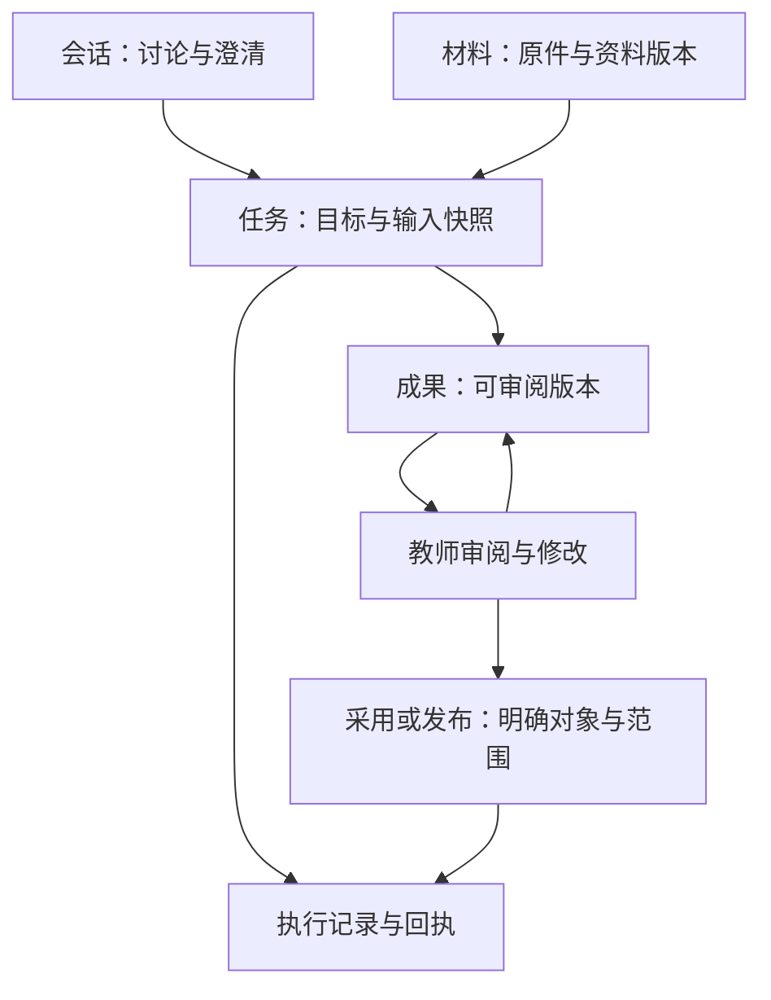

# OLE Agent 前端界面设计规范 · 蓝图

版本：v1.0 · 正式设计基线（单文件）  
日期：2026-10-16  
适用：OLE教师工作台；组件基座`intelligence-prism-ui`，业务组装`ole-school-workbench`。

**教师完成任务为先，组件复用其次，蓝图识别度最后。** 执行、保存、确认、发布须有服务契约、对象版本和回执；普通阅读、导航、本地草稿编辑不要求业务回执。

**当前：正式设计基线；实施准入未通过。** 根据用户2026-10-16在本对话明确提出的“形成正式版、同步GitHub并合并、之后同步Site”指令发布。v0.7文档级再审由用户提供，本版完成编辑澄清与编号／引用检查；审核来源保留于本对话，不构成本版工作流独立Reviewer签认或代码、样稿、服务验收。

| 当前决定 | 规则入口 |
|---|---|
| 首期 | 高中数学批阅与解析，含复核、保存确认、独立重开及教师端Token用量；不含发布，§1.3 |
| 单一主路径 | 步骤2前依服务证据选部分或整批确认，§1.5 |
| 组件/视觉 | Prism→coss（含particles）→必要适配；Beautiful UI可选；第4套blueprint，§5/§11.6 |
| 动效 | 简单CSS、复杂过渡按需Motion；合格既有glimm不强制重写，§5.5 |
| 未关闭项 | 服务证据/签认、路径资格、适用CI修复、公式样本、样稿及真实链路，§13.4/§14.9 |

产品定稿授权：用户本轮指令，2026-10-16（Asia/Taipei）；未提供实名，不代填个人签章。授权限于设计文档定稿、GitHub合并与Site文档同步；不等于工程启动或准入放行。独立审核依工作流，内部自检不能替代。[EV-G1] 技术、教育、安全责任及签认依§14.9，未取得姓名/日期/证据保持待确认。

**本版保持单文件，第14章为唯一契约登记源。** 后续若拆分，仍按M号关联适配/测试，仅可生成带来源版本的只读镜像，不维护第二套人工契约。M/CI/AT及脚本身份稳定；正文不重复历史审核，只留现行规则和缺口。

| 标识 | 含义 |
|---|---|
| 【已存在】 | 指定提交的源码/类型事实，不代表生产服务可用 |
| 【必须】 | 实施验收要求；未特标的行为规则均属此类，不表示已实现 |
| 【建议新增】 | 待测/可调整参数，未经验证不冻结 |
| 【待契约】 | 服务未映射，对应生产动作不渲染，不以模拟回执补位 |

阅读顺序：§1—10范围/交互，§11组件，§12—13治理/实施，§14契约/验收主登记，§15夹具，§16来源。公共规则引用唯一条款，保留适用条件。

## 1. 基线、范围与设计优先级

### 1.1 源码依据与核验边界

| 对象 | 证据快照 | 结论 |
|---|---|---|
| 用户附件 | 《OLE AI Teacher Workbench前端界面设计规范》v1.0全文 | 需求素材；代码、题型、性能承诺不直接作实施标准 |
| 智能曜彩 | main@`1f575ea142c7f3b5fa0ae8a41f5c63c310067251`；2026-10-15合并蓝图v5–v8等改动 | 第4主题blueprint白图；未实现blueprint-night |
| Agent组件 | 同提交registry/进度清单 | 42项仅Workspace验证登记；真实业务接入登记为0，不称生产可用 |
| 业务仓 | main@`449e98b56b096cfe0f68401dd9ffb4038c0adcbc`；2026-10-13 | README明示本机演示，未接业务API、真实鉴权、AI/OCR；本地command、localStorage及目标类型非服务证据 [EV-B1] |
| 蓝图验收记录 | docs/blueprint/STATUS.md v8 | PASS WITH NOTES；真机、读屏器、实体打印等未验，非本轮测试 |

来源：[EV-P1]—[EV-P4]、[EV-G2]。复用/动效仅增查组件仓`2865942bb755efaa516a0f6f4252cdf79b4b1969`的规则、依赖、局部实现（§5.5/§11.6），非全库复验或部署验收。本次未运行参考客户端、改产品代码、调真实服务或测公式/真机/性能；实施须核对当前工程及服务。

### 1.2 冻结原则、范围与优先级

冻结四对象分离、范围快照、工作触发布局、版本绑定确认、真实进度、人审/证据诚实、双仓职责和首期克制。变更依§12，不能借视觉改版静默推翻。

P0包括正确性、权限、恢复、输入安全、核心可访问性；失败/断线/冲突不能整体延期。P1为窄窗效率及次要增强；P2为手机专项体验及非核心扩展。外观不得降低P0。

### 1.3 首条闭环现在选定

首条真实路径：**批阅与解析 → 材料受理 → 真实进展 → 原件复核 → 保存并确认版本 → 工作记录重开同版**。仅已有高中数学范围；独立解析入库不另开主路径。

**本轮不含发布，到“确认这一版”结束。** 确认服务不支持则不显示该动作；模拟动作仅供标明的样稿。生产无发布按钮，本地result.publish非真实发布，本文发布条款仅约束后续接入。其他排除项：长期画像、自动记忆、blueprint-night、跨学科符号盘、可视公式双引擎、课堂演示/音视频/关系图首屏、绝对性能承诺、24题型schema、前端写诊断图谱。

**教师端Token用量属首期**：可查任务、会话及当前学校本人累计；额度/限制取服务事实。只有服务确认才显示“不设额度上限”，未知不作无限额。用量与执行状态独立，停止/失败/重试可核对，见§9.3。排除充值、支付、开票、定价配置及全校管理台；真实费用/执行前估算仅在服务和权限明确时只读展示，不自算补位。

业务仓只证明本机设置、示例材料/评分、复核/结果流程，边界见§14.1；不据此断言OLE其他服务不存在。[EV-B1]、[EV-B2] 更换首链须在步骤1列后端成熟度证据，并同步映射与全部夹具，不保留双主路径。组卷、资料问答、学情仅登记扩展。

### 1.4 准入术语与收口状态

文档复核查规则/证据自洽；定稿是产品签署设计基线；实施准入按§13.4分别判步骤1收口、步骤2样稿准入、步骤3真实链路验收，各自留证，不另设重叠总状态，也不同于班级发布。文档定稿不解除工程门禁。未关闭项在§13.4/§14.9，能力缺口/禁止动作在M表，组件/宿主处置在CI表。

### 1.5 部分确认依赖的预定退路

步骤2前由SVC/EDU/FE按M71a/M71b签认，产品负责人记录，只选一条正向路径。

| 服务能力 | 路径 | 夹具与确认范围 |
|---|---|---|
| 部分成果可独立保存/确认 | A：当前目标 | 8/12页；01/02两份V2确认，03/04未完成 |
| 仅可整批且能完成整批 | B：整批替换 | 8/12停止仅留只读/恢复异常测试、无确认按钮；另选真实整批执行，4份12页全部完成并核对后保存/确认；同步§15夹具及§1.3终点 |
| 均未证实或不支持 | 不放行 | 留目标与SERVICE-GAP，不用task.complete假造能力 |

结论待签。B另定输入、尝试、成果、异常和版本，不复用部分范围conf_demo_01，不假定停止尝试可续跑。共同终点为所选范围版本已确认且能独立重开。后续变更依§12回步骤1同步契约/夹具/验收，不能自动切换或双路径并存。

## 2. 参考研究：借鉴机制，独立设计

以下为固定文档/源码研究及OLE取舍，非运行/易用性验收；组件来源依§11.6。

| 项目/快照 | 观察及OLE采用 | 不直接沿用 |
|---|---|---|
| Open-ClaudeCode，LING71671/Open-ClaudeCode@2980105e… | CLI档案及Electron desktop/renderer；借鉴会话侧栏、连续对话、可收Inspector、稳定输入、运行展开/结束收敛、资源读取可查与阅读锚点 | 暖橙深色、固定窄Inspector、日志密度、全局放行、估算百分比、先清审批后等回执 |
| Open WebUI，main@6a18585f… | 导航、组合输入、附件/排队/澄清、来源定位、可拖侧区/小屏Drawer；采用统一输入材料、来源联动、成果工作区、草稿/授权分离 | 教师首屏堆模型/工具/终端；点选即提交、失败附件消失、full/ask代业务授权 |
| Codex，openai/codex@3bae578a… | CLI/TUI具体操作审批、待处理输入、计划、变更审阅；采用明确范围、折叠过程、独立差异、输入生效可见 | TUI作官方桌面/Web证据；终端、命令、Git术语 |
| OpenCode，anomalyco/opencode@4397ee44… | TUI/Web/Desktop文档、服务会话共享、折叠详情、Git依赖undo/redo；采用页面/任务状态分离、刷新恢复、停止/撤销分离 | 将编程回退当教育业务万能撤销 |
| Hermes Agent，NousResearch/hermes-agent@85a9af0e… | CLI/Memory中的运行输入、恢复摘要、上下文/记忆区分、变更批准绑定旧值；采用依据可查、偏好可纠正、旧批准不作用新内容 | 自动自我改进/技能/计划任务、开发者上下文仪表 |

证据：[EV-C1]—[EV-C5]、[EV-W1]—[EV-W6]、[EV-D1]—[EV-D3]、[EV-O1]、[EV-O2]、[EV-H1]、[EV-H2]。客户端不是组件包。

反向验收：Open-ClaudeCode的sessionProgress()按阶段/工具数估百分比；确认栏按按钮文案识别批准、等IPC前清提示。OLE必须以真实计量、类型化动作和明确回执替代。[EV-C3]、[EV-C4]

研究采用公开交互并独立设计。Open-ClaudeCode授权文件自述限研究用途，不作商业移植底座。任何来源进入代码复制，工作项须列固定版本、文件及许可依据，必要时法务判断。[EV-C6]

## 3. 产品对象与导航

### 3.1 四类界面对象

| 对象 | 教师理解与职责 | 边界 |
|---|---|---|
| 会话 | 讨论；承载消息、澄清、材料引用、任务入口 | 闲聊不必成任务；删会话不删试卷/撤发布 |
| 任务 | 具体工作；目标、范围、输入快照、进度、待决定项 | 一会话可多任务；换会话不取消任务 |
| 成果 | 可审阅修改采用的试卷/报告/批阅版本 | 长消息非正式成果；生成成功非发布成功 |
| 材料 | 上传原件、题目、教材、校本资料、历史结果引用 | 上传、解析、本任务使用分别取事实 |

仅示前端关系，不定义后端canonical对象/schema；发布是后续扩展，不在首链。

### 3.2 一级导航

拟调整为**Agent → 工作记录 → 批阅与解析 → 组卷 → 学情分析**。顶部新会话/搜索，底部个人设置；资源快捷入口通完整资源库，题篮为学校内全局工具。导航不随模型/工具变。现有业务仓仍为顶部主导航＋左目录。[EV-B1] 教师可直入业务，Agent/业务入口共享任务、成果及编辑态。

- 总骨架移出教师导航，留组件站评审。
- 会话列表放标题/简态；工作记录按任务筛进行中、需我处理、已完成、异常，删除语义分开。近期会话之外走搜索/列表，首期不叠项目、文件夹、频道。
- 待处理按任务去重：如“需我处理3项任务”，涵盖当前学校本人有权的班级；任务内另示“待核对2项”。只计服务确认的待回复/复核/决定或人工异常；排队/运行不计，未知仅需教师查询时计。无跨班汇总则标当前班级范围；切校重新取数，不默认推送/发声。
- 题篮跨会话但受学校、权限、题目版本约束；会话“资源与产出”仅当前会话过滤。

首次进入先核权限：有待办到工作记录对应筛选，否则最近可访问会话，无则新会话。深链接优先不跳走。首期搜索限当前学校有权的会话/任务/成果名称，题目检索走题篮；标签须准确，不把仅搜会话称“搜索全部”。

### 3.3 范围与上下文的位置

学校置全局导航顶部；班级、学科、材料置任务标题下或输入器上方，不逐消息重复。例：`高一（3）班 · 数学 · 本次作答38份`，点击调整下一任务范围。受理后冻结快照；切班只改浏览/下一任务，不改运行任务。

### 3.4 对象寿命与找回入口

以下是目标生命周期，非localStorage服务保证。删会话只删组织/引用，不级联删任务、成果、已采用证据；删除确认指明对象，保留期由学校/服务规定，不承诺永久。

| 对象 | 创建于 | 默认入口 | 删会话后 | 跨会话 | 跨班级 | 跨学校 |
|---|---|---|---|---|---|---|
| 会话 | 新会话 | Agent列表 | 会话删，任务仍可进工作记录 | 本身不适用；任务/成果可再引用 | 同校可切下一任务范围，历史快照不变 | 否 |
| 任务 | 服务受理；此前仅请求快照 | 工作记录/会话任务条 | 按任务策略保留 | 可找回/引用同任务 | 原班快照，有权才读 | 否 |
| 成果 | 可独立交付/读取 | 工作记录/资源库“我的成果”；会话仅过滤 | 按成果策略保留、可重开 | 同对象/版本 | 按权限，引用不改原范围 | 否 |
| 材料原件 | 上传受理/引用资料 | 会话资源；校本走资源库 | 校本不删；已用按证据策略，未用附件按服务清理 | 校本是；附件不自动跨用，任务依据可按权查 | 按权/材料范围 | 否 |
| 题篮 | 学校内全局工具 | 题篮 | 不受影响 | 是 | 按权/题目版本 | 否 |

会话学校固定；切班提示“仅用于下一次任务”，历史显原班，不注入他班材料。若改班级固定会话，须同步切班新会话策略。跨会话重开走工作记录/完整成果列表与M74，缓存不证明持久保存。

## 4. 空间结构：三种工作模式

### 4.1 布局模式

| 模式 | 适用及结构 | 输入/辅助内容 |
|---|---|---|
| 对话 | 开始、问答、澄清、摘要；导航＋单对话 | 底部稳定输入，资源/产出按需开 |
| 协作 | 讨论成果、报告审阅、轻改；导航＋窄对话＋宽成果 | 输入属对话，成果自有标题/工具栏，来源/属性抽屉或浮层 |
| 专注 | 批量复核、排版、长文、原件对照；桌面导航56图标轨，更窄隐藏 | 对话收为返回/沟通入口；回时恢复位置和稿 |

最多两个主工作面；不常驻对话＋编辑器＋右工具栏，资源目录/属性/符号盘按需。展开共享对象，不复制成果。

打开成果且宽度足够进协作，否则单成果主面；专注/核对异常等明确动作进专注，不设全局三选一。返回保留对象、对话位置和稿；断点只重排，不换对象、提交或重开主动关闭面板。

### 4.2 尺寸与断点

桌面**1440×900 / 1280×720为P0**，窄窗效率P1，完整手机批阅/公式编辑/排版P2；桌面缩放的等效窄视口重排、阅读/主操作/键盘焦点仍P0。以下CSS px为待实施规格，非已测结果。窗口宽定默认导航，实际净宽定并置。

| 窗口宽 | 默认导航 | 工作面/辅助策略 |
|---|---|---|
| ≥1440 | 232，可拖至280 | 默认对话，开成果后协作；对话约360–420，成果≥640，不足先收导航 |
| 1280–1439 | 56图标轨，可浮层展开 | 对话或合格协作；不沿用过大侧栏挤坏正文 |
| 1024–1279 | 56或收起 | 对话/成果单面切换；实际满足下限才并置 |
| <1024 | 抽屉 | 单面；成果/来源可返回全屏，不叠多层Drawer |
| 320–639或放大后等效 | 收起 | 单列；表格、原卷、必要二维公式可局部横看，普通正文不横滚 |

- 协作净宽≥360＋16＋640＝1016。导航含边框，左右内边距各24；展开总宽≥232＋48＋1016＝1296，紧凑≥56＋48＋1016＝1120。1248漏内边距，不能作舒适下限。1440为默认协作；1280紧凑净1176可并置，展开净1000改单面。
- 协作净宽<1016退出、≥1064恢复资格，48px迟滞；不重开手动关闭面板。拖拽到360/640钳制，只有容器变化触发降级，不来回换模式。
- 原件对照另用480＋16＋480＝976；<976用原件/结果真Tabs，≥1024恢复资格，保留48px迟滞及同题锚点；不套协作分隔条/1016阈值。
- 额外边栏、工具区、独立分隔继续扣净宽，不能只看窗口宽。来源/属性建议320–360，持续编辑直接进工作区。
- 阅读版心建议640–760、长文约40em上限；扫描原件/试卷/宽表不受限。顶栏≥56、专用工具栏≥44；有动作才显示，缩放/换行可增高。
- 输入器可长至可用高约三分之一，再内部滚动或开完整编辑面；短窗重排，不把主体压成不可操作窄带。

### 4.3 滚动、焦点与返回

外壳占宿主可用高，优先100dvh/宿主高及Grid/Flex min-width:0/min-height:0；禁止全站写死100vw、最小1280、select-none或禁全部窗口滚动。

对话/成果各一个主纵向滚动区，长表/原图等局部视口例外，正文卡不另限高滚动。流式仅在底部跟随；上读/选字保持位置并提示新内容。按会话/对象保留滚动锚点、题号、缩放、草稿，关闭来源/退出专注回原对象及触发处。

分隔条可键盘调宽。输入器/工具栏不盖焦点；吸顶条实测高度计入题锚点偏移（如scroll-margin）和焦点滚入位置。离开成果、切路由、受控后退按§7.7保护本地稿并区分服务工作态/原生关窗边界；关阅读浮层不弃稿。

## 5. 蓝图视觉语言

### 5.1 继承真实 Token

下面来自当前 `theme.css`，业务样式使用变量，不复制色值另建 `--ole-sky-*` 体系。[EV-P2]

| 角色 | 当前 Token | 蓝图值 | 使用规则 |
|---|---|---|---|
| 画布 | `--background` | `#F6F6F3` | 外部背景、空白区 |
| 阅读/编辑表面 | `--card` / `--popover` | `#FFFFFF` | 消息阅读、成果正文、浮层 |
| 次级表面 | `--secondary` / `--muted` | `#F3F5F8` | 次级区域、轻量分组 |
| 正文/标题 | `--foreground` / `--heading` | `#16181D` | 主要信息 |
| 主操作 | `--primary` / `--primary-foreground` | `#16181D` / `#FFFFFF` | 墨底白字，当前任务阶段的主要动作 |
| 次要文字 | `--muted-foreground` | `#4B5260` | 说明、来源摘要 |
| 普通分隔 | `--border` | `#D6DAE1` | 内容内分隔，不作所有元素的外框 |
| 结构线 | `--line` / `--line-width` | `#1D2026` / `1.5px` | 主工作区边界、输入器、关键对象 |
| 链接/信息/浅底焦点 | `--link` / `--info-foreground` / `--ring` | `#1D5FBF` | 可操作链接、选中线索、焦点 |
| 选中背景 | `--accent` | `#E4ECF8` | 已选对象或范围，不代表“已成功” |
| 成功 | `--success-foreground` | `#216440` | 已完成事实，附文字 |
| 警告 | `--warning-foreground` | `#A8620A` | 需注意或存在阻塞，不把所有待复核项都标成危险 |
| 失败/危险 | `--destructive-foreground` | `#C62828` | 失败、拒绝、危险动作；不是统一 AI 候选色 |
| 几何 | `--radius` | `0px` | 控件/表面直角；Radio 等语义形状保留 |
| 网格 | `--grid` | 墨色 `.055`，40px 网格 | 只在画布留白露出，不穿过正文 |

品牌 `#339FF2 / #E0438F / #C2F25B` 继续保留；它们不替代蓝图的正文、主按钮、错误和成功语义。废止 v1.0 草案把 `#4EB1D9 / #8B5CF6` 当作全局语义色的做法。

### 5.2 蓝图的应用强度

蓝图表达结构秩序，组件站装饰不逐条搬进长会话。

- 结构墨线用于外壳/成果，消息用角色/间距/排版区分。网格仅露于画布留白，正文/复核列表/输入器禁双框、标尺、逐条SHEET。
- “显示装饰网格”可关闭；开启“简洁背景”即关装饰，信息/定位不丢。图纸编号仅用于有名称、版本、定位价值的任务/成果。
- 双框/标尺限少量封面或测量/版面场景；任务卡单框、密集复核用行。复杂表格不受“一卡一线”限制，但分隔须有真实分组，外框/内框/投影不能重复强调同层。
- 硬阴影限少量浮层/强调动作，沿现有Token，不全改蓝；正文、列表、普通卡不普遍加阴影。图标与文字对齐，仅状态/选择需要才加背景容器。

### 5.3 排版与密度

沿现有语义字号，不另造px体系。[EV-P5]

| 角色 | 根16px时现值 | 用途 |
|---|---|---|
| 页面标题 | 26/36，600 | 首屏/完整页 |
| 章节标题 | 20/30，600 | 成果章节/重要面板 |
| 块标题 | 16/24，600 | 任务/对象名 |
| 阅读正文 | 16/28，400 | 对话/题干/报告/长输入 |
| UI操作 | 14/20，400/500 | 导航/按钮/控件 |
| 提示 | 14/22，400 | 错误/状态解释 |
| 元信息 | 12/18 | 时间/短编号，不作主动作或关键状态 |

字体为系统中文sans回退，非已部署全量Noto；数学沿STIX Two Math/MathML。中文不等宽、全大写或强制字距；时间/编号/数字可等宽。

间距按4增量，常用8/12/16/24/32。紧凑只压容器空隙、不缩题干/对话字体；P0标准密度，紧凑仅工作记录/复核队列，不增全站设置。

桌面主按钮建议36–40高；发送及触屏命中≥44×44，小按钮可扩透明命中区。图标16–20，按钮有可访问名。动效见§5.5。

### 5.4 焦点与颜色语义

浅色相邻表面：2px蓝色单外框，偏移2px；环落墨色表面才用白色。本轮仅已有墨色表面/控件，不含blueprint-night。[EV-P4]

按环实际相邻背景选色：浅底卡上的墨按钮，外移环仍用蓝；白内环须全在墨按钮内、不挡文字。浅底蓝环是现有基线，必要墨底处理由CMP按CI-09实现/验证，未称已完成。

outline/ring不叠加；选中和焦点分别表达，焦点仅一套。逐态核相邻背景、偏移、裁切、对比，不用Token达标替代。

### 5.5 动效基线与AI状态反馈

【已存在】motion 13.3.0、tw-animate-css ^1.4.0、MotionConfig reducedMotion="user"及实际Motion调用；Beautiful UI来源输入器扫光使用glimm。[EV-P17]、[EV-P18]、[EV-P19] 仅源码核实，非兼容运行验收；版本由lockfile管理，不自动升级。

| 层级 | 规则 |
|---|---|
| 简单反馈 | CSS/既有类处理悬停、颜色、轻量透明度，不为小效果加JS执行器 |
| 复杂过渡 | 按需用现有motion/react处理进出、展开、布局连续性，复用配置 |
| 既有特效 | 合格glimm等保留；替代效果及维护收益验证后才迁移，清调用后再删依赖 |
| 来源 | Beautiful UI为可选组件/效果来源，非全局引擎，不为来源统一重写 |

同一元素同一属性只能一个控制方；CSS/Motion/glimm不争用transform/opacity，组合须分层或交接。卸载/切页停循环、清监听，历史任务不重播执行动画。

| 场景 | 允许反馈与边界 |
|---|---|
| 输入器动作 | 短暂单次扫光/边框流光，不挡文字/焦点；绑定事件，点击仅表示触发，已受理须等回执 |
| 真实等待 | 局部骨架/轻量点配文字，不作百分比；断线/未知按§7事实，不假装继续生成 |
| 工具/成果变化 | 真实事件触发短淡入、展开、稳定布局；消息不大幅入场、整屏不跳 |

【建议新增】短过渡120–180ms，按设备/场景实测；扫光/等待另验阅读干扰，不机械套用。禁止常驻装饰扫描、满屏粒子/光球、逐字打字、假进度；动画结束不改执行/审核/发布状态。

【必须】P0唯一偏好源为系统prefers-reduced-motion，不增应用内开关。FE/CMP统一订阅并驱动Motion、CSS媒体查询、glimm，响应运行中变更。MotionConfig reducedMotion="user"不保证透明度/背景位置/关键帧/循环停止。[EV-X3] **Motion扫光及装饰循环须显式停用**；CSS/glimm同样停止扫光、位移／缩放动画及装饰循环；必要阅读操作直接更新静态结果，保留文字、焦点和操作反馈。未来应用内设置须先定义统一合并规则，不能引擎各自取值。

Border Beam、Skeleton Shimmer仅作参考；部分源码属Motion+，核心可用不等于成品许可/API相同。先核许可与版本，或以现有Motion＋CSS/SVG独立实现；不用样例定时器冒充业务事实。[EV-X4]、[EV-X5]

## 6. 对话与输入规范

### 6.1 首屏与消息

新会话显示简短邀请、主输入器及最多三个高频入口，如“批阅作答”“生成练习”“查询校本资料”；点击仅填入可编辑请求或选材料，不执行任务。未完成工作以少量“继续处理”条目呈现，不铺统计看板或营销Hero。

教师消息可右对齐，以轻背景和角色区分；助手正文左对齐、连续阅读。双方文本可选择、复制；消息操作克制呈现，键盘/触屏可达，不依赖hover。

助手消息按内容选择载体：

| 内容 | 默认载体 | 展开内容 |
|---|---|---|
| 普通解释、闲聊 | 文字段落 | 来源（如有） |
| 必要澄清 | 短问题 + 选项/自由输入 | 已填参数摘要 |
| 已受理任务 | 任务条，执行中可展开 | 阶段、输入范围、异常、回执 |
| 可交付结果 | 简短结论 + 成果行 | 同一成果的工作区 |
| 等待教师决定 | 就地确认面板 | 影响对象、版本、变化与依据 |
| 工具活动 | 最近阶段一行 | 可核对的活动记录；技术细节二级展开 |

活动记录只展示真实事件与可审计摘要，不伪造内在思考。简单问答不强加计划/进度；完成后收敛过程，失败、未处理、待决定项保持可见。

菜单区分“重新生成回答”（交流文本）与“重新生成试卷”（关联的新尝试/候选版），不省略宾语。编辑已发消息显示“基于这条消息重新开始”；保留原消息、任务与成果，原消息标“已分叉”并可打开新分支，不倒改历史。

### 6.2 一个统一输入器

输入器顺序：**范围与引用 → 附件 → 多行文本 → 操作行**。默认“添加材料 / 引用资源 / 发送”，更多动作进菜单；模型选择属高级设置，学校未开放则不出现。语音非P0必备。

【必须】教师路径只用一个受控组合入口：`AgentPromptBar`＋已有材料/澄清组件及宿主适配；停止独立呈现，不建第三套聊天状态机。现有PromptBar支持IME/Enter，但模型菜单总渲染；Composer用Ctrl/Cmd+Enter且运行中禁输入，差异尚未修复。[EV-P6]、[EV-P7] 基元变更须先更新下表，不能两入口扩张。共同规则：

- 桌面Enter发送、Shift+Enter换行；可提供显式偏好设置，但所有入口一致。IME合成/选字Enter不得提交；手机触屏策略见下表。
- `@`选有权限的材料/成果，`/`选任务模板，均提供点击替代。PromptBar选择`/`即发`run-command`，宿主只选取/填入模板；执行仍走M02/M03快照和资格校验。
- 发送时冻结原文、附件版本、范围及身份，消息显示“发送中”；提交副本与输入器新草稿隔离。受理只释放对应副本；失败保留原快照供独立编辑/恢复，任何回执均不覆盖新文字。未知显示“正在核对是否已受理”，按§7.6查询。
- 前端同步防重复，宿主/服务保证幂等。发起前连接资格按§7.6；未发出不造unknown，恢复连接不自动发送。
- 运行中可写。P0服务未支持并行输入时标“下一条草稿”，说明“这是下一条草稿，这段文字还没交给当前任务；结束后可发送”；Enter与按钮同禁发，不丢字、不排队、不停止任务，结束后教师主动发送。
- 禁发只约束新增请求。等待澄清/材料时切“回复当前任务”并允许回复；等待决定时确认面板按合法状态操作。自然语言涉及批准仍须服务校验确认请求。
- 服务支持有回执的“补充本任务”时优先接入；支持队列才显示“完成后处理”。显示归属、处理时机、受理状态；未受理队列项可编辑/撤回。目标/范围变更不能冒充补充暗改任务快照。
- “停止当前任务”为独立文字动作，不仅把发送箭头换成方块。

| 交互 | 现状差异 | 统一收口与责任 | 必测 |
|---|---|---|---|
| Enter / Shift+Enter | PromptBar为发送/换行；Composer为Ctrl/Cmd+Enter | FE统一PromptBar；CMP修已复现基元缺陷；Enter发送、Shift+Enter换行 | 相同文字在全部入口只发一次 |
| 手机触屏回车（优先级P2） | PromptBar目前Enter统一发送，无移动输入策略prop | CMP/FE后续补策略：触屏回车换行、按钮提交；不按视口宽度猜物理键盘 | 手机编辑开放前验证触屏键盘不误发；非本轮步骤1门禁 |
| IME | PromptBar已有合成状态与229保护；两者/variant仍须组合验证 | FE验证已有保护且不绕过；CMP仅修经复现的基元缺陷 | 选字Enter不提交 |
| 运行中草稿 | Composer running会禁用文本 | 业务仓分离草稿与任务；PromptBar保留可写，用发送门禁；不能伪造任务闲置 | 不发送、不排队、不停止、不丢字 |
| 等待澄清 | QuestionCard已有受控单选，非授权控件 | FE将文本/卡片绑定同一问题，写“回复当前任务”；组件不用“确认”歧义文案 | 选择仅暂存，显式回复才提交 |
| 提交快照 | PromptBar仅text/attachmentIds；Composer回调无参 | FE冻结草稿ID、原文、材料版本、范围、请求ID；服务核验 | 迟到props不污染快照 |
| 新草稿与失败 | 两者无正式受理receipt | 业务仓维持已提交副本和新草稿；失败/未知卡片不覆盖新文字 | IME＋运行中草稿＋失败回执组合 |
| 未开放模型菜单 | PromptBar总渲染；空数组不是隐藏 | 组件仓补可控呈现能力（拟新增，非已有prop）；业务仓按学校能力传入 | DOM中无模型入口，不能仅灰掉 |
| 停止与重复提交 | UI回调不等待服务 | FE同步锁定原操作，再处理回执并外置呈现状态，按CI-03/CI-04执行 | 双入口只产生一次同身份请求 |

“桌面输入规范落地”须调用路径唯一、差异修复或真实隔离、上表P0测试通过。手机发送按P2延期，提前开放须先通过对应测试；桌面缩放/窄视口不豁免键盘与IME门禁。

Composer退役：步骤1结束时本轮Agent路由无直接调用；步骤3由FE提交源码扫描与路由覆盖，工作台零调用后删旧适配层。CMP核实全部登记消费者迁移且兼容期/版本策略允许后才删组件导出；否则保留并标弃用，不扩第二套协议。字段见M01—M10；代码尚未修复。

### 6.3 材料状态

| 状态 | 展示与操作 |
|---|---|
| 上传中 | 文件名、可计量传输进度；仅服务支持且映射通过时提供取消上传，不写“正在理解” |
| 已上传，解析中 | 保留文件；说明暂不能作为该任务输入 |
| 部分可用 | 标注可用页数/题数与异常范围；是否允许继续由业务能力决定 |
| 可用 | 可引用；只有本任务实际采纳后才显示“本次已使用” |
| 失败 | 原位保留文件名、简明原因、重试或替换，不只弹 Toast 后消失 |
| 权限失效/材料更新 | 当前引用受影响提示，重新选择或更新版本；不静默替换旧输入 |

【已存在】`AgentFileInput`九态为选择/队列/移除/无效/已接收/上传中/已上传/失败/未知；解析、已使用由宿主组合，`processing`仅文字槽。移除引用≠取消上传；未知只查询，不重试/移除。见M46—M64。[EV-P13]

材料未就绪只阻止依赖它的任务并解释原因，不封锁讨论。操作明确写“移除此引用”或“删除校本文件”；后者须有对应权限与服务，不能把移除引用当删原件。

### 6.4 自然语言理解与业务交接

教师界面只表达理解的请求、缺失信息和将做的工作；轻量模型/分离器/调度留在运行层，不显示`4B`、`NL Splitter`、`UNKNOWN`或置信度仪表。

| 情况 | 前端行为 |
|---|---|
| 明确且信息足够的业务请求 | 展示简短目标/范围摘要；按业务已有授权直接执行，或进入确有必要的确认节点 |
| 缺少会改变行为的关键信息 | 一屏最多3项；依赖项串行（先班级后范围），独立项并行；选项可比较、允许自由输入，不重复问已知信息 |
| 闲聊或非业务讨论 | 正常回答，自然相关时给一个轻入口，不强拉回任务 |
| 无法可靠判断 | 诚实说明目前理解，给可能意图和“重新描述”；不把猜测当作已受理任务 |
| 当前能力不支持 | 明确缺口，给当前可完成的下一步；不生成假的可操作成果 |

澄清选择不等于授权。普通偏好可快选；班级、覆盖、发布等须可复核，最后一项点选不自动发布。“好/继续”须服务匹配当前确认请求，前端不按关键词批准。

## 7. 任务、确认与恢复

### 7.1 状态必须分维度

四类状态可并存，例如“生成完成 / V2待复核 / V1仍已发布 / 连接正常”，不使用统一五态生命周期。

| 维度 | 前端需要区分的意义 | 显示位置 |
|---|---|---|
| 任务执行 | 排队、执行中、等待输入/决定、请求停止、已停止、完成、部分完成、失败 | 任务条/任务详情 |
| 成果修订与审核 | 草稿、候选、待复核、已确认、被后续版本替代等业务实际状态 | 成果标题附近 |
| 发布记录 | 未发布、发布处理中、已发布、发布失败/待核对，以及支持时的撤回记录 | 发布操作与记录，不混入生成徽章 |
| 连接/信息新鲜度 | 正常、重连中、状态待同步、最后确认时间 | 页面轻提示与相关任务提示 |

上表是**显示语义，不是新增服务枚举**。适配层逐项映射；`AgentProgressState`声明`paused/degraded/retrying`不证明服务支持，未支持的暂停/继续/中途调整不渲染。停止按CI-03/CI-04由宿主组合，待实现验证。[EV-P8]

全局连接按§7.6顶栏去重；活动/待同步对象保留最后确认时间。未知回执、失权和脏稿仍单独可见；事件流中断不等于任务停止。

### 7.2 任务条的折叠与展开

折叠态：**名称＋一句结果/阻塞＋一个当前动作**，确定分母可入摘要。完成且无未处理项才收敛；失败、未处理、待决定不因消息变旧隐藏。

展开态顺序：`名称 → 阶段/结果 → 数量/范围 → 最新活动/更新时间 → 合法动作 → 阶段记录`；不常驻全套阶段卡。

示例：**批阅高一（3）班周测 · 36/38份已处理，2份待补页 · 查看异常**；结束仍保留未完成项。

- 有确定分母时才显示数量比/百分比，并标明计量对象；无分母显示阶段、已完成数量、耗时和最后活动时间。
- 发现新增页/题改变总量时说明分母变化。文件上传百分比不能当作整个批阅进度。
- 等待模型响应时不伪造平滑百分比；长时间没有事件显示“暂未收到更新”，不能直接认定任务死亡。
- 展开补充异常项、相关成果及处理入口。
- 部分完成可查看已成功结果；仅在服务支持时重试失败部分，不能暗中重复整个班级的处理。

提交等待、原件慢加载见§7.6；5秒不等于失败/unknown。

### 7.3 确认与批准

服务决定确认节点与范围：用于发布、覆盖已确认结果、批量修改等实际影响，不对普通读取、解释和本地草稿编辑反复确认。

面板必须显示**动作、对象、版本、班级/人员范围、主要变化、去向及不可逆影响（如有）**。按钮写“发布V3至高一（3）班”“仅修正这份作答”等具体动作。

确认唯一六态：`ready / submitting / received / recorded / blocked / unknown`（待确认/正在提交/请求已接收/确认记录/暂不可确认/回执未确认）。`recorded`仅证明决定已记录；执行另用`succeeded / partial / failed / unknown`四态。只接收不显示生效/发布；失败保留面板与选择。旧版本、过期或权限变化使确认失效，说明原因并重新审阅。

【已存在】`AgentExecutionConfirmation`具备六态，但`target/version/effects`仅字符串。宿主/服务须补稳定请求ID、版本、范围、幂等、授权及点击锁定；不得按按钮文字或本地布尔值宣称批准。[EV-P9]

映射：M30—M38确认、M39—M43结果、M24—M26停止。任务详情与工作区的同一决定必须同请求；一处完成，另一处立即成为只读回执。

【必须】同阶段至多一个强调主按钮；服务支持且合法的停止/撤回等动作持续可达，用次级/危险样式。待处理计数属导航提示，不占主按钮。

### 7.4 操作名称与真实效果

| 操作 | 明确含义 | 必须防止 |
|---|---|---|
| 停止当前任务 | 请求停止尚未完成的工作，等待服务确认 | 点击就写“已停止”；把已保存/已发布结果一并当作撤销 |
| 重试失败部分 | 根据服务允许的范围创建关联尝试 | 重复处理成功项；丢失原失败记录 |
| 重新生成一版 | 以确认的输入生成新候选版本 | 覆盖已确认或已发布版本 |
| 基于此版修改 | 打开同一对象的新修订工作 | 编辑器与聊天各维护一份不同正文 |
| 撤销编辑 | 回退编辑会话内支持的修改 | 承诺撤回远端已发布业务 |
| 撤回发布 | 只有业务具备能力时才出现 | 用通用“撤销本轮”掩盖实际影响 |

停止点击同步锁两入口，写“正在请求停止”，有确认回执才写“已停止”。迟到合法部分结果归原任务并保留服务时间/事件顺序，不建新“成功任务”。组件无`stopping/cancelled`，宿主显式组合，不凑成失败/未知。

重试前回显获准对象ID与可读范围清单，默认排除成功项；不能只给数量。无稳定范围或幂等契约不渲染重试。

### 7.5 断线、刷新与多窗口

断线不等于失败，关页不自动取消；已受理任务是否后台继续按服务能力说明。

恢复先取权威快照，再按事件ID及服务序列/游标去重合并后续事件；断档补快照/历史。前端只标重连/待同步，不按聊天猜状态或重发未知请求。

多窗口以版本校验防覆盖：保留本地稿，显示“服务端已有更新”，提供查看差异、复制草稿、基于新版继续修改。恢复草稿不恢复旧授权；切校重验权限/资源。

**认证失效与权限拒绝分开。** 401指该请求缺有效认证且未应用，403指请求被理解但拒绝，不必然是班级撤权；原因/范围须契约补全。[EV-N4] 查询获401不证明此前保存/确认未执行。

| 服务确认的事实 | 本地内容与动作 | 恢复要求 |
|---|---|---|
| 登录会话失效/需重新认证（常见401） | 遮蔽原件/学生信息/受保护用量，冻结远端写入；草稿仅按安全策略留原账号/学校/对象隔离内存，不显示、不跨账号、不新写持久存储 | 同账号/学校且重验对象权限后，先查原未知请求和最新版本，再恢复合法草稿；版本变化走M73，不重放请求或沿用旧确认 |
| 某操作被拒绝但仍有读取权（可能403） | 阻断该操作，保留获准的读取范围；不一概退出登录或清空全部学校内容 | 重新取动作资格；不能靠重新登录绕过拒绝 |
| 明确撤销目标读取权/对象访问权 | 关闭受限预览，清原卷/作答图/姓名/查询缓存；草稿按安全策略封存/销毁，不供无权复制/导出 | 只显示允许的最小状态；重新获权后再校验对象/版本/工作态，不自动恢复旧批准 |

重认证内存保留须签认有效期/清理条件，不保证刷新、进程终止或关窗恢复。换账号、明确退出或安全策略要求时销毁；切校按§9隔离，不能携稿跨校。恢复登录后有权才查询原未知请求，不重发。

### 7.6 连接反馈、慢响应与明确未受理

不新增状态枚举。`navigator.onLine`仅启发提示，不能单独禁用功能；SSE正常结束/失败均可能重连。[EV-N1]、[EV-N3] OLE分别记录设备网络提示、目标通道可达性、事件新鲜度和请求结果，互不替代。

| 情况 | 提示与动作 | 状态边界 |
|---|---|---|
| 尚未发出，宿主依已签认的目标连接检测/传输状态确认当前不可提交 | “暂时无法连接服务，草稿仍可编辑；连接恢复后可提交。”限制发送及对应保存/确认；有能力才给只读连接检查 | 未发出仍为未提交；仅`onLine=false`时提示“设备可能离线”、允许查连接，不永久禁发 |
| 事件流断开但HTTP服务可达 | 顶栏“进度连接中断，正在重新连接”；活动任务保留最后确认时间 | 可按独立资格查询/提交，不把所有HTTP动作一起禁用；任务不自动失败 |
| 全局业务通道断连/重连 | 顶栏单一轻提示；只有实际开始查询才写“正在核对任务状态” | 历史卡不叠警告；各对象未决请求/权限/脏稿仍保留 |
| 请求已发出，受理回执仍在等待 | 【建议新增】约5秒后追加“尚未收到服务确认，仍在等待，请勿重复提交。” | 5秒仅待测提示阈值，非SLA/unknown阈值；原因不明不称网络故障，不阻止正常离开 |
| 原卷图像加载较慢 | 【建议新增】约5秒后写“原件仍在加载，已加载内容与修订保留。”可用时提供只读重载 | 不称“等待received”，图像不是业务受理；不因此使整个任务failed |
| 请求结果不明 | 按M03/M14/M36/M42/M71a显示待核对并查询原请求 | 超时/断线不能自动重发；也不能把明确未受理长期困在unknown |

慢提示/重连不抢焦点、清稿或逐秒播报。未决请求离开后按原身份恢复，保护见§7.7，不用“请勿关闭页面”替代恢复。

**未受理与未知分开。** 429限流、503暂不可服务及`Retry-After`等待建议均不能单独证明无副作用。[EV-N4]、[EV-N5] 写操作按请求级事实处理：

- 未知只核对原请求；受理事实澄清、服务准许后才按幂等契约重试。幂等本身不解除unknown限制；一次查无记录不证明未执行，须有一致性/查询覆盖保证。
- 明确未受理写“服务当前繁忙，未受理本次请求；原提交内容与新草稿均已保留”。按有效`Retry-After`/退避策略冷却，无等待值只写“请稍后重试”。冷却属宿主资格，不增`backoff`枚举，不自动提交。
- 重试回显原快照范围，重检权限/版本/材料/额度/资格，保留原请求和尝试关联；原幂等ID或新关联ID由契约决定。修改原内容形成新快照，不覆盖输入器新稿。
- 已受理任务不因某次HTTP错误改failed；确定失败才投影M41，确认失败按§14.5回ready/blocked/unknown，不增第七态。任务/工作态提交、保存、确认、停止分别判定，不能串用请求事实。

### 7.7 离开工作区与未提交内容保护

【必须】宿主区分本地未提交修改、已受理工作态、已固化版本、未知请求。离开成果、一级路由、受控后退、关闭工作面及切校共用离开策略。

| 当前事实 | 受控导航/关闭工作面的行为 |
|---|---|
| 本机未提交修改，离开将使内容丢失或无法安全恢复（如S-C2） | 确认“当前有未提交修改，离开将丢失这些本地修改。”选“继续编辑 / 放弃本地修改并离开”；取消回原位置。有保存能力/资格才增“提交并离开”，失败/未知留页，不称已存V2 |
| 仅有服务已接受且证实可恢复的工作态（S-C3/S-C5/S-C6），尚无V2 | 提示“复核处理已提交，尚未保存为成果新版本”及恢复入口；允许离开，不称本地未提交稿、不强弃、不自动S-C7 |
| 工作态已受理但持久化/读取资格尚不明 | 说明“处理已提交，恢复能力待核对”；不能显示“已暂存可恢复”。先核对工作态；不以本地成功代替恢复契约 |
| 已有保存/确认/停止请求待回执 | 提示“结果待核对，离开不会取消请求”，保留原ID查询恢复；有脏稿仍保护，不因离开重发、取消或清未知ID |
| 无会丢失的本地修改且没有需说明的未固化状态 | 正常离开，保留已授权的对象位置，不反复弹确认 |

“放弃本地修改”只丢弃本机未提交差异，不撤销工作态、回滚版本或撤回请求。临时隐藏但宿主可靠持稿时，只保留未提交标识/恢复入口，不假称丢失。离开弹窗不得阻止安全退出/失权清理。

仅有脏稿时注册原生`beforeunload`，解除即移除。刷新/关页/离站可能不触发，文案和激活条件由浏览器决定；不承诺自定义必弹、异步离页保存或关窗恢复。[EV-N2] 内存不等于持久保存；未来自动保存另签权限/回执/冲突契约，不默认把原卷或学生全文写localStorage。

## 8. 成果工作区与教育专用视图

### 8.1 通用成果框架

标题固定为**名称、版本、审核状态、保存状态**，另有来源/版本历史/关闭/专注入口。保存状态：“有未保存修改 / 保存中 / 已保存 / 保存失败 / 结果待核对”；离开恢复见§7.7。

正文上方仅当前对象工具；下方或标题右侧为“提交复核”“确认这一版”等阶段主操作，“导出/复制”为次级。保存、确认、发布分别显示。

消息只放摘要/成果行，如`周测针对性练习 · V2 · 待复核 · 打开`，不嵌完整长卷/表格/编辑器。工作记录/资源可重开成果；删消息不删成果。

所有入口打开同一对象的规范编辑视图，不维护冲突表单。三种版本称谓如下：

| 版本概念 | 教师标题/文案 | 禁止混用 |
|---|---|---|
| 成果/卷面修订 | `批阅结果 · V2 · 待复核`；试卷同理用V1/V2 | 不能以重试次数直接递增卷面版本 |
| 任务尝试 | 次级说明 `第 2 次生成`（批阅可写“第 2 次批阅”） | 同输入新候选不自动覆盖确认版 |
| 服务版本标识 | 来源/诊断详情中的原始标识 | 不进入教师标题，不由前端V2倒推 |

### 8.2 四类工作视图

| 视图 | 主要版面 | 主要动作 | 证据和属性 |
|---|---|---|---|
| **批阅与解析** | 专注模式；原件与结构化结果并置，顶部/侧边轻量复核队列 | 接受识别、修正本项、上一项/下一项；批量动作显示确切范围 | 点题号/区域联动原图；评分依据按需展开；规则建议与本次修正分开 |
| **组卷/练习** | 试卷正文为主，题目结构可折叠；候选与题篮按需出现 | 替换题目、调整顺序、修改分值、预览、确认版本 | 题目来源/版本、适用范围、难度来源；不常驻全套题型属性表 |
| **学情分析** | 先说明本次范围和结论，再用适合问题的图表/表格 | 查看证据、筛选、定位题目、生成后续任务 | 样本覆盖、统计口径、更新时间就近可见；详细依据展开 |
| **校本资料问答/文档** | 结论或文档正文为主；引用可定位原件片段 | 查询、引用、进入文档编辑、保存新版本 | 来源名、页/节、版本、可访问状态；无依据时明确说明 |

按对象类型注册视图，不在组件仓造四个业务页；课堂演示/音视频/关系图按需开放，不进首屏功能大全。

### 8.3 原件对照与复核

按题/作答区域ID同步，不按滚动百分比。同题可独立缩放并解除联动，持续标“已解除同步”；切题重对齐并恢复“同步定位”。提供键盘上/下一项，不只靠点细框。

识别、评分候选和教师修订分别标来源。异常用下表分类，不统称“AI出错”；原文修正后的影响按服务回执处理。

“仅修正本次结果”与“提交规则改进建议”分开；治理入口按角色，教师不可一键改全校规则。

| 异常类型 | 教师文案样例 | 合法后续动作 |
|---|---|---|
| 低质量图 | “第2页图像模糊，部分文字无法可靠识别。” | 查看原图；有材料替换能力才可补传 |
| 缺页 | “这份作答缺第3页；当前结果未包含该页。” | 查看缺页范围；补充材料，不假补0分 |
| 识别存疑 | “第12题这一处识别待核对，请对照原件。” | 定位区域、保留原文、修正本项 |
| 评分分歧 | “第8题评分建议存在分歧，请查看给分依据。” | 查看证据、接受/修正本次分值；不改全校规则 |
| 疑似重复材料/重复作答 | “这份材料疑似与{获准显示的对象名}重复，待核对。”确证内容重复时才改为“内容重复” | 查看允许的依据；未受理引用可移除；已受理范围按M89处理，不自动删原件或扣减分母 |
| 试卷版面不匹配 | “这份作答与当前试卷版本不匹配，待核对是否采用。”服务明确排除才写“未计入批阅” | 查看原件；有合法能力时替换/移除引用；不计为0分，不把整份异常拆成满屏OCR错误 |

“待重新核对”仅标服务返回的影响对象；未知写“影响范围待服务核对”，不重写/扩散诊断或假定全卷重算完成。

#### 8.3.1 原件阅读旋转与同份翻页

原件工具提供“左转90° / 右转90° / 旋转180° / 复位”、缩放及“上一页 / 下一页 / 第N页（共M页）”。这是本地阅读变换，不改原文件、OCR坐标、材料版本、评分或任务快照，不算业务脏稿、不调用模型。页列表/总页数须真实可读；必需页元数据缺失时不造页数，按原件读取门禁禁用依赖的翻页/旋转动作。

视图按原件ID、版本、页身份保存；页版本变更不沿用旧定位。只在同份作答内翻页，首末页禁用对应动作；页导航与异常导航分别命名。翻离当前题页保持右侧题号/草稿，显示“已解除同步·当前第2页；返回第3页本题位置”；返回或切异常再同步，缺页/失权不拿另一份作答补位。

FE组合`DocumentRegionViewer`。源码已有`pageRotation/pageLayout`和定位，但旋转分支与`zoom`缩放分支互斥，是待补能力，不是目标标准。[EV-P14] 本轮不扩无旋转prop/intent的`AgentImageCanvas`。[EV-P15] **目标必须支持旋转后继续缩放**，组合规则：

1. 唯一基准为未旋转原图坐标：先绕页中心旋转并平移归一至旋后包围盒，再统一比例缩放，最后施加视口平移/滚动偏移；90°/270°互换宽高，缩放后尺寸用于布局与滚动边界。图像、区域框和命中映射共用此变换。
2. 旋转保留用户缩放倍率；若处于fit模式，按旋后尺寸重算fit，不静默归零。切页恢复该页已存视图；首次按视口适配。“复位”恢复当前页0°及适配视口。
3. 返回异常用锚点页当前变换并滚动使框可见；区域矩形仍存原图坐标。现有按钮返回区域ID时不再次逆变换；指针生成原图坐标时才对完整变换求逆。
4. FE补具名可聚焦视口和键盘等效；方向键仅在视口聚焦时平移，不抢公式快捷键。组合修复后按AT28验90°/180°/270°、缩放、翻页与返回同题；不声称现组件已通过。

#### 8.3.2 将原候选填回当前修订

次级动作“用原识别候选替换草稿 / 用原评分候选替换草稿”标明来源版本（夹具V1）及字段范围，不以“恢复原始”混改原文/评分/说明。须有可读、可定位原候选及合法编辑入口；只读/已完成条目不能靠本地改状态解锁。

点击只填当前草稿，保留本地差异可撤销，不远端覆盖或回滚V1。显式提交后服务生成新工作态及影响/重核回执，据此判异常状态。恢复识别不自动用旧评分，恢复数值不抹除人工修订/恢复记录。

S-C3/S-C5后按最新工作态及原候选版本编辑；提交中/未知、失权、冲突或无合法重开能力时阻断。已存V2只建新修订，已确认版须重核/确认。无候选读取/修订/提交契约不放服务恢复按钮，本地Undo仍可用。

#### 8.3.3 材料级异常与错传/重传

疑似/确证重复、版面不匹配、采用/排除分别保留，属宿主问题事实，不增FileInput九态，不假称`duplicate_material/template_mismatch`已有服务码。文件名、相似度或hash不能独证同学生同次作答；只据证据提示疑似，无访问权不泄露匹配对象姓名/预览。

提交前仅移除引用，不删原件；受理后本地移除不改快照/分母。替换或重传绑定旧材料ID/版本、目标作答、新版本，由服务返回采用/排除、重试/新尝试及影响范围。无契约保留问题和合法结果，不放替换按钮。服务确认排除才写“未计入批阅”；已计入后调整须示原因及新计数快照。

材料异常不计0分、不连带否定合法作答；整批确认资格依路径A/B与复核契约。排除/重传不清零或退还既有Token用量，新增调用按§9.3计量。

### 8.4 证据与指标诚实性

数字旁标范围、样本/覆盖、时间；“依据与口径”按钮展开计算口径、分子/分母、截止时间、模型/规则版本（适用时）、排除项、可比性和来源，不只用Tooltip。

来源定位到页/题/片段；失效、失权、删除均说明，不造跳转。检索相似度≠教学可信度；预设难度、模型估计、实测统计分别标来源，不统称0–1“IRT难度”。

无证据、不可比、受限不得显示0；逐项映射现有组件契约，不造统一“四态”。观察、候选解释、诊断结果依后端合法返回分别呈现，不能由单次答错/探针通过宣称确认或排除认知原因。

### 8.5 公式与题型

【已存在】`AgentSubjectEditor`支持受控单公式源文本、结构插入、撤销/重做及Temml 0.13.4→MathML预览，字体STIX Two Math；非完整WYSIWYG或KaTeX＋MathQuill双引擎。[EV-P10]、[EV-P11]

【必须】公式P0验收：

1. 真实高中题库按频率取前100个不同公式表达式（不足全量），补矩阵、分段、上下标、根式、分式、积分/求和、向量、不等式、多行及不支持语法；留题目ID/版本、TeX、截图。尚未抽样。
2. 逐项对照原件，分别记正确渲染/原文回退/需修正；不支持或超限原位保留TeX及原件入口，不删字符。
3. 编辑目标绑定formulaId/baseVersion；确认替换只改宿主草稿，取消保留原式，旧版本提交受阻；IME、粘贴、撤销/重做与焦点返回逐项验。
4. 虚拟化不得卸载编辑项或未保存内容；长式不挡按钮、缩放可读、复制保留原表达式。符号工具不丢选区；编辑域管理焦点，不因任意`blur`结束编辑。

EDU真实抽样，QA在步骤1收口前锁定清单、题目/版本、频率口径与文件摘要；CMP/FE复现，EDU比对原件，QA留截图、TeX、环境、失败记录。不得以手写简单式替代；单位是表达式而非题数。格式/文件名由验收流程定，不冻结为API；本轮无样本附件。

正向集（Top100/不足全量＋核心结构）须100%正确呈现，无丢字符、错层级或遮挡；负向集（明确不支持/超限）须100%保留原文与原因，降级比例另报。**Top100失败不得挪入负向集**。缩范围须EDU/CMP/FE记录例外与影响、产品确认后重测；仅承诺此样本门禁。

“确认替换公式”只改宿主草稿；“保存成果”有成功回执才算保存。排版成功≠数学正确/答案等价。

后续可视编辑器用真实集验证语法、IME、复制粘贴、撤销、读屏、往返保真后选型；不预承诺AST无损、化学全兼容或0.5ms。不支持项保留原文/原件并说明。

首期接入题库实际支持的数学单选、多选、填空、解答及复合结构；不采用旧草案24/26题型混合枚举。作答形式、复合结构、用途、生成关系分别显示，字段沿用题库契约。

题型转换列保留/丢失/待补项及评分变化，存新修订，不称单选转双阶诊断“一键无损”。化学结构、电路、实验热点、全学科符号盘待专项验证。

## 9. 资源、上下文、记忆与用量

“资源与产出”按对象分组展示当前会话材料/成果，打开同一对象；其他会话、校本资料和题篮用明确入口扩范围，不默认注入全校资源。

| 信息层 | 教师需要看到的内容 | 修改的作用范围 |
|---|---|---|
| 本次任务依据 | 实际使用的班级、材料版本、选定题目、规则/配置来源 | 已受理任务保持快照；修改作用于后续任务或经服务批准的新尝试 |
| 会话上下文 | 当前讨论对象、早期交流摘要、历史引用来源 | 本会话；摘要不得伪装为原始证据 |
| 个人偏好 | 用户主动设置或明确保存的表达/工作偏好 | 用户可查看、纠正、删除；作用范围与生效时间清楚 |
| 学校约束 | 当前可使用的资源和能力、必要权限限制 | 只读说明或有权限的管理入口，不由聊天偏好覆盖 |

上下文以一句摘要入口展开实际清单，如“依据：周测原卷、38份作答、当前评分规则”。**题篮是仓库，不是当前任务依据**；仅实际采纳的材料/题目版本列“本次已使用”，不以附件列表或题篮存量替代。

P0只需当前范围/材料快照，不建长期画像。未接记忆不显示“已记住”或空壳设置，可有显式偏好。后续保存建议须展示候选、来源、范围并绑定版本批准，内容改变不沿用旧批准。[EV-H2]

切校先处理当前草稿，再清前校活动选择/敏感缓存，按账号与学校隔离：学生姓名、原卷全文、作答图/临时URL、题篮选择、未保存稿及查询/预览缓存。浏览器默认不持久化原卷/作答全文；普通文字稿也须绑定账号/学校、按策略清理。丢弃旧范围迟到响应，不能回填前校数据。

### 9.1 内容、材料与权限的可测边界

【必须】正式工作区用受限Markdown及链接协议白名单，代码/不支持标记按文本；模型HTML/脚本不进DOM，不生成授权审批控件。可执行演示放独立受限沙箱，不共享教师令牌、正式表单或宿主操作桥。

上传类型/单文件大小/文件数/页数/扫描要求均取正式策略，前后端各校验；当前无策略，不猜上限。未取有效策略隐藏执行入口，留只读说明或“仅本机预览”。`AgentFileInput.limits`仅类型/大小/数量，页数/病毒状态由宿主适配。

| 阻塞 | 原位文案及恢复 |
|---|---|
| 类型不支持 | “不支持此文件类型。允许：{服务策略中的类型}。”保留文件名，允许替换 |
| 文件过大/页数超限 | 显示实际大小/页数和有效上限；未读到页数写“页数尚未核验”，不当0 |
| 安全扫描未完成 | “文件安全检查中，暂不能用于批阅。”不等于已解析 |
| 安全检查拒绝 | “文件未通过安全检查，不能使用。”不提供绕过入口；可移除此引用/换文件 |
| 策略/权限失效 | 撤销执行资格、保留可公开的错误原因；敏感预览立即关闭 |

### 9.2 首期角色与导出

下表为目标资格，每次操作仍须真实授权；本地身份不证明鉴权，教研/管理员不天然获学生数据。

| 动作 | 教师 | 教研 | 管理员 |
|---|---|---|---|
| 查看原卷/全班作答 | 仅授权任教班级及任务范围 | 只有另授数据访问权时 | 只有另授数据访问权时 |
| 复核、保存、确认成果 | 有该任务权限，且版本/范围有效 | 同样须明确任务授权 | 同样须明确任务授权 |
| 覆盖已确认结果 | 不原地覆盖；基于旧版创建修订并重新确认 | 同规则 | 同规则，不以管理角色跳过版本 |
| 发布至班级 | 本轮所有角色均不提供；后续需独立发布权与送达契约 | 同左 | 同左 |
| 改全校评分规则 | 不提供；只能提交建议 | 以后按治理权限开放 | 以后按治理权限开放 |

打印/导出按状态与目的：未确认识别/评分仅出“草稿·待复核”审阅件，不作正式成绩单；部分结果标范围/未完成项。正式输出含版本、确认状态、导出时间及学校要求的水印。个人信息最小化，明细须权限/目的，不自动打包全班原图。去装饰网格/阴影，留来源、表线、状态水印；导出不等于发布。

### 9.3 用户端模型Token用量与额度（首期必须）

【必须】首期展示用户端真实用量/额度，尚未实现。用量关联会话、任务、调用、账号，不增第五对象或前端计费引擎。本节Token是模型计量，区别于§5视觉令牌，不等于字数/提示词条数/API次数；解释可展开，不只靠Tooltip。

#### 9.3.1 四种量分开，计量口径由服务确认

| 概念 | 教师看到什么 | 禁止混用 |
|---|---|---|
| 实际模型用量 | 输入、输出、总Token；统计范围、更新时间、是否齐全；受支持的缓存/推理明细 | 不用字符数、消息长度、生成时长或调用次数冒充Token；缓存/推理子项不能重复加进总数 |
| 上下文容量 | 单次模型请求可容纳内容的限制；只有另有契约时才显示 | 会话累计消耗不等于当前上下文占用；P0不新增上下文仪表，不由累计数推断“上下文已满” |
| 可用额度 | 属于谁、什么单位、周期与时区、可用量、必要的预占/重置说明 | 学校共享额度不等于个人累计；积分、次数、金额不改名Token；已用加剩余不一定等于额度上限 |
| 费用 | 服务提供的金额、币种、估算/待结算/已结算等真实性质 | Token不等于收费Token；消耗不等于扣款；不从公开单价或前端乘法生成正式费用 |

服务签认输入是否含缓存、输出是否含推理、总量关系及“其中”子项后，才并列可相加的输入/输出/总量。仅有权威总量则注明明细未提供；口径不兼容按模型/口径分组，不强合计。

归一化依据：OpenAI Chat Completions缓存/推理是details子项，总量为输入＋输出，断流可能丢最终usage。[EV-U1] Claude原始`input_tokens`不含缓存创建/读取，须另合入。[EV-U2] OpenAI组织Usage与Costs分别提供计数和带币种金额。[EV-U3] 仅据此区分口径，不证明OLE接入，不冻结供应商字段为OLE契约。

#### 9.3.2 三层入口与信息顺序

| 入口 | 默认范围和内容 | 空间与交互约束 |
|---|---|---|
| 任务条“查看详情”内的“模型用量” | 当前任务的服务确认尝试/调用；默认合计，展开本次尝试和调用 | 折叠态沿§7.2，不增用量按钮，不以Token作进度 |
| 会话标题二级菜单“会话用量” | 当前会话调用累计，普通对话/任务调用按服务去重规则 | 无常驻气泡徽章；服务有回答关联时，消息更多菜单可进同一用量详情 |
| 个人设置“用量与额度” | 当前学校、本人、当前服务统计周期；可切换服务支持的时间范围 | 无新一级导航，不默认显他人/全校流水；无共享额度读取权仅显本人获准信息 |
| C专注工作区标题更多菜单“本次任务用量” | 同一任务详情，同一事实来源 | 临时详情层，无第三常驻栏；关闭恢复原题/编辑位置/滚动锚点/触发焦点 |

详情顺序：**范围/周期 → 已返回用量及完整性 → 输入/输出及“其中” → 尝试/调用覆盖 → 有权额度 → 可选费用 → 更新时间/只读刷新**。缺事实说明或省略可选区，不补0。列表可缩写，详情Token须精确整数；额度/金额保留服务精度、单位、币种，不取整成0或夸大余额。

用蓝图次级文字、键值、轻表线，不用战报卡、数字动画、逐Token播报或逐调用SHEET。读屏合并摘要并区分“输入/其中缓存/统计未齐”；浮层标题/关闭/刷新键盘可达，320 CSS px单列、明细可折叠，不整页横滚。无费用读取权不放空卡/充值按钮。

#### 9.3.3 归属、累计与时间范围

1. SVC提供稳定计量ID及学校/用户/会话/任务/尝试/调用关联。重试调用按真实归属计入，不假定每次内部重试均是新任务尝试；多处引用不重复累计，执行者/额度承担者/查看者分开。
2. 一任务可多调用；系统提示/工具结果/重送上下文/内部调用依服务覆盖声明，不以消息可见性推断消耗。OCR页数/运行秒数保留原单位。部分用量写“已返回…，统计未齐”，未知缺失次数不猜。
3. 服务聚合，或FE按签认的稳定身份/兼容口径/完整集合聚合；分页列表、部分SSE不当完整账本。跨模型总Token标“处理量合计”，不据此比较价格/扣额；不兼容单位分组。
4. 任务用量归属快照不随切班改变；个人设置默认本人当前学校，不自动跨校合计。服务明确周期起止/时区/按调用发生或完成归期；“今天/本月”不混浏览器时区。迟到记录归原周期，更新时间另列。
5. 本地模型有真实计数可显，无计数写“未提供Token统计”，不因无云费填0；完整覆盖且服务明确零才显0。查询记录不重跑模型。

#### 9.3.4 用量完整性、迟到与更正

下表为宿主条件，不扩状态枚举；用量与额度各有新鲜度。

| 已知事实 | 推荐文案 | 行为 |
|---|---|---|
| 首次读取，尚无统计 | “正在读取用量” | 无占位0、无假计数动画 |
| 部分调用已返回 | “已返回8,000 Token · 统计未齐” | 展开显示已知范围；不声称任务完整总耗用 |
| 完整覆盖的权威统计 | “本次任务15,100 Token”＋更新时间/覆盖范围 | 输入输出按签认口径显示；完整不等于费用已结算 |
| 查询失败，有旧值 | “用量暂未更新”＋“截至{时间}”旧值 | 保留旧值并标旧；只读刷新，不重跑任务 |
| 查询失败，无旧值 | “暂未取得用量” | 不显示0、不把任务改为失败 |
| 当前服务不提供统计 | “当前服务尚未提供用量统计” | 只读说明，不放无效刷新；这不是P0用量能力验收通过 |
| 权限撤销 | “当前无权查看此范围用量” | 清除受限数值/明细，关闭越权预览；不保留敏感旧值 |
| 真实完整零值 | “0 Token”＋范围/时间 | 只在服务明确返回零且覆盖完整时使用 |

停止/失败/取消后的迟到用量归原任务/调用，不重开任务或改确认/发布状态；不承诺“失败免费/停止不计量”。降级文案不能替代M78—M83真实证据。

累计快照替换对应版本，不将100→200→250加成550；去重/乱序/断档见M76/M83，旧查询不覆新。权威更正可调低，标“用量已更正”及时间并留修订依据；统计齐全不等于永久不可更正账单。

#### 9.3.5 额度、执行资格与保留草稿

额度标归属（“本人分配额度/学校共享额度”）、单位、周期、时间；仅显获准的可用量/预占/重置，不推算缺项。服务明确无限额才写“此范围未设置额度上限”，不写“无限免费”。低余额阈值、硬限/软提醒、预占释放均取服务策略，不私设80%或计费规则。

| 原因 | 输入器/任务附近的提示与动作 |
|---|---|
| 服务明确额度不足 | “{归属}的{单位}额度不足，暂不能开始此操作。草稿已保留。”说明受限操作及已知重置时间；有真实授权入口才显示申请入口 |
| 服务限流/繁忙 | 按§7.6区分明确未受理与结果未知；仅按真实等待策略提示；不把429/503单独当可重试证据，也不写成额度用尽 |
| 上下文容量超限 | “本次输入超出模型可处理范围。”引导调整本次材料/上下文；不诱导充值 |
| 额度查询不可用 | “额度信息暂不可用。”旧余额不证明可执行/超限；提交依签认的服务资格与原子校验 |
| 已知策略限制特定模型/操作 | 显示允许公开的原因及可执行替代路径 | 

执行由服务原子校验用户/学校/操作/额度（M75/M82）；两窗余额不保证均受理，本地扣减不作预占。界面投影最近有效资格，最终据受理回执。额度查询故障而资格服务有效不锁工作台；资格无法确认只阻对应新执行，保留草稿/读取。

额度不足仍可编辑、不排队，恢复不自动发。FE用`sendDisabledReason`及唯一提交门禁同步拦Enter/按钮，不整体`disabled`。获准的成果读取、原请求查询、停止及不调用模型的人工编辑/保存/确认仍可用；重算/保存若耗模型，服务明确资格与计量，不藏在“保存”文案后。运行中额度变化依服务继续/暂停/终止/拒后续调用回执，前端不按余额自行停任务，保留结果。

学校额度失败不自动换个人额度/密钥/计费源，本轮无切换器。普通短请求不逐次弹成本确认；学校预算策略如需确认，须绑定输入快照/范围并遵守§7.3，不按“好/继续”批准收费。

#### 9.3.6 权限、缓存与记录寿命

本人用量、任务用量、学校额度分别授权；看共享余额≠看他人流水，看成果≠看执行者/承担者消耗，教研/管理员同样限范围。详情仅必要任务名、时间、模型显示名、计量，不含学生原文/隐藏提示词/密钥/供应商账号。可显获准模型别名，不借用量入口开放模型选择。

缓存按账号/学校/权限/周期隔离；退出、切校、撤读取权清受限明细/查询缓存；短时失认证按§7.5遮蔽隔离，不一律抹草稿，丢弃旧范围迟到响应。删会话不撤用量、恢复额度或退款；保留/去标识按服务策略，可写“原会话已删除”不恢复正文，不承诺永久流水。

#### 9.3.7 执行前估算与费用展示的条件边界

实际用量/额度首期必须；**估算与金额可选**，未提供不显示数字、不代替实际统计，不将整体用量延期。

服务估算标“预计…（非实际消耗）”、单位、范围/上下界、时间，绑定输入/材料版本/模型/范围，编辑即失效重查；不保证最终值或执行资格。本轮仅接不启动模型的只读估算；有消耗的估算另需计量/告知契约。

费用只读显服务币种/金额/性质（预估/待结算/已结算），未证实不显抵扣/退款。缺值按事实写“费用尚未提供”或“结算中”，不填0；免费须明示。不同币种不加，积分不作人民币，费用/Token可各自显示。价格版本、舍入、税费/折扣由服务负责；FE不抓价算账，本轮不定收费或开发支付。

#### 9.3.8 实施收口

首期门禁M78—M83、CI-13、AT18—AT25；M84/M85依估算/金额开放签认，未开放验无假数字/入口。M81/M82可用真实“无额度限制”策略签认，不强设限额，但未返回≠无上限。SVC/FE签归一化、去重、完整性、只读查询；SEC签权限/跨校，PO签可见口径/学校策略，QA留真样本，公开API/模拟/本文不替代签认。

## 10. 关键界面实施规格

以下是可画的信息结构；状态迁移、同一组数量及请求身份以第15章 为准。所有样稿A—F、全部分支、独立打开页和打印/导出预览持续标注“模拟数据 · 未连接真实服务”；不能仅在B屏出现。B/C/E是步骤2必审三屏，确认、停止、回执未知是必审变体；不能只画成功协作页。

| 界面 | 首屏必须可见 | 视觉中心与布局 | 主操作与退出 |
|---|---|---|---|
| A 新会话 | 工作邀请、当前范围、输入器、三个高频入口；有未完任务时显示继续入口 | 单主面；留白集中在输入周围；无装饰统计卡 | 发送请求；快捷入口先让用户提供必要材料 |
| B 执行中 | 原请求、已受理任务、当前阶段、真实计数/最近更新、材料状态、停止入口 | 对话为主；活动详情可展开；未产生成果时不预留空编辑栏 | 查看进度或停止；输入器可继续保留草稿 |
| C 等待复核 | “2份可复核，2项待核对；另2份未完成”、两项异常列表、原件入口 | 简短任务摘要后进入成果工作区；不以整页玫红警报包围 | “核对2项”；点开定位第一项，返回时保持位置 |
| D 结果编辑 | “批阅结果 · V2 · 待复核”、任务尝试次级标签、保存状态、正文、来源入口 | 宽成果区主导，窄对话区用于修改要求；批量编辑可专注 | 编辑后保存新修订；确认这一版；本轮无发布 |
| E 部分完成/回执未知 | 已完成范围、未完成或未知范围、最后确认时间、可保留成果 | 局部状态面板，不覆盖全屏阻断已有成果查看 | 部分失败按范围重试；未知先“核对结果”，不直接重发 |
| F 工作记录 | 搜索、状态筛选、任务名、范围、状态、更新时间、成果入口 | 扫描友好的记录行，默认不做卡片瀑布流 | 回到任务/打开成果；删除/归档对象语义明确 |

| 屏 | 主滚动区/初始焦点 | 空态/错误态 | 主要键盘路径 |
|---|---|---|---|
| A | 对话单滚动；无阻塞时焦点在输入器 | 无材料仍可讨论；执行材料缺失在输入旁说明 | 范围→材料→输入→发送 |
| B | 对话流；受理播报不抢新草稿焦点 | 暂无事件不填假进度；断线为连接提示 | 任务详情→停止→下一条草稿 |
| C | 结果为主滚动，原件独立视口；主动打开异常后落在对应题标题 | 无待核对项给完成提示；原件失权关闭预览 | 队列→定位题目→原件/证据→修正→下一项→返回原队列位置 |
| D | 成果正文；由编辑入口进入时焦点在目标字段 | 无可编辑版只读；保存冲突保留草稿 | 编辑→保存→版本差异→确认；公式取消回触发点 |
| E | 状态和已有成果共享主区；不抢输入焦点，主动打开详情才聚焦标题 | 无可用结果仍可查请求；查询失败保留未知 | 读范围→核对原请求→查看已有成果；无重发捷径 |
| F | 工作记录列表；初次进入聚焦标题而非强制搜索 | 无记录显示起步入口；权限错误不等同空列表 | 搜索→筛选→记录→打开；返回恢复该行 |

协作样稿以1440×900与1280×720为主要桌面样本；同时做窄屏与缩放检查。工作区标题、主操作位置保持稳定，正文随内容增长；不要为展示蓝图装饰牺牲题干宽度。

### 10.1 用量视图与B/C/E的关系

用量沿用§9.3入口与既有1440/1280版面，所有样稿继续显示模拟横幅。B从任务详情查看已知用量；E并列解释“任务已停止”与“用量统计未齐”；C标题更多菜单打开同一任务详情，关闭回到原题。F从任务记录进入同一详情，不能依赖原会话内存计算。会话与个人累计由各自服务查询，不抄任务卡当前显示值拼总数。

| 项目 | 规格 |
|---|---|
| 主滚动区 | 打开的用量详情内部单滚动；后台对话/原件滚动锚点保持；个人设置页面为自身主滚动 |
| 初始焦点 | 主动打开时到详情标题；不因迟到用量或刷新自动抢输入器/公式焦点 |
| 空态 | 真实0、统计尚无回传、服务不支持分别显示，不用同一空白0卡 |
| 错误态 | 权限错误清受限内容；读取失败保留有时间标记的合法旧值；任务仍按自身状态显示 |
| 键盘路径 | 原入口→标题/范围→明细展开→只读刷新→关闭；Escape关闭浮层，回标题更多菜单的触发按钮；若触发点已消失则回任务标题。不停止任务、不自动抢回编辑框；原编辑选区保留 |
| 必审变体 | 部分统计、迟到补齐、更正变小、额度不足保稿、切校旧响应、费用未提供，见§15.11 |

## 11. 组件复用、补齐与职责

### 11.1 当前资产怎么使用

保留42项语义组件的能力契约，按真实任务组合。不以数量为设计目标，不再以“42×2=84态”规定实现量。当前 registry 本就有仅 Inline 的组件；`density`、外框样式、展开工作区是不同维度，不能混为更多业务状态。[EV-P3]

下表只导航首链资产；完整登记见[EV-P3]，接口与缺口由M／CI表维护，不重复复制registry。

| 首链场景 | 可复用资产 | 宿主责任／处置入口 |
|---|---|---|
| 输入与会话 | AgentPromptBar、AgentMessage；AgentComposer退役 | 草稿、任务身份、回执、发送资格：CI-01/02/08，M01—M10 |
| 范围与材料 | AgentObjectPicker、AgentScopeBuilder、AgentContextSummary；AgentFileInput、AgentCaptureScan、AgentContentInput | 权限／范围快照、材料版本、上传／解析／采用：M05—M08、M46—M64；采集仅能力可用时开放 |
| 配置与澄清 | AgentQuestionCard、AgentParameterConfig、AgentConstraintBuilder、AgentTemplatePicker | 问题身份、依赖、合法回复；模板不授权执行：CI-07 |
| 执行与确认 | AgentExecutionConfirmation、AgentExecutionProgress、AgentExecutionResult | 请求绑定、幂等、停止、事件与查询：CI-03—05，M11—M43 |
| 成果与复核 | AgentArtifactPreview、AgentObjectViewer、AgentChangeSet、AgentArtifactOutput；AgentReviewQueue、AgentItemReviewer、AgentExceptionHandler | 同一对象／版本、差异、异常定位与处理回执：M65—M77、M88 |
| 原件与编辑 | AgentDocumentWorkspace、AgentImageCanvas、AgentStructuredContent、AgentSubjectEditor；DocumentRegionViewer | 草稿／冲突、公式、旋转翻页及锚点：M09、M73、M86/M87，CI-10/15 |
| 资源与证据 | AgentResourceRetriever、AgentMaterialExtractor、AgentMaterialPack；AgentMetricSummary、AgentDistributionMatrix、AgentEvidenceDrilldown | 会话／学校过滤、来源／权限／版本、指标口径与非数值状态：§8.4、§9 |
| 按需扩展 | 题篮／组卷、建议／计划，以及课件、音视频、关系图、演示与计算等登记资产 | 不因登记存在就加入P0导航；建议不当已受理任务，能力资格按M表 |

“Workspace已验证”的边界见§1.1；接入仍须验证当前路径、主题、权限和服务结果。

### 11.2 蓝图呈现层

`BlueprintSheet`、`BpPaneHead`、`BpFacts`、`BpTitleBlock` 等适合成果/任务的呈现组织；其余 `bp-*` 按需使用。它们目前不计入正式组件目录，也不替代 coss 的通用表单和操作控件。[EV-P12]

特别注意：`BpSegTabs` 的当前实现是受控 radio group，不是带 `tabpanel` 的导航 Tabs。选择显示方式用它可以，切换独立面板应使用正确的 Tabs 语义。

现有自定义元素不会因 `--radius:0` 自动全部归零。例如 `AgentMessage` 用户气泡的自定义圆角需要局部蓝图适配；必须检查真实组合，不以 token 值代替视觉结果。Portal 浮层也需继承正确主题边界，不能出现正文蓝图、菜单默认主题的混搭。

### 11.3 仓库与运行层边界

| 层 | 负责 | 不负责 |
|---|---|---|
| 组件仓 | 可复用视图、控件、视觉令牌、受控状态呈现、键盘与可访问语义、交互意图接口 | 教师业务调度、数据库写入、真实权限判定、最终诊断与发布 |
| 工作台业务仓 | 导航与布局、会话/任务/成果组装、草稿、服务状态适配、对象打开与路由、业务API接入 | 在组件中复制整套业务流程、另造长期权威状态 |
| 应用服务/Runtime | 权威状态、幂等、权限、取消/恢复、版本、授权、业务结果与证据 | 由 UI 动画或按钮文字替代其业务判断 |

允许新交互先在业务仓按清楚边界实现；确有复用价值且接口稳定后提炼到组件仓。不要为首次场景提前创造大型通用 Agent 框架，也不要把批阅、组卷整页搬进组件站。新增 AgentRuntime / AgentOS 等包默认视为范围膨胀，须证明是本闭环不可替代的必要改动，不能以架构整理名义绕过门禁。

### 11.4 必须补齐的前端适配

宿主适配按CI表实现：输入与草稿（CI-01/02）、任务／确认与停止（CI-03—05）、材料与范围（CI-06/07/12）、成果路由／版本／焦点（CI-08—11）、用量及异常边界（CI-13—16）。这些是职责，不是拟造的新组件名。

第14章唯一登记“服务事实 → 现有props → 教师文案 → 不可用行为”；正式API名称待签认，不将本机示例反向规定为后端schema。

保留React/TypeScript、Tailwind与现有组件栈。服务权威数据、临时UI状态、未提交草稿分开；状态库与传输选型依工程基线，不用库名代替职责。UI不得直连数据库执行业务写入。模型输出与教学演示隔离按§9.1，不得生成正式审批控件。

### 11.5 组件与宿主改动处置表（步骤1清单）

CMP是组件仓负责人，FE是工作台宿主负责人。以下是已作出的设计处置，均未执行代码变更；新增prop名称须经CMP接口审阅，不能当作已有API。服务资格仍受第14章约束。

| ID / 项目 | 本轮确定处置 | Owner | 收口证据 |
|---|---|---|---|
| CI-01 PromptBar模型入口 | **组件仓改受控呈现能力**：未开放时真正不渲染菜单；空models不代替隐藏 | CMP；FE接入 | DOM无入口；开放/关闭与旧调用兼容测试 |
| CI-02 单一输入入口与IME | **宿主选定已有键盘基元并统一组合**；CMP只修经复现的基元缺陷：PromptBar为基元，快照/草稿/澄清/停止资格由FE持有；Composer退役按§6.2 | FE主责；CMP按缺陷参与 | IME＋运行草稿＋迟到失败组合；工作台调用扫描 |
| CI-03 停止按钮（M24） | **宿主在组件外渲染**有文字停止按钮，同步锁定双入口；不新增PromptBar.onStop | FE | 双入口只提交同一身份操作；请求/接收/终态可区分 |
| CI-04 停止状态（M25/M26） | **宿主在组件外渲染**停止请求状态。实际仍运行时Progress保持真实执行态；有停止终态后移除活动Progress，用宿主“已停止”摘要＋独立结果/只读历史。**本轮不改Progress枚举** | FE；CMP审核组合边界 | 不用failed/unknown/完成伪装停止；历史无实时动画；结果范围保留 |
| CI-05 计量（M23） | **宿主显示真实数量**，P0不新增percent prop、不渲染批阅百分比；宿主只投影或按服务约定聚合真实完成事实，不自行推断分母/完成度；上传进度仍按FileInput既有契约 | FE | 页/份/异常数不混算；无计时器百分比 |
| CI-06 文件页数及安全检查 | **宿主在组件外/现有notice/details中呈现**；不新增FileStatus页数/病毒枚举；保持现有选择、校验与上传事实边界 | FE/SVC/SEC | 越界/待扫描/拒绝时无执行资格；本机预览错误不借failed；超inlineLimit的错误仍在摘要/展开入口可发现 |
| CI-07 澄清与评分复核 | **宿主分开组装**：QuestionCard只用于普通澄清；评分走ReviewQueue/ItemReviewer等既有能力或局部宿主表单；不扩QuestionCard为通用评分控件。组件固定“需要你确认”文案由CMP允许受控或采用中性提示 | FE；CMP改澄清文案 | 选项不当批准；评分目标、依据和版本明确 |
| CI-08 AgentMessage蓝图圆角 | **组件仓改主题样式**：自定义用户气泡及附件圆角按blueprint归零，其他主题不回归 | CMP | 四主题实际组合截图/交互检查 |
| CI-09 焦点 | **组件仓改必要样式**，按实际相邻表面选单环；白色外环不得落在浅底 | CMP；FE核对宿主组合 | 浅卡墨按钮、墨区控件逐状态实测；无双环、裁切 |
| CI-10 原件/结果Tabs | **宿主选择现有真Tabs**；不修改BpSegTabs的radio语义、不另造Tabs组件 | FE；CMP核对用法 | <976净宽时tabpanel关系/方向键/焦点正确；≥1024恢复 |
| CI-11 Portal主题 | **宿主把主题边界传到Portal容器**；若核对发现共享控件不能承载则CMP修该具体缺口，不预设全库重构 | FE主责/CMP支持 | 菜单、对话框与宿主同主题，其他主题回归 |
| CI-12 无服务能力的动作 | **本轮生产模式不渲染**：暂停/恢复、无契约上传取消、班级发布等；模拟仅供隔离验收 | FE/SVC | 动作与M表资格一致；无假按钮 |
| CI-13 用量与额度 | **宿主组合现有文字、明细与可访问浮层**；不新增Progress用量枚举、不假造Token专用props，不用强调统计卡占据任务流。M78—M85投影由FE持有；额度不足仅限制相应提交，草稿仍可编辑 | FE主责；SVC/SEC签认；CMP仅修已复现基元问题 | AT18—AT25及1440/1280/缩放；折叠条一个动作；专注无第三栏；用量与执行、确认互不污染 |
| CI-14 连接、认证与离开保护 | **FE宿主统一处理**对应请求资格、轻提示、受控路由离开与原生尽力提醒；认证恢复/操作拒绝/读取权撤销分开；不新增组件状态 | FE/SVC/SEC；QA验收 | AT26/AT27/AT29/AT32；IME草稿可写；先查询不重放；浏览器无法拦截的边界明确 |
| CI-15 原件旋转翻页 | **FE直接组合现有DocumentRegionViewer**的pageLayout/pageRotation/定位；补页列表、缩放尺寸、滚动/键盘与坐标一致性，不假造AgentImageCanvas旋转prop | FE；CMP只修实测基元缺陷 | AT28；按§8.3.1组合旋转与非1倍率缩放、同题定位；不改原件/分数，无第三栏 |
| CI-16 候选恢复及材料异常 | **FE组合编辑区与材料问题面板**，SVC提供原候选/合法修订/采用排除事实；不把恢复动作放进被动证据区，不用FileInput新枚举冒充能力 | FE/SVC/EDU/SEC | AT30/AT31；未知/冲突不覆盖；不篡改旧版本、输入快照和计数 |

步骤1按CI行逐一验收，不能用“有限适配”三个字代替选择，也不能将CI-03—07、CI-10一概派成组件仓新增prop。任何后续改变处置，须同时更新本表和对应M行。

### 11.6 复用顺序与外部项目定位

【必须】本节为用户已批准的来源取舍：**已有智能曜彩／Prism组件 → coss（含particles）匹配检索 → 必要的Prism组合与适配**；仍有稳定缺口才新增。Beautiful UI从强制优先来源调整为可选来源，不因这项调整强制替换已验收实现。此规则取代组件仓既有“Agent组件必须优先Beautiful UI检索”的要求，其余保护边界继续有效。[EV-P16]

| 来源／层级 | 本项目职责与边界 |
|---|---|
| 智能曜彩／Prism | 统一公开组件、语义Token、字号、状态呈现与可访问性；采用第4套blueprint，核心三主题不回归 |
| coss／particles | 通用控件和组合模式的主要外部来源；冻结的`components/coss/**`原始源码不改，适配留在Prism；官方新增能力须先检查与本工程版本的差异，不能当作已接入 [EV-X1] |
| Beautiful UI | 可选Agent交互、组件与局部效果参考；代码复用核对对应许可、保留声明，去掉模拟计时器／自动播放并接入真实状态与Prism主题 [EV-X2] |
| Open WebUI／Open-ClaudeCode等客户端 | 用于第2章交互研究，不作为本轮可直接替换的组件包；不引入整套应用或改换前端框架；Open-ClaudeCode不作商业代码移植底座 |
| Motion／CSS | 按§5.5承担动效实现，不替代业务状态、基础控件或教师工作流 |

取舍理由：优先沿用既有主题、控件语义与工程依赖，减少跨来源适配；交互参考不绑定实现来源。已有合格组件与glimm效果保留，避免无收益重写。

新增／改造须记录检索与取舍。**相关组件代码改动前**，CMP先将本节同步到组件仓AGENTS／规则说明并留生效PR／提交；FE同步受影响宿主规则、核对调用与主题边界。规则文件更新和契约取证可先行，不能与依赖旧规则的代码修改并行。该前置项纳入§13.4／§14.9；本版同步组件仓的文档规则，不修改组件实现或依赖；生效以合并提交为证，宿主规则仍须由FE核对。

## 12. 现行约束与变更治理

现行规则以§1.2冻结原则及各行为章节为准，不再复制历史处置表。改变范围或冻结规则时，工作项／PR须记录日期、原因、替代行为、迁移影响和验证证据，经有权角色确认，同步M／CI／AT及相关脚本。

回归与反向检查按实际改动和适用CI／AT执行；组件站验通用能力，业务站验教师闭环。第14章为唯一动作资格登记，章节冲突先修订再实施；精简不解除权限、能力或恢复门禁。

## 13. 验收与实施顺序

### 13.1 验收入口与适用范围

**AT01—AT32的唯一逐项结果登记见§14.10，模拟操作见§15；本章不另抄一套通过条件。** 按§13.4选定首链适用项，单元／模拟测试不能替代真实服务验证。

| 验收范围 | 主入口 |
|---|---|
| 输入、IME、快照与迟到回执 | AT01/02、CI-02；覆盖IME＋运行中草稿＋失败回执组合 |
| 进度、停止、断线、确认与结果 | AT03—07、AT11；§15的CONF／STOP／UNKNOWN分支 |
| 材料、权限、冲突、重开、事件与待办 | AT08—10、AT12—15 |
| 公式、打印与导出 | AT16/17、§13.2 |
| 用户端Token、额度、条件费用 | AT18—25；§15.11 |
| 离开、网络、认证、原件、候选与错传 | AT26—32；§15.12 |

跨场景回归同时覆盖：切班不改任务快照、切校隔离（§3.3、§9）；长对话及工作区切换保位置／稿（§4.3）；原件按题／区域联动（§8.3）；四主题及Portal（CI-08/11）。首链不含的发布／记忆只检查入口缺席，未来开放再验完整流程。

### 13.2 可访问与视觉验收

- 仅键盘可以新建、提交、澄清、开关工作区、查看来源、处理确认、停止、返回；没有焦点陷阱，关闭浮层回到触发入口。
- 输入、图标按钮、状态和分隔条具有正确名称与语义；状态摘要适量播报，不能逐token打断读屏。
- 正文/常规文字对比度目标至少4.5:1，满足条件的大文字至少3:1；必要控件边界和状态图形按非文本对比要求检查。Token达标不替代透明叠色、选中、悬停等组合状态验收。
- WCAG 2.2 AA 的目标尺寸最低要求为24×24 CSS px并存在例外；本产品将主要/触屏命中区44×44作为更高设计目标，不能混写成AA统一要求。[EV-A1]、[EV-A2]
- 200%文字/页面放大、等效320 CSS px重排时，普通内容和主要动作仍可达；二维原卷/复杂表格等必要例外局部处理，不据此放弃整个外壳的重排。[EV-A1]
- 浅底蓝焦点属当前可测基线；实际墨色相邻表面的焦点处理按§5.4/CI-09验收，未实现不能记通过，不要求blueprint-night。首末标签、对话框按钮不得被裁切。只保留一套可见焦点框。
- 以长中文标题、长文件名、多行公式、缺页、无证据、无权限和空数据验收，不能只看英文短标签与成功态。
- 原生打印预览与实际导出检查题干、公式、分页和来源；去掉页面装饰网格及硬阴影，保留内容必要结构。现有v8的注入式打印模拟不能替代这一步。

- 视觉禁区逐项查：`BpSegTabs`不得冒充带面板导航的Tabs；Portal继承当前主题；`AgentMessage`自定义圆角不能因`--radius:0`而假设已归零；消息/输入/复核列表无双框标尺；禁止打字机和假进度。
- 模型输出、链接协议、上传超限/安全扫描、失权清理、导出草稿水印与个人信息最小化，按§9.1–9.2逐项检查。
- 动效按§5.5核验：同属性无竞争、真实事件触发与卸载清理；系统减少动态效果开启时及运行中切换时，逐一检查Motion／CSS／glimm的扫光、背景／透明度循环均停止，静态状态、焦点及文字仍可读。不能只检查MotionConfig或transform；现有共存不等于组合兼容通过。

### 13.3 性能以真实工作负载验证

首轮测试样本建议：200条混合消息、约100个公式的20页试卷、约40份作答的复核批次；不是已测容量。记录设备、浏览器、网络、公式复杂度、缓存与任务数据。

【建议新增】实验室配置DEV-01：Windows 11、i5-8250U／8GB／集显、Chromium，1440×900和1280×720；DEV-02：M1／8GB、macOS／Safari，重点验公式、IME、焦点。尚未实测；记录实际机器ID、CPU、内存、OS／浏览器完整版本，替代设备须登记差异，不能静默换高性能机。学校设备补测后定门槛，不将配置写成用户硬件要求。

【建议新增】输入和本地选择到可见反馈的初始预算为约100ms，尚未测得、尚非硬性SLA，需在学校实际设备上校准。QA固定200条消息等工作负载，在DEV-01/02分别记录30次输入或选择的事件到下一次可见更新延迟，报告p50/p95/最大值、原始性能trace和长任务记录；支持Event Timing的浏览器可作辅助，其余用同一动作的性能录制，不比较不同口径。上传、OCR和批阅耗时另计。

“不中断编辑”的可测代理为：录制中焦点不丢、选区不跳、IME不被结束、输入无丢字，活跃编辑节点不因虚拟化卸载；逐次比对输入与提交快照，异常与长任务按时间对应。全量重绘本身不是判失败依据，不能以一张FPS图代替上述检查。

先测量，再决定是否虚拟化。需要时使用可测的成熟方案、动态高度与稳定锚点；活跃编辑项固定挂载或保留完整可恢复编辑状态。禁止仅因达到“50题/45人”就强制自制固定估高缓冲池。

### 13.4 四步实施与门禁

| 步骤 | 工作内容 | 收口条件 | 本轮状态 |
|---|---|---|---|
| 1 契约与复用 | 填实第14章本轮选定链路适用行的正式服务列、样本和责任签认；统一/隔离输入入口；冻结本条链路 | 每个生产动作可追溯服务事实；停止/确认/查询/权限/保存可测；无假按钮；输入组合用例通过 | 文档完成，接口证据（含部分成果保存/确认资格）与代码修复未完成，门禁未解除 |
| 2 B/C/E三屏交互样稿 | 仅用第15章同一夹具；含确认、停止、未知回执、复核定位、双入口、用量/额度及异常变体 | 1440/1280通过，缩放底线通过；蓝图减噪；状态与第14章一一对应 | 仅有脚本，未绘制/验收 |
| 3 一条真实闭环 | 按§1.3接批阅与解析并核对真实用量，不含发布；使用与步骤2相同身份/范围结构的测试数据 | 材料→受理→进度→复核→确认版本→重开；停止/刷新/双窗/切班/未知/失权等相关门禁全部通过 | 未接真实服务 |
| 4 提炼与扩展 | 将稳定交互回归组件仓，再按服务成熟度扩其他视图 | 以回归和旧主题不回归为准，不以组件数量计完成 | 未开始 |

**步骤1启动与收口分开。** 项目负责人授权后，可开展规则同步、契约取证和样本锁定；**CMP／FE先完成§11.6规则同步并留下生效PR／提交，再开始受其约束的CI修复与宿主隔离**，修复及其测试可与契约取证并行。规则同步是步骤1收口项，不新增服务接口。SERVICE-GAP禁止未映射的生产业务动作；步骤1未收口，不进入步骤2正式样稿评审或全面业务接入。本次规范修订不构成工程启动授权。

步骤1按选定首链逐行标明适用性，并通过所有适用的G0—G7与CI处置要求；不能只检查CI-01/CI-02，也不能把M01—M89理解为89个本轮必须新增的服务接口。发布M44/M45等延期项维持不渲染并验其边界；允许的只读/无计数降级按对应M行签认，不伪装为完整能力。不能用“延期”豁免首链必需的停止、确认、保存、权限与恢复。用户端用量M78—M83/CI-13，以及异常场景对应M86—M89/CI-14—CI-16现为首期适用门禁；M84/M85估算/金额未开放时只验无虚构显示。步骤2的样稿验收是下一阶段要求，不是启动步骤1的前提。

项目制度：**组件站验收通用能力，业务站验收教师闭环。** 组件registry勾选、模拟夹具成功、localStorage写入均不能替代业务服务验收。可以在门禁前做只读契约研究和明确标注的脚本推演；不能把本轮文档当作步骤1已通过。

### 13.5 教师文案与键盘约定

| 术语 | 固定含义 |
|---|---|
| 确认 | 教师核对具体对象、版本、范围及影响后提交决定；看到面板不是确认成功 |
| 批准 / 已批准 | 有权限的人作出允许决定 / 服务已将该决定绑定对象版本范围并记录；不能只因校验通过就写已批准 |
| 发布 / 已发布 | 请求对指定班级生效 / 有相应服务结果；收到请求不是已发布；本轮无发布入口 |
| 停止 / 已停止 / 取消 | 发停止请求 / 有停止回执 / 仅用于服务允许取消的未受理或排队项，含义须明示 |
| 已保存 / 已确认 / 已发布 | 分别须有保存回执、该版本/范围的成果确认业务状态、发布结果；recorded仅是决定记录，不自动等于成果已确认。同一回执可同时提供多项事实，无需因此新增请求；徽章仍分开 |
| 依据 / 来源 / 证据 | 本次输入快照 / 可定位材料 / 支撑结论的口径与原件 |
| Token用量 / 额度 / 费用 | 模型处理内容的计量 / 服务允许使用的资源及其单位 / 服务返回的货币金额；三者不可互换，第5章视觉Token不属此义 |
| 统计未齐 / 费用未结算 | 用量覆盖尚不完整 / 有计费事实但结算未完成；二者不改变任务执行或确认状态 |
| 重试 / 重新生成 / 基于此版修改 | 重试失败范围 / 新候选尝试 / 新修订；菜单不得合并 |
| 实施准入（工程治理术语） | 从步骤1契约签认及代码收口到步骤3真实链路验收的工程许可统称；各阶段分别判定，不等于班级发布，也不作为教师界面状态文案 |

| 键盘 | 作用与范围 |
|---|---|
| Enter、Shift+Enter | 桌面组合器发送、换行；IME合成优先；运行禁发时不排队不清文字 |
| 手机触屏回车（优先级P2目标） | 拟为换行、按钮提交；尚未实现，按§6.2在手机编辑开放前验证 |
| Tab / Shift+Tab + Enter或Space | 所有按钮包括停止、查询、确认、返回对话可达；停止后仍等回执 |
| 方向键 | 仅在具有正确语义的Tabs、单选组、菜单、分隔条中生效；分隔条遵守下限 |
| 上一项 / 下一项 | 有文字按钮，可Tab到达再触发；不抢占编辑器全局方向键 |
| Escape | 关闭当前可关闭的浮层并回到触发点；不直接停止任务、不批准、不丢稿 |
| Ctrl/Cmd+Z、Redo | 公式/本地编辑域内按已支持行为；不撤销远端确认或发布 |

## 14. 服务字段映射与实施门禁

M01—M89是动作资格与适配门禁的唯一登记，M71a/b为M71子项；编号不重排，也不表示必须新建同数API。第1—13章解释原则，第15章提供脚本。章节与M表冲突时阻断对应动作并修订，不择宽执行；M表不能覆盖冻结原则。

### 14.1 核查范围与共同约束

| 核查对象 | 固定基线与证据边界 |
|---|---|
| 智能曜彩 | `Ashrum/intelligence-prism-ui@1f575ea142c7f3b5fa0ae8a41f5c63c310067251`；已核查PromptBar、Composer、QuestionCard、ExecutionConfirmation/Progress/Result、FileInput、SubjectEditor及类型。枚举/回调不证明业务服务存在 |
| 学校工作台 | `Ashrum/ole-school-workbench@449e98b56b096cfe0f68401dd9ffb4038c0adcbc`；已核查本地模型、command/transition、存储、预览、评分示例、成果固化、解析与目标适配类型。README说明未接业务API、真实鉴权、AI/OCR、扫描设备和学生服务；数据仅存当前浏览器当前源localStorage [EV-B1] |
| 正式服务 | **本章所有服务事实均为SERVICE-GAP、未签认**：本轮未取得正式接口/运行回执，不断言其他OLE仓库或环境不存在实现。表中“待签服务事实”是语义要求，不是现有字段/API |

`object-contract.ts`的`StorageScope.server`、`SaveReceipt`、`ActionReceipt`是目标适配类型；当前`Outcome{ok,message,id}`仍需显式适配，不能据类型声明生产能力。[EV-B4]

**各行共同适用，不再逐行复述：**

- 服务未签认，对应生产动作不渲染；历史结果按实际读取权限展示。真正本机操作标明本机范围，不能包装成云端保存、后台运行、跨设备恢复或送达。
- 模拟/本机夹具须明确标识并与生产隔离；可供交互验收，不访问正式服务、不生成正式回执。SERVICE-GAP不禁止合法本地阅读、草稿编辑或离开确认。
- 取得正式接口后，在本表登记字段/API/事件、固定证据及签认；页面说明、口头约定或模拟通过不代替放行。
- 表内组件能力、localStorage及本地command均不证明正式服务已接；各行保留具体能力差异与禁令。“未取得”仅限已核查范围；本地来源列“—”表示无可映射现有来源。
- EV-*为证据，S-*为脚本，DEV-*为设备；M/AT/CI分别为映射/验收/组件处置，P0/P1/P2仅表示优先级。

### 14.2 责任与门禁代码

Owner为待认领的责任角色，不表示人员已指定或签字。**表头共同Owner／门禁是每行下限，行末附加项与共同项取并集、并列生效，不互相覆盖；“—”仅表示没有附加项，不豁免共同项。**

| 角色 | 责任 |
|---|---|
| FE | 工作台宿主负责人；业务适配、状态、文案、焦点、恢复和CI宿主项 |
| CMP | 智能曜彩组件仓负责人；CI组件接口/主题/可访问改造及G6核对，与FE分别签认 |
| SVC | 对应业务服务负责人；服务字段、权威状态、幂等、版本、取消、读取及用量/额度归一化接口 |
| PO | 用户或明确指定的产品负责人；首期范围、教师可见口径和学校额度策略的产品决定，不代替服务/安全签认 |
| EDU | 教育业务负责人；批阅范围、复核要求、结果确认与业务完成标准 |
| SEC | 身份、权限与文件安全负责人；授权范围、上传隔离及安全检查 |
| QA | 联调与验收负责人；夹具/真实回执分离、失败和竞态验证 |

| 门禁 | 放行标准 |
|---|---|
| G0 服务证据 | 取得正式接口/事件文档、对应实现版本、可核验请求和回执；映射由 SVC 与 FE 签认 |
| G1 身份绑定 | 操作绑定稳定请求身份、对象/版本/范围、当前用户权限；重复、越权和版本变化由服务端处理 |
| G2 回执诚实 | 点击、提交、接收、确认记录、执行结果分开；迟到/未知回执不得被推成成功；重复提交受控 |
| G3 上传与处理 | 材料状态有独立事实来源；选中/上传/处理/实际使用分开；服务校验与安全结果明确 |
| G4 恢复与查询 | 通过原请求或对象版本重读；断线不自判任务失败；重连不误写、不重发、不回放动画 |
| G5 示例隔离 | 模拟、本机、正式来源明确隔离；示例动作不访问正式服务、不留下正式回执 |
| G6 组件正确 | CMP与FE按§11.5的CI清单签认确切props与宿主组合；未决定的适配不得放行，不伪造现成props |
| G7 验证与可操作性 | 非法输入、权限不足、冲突、过期、失败和键盘/IME路径按实际风险验证；不只验证顺利路径 |

**全部门禁待验证；源码核查不等于通过。** G5不能豁免G0/G1。

### 14.3 统一输入、澄清与范围

本表共同Owner：FE；共同门禁：无，逐行列全。末列仅列附加项，须与共同项合并；“—”表示无附加项。组件证据：[EV-P6]、[EV-P7]。

| ID | 本地来源 | 组件props/意图 | 教师语义 | 待签服务事实 | 差异禁令（共用§14.1） | 附加Owner；门禁 |
|---|---|---|---|---|---|---|
| M01 | 宿主受控草稿 | PromptBar `value/onValueChange`；Composer `value/onChange` | 空闲“输入工作要求”；运行中“下一条草稿，这段文字还没交给当前任务”；澄清“回复当前任务” | 没有已签认的草稿/会话同步契约 | 不称云端保存；不伪设running=false解锁。§7.6预检只限制未发出的对应请求，草稿仍可写；onLine单独提示不禁用 | —；G5/G6/G7 |
| M02 | command仅为本地调用 | PromptBar `onIntent({type:submit,text,attachmentIds})`；Composer `onSubmit()`；`sendDisabledReason` | “提交要求”；受理前不称任务开始 | 正式提交路径与受理字段 | run-command:{id}仅选取/填模板，执行仍经本行/M03；sweep/回调不代表受理 | SVC；G0/G1/G2/G6 |
| M03 | 宿主捕获输入 | 组件没有 `requestId/scopeVersion/submitState`；由宿主适配处理 | “正在提交”“未提交成功，内容已保留”；迟到回执不清新稿 | 需要正式请求身份及绑定输入依据，字段名不预设 | 不以新props重组旧请求，不失败清稿/盲重发；约5秒仅慢提示待测值。未发出不造unknown；确定未受理/未知按§7.6 | SVC；G0/G1/G2/G7 |
| M04 | — | QuestionCard `question/options/value/onValueChange/children/disabled`；单选本身不提交 | “补充一个信息”；文字/选项回答同一待澄清问题 | 澄清身份、有效版本、是否仍待回答 | 选择、“好/继续”不当批准；不回答过期问题 | SVC/EDU；G0/G1/G2/G6 |
| M05 | `GradingTask.contextId`；`TeachingContextSnapshot`含班级/学科/学年学期 | Composer `scope:ReactNode`；PromptBar `contextActions`；组件无范围授权 props | 显示真实选定范围；变更时说明本任务范围版本 | 服务组织/班级/教师授权字段未取得 | 标签/本机contextId不授权；新范围不套旧任务 | SVC/EDU；G0/G1/G7 [EV-B2] |
| M06 | currentTeacher源于mocks/workspace/catalog；本地context.active校验 | 各组件 `disabledReason/readOnlyReason` 只负责呈现 | 有权限回执才写“当前账号无权执行”；未接写能力未接入 | 真实身份/角色/组织授权未取得；动作前原子校验详M75 | 隐藏按钮不代替鉴权；target/version/effects文字不授权 | SVC/SEC；G0/G1/G7 [EV-B13]、[EV-P9] |
| M07 | 本机确定性查找/来源选择 | PromptBar `sources`、`select-source:{id}`；执行/结果的 query action 另见 M14/M29/M36/M42 | “查阅本机已保存记录”；未读资料不作证据 | 生产检索接口、数据范围与引用身份 | 不称学校全量检索；选中不等于实际读取 | SVC；G0/G1/G2/G5 [EV-B1] |
| M08 | 宿主区分来源/选用/读取/成果引用 | FileInput `processing` 仅文字槽；PromptBar附件只有 `id/label` | “已选资料”“本次已读取”“成果引用”分别显示 | 真实读取/使用/引用回执未取得 | 上传成功不等于用于分析；不凭标签推版本/用途 | SVC；G0/G1/G2/G3 [EV-P13] |
| M09 | 公式apply仅改草稿 | SubjectEditor `formulaId/baseVersion/location/baseVersionLabel/value/onIntent`；意图 `change/apply/cancel` | “应用到当前草稿”；远端保存另有回执；预览不证明数学正确 | 原内容保存、版本冲突、复核接口 | apply不称已保存；换对象/版本不复用撤销栈 | SVC/EDU；G0/G1/G2/G6/G7 [EV-P10] |
| M10 | 本地`Outcome={ok,message,id?}`及存储故障 | 无组件统一 receipt props；由统一宿主适配 | 失败留稿；鼠标/快捷键同路；IME选字不提交 | 网络提交/重复提交/迟到回执语义 | ok不等于服务成功；两输入组件不分协议。须区分认证范围、受理确定性、429/503退避/幂等/合法重试；HTTP码不代替业务结论 | SVC/QA；G0/G1/G2/G6/G7 [EV-B3] |

### 14.4 执行进展、停止、快照与恢复

ExecutionProgress顶层状态为M11—M22；步骤与宿主能力为M23—M29。[EV-P9]、[EV-P8]

本表共同Owner：FE/SVC；共同门禁：G0/G2。末列仅列附加项，须与共同项合并；“—”表示无附加项。组件证据：[EV-P9]、[EV-P8]。

| ID | 本地来源 | 组件props/意图 | 教师语义 | 待签服务事实 | 差异禁令（共用§14.1） | 附加Owner；门禁 |
|---|---|---|---|---|---|---|
| M11 | phase=SETUP/PREPARED不同于gradingService=pending | Progress `state=pending`；必需 `title/description/steps/expanded` | 真实待开始才显示“待开始”；服务pending写“批阅服务待接入” | 待开始/未配置含义 | 未接不显示排队/后台即将运行 | —；G6 [EV-B2]、[EV-B10] |
| M12 | gradingService=running可由本地示例推进 | `state=running` | 有执行证据才“正在批阅”；示例冠“模拟” | 运行受理、运行ID及实时状态未取得 | 按钮/计时器不启动生产运行态 | —；G5/G6 [EV-B10]、[EV-B14] |
| M13 | shell attention→waiting为显示映射 | `state=waiting` | “等待……”须说明真实等待对象 | 等待原因及恢复条件 | 服务未接不装成业务等待 | —；G6 |
| M14 | 本地存储冲突不等于服务unknown | `state=unknown`；可通过 `action` 组合查询 | “当前执行状态未确认”；查原请求 | 状态查询与未知回执依据 | unknown不自动重试/判终态；已停止不映射unknown | —；G4/G6 [EV-B3] |
| M15 | phase=COMPLETED＋ResultVersion仅本机完成 | `state=completed` | 本机称“示例批阅已完成”；生产明示完成范围 | 服务终态与成果关联回执 | 回复结束、步骤勾选、上传完成均不证明业务完成 | EDU；G1/G6 [EV-B11] |
| M16 | Outcome无通用部分完成字段 | `state=partial` | “部分完成”列完成/未完成范围 | 部分结果与未完成范围 | 不凭百分比/异常数猜部分完成；不开放无范围整任务重跑 | EDU；G1/G6 |
| M17 | failure read/invalid/conflict/write不全为任务失败 | `state=failed` | 说明本次失败影响；保留已有结果 | 业务失败与网络不确定须区分 | 断线/停止/失权不统一failed；单次HTTP错误不令已受理任务failed；确定未受理只反馈提交失败，不创建失败任务 | —；G4/G6 [EV-B3] |
| M18 | — | `state=queued` | 有受理事实才“已排队” | 队列受理与可取消条件 | 无依据不开放生产入队/调整；未发草稿不是队列 | —；G1/G6 |
| M19 | — | `state=paused` | 服务支持并能恢复才“已暂停” | 暂停/恢复协议未取得 | 不开放无协议暂停/继续；等待教师不等于暂停 | —；G1/G6 |
| M20 | review confirm→waiting-human；待复核不必阻塞全任务 | `state=waiting-human` | “需要你复核N项”；说明其他部分是否继续 | 人机交接范围、阻塞性与待办身份 | 单项待复核不强制全任务停止 | EDU；G1/G6 [EV-B2] |
| M21 | — | `state=degraded` | 服务确认后才“已改用……处理” | 降级路径与限制 | 模型错误不自造降级/改结果标准 | EDU；G6 |
| M22 | — | `state=retrying` | “正在重试……”绑定具体操作 | 幂等、次数、范围和重试许可 | 无许可不开放重试；未知不自动重发 | —；G1/G6 |
| M23 | 步骤/业务阶段不同于顶层state | `steps:{id,label,state,detail?,time?}[]`；步骤枚举 `done/running/pending/error/unknown/waiting-human/waiting/partial` | 真实阶段/数量；完成项低强调 | 阶段/工作量字段与来源 | CI-05投影真实页/份，不新增percent、不按步骤数算百分比；顶层completed/failed不直传步骤 | —；G6 |
| M24 | task.cancel{id}仅本地同步变更 | PromptBar无onStop；按CI-03由宿主外置文字停止按钮，Composer旧onStop仅为回调事实 | 点击仅“正在请求停止”；保留输入/已有产物 | 停止请求路径与稳定请求身份 | 点击不等于已停止；remove附件不充当停止 | —；G1/G6 [EV-B8]、[EV-P6]、[EV-P7] |
| M25 | — | Progress **没有** `stopping`；description也不是状态事实 | 有回执才“停止请求已接收，正在等待执行停止”；仍运行范围可见 | 取消接收、收尾状态及查询 | CI-04宿主外置停止状态；Progress据真实执行态，不新增stopping/伪映射waiting/unknown/failed | —；G1/G6 |
| M26 | phase=CANCELLED可移除未保存设置；review stopped→null | Progress **没有** `cancelled/stopped`；null由宿主处理 | 终止回执后才“已停止”；列完成/保留/未完成范围 | 终止结果与晚到结果处理 | CI-04宿主终止摘要＋结果/只读历史；不伪改活动Progress为unknown/failed/completed，不称全部撤销 | EDU；G1/G4/G6 [EV-B8] |
| M27 | 固定ResultVersion/历史快照非当前执行 | Progress `snapshot`、`history`、`run?:{id,label,version?}`、`updatedAt`；Visual `sample/excerpt/disconnected/updatedAt` | “历史记录·截至……”；running仅指当时 | 服务历史快照与当前查询边界 | 不回放动画/声音；snapshot不当实时权威任务 | —；G4/G6 |
| M28 | localStorage可恢复已存对象，不承诺未存输入/页内图像 | 组件无 reconnect/resume API；`visual.disconnected`仅呈现元信息 | “连接中断，正在核对任务状态”；本机称“重新读取本机记录” | 服务重读、事件重放/去重、请求对账未取得；详细规则归M76 | 不自动重交/回退确认，不称跨设备/后台恢复；设备/业务通道/事件流分开；全局提示去重保留对象问题及确认时间，见§7.6 | —；G1/G4 [EV-B1]、[EV-B3] |
| M29 | — | Progress `action`；Confirmation unknown `query`；Result unknown `query`；File unknown `onAction(query)` | “查询原请求”；同请求同范围 | 原请求查询路径、身份与权限 | query不得替换为重交 | —；G1/G4/G6 [EV-P13] |

### 14.5 确认与版本审核：完整六态

ExecutionConfirmation 必需 `title/target/version/effects/confirmation`，可选 `conditions/presentation/visual`。没有独立 RunConfirmation 导出；没有 view/density；`target/version/effects` 是可读文字，**不是授权身份**。以下六态全部保留。[EV-P9]

本表共同Owner：FE/SVC；共同门禁：G0/G1/G2。末列仅列附加项，须与共同项合并；“—”表示无附加项。组件证据：[EV-P9]。

| ID | 本地来源 | 组件props/意图 | 教师语义 | 待签服务事实 | 差异禁令（共用§14.1） | 附加Owner；门禁 |
|---|---|---|---|---|---|---|
| M30 | task.confirmSetup含本地id/idempotencyKey/draft；目标类型含objectId/versionId | `target:string/version:string/effects:string[]`；Action `label/onAction/disabledReason?` | 说明哪份成果、哪版、班级及影响 | 稳定确认ID、操作ID、对象ID/版本、范围、权限与有效性 | 文字/按钮标签/“好”不授权；不同对象不共享确认闭包 | EDU/SEC；— [EV-B2]、[EV-B4] |
| M31 | 本地资格仅供示例 | `confirmation={state:ready,confirm:Action}` | “待确认”；主按钮写具体动作，如“确认本版批阅结果” | 可确认资格/有效请求 | 未接服务/版本变化不显示生产确认主按钮 | EDU；G6 |
| M32 | dispatch同步，无正式提交中记录 | `state:submitting,description` | “正在提交确认”；禁连点，保留输入 | 确认提交与去重语义 | 组件自锁不证明服务防重；动画不等于接收。慢提示不提前unknown/加第七态；失败按本节/§7.6投影 | —；G6 |
| M33 | — | `state:received,description` | “确认请求已接收”；后续执行未完成 | 接收回执及其查询方式 | 不称成果完成/发布，不直跳成功 | —；G6 |
| M34 | setupEvents含GradingSetupConfirmed，非通用成果确认 | `state:recorded,description` | “已记录本次确认”；列对象/版本 | 正式确认记录、操作归属与保留周期 | recorded不等于执行/保存/发布成功 | EDU；G6 [EV-B2] |
| M35 | 本地completion/权限/材料guard提供本机原因 | `state:blocked,description,review?:Action` | “暂不可确认”＋真实待复核/变更原因 | 正式阻断原因/审阅路由 | 不隐藏未接事实；无备用按钮绕过阻断 | EDU；G6 [EV-B10] |
| M36 | 存储失败不等于网络确认未知 | `state:unknown,description,query?:Action` | “确认回执未核实，请查询原请求” | 幂等记录查询与不确定结果处理 | 不留原确认按钮、不重发、不推定拒绝 | —；G4/G6 |
| M37 | ResultVersion含id/version；task.review含submission/question；task.complete仅task id | Confirmation `version`用于显示；SubjectEditor `baseVersion`是局部输入依据 | “当前审核：结果vN”；变更须重核 | 服务端expected version/内容摘要/范围绑定，字段名不预设 | v1文案不作唯一版本身份；旧确认不能批准新内容 | EDU；G7 [EV-B2]、[EV-B11]、[EV-P10] |
| M38 | parse/regrade保留失效前history；无通用确认过期协议 | Confirmation `blocked`用于真实阻断；`review`可返回审阅 | “内容已变化，请重新审核当前版本”；旧确认归历史 | 变更失效、过期、撤销、并发冲突响应 | 不迁移旧确认、不由UI设ready绕服务校验 | EDU；G7 [EV-B2] |

#### 确认失败如何投影回六态（M31—M36、M41—M42）

保留失败回执。服务明确未执行、允许重提且对象/版本/范围/权限仍有效时，按服务操作身份恢复ready；不自行复制请求。资格不足→blocked，执行不明→unknown并查原请求。决定已recorded后业务失败，保留recorded并另显Result.failed；不新增第七态、不一概恢复ready。

### 14.6 执行结果：完整四态，发布另立门禁

ExecutionResult 必需 `title/description/receipt`。succeeded/partial/failed 需 `completed/remaining`，可选 `next/secondary`；unknown 仅可选 query，不提供通用 next/secondary。共用可选 `record:{request,run,version?,receivedAt?}` 是展示记录，必须绑定真实来源。[EV-P9]

本表共同Owner：FE/SVC；共同门禁：G0/G1/G2。末列仅列附加项，须与共同项合并；“—”表示无附加项。组件证据：[EV-P9]。

| ID | 本地来源 | 组件props/意图 | 教师语义 | 待签服务事实 | 差异禁令（共用§14.1） | 附加Owner；门禁 |
|---|---|---|---|---|---|---|
| M39 | task.complete本机创建ResultVersion；Outcome.ok仅本地结果 | `receipt.status=succeeded; completed; remaining` | 本机称“本版批阅结果已保存到本机”；正式回执后称“本版已保存”，列成功范围 | 正式保存/固化成功与版本回执 | 生成不等于发布；本机ok不包装server succeeded | EDU；G5/G6 [EV-B11] |
| M40 | Outcome无部分成功范围；ActionReceipt.partial仅目标类型 | `receipt.status=partial; completed; remaining`；可带next/secondary | 列完成/剩余范围；仅重试获准未完成项；已有部分按权限审阅/保存/确认 | 部分结果、可重试范围与幂等身份 | 子步骤失败不重跑已完成；不造retryToken | —；G6 [EV-B4] |
| M41 | 本地存储/校验失败返回ok=false并留旧状态 | `receipt.status=failed; completed; remaining` | 据事实写“保存失败，原结果/草稿已保留”等 | 服务失败码、可重试性与已完成副作用 | 超时不当确定失败；无资格无重试；确定未受理依退避/幂等协议，未知只查；冷却结束不自动发 | —；G4/G6 [EV-B3] |
| M42 | — | `receipt.status=unknown; query?:Action` | “结果回执未确认”；留原请求/输入 | 原请求结果查询 | 不复制成功按钮/next/secondary为再执行入口，不自动判失败 | —；G4/G6 |
| M43 | ResultVersion.id/taskId/version/status；各版独立id，无resultObjectId | Result `outputs:{id,title,version,status,open?}[]`、`facts`；目标SavedObjectRef有objectId/versionId | “结果vN·当前/历史”；准确打开，历史只读 | 服务对象/版本身份与独立读取接口 | 数字不作唯一ID；outputs文案不造可读成果 | EDU；G4 [EV-B2]、[EV-B4]、[EV-B11] |
| M44 | result.publish仅设本地published=true | Confirmation `received`可呈现接收，Result四态负责后续结果；不能混用 | 未来仅接收时写“发布请求已接收” | 发布任务接收、目标范围、版本与确认语义 | 首闭环无发布动作；received不改published/宣称学生收到 | EDU；— [EV-B11] |
| M45 | engine仅记录本地发布，未发送学生 | 没有独立“送达成功”组件契约；需服务事实填Result | 未来区分发布完成与接收方送达 | 完成/部分失败/送达/撤销协议 | 首闭环不实现/验收发布送达；published不证明送达 | EDU；G7 [EV-B11] |

### 14.7 材料九态与处理事实

AgentFileInput 必需 `title/items/limits/capabilities/onSelect`；可选 `onAction/batchActions/onBatchAction/renderItem/renderSelection/selectionDisabledReason/inlineLimit/groupBy/onGroupByChange/onBack/notice`。以下九个 `status.state` 是上传材料显示契约，**不是 OCR、解析或已使用状态机**。[EV-P13]

本表共同Owner：FE/SVC；共同门禁：G3。末列仅列附加项，须与共同项合并；“—”表示无附加项。组件证据：[EV-P13]。

| ID | 本地来源 | 组件props/意图 | 教师语义 | 待签服务事实 | 差异禁令（共用§14.1） | 附加Owner；门禁 |
|---|---|---|---|---|---|---|
| M46 | readMaterialFile/selectedMaterial；uploadState=not-uploaded | `status:{state:selected}`；item `source.kind=local/existing` | “已选择（仅本机/已有资料）” | 正式材料选择引用/版本未取得；本机读取真实可用 | 选中不等于上传成功/已接收/开始识别 | —；G2/G5/G6 [EV-B5] |
| M47 | 宿主检查扩展名/大小/PDF页数，非服务安全检查 | `status:{state:invalid,validation:type/size/count,reason}` | 说明类型/大小/数量错误及处理方式 | 服务校验结果/错误码 | 页数/病毒不硬塞现有枚举；用details/notice或有限修订 | SEC；G0/G6/G7 [EV-B5] |
| M48 | — | `status:{state:queued}` | “待上传”；区分本机与已受理队列 | 上传队列归属、重排和持久化 | 不暗示已收文件；无服务不批量upload | —；G0/G2/G6 |
| M49 | 材料receive command非网络接收 | `status:{state:received,request:{id,label}}` | “提交请求已接收”；上传未完成 | 正式接收请求身份/回执 | task.material.receive名称不映射received，不造requestId | —；G0/G1/G2 [EV-B5]、[EV-B8] |
| M50 | 选择/渲染无上传transport | `status:{state:uploading,request,progress?}`；progress仅有限0–100 | “正在上传”；无可靠进度写“上传进度未确认” | 上传进度来源、会话与失败判定 | 禁计时百分比/PDF渲染冒充上传进度 | —；G0/G2/G6 [EV-B5]、[EV-B16] |
| M51 | model有uploaded；本机选择始终not-uploaded | `status:{state:uploaded,uploadedAt?}` | “上传完成”不含识别/解析/校验/使用 | 持久文件ID、完成回执与可读性 | 枚举不证明上传服务；不自动变解析完成/可批阅 | —；G0/G1/G2 [EV-B2]、[EV-B5] |
| M52 | 本机读取异常不等于上传失败 | `status:{state:failed,reason,request?,retry?:{disabledReason?}}`；retry意图带fileId/version?/requestId? | failed徽标固定“上传失败”，仅用于真实上传；本机预览失败保留selected/真实传输态，在preview/details/宿主错误区写“文件预览失败” | 重试作用范围、是否续传和幂等 | 无上传不借failed/uploaded表示预览结果，不给生产重试；失败不遮蔽未知 | —；G0/G1/G2/G6 [EV-B5] |
| M53 | — | `status:{state:unknown,reason,request,query?:{disabledReason?}}`；query必须requestId | “上传回执未确认”；查原请求 | 上传状态查询 | 移除/替换/重试及批量动作不得绕unknown | —；G0/G1/G2/G4/G6 |
| M54 | task.material.remove删除本地任务引用 | `status:{state:removed}` | “已从本任务移除”指引用范围 | 移除引用/删除文件/取消上传区分 | removed不证明远端删除/终止；不影响其他引用 | —；G0/G1/G2 [EV-B8] |
| M55 | MaterialParsingRecord与批阅问题另见M69/M70 | item `processing?:{label,description?}`；**没有 parsed/usable/used state** | 等待解析/待校对/本次已使用分别依据真实事实 | 解析完成、可用性与实际使用的独立字段 | 不加AgentFileStatus假枚举；processing文案不作状态机/权限 | EDU；G0/G1/G2/G6 [EV-B12]、[EV-B2] |
| M56 | createMaterialRequests.cancel仅丢弃页内令牌 | `onAction(remove/replace/move/retry/query)`；**无 cancel-upload 意图**；move含direction/adjacentId | “取消选择/移除引用”；停止上传需服务能力 | 取消上传及晚到回执协议 | remove/本地cancel不当服务取消；保留已受理请求对账身份 | —；G0/G1/G2/G6 [EV-B5]、[EV-B15] |
| M57 | 读取模块提供本机限制 | `limits:{accept,acceptLabel,maxFileSize,maxFiles}`；`capabilities.select/upload/drop` | 显示类型/单文件大小/数量；无上传能力不称可上传 | 生产限制、租户配额、服务器验收 | accept/组件限制不代替强校验；onSelect仅收File[] | SEC；G0/G6/G7 [EV-B5] |
| M58 | 本机检查pdf/png/jpg/jpeg扩展名并解码图像 | `invalid.validation=type`；`limits.accept/acceptLabel` | “请选择支持的PDF或图片”，列表依配置 | 真实MIME/内容签名/损坏文件服务验证 | 不信扩展名/MIME标签；内容未验不正式处理 | SEC；G0/G7 [EV-B5] |
| M59 | readMaterialFile拒绝空文件/超过20MiB | `limits.maxFileSize`；`invalid.validation=size` | “文件为空/超出大小限制”，标当前入口范围 | 正式单文件/整批大小限制 | 20MiB非OLE全局标准；前端不代服务限额 | SEC；G0/G7 [EV-B5] |
| M60 | paper/answerKey单槽约束不同于批量数量 | `limits.maxFiles`；`invalid.validation=count`；batchActions | “本次最多选择N个文件”，已选＋新增计数 | 正式批量数量/槽位规则 | inlineLimit=3非数量上限；不藏超限项 | —；G0/G6/G7 [EV-B2] |
| M61 | renderMaterialPages验页数/逐页尺寸/像素预算；失败不返部分页 | FileInput无page-count validation枚举；按CI-06由宿主用现有 `notice/details` 与外部资格提示组合，不新增枚举 | “页数超限/无法读取第N页”；保留选择说明 | 正式页数、尺寸、压缩炸弹/像素预算与处理限制 | 页数不伪装type/size；部分渲染不当整份验收 | SEC；G0/G6/G7 [EV-B5] |
| M62 | 无病毒检测/隔离/安全回执证据 | FileInput无virus状态；不得发明 `status=virus/scanning`；可用受控notice说明能力缺口 | 服务要求时，放行前写“文件尚未通过安全检查” | 检测责任、工具、隔离/放行/拒绝及回执待SEC签认 | 缺规定安全结果不正式处理；示例不冒称查毒 | SEC；G0/G6/G7 [EV-B1] |
| M63 | GradingMaterial.id为本地UUID；异步令牌绑定taskId和settings(setupVersion/source/paperVersionId/paperMode/contextId) | item `id/version?`；onAction含fileId/version? | “任务设置已变化，请重新选择文件”；版本不混用 | 内容身份、去重、材料版本与归属 | 文件名不作ID；迟到预览不写新任务/版本；重复/错卷采用见M89；移除引用不改受理快照 | —；G0/G1/G2/G7 [EV-B5]、[EV-B15] |
| M64 | 图像在React state；引用可本机保存；选择非内容接收 | `source.kind=local`及notice；组件不负责存储 | “仅本次页面可预览，刷新后需重新选择”；记录标本机范围 | 持久文件、跨页/跨设备回读与保留周期 | 不承诺刷新/重登/跨设备恢复；metadata不等于文件保存 | —；G0/G2/G4 [EV-B5]、[EV-B6]、[EV-B16] |

### 14.8 首条闭环与本地模型的唯一对应

批阅站默认`connected:false`、`active:false`、“待接入”，尚无生产传输；本地接收会话不证明设备/后台启动。[EV-B7]

本表共同Owner：FE/SVC/EDU；共同门禁：G0/G2。末列仅列附加项，须与共同项合并；“—”表示无附加项。

| ID | 本地来源 | 组件props/意图 | 教师语义 | 待签服务事实 | 差异禁令（共用§14.1） | 附加Owner；门禁 |
|---|---|---|---|---|---|---|
| M65 | task.saveSetup/task.confirmSetup：id?、idempotencyKey、GradingSetupDraft；task.setupVersion/setupEvents | Confirmation六态/Composer scope由宿主组合；不新增组件状态 | “确认本次批阅设置”；非接材料/评分 | 正式建任务、幂等与范围校验 | 确认设置不等于开始；未收内容的本地设置可能不持久化 | —；G1/G5 [EV-B2]、[EV-B6]、[EV-B8] |
| M66 | GradingTask.phase=SETUP/PREPARED/RECEIVING/GRADING/COMPLETED/CANCELLED | Progress须按M11—M26显式投影，不能原值透传 | 分清配置/接收/批阅/完成；取消可指放弃未存设置 | 正式业务阶段及合法转换 | 不合成统一run状态机；CANCELLED不伪映射failed/unknown | —；G6 [EV-B2]、[EV-B8] |
| M67 | gradingService=pending/running/completed（可缺）；gradingServiceState另有not-started；源于本地评分事实 | Progress的state不是该字段直接别名 | pending写“服务待接入”；running须示例标识或真实证据 | 服务执行状态和评分事实完备性须分别确认 | GRADING/sampleGraded不自证AI运行 | —；G5/G6 [EV-B10]、[EV-B14]、[EV-B2]、[EV-B17] |
| M68 | GradingDisposition.kind=auto/needs-confirm/needs-manual；task.review含id/submissionId/questionId/score/reason/action?/operationId?/pointScores?/unanswered?；action=accept/adjust/manual/unanswered | 通用QuestionCard只适合澄清，不能替代评分复核；确认组件按M30—M38使用 | “待确认评分/待人工批阅”，附原作答/依据/影响范围 | 服务复核命令、必需操作ID/版本、权限与事实回执 | 复核不当闲聊；无服务不改分。合法重开/候选提交见M88，材料采用见M89；本地恢复不直接改分 | —；G1/G7 [EV-B2]、[EV-B9] |
| M69 | task.reviewParse含id/questionId/operationId/action(select/correct/manual)/candidateId?/structure?/region?；QuestionParseIssue.status=pending/confirmed；task.regrade scope=answer/submission/question | 组件仅展示/编辑意图；Progress waiting-human与重批阅显示须有业务依据 | “核对解析”；修改后列真实待重批范围，不称重算完成 | 解析更正、失效旧结果、重批阅受理与结果回执 | 本地改结构不造评分；不混独立材料解析态 | —；G1/G7 [EV-B2]、[EV-B9] |
| M70 | MaterialParsingRecord.phase=MATERIAL_PENDING/MATERIAL_REVIEW/RECOGNIZING/PROOFREADING/IMPORT_PENDING/COMPLETED/NEEDS_ACTION/FAILED；parse.create/parse.materials仅到MATERIAL_REVIEW；RECOGNIZING须recognitionRequest{id,receivedAt} | FileInput上传九态不包含这些；processing仅描述槽 | “材料引用已保存，识别服务未接入”；无回执不称识别中 | 识别/校对/入库链路与事件未取得 | 无服务不开放识别/解析重试/入库，前端不推进后续阶段 | —；G1/G3/G6 [EV-B12]、[EV-P13]、[EV-B2]、[EV-B19] |
| M71 | gradingCompletionReason验解析暂停/重批阅/服务事实/验收/缺交/异常/待复核/完整分数；task.complete{id}固化ResultVersion | Confirmation用于拟议“确认本版成果”；Result用于明确固化回执 | 先“保存修订”再“确认这一版”，分别显示两种事实；本机明确“保存到本机” | 分别签认M71a保存修订和M71b确认指定版；冲突归M73、独立读归M74；字段/稳定ID | 不称已有正式确认；结果页useEffect本机固化须显式适配，不作为生产授权 | —；G1/G7 [EV-B10]、[EV-B11]、[EV-B18] |
| M72 | ResultVersion.id/taskId/version/status/rows/exclusions；localStorage重开 | Result outputs.open绑定准确版本；历史只读；StorageScope区分local/fixture/server | “结果vN·已保存到本机”；同版核对范围/排除项 | 正式独立读取/不可变版本详细定义归M74；本行仅保留本地来源与显示适配 | Toast不够闭环；内存/fixture不当正式成果 | QA；G1/G4/G5 [EV-B3]、[EV-B4]、[EV-B11] |

#### M71 子契约：保存与确认分开签认

| 子项 | 操作与绑定事实 | 回执及未知行为 | Owner/当前状态 |
|---|---|---|---|
| M71a 保存修订 | 对应req_demo_save_01；基于V1及被服务接受的复核工作态，生成可独立读取的V2；范围和期望版本须绑定，不能覆盖V1 | 保存回执返回准确新版本及范围；未知只查询原保存请求，不提前显示V2；冲突按M73 | SVC/FE/EDU；未签 |
| M71b 确认指定版本 | 对应req_demo_confirm_01/conf_demo_01；只有已保存且资格有效的V2及明确范围可确认 | 决定recorded和成果确认状态分开；未知查询原确认请求；不再次生成版本，不自动发布 | SVC/FE/EDU/SEC；未签 |

两子项分别绑定操作和对账身份，可由现有接口承载。S-C3/S-C5工作态归M68/M69；只有M71a成功才形成新成果版本。

#### 14.8.1 跨入口保存、读取、授权与事件映射

本表共同Owner：FE/SVC；共同门禁：G0/G1/G2。末列仅列附加项，须与共同项合并；“—”表示无附加项。

| ID | 本地来源 | 组件/宿主投影 | 教师文案与语义 | 待签服务事实 | 不支持时禁止动作 | 附加Owner；门禁 |
|---|---|---|---|---|---|---|
| M73 | persisted写入比较/conflict仅本地 | 宿主冲突区＋差异/复制草稿/基于新版继续三个出口；原保存结果不清新稿 | “服务端已有更新，你的修改仍保留” | 需保存时携带服务认可的期望版本、冲突返回的当前版本/可读差异和操作身份；HTTP409只作可能例子，实际错误码由正式协议决定 | 无并发保护不写共享版；不覆盖/盲重试/复用旧批准 | QA；G7 [EV-B3]、[EV-B4] |
| M74 | ResultVersion.id/version及本机重开；SavedObjectRef为目标类型 | Result.outputs.open绑定实际对象/版本；路由独立读取并核对，不依赖旧页内存 | “正在打开V2”；区分无权/失败/不存在 | 按稳定对象与版本读取正文、范围、来源、审核事实的接口和不可变/被替代规则 | 无独立读取不算保存闭环；最新版本不冒充指定版 | QA；G4 [EV-B2]、[EV-B4]、[EV-B11] |
| M75 | 本地身份/guard不授权生产 | 宿主更新动作资格；确认blocked；受限预览关闭，双入口同步 | “权限已变化，暂不能执行”；查询也鉴权 | 敏感动作执行时由服务原子核验主体、租户、对象版本、范围和资格；前端预检只改善体验，不能消除检查后权限变化风险 | 不只靠入页旧权限/隐藏；失权不写入/复用敏感缓存，未知不重发。按§7.5区分认证、操作拒绝、读取撤权；403不全站清理，401不证明旧请求未执行 | SEC；G7 [EV-B13]、[EV-B4] |
| M76 | 历史/存储无正式事件协议 | 宿主先取权威快照，再按服务序列/游标合并事件，去重；断档回取快照 | “状态待同步”“最后确认……”；断线不判失败 | 快照一致性边界、请求/任务身份、事件ID、顺序/游标、重复冲突和重放有效期须签认，字段名不预设 | 不按到达/客户端时间猜状态；不重复产物、倒退版本或重发业务请求 | QA；G4 [EV-B3]、[EV-B4] |
| M77 | 本地筛选非全校授权聚合 | 宿主导航badge；按任务身份去重，异常项数另列；取数范围标识始终可见 | “需我处理3项任务”；无汇总仅写“需我处理” | 当前学校授权范围的待办聚合/完整快照，计入条件、权限过滤、更新时间及增量对账 | 分页行数/消息卡数不冒充总数；无跨班能力仅显示标明范围的完整当前班级数 | EDU；G4 [EV-B1]、[EV-B2] |

M73—M77分别为上述规则的唯一签认锚点；M06/M28/M71/M72保留来源与显示适配。

#### 14.8.2 用户端用量与额度映射

M78—M83是首期必需项；M84/M85仅在开放估算/金额时适用，收费后台不是前六项的前提。供应商文档只解释口径，不证明OLE服务已接。

本表共同Owner：FE/SVC；共同门禁：G0。末列仅列附加项，须与共同项合并；“—”表示无附加项。

| ID / 语义 | 现有证据与确切组件边界 | 待签服务事实 | 宿主显示/文案 | 不支持时的降级与禁止动作 | 附加Owner；门禁 |
|---|---|---|---|---|---|
| M78 真实Token与明细口径 | 无专用props；供应商口径见EV-U1/U2 | 权威计数、单位、输入/输出/总量关系、缓存/推理子项关系、模型/口径版本、覆盖声明；仅总量时明确明细缺失 | FE普通文字/键值；“已返回…Token”“其中缓存…” | 未知不当0；不按字符/时间估算实际量；无兼容口径不自行合计；整体不支持不算P0通过 | —；G2/G7 |
| M79 计量归属与去重 | 不从消息卡数量或本机task推导真实调用 | 稳定计量/调用身份、学校及有权查看的承担范围、会话/任务/尝试关联、重试关联、同一调用多处引用的去重规则 | 同任务详情与会话详情引用同一事实；内部调用覆盖只作必要说明 | 不把重试一概改名第2次生成；不重复计入引用；无关联不伪造“本次任务”总量 | SEC；G1/G4 |
| M80 个人与会话累计 | 宿主组合现有读视图 | 授权聚合范围、时间窗/时区/归期、完整性、分页边界、更新时间；支持哪些周期 | “当前学校·本人·{周期}”；会话另列；精确整数与范围可读 | 不把当前页当累计；不跨校/跨人拼总数；不可用时说明缺口，不生成图表假数据 | SEC；G1/G2/G4 |
| M81 额度事实与归属 | 不扩组件为余额账本 | 有无额度限制、个人/学校池范围、单位、周期及重置口径、可用/预占等实际支持字段、提醒策略、新鲜度 | “学校共享额度”“额度暂未更新”；确证无限制才写“未设置额度上限” | 不推导余额/预占；不私设阈值；未知不当0或无限；无权不露学校明细 | SEC/PO；G1/G2/G4 |
| M82 动作额度资格 | 沿用M75原子鉴权，不新增确认状态 | 操作是否调用模型/受何限制、原子受理判定、额度不足/限流/上下文超限的可区分原因、运行中耗尽策略与合法恢复 | 对应操作旁提示，保稿；仍允许有权限读取、停止、只读核对及不调用模型的合法编辑/保存 | 不靠旧余额放行或前端扣费；不自动换扣费来源；未判定资格不启新调用；额度恢复不自动发送 | SEC/PO；G1/G2/G7 |
| M83 统计查询、迟到与修订 | M76的权威快照/序列纪律复用；不是执行重试 | 只读查询身份、统计完整/部分、快照修订/游标、旧新比较与断档补读、已完成后更正规则；查询不启动模型 | “暂未取得用量”“统计未齐”“用量已更正”；旧值带时间；停止后仍可补齐 | 不将累计快照相加；不拿查询重跑任务；不覆盖新修订；无查询能力不放刷新按钮 | —；G2/G4/G7 |
| M84 执行前估算（条件项） | 非本期实际统计替身 | 只读估算来源、单位/区间、输入材料模型范围快照、时间/有效条件；估算不产生新模型执行 | “预计…，非实际消耗”；改输入即失效 | 未开放不渲染估算数/入口；不从本地字符数造值，不当受理保证或扣费批准 | PO；G1/G2 |
| M85 金额显示（条件项） | 供应商用量/金额对象不同，见EV-U3 | 可见范围、币种金额、估算/结算性质、计价政策引用、与任务/周期关联及更正事实 | 只读“预估费用/已结算”等实际性质；费用未知不当0元 | 未开放不渲染费用卡；不乘供应商价格算账单，不合并币种，不造退款/免费/充值入口 | SEC/PO；G1/G2/G4 |

同一回执可覆盖多行，但统计、资格、金额分别须有证据。缺口说明可读；查询/执行按已签能力开放。M78—M83整体缺失即阻断首期用量验收，不能永久降级豁免。

#### 14.8.3 离开、阅读、候选与材料边界（追加M86—M89）

网络/认证/重试对应M01/M03/M10/M17/M28/M32/M41/M75及§7.5—7.6；以下四项补独立签认锚点，不改既有枚举。

本表共同Owner：FE/SVC；共同门禁：G0/G1/G7。末列仅列附加项，须与共同项合并；“—”表示无附加项。

| ID / 语义 | 组件/宿主处置 | 现有证据/待签服务事实 | 教师语义 | 不支持时禁止动作 | 附加Owner；门禁 |
|---|---|---|---|---|---|
| M86 离开与工作态恢复 | FE持有本地差异、受控导航拦截和原生尽力提醒；不使用关窗异步保存冒充回执 | 本地离开能力待实现；待签：工作态持久性、可恢复读取与原请求查询仍依M68/M69/M74/M76签认 | 本地未提交/处理已提交但未固化/结果未知分开；放弃仅本地差异 | 无持久证据不写“已暂存可恢复”；未知保存不自动跳离或重发；不默认持久化学生正文 | SEC；G4 |
| M87 原件页序与阅读变换 | FE按§8.3.1组合旋转/缩放/平移，图像/区域/命中同变换；pageLayout/pageRotation及按页视图绑定原件ID/版本/区域；CI-15 | 固定组件能力EV-P14/15；待签：授权原件、页列表/总页数/版本/区域位置依M70/M75提供；不要求旋转写API | “第N页/共M页”“已解除同步”“返回本题所在页”；仅阅读变换 | 无页序不造页码；无权不预取；不把旋转写入原件或触发OCR；不声称ImageCanvas已有rotation | SEC；G6 |
| M88 原候选填回与合法重提交 | FE编辑区次级动作，先填草稿再显式提交；未知/冲突/无合法编辑入口受控 | 待签：候选来源/字段/版本、当前工作态修订、重新打开资格、提交幂等与受影响项重核、查询恢复及审计事实 | “用V1原识别候选替换草稿”；提交后按回执显示；已确认版不原地覆盖 | 不伪造restoreOriginal prop或复核动作码；不直接回滚V1/V2/清审计；无服务不开放远端恢复/重开 | EDU；G2/G4 |
| M89 材料身份、匹配与采用 | FE问题面板，不改FileInput九态；本次引用移除与已受理替换分开 | 待签：疑似/确证重复依据、允许公开的匹配对象、试卷版面资格、采用/排除事实、旧新材料版本、受影响范围与计数快照 | 疑似重复/不匹配待核对；只有确实排除才“未计入批阅” | 不按文件名/相似度判同学生，不自动删原件/扣分母；受理后无替换协议不显示写动作；不把排除当0分或退款 | EDU/SEC；G2/G3 |

#### 首条闭环边界

首链范围、路径选择依§1.3／§1.5；M71a/b须分别证明保存和确认所选范围，M74证明独立重开。路径A仅确认01/02，不能套用整批task.complete回执；不支持即回步骤1改路径B及全部正向夹具。本轮排除发布、学生送达、自动创建后续练习与跨校共享。实际通过才记录验收，不以模拟代替。

### 14.9 责任认领、时限与协议签认

责任人和承诺日期均待确认，由用户或指定项目负责人认领/指派；具备职责者可兼任。Agent可执行任务，不代签产品、教育、业务或安全责任。

T0为负责人正式记录“步骤1启动”并确认责任人的日期。表中【建议新增】检查点须填实际姓名、T0公历日期、承诺截止日和工作日历后生效；未启动仍填待确认，不另建附件。审核意见不自动形成期限，本轮未派单、排期或代签。

规则同步的先后顺序按§11.6执行，下面单列收口证据；服务取证和公式抽样可并行，不新增M／CI编号。

| 签认项/关联 | 角色 | 具体责任人 | 拟定检查点 | 实际日期/承诺 | 必需证据 | 当前状态/未完成后果 |
|---|---|---|---|---|---|---|
| 人员及范围认领 | 项目负责人、SVC/SEC/EDU/FE/CMP/QA | 待指派 | T0当日 | 待确认 | 姓名、职责、接单确认、日期 | 未认领；不启动无人负责的服务会签 |
| 复用规则同步 §11.6 | CMP主责、FE配合、QA核验 | 待指派 | 相关代码修改前；步骤1收口核验 | 待确认 | 生效PR/提交、AGENTS/规则位置及受影响宿主规则 | 组件仓规则随本版同步，生效以合并提交为证；宿主规则及责任签认待核对，受影响代码修改仍受门禁约束 |
| 正式服务归属/版本 G0 | SVC/FE | 待指派 | T0+3工作日 | 待确认 | 后端归属、实现版本、协议和首批真实回执 | 未签；相应执行动作不渲染 |
| 部分或整批路径 M71a/M71b | SVC/EDU/FE | 待指派 | T0+3工作日 | 待确认 | 部分保存/确认资格；否则整批替代的真实证据 | 未选定；步骤2阻断 |
| 身份与敏感动作 M75 | SEC/SVC/EDU/FE | 待指派 | T0+5工作日 | 待确认 | 授权、失权及并发撤权回执 | 未签；敏感生产动作阻断 |
| 提交/查询/停止/事件 M02—03/M24—29/M76 | SVC/FE | 待指派 | T0+5工作日 | 待确认 | 幂等、停止、未知查询、快照/序列与断档样本 | 未签；对应链路不能联调放行 |
| 文件策略与安全 M46—64/M70 | SVC/SEC/FE | 待指派 | T0+5工作日 | 待确认 | 类型/大小/页数、安全放行、材料保留与读取 | 未签；真实材料执行阻断 |
| 工作态、版本、冲突和重开 M68—74 | SVC/EDU/FE | 待指派 | T0+5工作日 | 待确认 | 单题工作态与成果快照边界、并发冲突、独立读 | 未签；不得宣告成果闭环 |
| 待处理聚合 M77 | SVC/EDU/FE | 待指派 | T0+5工作日 | 待确认 | 任务去重、权限范围、完整性及更新方式 | 未签；无总数徽章伪装 |
| 用户用量 M78—M83 / CI-13 | SVC/FE/SEC/PO/QA | 待指派 | 步骤1收口前 | 待确认 | 原始/归一化计数、去重归属、授权累计、额度策略、原子资格及迟到/修订查询样本 | 未签；首期用量及步骤2准入不通过 |
| 估算/费用 M84/M85 | SVC/FE/SEC/PO | 待指派 | 开放相应显示前 | 待确认 | 真实估算/金额及口径；或明确不开放并验无假入口 | 未开放，不作为M78—M83的替代 |
| 异常边界 M86—M89及相关旧行 | FE/SVC/SEC/EDU/QA | 待指派 | 步骤1收口前 | 待确认 | 认证/未受理/幂等、工作态恢复、原件页序、合法候选重提交、材料采用及计数事实 | 未签/未实现；相应步骤2准入阻断 |
| 组件/宿主 CI-01—16 / G6 | CMP/FE/QA | 待指派 | 步骤1收口前 | 待确认 | 逐行处置实现、调用扫描、主题/键盘/状态验证 | 未实现；步骤2阻断 |
| 公式样本与阈值 §8.5 | EDU/CMP/FE/QA | 待指派 | 步骤1收口前 | 待确认 | 固定真实样本、正负向结果、截图及环境 | 未抽样/未测；公式P0不能记通过 |
| 首链验收 AT01—AT32 | QA/SVC/FE/EDU | 待指派 | 步骤3结束前 | 待确认 | 真实成功/失败/冲突/失权/刷新/同版重开 | 未执行；实施准入不通过 |

逾期须更新阻断原因及书面承诺，不自动记已签。M44/M45以后独立立项。空栏阻断实施认领/放行，不妨碍文档审核；产品定稿与服务签认不可互代。

### 14.10 验收映射（要求，非测试通过报告）

**AT01—AT32均未完成验收**；源码/组件类型核查不等于适配或服务通过。AT11真实闭环当前不可验收；AT16未抽样；AT24为条件项；AT25仅有模拟脚本。每项服务证据与缺口以对应M行为准。

| 验收ID | 对应行 | 必须观察到的结果 |
|---|---|---|
| AT01 单一输入与IME | M01—M04/M10 | 桌面鼠标、键盘进入相同宿主路径；手机发送开放前另验P2输入策略；IME选字不提交；澄清不当审批 |
| AT02 快照与迟到回执 | M02/M03/M05/M10 | 同一提交绑定当时草稿/引用版本/范围；失败留稿；旧回执不清新稿 |
| AT03 执行状态投影 | M11—M23/M66/M67 | 顶层/步骤显式映射；服务待接不显示排队；无计时器伪进度 |
| AT04 停止三阶段 | M24—M26 | 请求、已接收、终止结果独立；停止不撤销已完成；晚到事实可对账 |
| AT05 历史、断线与查询 | M14/M27—M29/M42 | 历史不动画；断线不判失败；查询原请求，重连不重交 |
| AT06 确认六态 | M30—M38 | ready/submitting/received/recorded/blocked/unknown全部可验证；过期/改版阻断；unknown只查 |
| AT07 结果四态与版本 | M39—M43/M71/M72 | 完成与剩余范围真实；unknown不重发；成果按稳定版本独立重开 |
| AT08 上传九态 | M46—M54/M56 | 所有九态可验证；未知只查；移除不等于取消上传；错误项不被折叠隐藏 |
| AT09 处理与使用事实 | M08/M51/M55/M69/M70 | 上传不推出解析/可用/已使用；processing不成为新状态机 |
| AT10 文件验证与安全 | M57—M64 | 扩展名伪装、大小/数量/页数越界、坏文件、安全未放行、迟到预览均有正确结果 |
| AT11 首条批阅解析闭环 | M05/M30/M37/M65—M72 | 服务事实→教师复核→保存修订→确认具体版本及范围→同版重开；不发布 |
| AT12 权限与示例隔离 | M06/M44/M45及全部SERVICE-GAP行 | 示例不调用生产；无权限不能靠UI绕过；首闭环无发布/送达动作 |
| AT13 保存冲突与重开 | M71a/M73/M74 | 期望版本冲突保留草稿，三出口可用；新页面独立读回准确版本 |
| AT14 动作前失权 | M75 | 前端预检后撤权仍由服务拒绝；两入口只读，敏感缓存清理 |
| AT15 事件及待办聚合 | M76/M77 | 乱序/重复/断档不倒退；任务去重、分页不冒充总数、跨班范围可见 |
| AT16 公式P0 | §8.5及M09 | 正向样本全部准确；负向完整回退；IME/选区/版本/编辑项不丢失 |
| AT17 打印与导出 | §9.2/§13.2 | 实际打印/导出内容、分页、版本、范围、草稿水印及个人信息策略一致；无能力则检查无入口 |
| AT18 Token口径 | M78 | 实际开放的供应商/模型口径归一化正确；X/Y仅作模拟反向样本，不要求双供应商接入；推理/缓存不重复加；只给总量不造明细；未知和真实0分开 |
| AT19 归属与累计 | M79/M80 | 重试按真实关联计数，多入口去重；不以当前页凑全量；调用归期、跨月迟到、模型/学校/承担者范围一致 |
| AT20 额度与执行 | M81/M82/M75 | 不足/限流/上下文超限/查询故障区分；并发受理由服务判定；不换来源；保稿、合法读取/停止/人工保存不被误锁 |
| AT21 迟到与更正 | M83/M76 | 停止后补齐不复活任务；累计快照不相加；新修订可调低；重复/旧响应/断档及跨窗口恢复可核对 |
| AT22 只读与未知 | M78/M80/M83 | 无旧值未知不当0，有旧值标时点；只读刷新不增加模型调用；完整量与费用结算分开 |
| AT23 权限与用量入口 | M79—M83/CI-13 | 个人/任务/学校额度分别授权；切校失权清缓存；C返回同题同焦点；折叠条单动作；键盘/重排可用 |
| AT24 估算及费用边界 | M84/M85 | 未开放时无假金额/入口；开放则输入变更使估算失效、未知不写0元、多币种不合计、不能凭统计宣告扣款 |
| AT25 同链路用量 | M78—M83/§15.11 | B/E/C、确认未知及重开共用任务身份；页数与Token独立；真实用量及额度证据随首链留档 |
| AT26 连接与慢响应 | M01/M03/M28/M32/CI-14 | onLine误报/SSE单独断连不全站误禁；确知未发出不造unknown；5秒提示不改状态；全局去重保留对象问题 |
| AT27 离开保护 | M86/CI-14 | 受控导航/后退、关闭工作面拦本地脏稿；提交失败/未知留页；服务工作态不当本地稿；原生关窗不保证但安全降级可解释 |
| AT28 旋转与翻页 | M87/CI-15 | 非1倍率下90/180/270°图像/区域/命中同位，90/270°布局换宽高，原图不改；切页/返回定位保留用户视图，键盘/页失权正确（§8.3.1） |
| AT29 认证与权限 | M75/M86/CI-14 | 同账号/同学校/权限复核后恢复合法内存稿，换账号/退出清理；403按范围；查询401不抹掉旧操作unknown |
| AT30 候选恢复 | M88/M68/M69/CI-16 | 仅填选定草稿字段，旧本地差异可撤销；已提交须合法重开与新回执；评分影响不前端推断；未知/冲突受控 |
| AT31 材料异常 | M89/M63/M70/CI-16 | 同名不判重复、跨权限不漏对象；确证采用/排除才改范围；已受理替换不暗改快照，错卷不当0分或退款 |
| AT32 拒绝与安全重试 | M10/M17/M41/M82/CI-14 | 明确未受理与模糊429/503分开，受理后503不重跑；倒计时不自动提交，原快照/新稿/请求关联独立 |

## 15. 批阅闭环 B/C/E 交互脚本

主线：**B执行 → E部分结果 → C复核 → 保存/确认回执 → 工作记录重开**；D仅作版本对照。目标为批阅与解析，不含发布、撤回发布、自动改规则或长期画像。契约与合法动作以第14章为准；本章只规定同一夹具的触发、画面与预期结果。

### 15.1 前置门禁与证据边界

本章按路径A编写，路径未签认前仅为目标脚本；最终选定以§1.5的服务证据与签认记录为准，尚未执行。步骤2准入依§13.4：适用服务映射及统一输入器门禁收口后，才能进入正式样稿评审。夹具别名不构成API/schema。组件能力与宿主责任依§11.5；不得为走通脚本编造props。

所有样稿持续显示“**模拟数据 · 未连接真实服务**”。事件、OCR、用量、学校及请求均为合成数据；脚本通过不代表服务或产品验收。

### 15.2 同一合成夹具

#### 15.2.1 对象与请求别名

| 夹具别名 | 含义与绑定 |
|---|---|
| `school_demo_A` | 示例学校A，无真实学校数据 |
| `class_demo_10_2` | 高一（2）班·数学；全程同一班级快照 |
| `session_demo_01` | 周测批阅讨论；对话、任务入口及草稿归属 |
| `task_demo_grade_01` | 批阅高一（2）班周测；输入4份作答 |
| `attempt_demo_01` | 第1次生成；执行尝试，不是成果版本 |
| `doc_demo_01`～`doc_demo_04` | 示例作答01～04，各3页、共12页；不用学生姓名 |
| `artifact_demo_01` | 周测批阅结果（部分）；V1经人工修订可保存为V2 |
| `conf_demo_01` | 只确认该成果V2的作答01、02 |
| `req_demo_grade_01` | 任务受理请求；绑定原提交快照，恢复时查询此请求 |
| `req_demo_stop_01` | 停止请求；绑定任务与attempt_demo_01，不删除成果 |
| `req_demo_save_01` | 基于V1保存V2；独立于确认、发布 |
| `req_demo_confirm_01` | 提交conf_demo_01；未知时查询此请求 |

教师首屏不显示内部长标识；排障详情使用宿主正式返回的请求身份。

#### 15.2.2 页数与范围冻结

| 作答 | 总页数 | B已处理 | E停止确认后已处理 | E/C可用性 |
|---|---:|---:|---:|---|
| doc_demo_01 | 3 | 3 | 3 | 可复核；第8题评分分歧 |
| doc_demo_02 | 3 | 2 | 3 | 可复核；第12题OCR存疑 |
| doc_demo_03 | 3 | 1 | 2 | 未完成，不得作为完整批阅结果确认 |
| doc_demo_04 | 3 | 0 | 0 | 未完成，不显示0分或无异常 |
| 合计 | **12** | **6** | **8** | **2份可复核、2份未完成** |

页数取自模拟权威事件，不定义真实服务计量口径，也不换算任务50%/67%。页数、作答份数、异常数分别展示；可复核、已核对、已确认互不替代。

本章为§1.5路径A：只保存/确认01、02，03、04持续未完成。部分保存与确认须有正式服务证据，本地task.complete不作证明；不支持则阻断该动作，并在步骤1选路径B后整体替换正向夹具，不能现场扩大范围或伪造部分成功。

异常须在**对应页已处理且已收到带稳定身份的异常事件**后入队：B中doc_demo_01第8题已返回；doc_demo_02仅处理前2页，不能预显第3页第12题。后者到达后E/C才有2项；页处理完成不等于必有异常。

#### 15.2.3 稳定定位

| 异常 | 类型与文案 | 原件锚点 | 结构化对象 |
|---|---|---|---|
| `review_demo_01` | OCR存疑：请核对原式 | doc_demo_02·第3页·`region_demo_02_p3_q12` | 作答02·第12题 |
| `review_demo_02` | 评分分歧：请核对本题得分 | doc_demo_01·第2页·`region_demo_01_p2_q8` | 作答01·第8题 |

页码从1开始。缩放/旋转、独立滚动、窄屏切面与对话入口均定位同一身份，不用滚动百分比或相似题替代；原件缺失仍保留题号与原因。

### 15.3 全程共用的布局与输入规则

#### 15.3.1 1440与1280的算式

宽度单位CSS px；左右各24内边距，共48，不计入工作面净宽。

| 窗口/布局 | 导航 | 净宽 | 工作面 |
|---|---:|---:|---|
| 1440协作（B/E打开详情或成果） | 232 | 1160 | 360对话＋16＋784成果 |
| 1280协作 | 56 | 1176 | 360对话＋16＋800成果 |
| 1440专注（C） | 56 | 1336 | 660原件＋16＋660结果 |
| 1280专注（C） | 56 | 1176 | 580原件＋16＋580结果 |

协作下限360＋16＋640＝1016；含导航的窗口下限分别为232＋48＋1016＝1296、56＋48＋1016＝1120。对照下限480＋16＋480＝976。

依§4迟滞：协作净宽<1016退出、≥1064恢复资格；对照<976退出、≥1024恢复资格。拖拽到单区下限钳制。单主面保留对象/位置：协作用显式返回，对照用真Tabs。宽度变化不提交草稿、不换成果、不重开主动关闭的面板。200%缩放及等效320px重排属P0；二维原件允许局部缩放/横移，正文和主动作须重排。

#### 15.3.2 工作面、滚动与焦点

| 项目 | 共用规则 |
|---|---|
| 进入模式 | B单对话；E对话摘要，点击后开成果；C专注双面、对话收为“返回对话”。按工作触发，不设全局模式三选一或空成果栏 |
| 滚动 | 每工作面一个主纵向滚动区；消息不嵌限高卡。原件视口例外；结果选题为定位主源，原件仅换题或显式定位时跟随 |
| 焦点 | 主动导航到标题/目标；事件不抢焦点，以短播报提示。关闭面层返回触发控件，已消失则回所属任务/成果标题 |

#### 15.3.3 统一输入器门禁的脚本要求

依§6.2使用唯一宿主门禁；全部情况允许保留合法草稿。

| 情况 | Enter/发送及可见反馈 |
|---|---|
| 空闲可提交 | 桌面Enter发送、Shift+Enter换行；显示范围和引用 |
| 中文IME合成/选字 | 回车仅处理输入法，不提交、不丢字 |
| 发送中 | 原快照独立显示“发送中”；后续输入是新草稿，其发送资格另判，不重复提交原请求 |
| B执行/停止请求中 | P0不发送、不排队、不静默补充；显示“这是下一条草稿，这段文字还没交给当前任务；结束后可发送” |
| 正式待澄清 | 卡片继续与自由输入绑定同一问题/请求；不取得确认或发布授权 |
| 停止/确认未知 | 保留草稿；原操作仅查询，相关重发/再次确认受阻 |

提交冻结文字、附件版本与范围。回执只处理对应快照；确定失败的原文留在原请求下，可恢复但不覆盖新草稿。不得用running=false伪装可发送状态。

### 15.4 B屏：执行中

#### 15.4.1 初始画面

恢复session_demo_01；权威模拟快照表示task_demo_grade_01/attempt_demo_01已受理执行。4份材料已上传，处理数见§15.2.2，上传不代表解析、评分或已采用。

> **批阅高一（2）班周测**  
> 已处理6/12页 · 当前执行：第1次生成  
> 范围：4份作答，每份3页；成果尚未就绪  
> 查看任务详情 / 停止当前执行

默认单对话版心最大760，分别置于1160/1176净宽；打开详情用§15.3.1协作布局，分项页数展开才显示。不预显V1或假缩略图。对话与详情独立滚动；工具栏换行不挡输入器。主动打开焦点到任务标题，直接发送进入则留新草稿输入器。可无强调主按钮；停止持续可见，用次级/危险样式和完整标签。

#### 15.4.2 操作脚本

| 步骤 | 触发 | 预期结果 |
|---|---|---|
| S-B1 | 展开任务详情 | 同任务工作区显示4份分项；不新建任务或独立进度 |
| S-B2 | 向上读旧消息时来进度事件 | 保持阅读/焦点，更新阶段并给“有新内容”入口 |
| S-B3 | 输入“稍后帮我整理共性错误”后Enter | 保留下一轮草稿及未交付提示；无排队、新任务或假受理动画 |
| S-B4 | 从工作区停止 | req_demo_stop_01立即提交中，宿主同步锁定两个入口 |
| S-B5 | 停止请求已接收 | “停止请求已接收，正在等待执行停止”；最后已知6/12仍可随真实进度更新 |
| S-B6 | 两条合法处理事件 | 7/12→8/12，说明为停止生效前工作；不是停止失败，不转任务百分比 |
| S-B7 | 权威停止快照 | 转E：已停止8/12、2份可复核/2份未完成；成果和草稿保留 |

#### 15.4.3 双入口同步、错误与空态

两个停止入口共享任务/尝试/req_demo_stop_01。宿主同步状态并防重，服务幂等兜底；按钮文案不作授权身份。

| 情况 | 画面与出口 |
|---|---|
| 无新进度 | “暂未收到新进度 · 最后确认6/12页”；可看记录，不推断失败 |
| 快照读取失败 | “暂时无法取得任务状态”；焦点留错误摘要，可查询/重载，不提供重跑 |
| 无材料/未受理 | 回材料准备，显示尚未开始及缺项；不进入B样例执行态 |
| 停止确定未受理 | 保留失败记录并显示原尝试最新事实；仅服务允许时可重新申请停止 |
| 停止未知 | “停止结果待核对”；只查原请求，见STOP-02 |

键盘：跳到主区→任务标题→展开详情→详情标题→材料/阶段→停止。停止后焦点到任务状态标题，事件不抢焦点；分隔条方向键调宽，Escape仅关闭当前浮层。

### 15.5 E屏：停止后的部分成果与未知回执

#### 15.5.1 初始画面

权威快照已确认停止。artifact_demo_01 V1可复核01/02；03两页记录可看但不能确认，04仍未完成。

> **本次执行已停止，部分结果已保留**  
> 已处理8/12页 · 2份可复核，2份未完成  
> 部分成果：周测批阅结果 · V1 · 待复核  
> 核对2项 / 查看范围与处理记录

2项是异常数。默认单对话摘要；点开部分成果用协作布局。对话保留锚点、成果区为范围检查主滚动，作答不各嵌小滚动框。B自动更新不抢焦点，主动打开到成果标题。主动作“核对2项”；未完成范围保持可见，不以绿色成功覆盖。

#### 15.5.2 操作脚本

| 步骤 | 触发 | 预期结果 |
|---|---|---|
| S-E1 | 对话打开V1 | 同成果区列出可复核01/02、未完成03/04；不冒充整批完成 |
| S-E2 | 点作答03 | 仅未完成事实及已有记录，无0分、无问题或确认入口 |
| S-E3 | 核对2项 | 进C默认review_demo_01；两入口同队列/顺序 |
| S-E4 | 迟到7/12旧事件 | 不回退8/12或复活任务；按正式序列/游标标为已被新快照覆盖 |
| S-E5 | 未被快照确认的第9页事件 | 标待同步并查权威快照；本夹具仍8/12，不扩范围、不新尝试 |
| S-E6 | 重复V1事件 | 更新原成果行或忽略，不新增卡片/对象 |

#### 15.5.3 必审分支：停止回执未知

从S-B4/S-B5进入STOP-02，两个入口只读并提供查询：

> **停止结果待核对**  
> 最后确认已处理6/12页；停止请求的最终结果尚未确认。  
> 核对停止结果

查询req_demo_stop_01及原任务/尝试，保留草稿。连续失败仍未知、更新时间准确；权威返回已停止8/12才进E基线。返回仍运行则仅恢复执行事实、保留停止请求状态；明确未受理才显示确定失败及合法后续动作。

#### 15.5.4 错误、空态、双入口与键盘

| 情况 | 预期行为 |
|---|---|
| 部分成果未读到 | “部分成果暂不可读取”，保留已知2份范围，不说没有成果 |
| 权威明确无成果 | 替代空态“本次未保留可复核成果”，不显示核对按钮；不混入主夹具 |
| 某原件不可访问 | 按权限保留可读成果，来源列原因、相关复核受阻，不判整批失败 |
| 权限撤销 | 按§15.9处理，不继续缓存复核 |

两入口同artifact_demo_01 V1队列，共享剩余计数。键盘：结果标题→范围/记录→作答01/02/03/04→核对2项→C目标题标题。返回E恢复所选作答与滚动。

### 15.6 C屏：两项异常复核

#### 15.6.1 初始画面与工作面

默认review_demo_01（作答02·第12题·第3页OCR存疑）。标题“周测批阅结果 · V1 · 待复核”；摘要“可复核范围2份 · 异常剩余2项 · 另2份未完成”。紧凑切换条为“第1/2项 · OCR存疑”“第2/2项 · 评分分歧”与上一/下一项。

按§15.3.1专注布局：两尺寸均导航56，分别660＋16＋660、580＋16＋580；对话收为返回入口，无第三栏。初始焦点当前异常题标题，右侧选题驱动左侧定位。净宽<976用原件/结果真Tabs并保留位置，不把单面压至480以下；工具条可增高但不遮正文。

原件可旋转、缩放及同份翻页。原图与区域按原图坐标先旋转、再统一比例缩放；90°/270°交换版面宽高。视图按页保持；回锚点使用该页当前变换。第12题临时翻第2页时右侧题号不变，显示解除同步及“返回第3页本题位置”。这是§8.3.1目标规则，现有分支不支持组合须按M87补齐，不能宣称已实现；见AT28/EDGE-07。

#### 15.6.2 主操作脚本

| 步骤 | 触发 | 预期结果 |
|---|---|---|
| S-C1 | 开第12题OCR存疑 | 定位doc_demo_02第3页区域；右侧保留原候选/问题说明，不作教师已确认 |
| S-C2 | 放大原件、修正原式 | 产生本地稿；公式apply仅替换宿主草稿，不等于远端保存或数学正确 |
| S-C3 | 提交本项修正 | 接受基于V1的复核工作态及必要重核，V1不变；影响评分则“评分待重新核对”，服务明确完成才收口 |
| S-C4 | 下一项 | 到doc_demo_01第2页第8题，左右身份同步、上一题草稿保留，不用滚动比例 |
| S-C5 | 核对并修正评分 | 保留原候选、修正及依据；接受工作态，V1不变，不更新学校规则/自动确认整份 |
| S-C6 | 两项均获处理回执 | 异常0；“2项处理已提交，尚未保存为成果新版本”；另2份仍未完成 |
| S-C7 | 保存修订 | M71a/req_demo_save_01将已核对工作态封装V2；成功才显示V2，保留V1及差异；未知查原请求 |
| S-C8 | V2已保存且资格满足 | M71b就地出现conf_demo_01，只含01/02；内容/范围变使旧确认失效，不自动切布局 |

S-C3/C5与S-C7分别是工作态提交、可独立读取的版本保存；持久性依M68/M69/M76证据，不据本地演示声称云端已存。文案分“本项提交失败”与“成果版本保存失败”。OCR受影响范围由服务返回并完成必要核对，否则阻断，前端不得自行判通过。反悔见EDGE-08；填回候选不提交也不自动重核。

保存后可留专注面确认；主动“返回对话”才回此前协作布局（1440：232导航、360＋16＋784；1280：56导航、360＋16＋800）。双入口同conf_demo_01；不足净宽用单面切换，状态仍同步，不自动进D。

#### 15.6.3 错误与空态

| 情况 | 画面、出口及确认资格 |
|---|---|
| 原件加载失败 | 留题号/来源/错误；能力允许才重载或替换；本项仍待处理 |
| OCR影响评分 | “原文已修改，评分待重新核对”；合法结果未到不能确认V2 |
| 工作态提交失败 | 原稿/修改稿保留，可回编辑；不得显示已处理 |
| 版本保存未知 | “成果版本保存结果待核对”；仅查req_demo_save_01，不先显示V2或另存一版 |
| 队列0 | “2项已核对”及范围/修订摘要；满足保存、权限、版本、必要核对才可确认 |
| 队列读取失败 | “暂时无法取得待核对项”，不显示0 |
| S-C2脏稿离开 | §7.7继续编辑/放弃本地差异；不因导航提交、确认或写V2 |
| S-C6未封装V2 | 已证可恢复才提示工作态已暂存，否则说明恢复待核对；离开不撤销工作态 |

键盘：题标题→原件/结果切换或定位→原式/评分→本项动作→下一项→修订摘要→保存→确认。公式插入保留选区，失焦不卸载；切题保留各题草稿。解除同步持续可见，同题内保留、换题重新对齐。吸顶条计入锚点偏移，不能盖题干/焦点。回对话显示同异常数、版本、保存态。

### 15.7 确认：六态与结果四态分别验证

#### 15.7.1 确认对象

> **确认这2份作答的批阅成果**  
> 成果：周测批阅结果（部分）· V2  
> 范围：高一（2）班，示例作答01、02  
> 变化：第12题识别修正、第8题评分核对；其他受影响项按服务返回已完成必要核对。  
> 去向：保存部分成果确认记录，不发送给学生。  
> 未纳入：作答03、04，仍未完成。  
> **确认V2中的这2份作答**

宿主绑定conf_demo_01、req_demo_confirm_01、V2及两份范围；显示文字和自然语言“好/继续”不作授权标识。

#### 15.7.2 `AgentConfirmationState` 六态

以下仅映射既有AgentExecutionConfirmation六态，不新增props；两入口引用同conf_demo_01，由宿主同步锁定，不能只禁用被点击的按钮。

| 状态 | 本夹具事实、文案与动作 |
|---|---|
| ready | V2已存、必要核对完成、范围/权限有效；“待确认 · 尚未提交”，可确认两份 |
| submitting | 提交req_demo_confirm_01；“正在提交确认”，两个入口禁重复 |
| received | 服务明确接收；“确认请求已接收，正在核对结果”，不显示已确认或解锁 |
| recorded | “确认记录已保存”；两入口只读同V2/范围记录，不代表全批完成或发布 |
| blocked | 未存、未复核、版本变或失权；列具体原因，合法时看待处理项/新版，旧入口不得绕过 |
| unknown | “确认回执待核对”；仅查req_demo_confirm_01，无再次确认/重发 |

recorded之外还需权威成果结果明确“V2的01/02已确认”，才显示“V2 · 2份已确认”。

#### 15.7.3 `AgentExecutionResult` 四态

每张结果标题指明具体操作；四态不替代确认六态。

| receipt.status | 本夹具预期 |
|---|---|
| succeeded | 指明停止请求完成或V2两份确认成功；后者仍列另两份未完成 |
| partial | 批阅2份可复核/2份未完成，完成/剩余范围均可见 |
| failed | 服务确定该保存/确认未成功；保留草稿/版本与合法后续动作，不自动重发 |
| unknown | 停止或确认结果不明；只查询对应原请求，next/secondary不得夹带重发 |

不模拟未经契约证实的“两份只确认一份”；确认是否原子依服务。确定失败按§14.5投影ready/blocked，执行不明为unknown；已recorded后执行失败保留记录、另列失败结果。

键盘开面板聚焦标题，阅读次序动作→版本→范围→变化→去向→主按钮，不默认聚焦批准。提交后到本区域状态标题，后续回执不反复移焦；返回到触发入口，已转只读则到同记录标题。

#### 15.7.4 必审分支：确认、停止、unknown

| 用例 | 操作序列 | 预期 |
|---|---|---|
| CONF-01 | ready→提交→received→recorded→权威确认结果 | 双入口同步、不重复，仅V2两份 |
| CONF-02 | ready时另一入口改成果或收到新版 | 两入口blocked，旧conf_demo_01失效；重新审阅获新资格，不迁移批准 |
| CONF-03 | 提交断线→unknown→查原请求→权威结果 | 无再次确认，只更新原记录 |
| STOP-01 | 6/12请求停止→接收→7/12→8/12→停止确认→旧事件 | 最终8/12、部分成果保留，旧事件不复活 |
| STOP-02 | 停止回执丢失→unknown→查原请求 | 核对前不显示已停止，无重跑或重复停止 |
| CONF-04 | 确认确定未执行；另测recorded后执行失败 | 前者按资格回ready/blocked并留原回执；后者记录不变另列失败，不加第七态 |
| UNKNOWN-01 | 连续查询失败或暂时无记录 | 仍unknown，查无记录不等于未受理，不解锁重发 |

#### 15.7.5 从工作记录重开同一成果

权威确认后，关闭旧页，从工作记录/新窗口独立读取artifact_demo_01 V2、确认范围、来源锚点及未完成03/04；不能靠旧页内存。对话与工作区同步；只有recorded则仍写“确认结果待核对”。无权限、读失败、无此版本分别说明，不用别版替代恢复。

### 15.8 D附页：V2与第2次生成如何区别

仅作标题对照，不自动重跑。

#### 15.8.1 同一生成结果上的教师修订

> **周测批阅结果（部分）· V2 · 待确认**  
> 来自：第1次生成；基于V1修订  
> 已保存 · 范围：作答01、02  
> 修订：第12题识别修正、第8题评分核对

V2属artifact_demo_01，attempt_demo_01仍为第1次生成。差异比较V1/V2，旧版只读；未保存稿只称“基于V1的未保存修订”。

#### 15.8.2 再次执行生成，是另一维度

> **周测批阅结果（新候选）· [服务返回的成果版本] · 待复核**  
> 来自：第2次生成 · 基于明确输入快照  
> 已有V2：已确认的2份部分成果；新候选尚未取代它

后续可用`attempt_demo_02`演练新尝试；版本由服务返回，不预定V2/V3。新尝试不继承conf_demo_01，不覆盖V2及确认记录。

### 15.9 多窗口冲突、权限撤销与恢复

#### 15.9.1 多窗口冲突的三个出口

A基于V1保存时B已保存新版：提示“服务端已有更新，你的修改仍保留”，不得静默覆盖。

| 出口 | 行为与边界 |
|---|---|
| 查看差异 | 对照本地稿、原基线、新版，保留原稿；查看不等于选择覆盖 |
| 复制草稿 | 只复制仍有权访问的内容，不写服务；失权后不提供受限原件/全文 |
| 基于新版继续修改 | 明确选择后换基线，人工冲突逐项处理；不自动覆盖新版或迁移旧批准 |

此分支显示实际返回版本，不强套主线V2。B更新同步两入口；状态不完整时待同步，阻断依赖版本的确认。

#### 15.9.2 认证恢复与权限撤销

§7.5先判原因/范围，401/403不直接决定清稿。认证失效遮敏锁写、隔离允许的内存稿；同账号同校重新获权后先查旧请求/版本再恢复，换账号或退出清理，详AT29/EDGE-05—06。

下表仅适用明确撤权：

| 时点 | 反应 |
|---|---|
| B执行中 | 停止资格由服务判；清理/遮蔽受限内容，仅留允许的最小状态 |
| C编辑中 | 保存/确认分别核验；失读权遮正文，仍有读权保留合法只读范围。受限稿按策略封存/删除，不允许受限复制/导出，不把单操作拒绝扩大为全站清稿 |
| ready | 双入口blocked并解释失权，旧确认不可提交 |
| submitting/received/unknown | 停新写；有查询权才查，否则“暂无权限核对结果”，不判成功或失败 |
| recorded后 | 历史事实不改写，仅留获准最小记录，不展示缓存敏感正文 |

切校隔离草稿并移除前校原件、题号选择、题篮及敏感标题；已受理任务范围不变。

#### 15.9.3 刷新与重连

按M76恢复：身份/范围→权威任务、请求、成果状态→合法显示/动作→允许的草稿/位置；后续事件按正式身份/顺序去重补缺。恢复会话、任务、尝试、版本、题目锚点，不能凭聊天文字推断。草稿恢复不恢复旧授权；原请求未核对不重发，重连不播完成动画。

### 15.10 后续样稿与首链检查索引

只登记执行入口；判据唯一来源为§13、§14及下列脚本，当前均未执行。QA按场景记录版本、设备、触发及结果，不另抄第三套通过条件。

| 执行组 | 样稿/分支 | 判据入口 |
|---|---|---|
| B/E/C/D与确认结果 | 两桌面尺寸；§15.4—15.8、CONF/STOP/UNKNOWN | §10、§13.1—2、AT01—AT17中适用项 |
| 冲突/权限/刷新 | §15.9及EDGE-05—06 | M73—M76、AT13—AT15、AT29 |
| 输入与可访问 | 全程键盘、IME、200%及等效320px；各屏焦点路径 | §6.2、§13.2、AT01—AT02；不因手机P2延期 |
| 公式 | 真实样本、编辑/IME、失败回退 | §8.5、AT16 |
| 材料九态 | 未知、预览失败、安全/超限 | M46—M54、AT08—AT10 |
| 打印/导出 | 实际预览/文件；正式/草稿与权限范围 | §9.2、AT17 |
| 用量/额度 | §15.11，估算/金额不开时验证入口缺席 | §9.3、AT18—AT25 |
| 异常动线 | §15.12 | §7.5—7.7、§8.3.1—3、AT26—AT32 |
| 尺寸迟滞 | 协作1015→1040→1064；对照975→1000→1024；拖拽单区下限 | §4、§15.3：中间宽度不恢复；到阈值仅取得资格，不重开主动关闭面板；拖拽钳制无抖动 |

路径A终点为指定两份版本真实确认且可独立恢复；路径B整体换全批，不含发布。服务事实缺失阻断对应真实能力；用量迟到不撤销业务成功，但首期整体验收仍包括适用AT18—AT32。

### 15.11 同一批阅夹具的用量与额度演练

复用§15.2学校、会话、任务、尝试及成果身份，均为模拟，不作性能/价格记录；不改变页数、两项异常或V1→V2。调用别名不冻结服务字段。

#### 15.11.1 归一化计量夹具

本夹具输入已含缓存、输出已含推理，“其中”不再相加。三调用同任务/尝试，本会话无其他调用；个人累计另含此前会话。

| 调用别名 | 输入Token | 其中缓存 | 输出Token | 其中推理 | 总Token |
|---|---:|---:|---:|---:|---:|
| call_demo_usage_01 | 7,200 | 1,600 | 800 | 200 | 8,000 |
| call_demo_usage_02 | 4,800 | 1,200 | 600 | 100 | 5,400 |
| call_demo_usage_03 | 1,600 | 0 | 100 | 0 | 1,700 |
| 任务/会话合计 | 13,600 | 2,800 | 1,500 | 300 | 15,100 |

独立反向样本：X输入总1,400、其中缓存400；Y未缓存1,000、缓存创建100、读取300。SVC均归一化输入1,400，FE不得得出X＝1,800或Y＝1,000。此样本不加进任务，也不要求接两供应商；真实验收覆盖实际开放口径。

#### 15.11.2 B→E→C及重开

| 时点 | 模拟事实与画面 |
|---|---|
| B 6/12 | 只有调用01回传、覆盖未齐；“已返回8,000 Token · 统计未齐”，不推算12页 |
| E停止8/12 | 01/02回传，03未回且覆盖未齐；已停止与“已返回13,400 Token · 统计未齐”并存，只读刷新不重批 |
| E迟到统计 | 03到且服务声明齐全；15,100（入13,600/出1,500），停止/成果范围不变，无新任务 |
| C工作态/保存确认 | 本分支服务明确这些操作及必要规则核对不调模型，保持15,100；真实额外调用依M79/M82计量并反馈资格，不套用模拟无调用结论 |
| F记录/新窗重开 | 权威读回15,100，不从消息累加、不靠旧页内存；删会话不清旧消耗 |

个人范围“school_demo_A · 本人”，时区Asia/Taipei，周期[2026-10-01 00:00, 2026-11-01 00:00)。任务调用均发生于该时区2026-10-15：此前当日10,000/月200,000；完整回传后服务返回日25,100/月215,100。月额度1,000,000 Token、可用784,900、预占0均为本夹具服务事实，FE不得据此推导其他共享池/积分策略余额；15,100不再加扣到215,100。

#### 15.11.3 必测分支

| 脚本ID | 触发 | 预期结果及关联 |
|---|---|---|
| USE-01 流中断 | E停止、最终用量未到，查询超时再只读查询 | 保留13,400、未齐/截至时间，无0或任务重发；M78/M83、AT22 |
| USE-02 重复乱序 | 同身份快照100→200→250→重复250→迟到200 | 250，不550或回退；缺口补权威快照；M83/M76、AT21 |
| USE-03 权威更正 | 新修订将调用03输入改1,400、输出100、总1,500 | 任务/会话14,900并标更正；服务返回日24,900/月214,900/可用785,100；旧查询不覆盖，FE不私改余额；AT19/AT21 |
| USE-04 额度不足 | 独立分支可用0，拒绝新执行；教师IME选字、有草稿 | 选字不提交，Enter/按钮受控，无新任务；保稿可写；获权的查看/停止/查询及不调模型保存仍可用；额度恢复不自动发；AT20 |
| USE-05 双窗/运行变额 | 双窗读同余额分别提交；另测执行中学校池耗尽 | 服务原子判定与后续行为；不承诺双成功、不自行停止/切个人额度，保留成果；AT20 |
| USE-06 权限/切校 | A用量开着切B、A响应迟到；另测可读额度却失任务明细权 | 丢A响应、清受限数值；共享余额权不开放他人明细；AT23 |
| USE-07 入口/焦点 | C第12题编辑时开用量、缓存说明、刷新、关闭 | 不改变660/16/660或580/16/580；题/稿/选区/滚动保持；开到详情标题，关回更多按钮，消失则任务标题，不抢编辑框；折叠任务条无第二动作；AT23 |
| USE-08 条件项 | 默认无估算/金额；另测获准开放、改输入、金额缺失/异币种 | 默认无空卡；估算失效、未知不0元、不合币种、不造支付退款；AT24 |
| USE-09 覆盖/跨期 | 重试/分页未齐/后台调用；上月调用本月迟到 | 稳定身份去重、当前页不作总量，迟到回原周期；AT18/AT19 |
| USE-10 两种未知 | 确认未知但用量齐；另测用量未知而版本已确认 | 各保正确状态，15,100不证明确认/发布，用量未知不撤销确认；查询各自身份；AT25 |

若选路径B，同步替换正向调用归属与聚合夹具至4份12页，不机械沿用15,100；8/12停止及迟到统计只留异常测试。页数与用量不线性互算。

### 15.12 异常动线分支（同夹具、模拟）

与§15.11同任务，各分支独立，不同时混入B/E/C或改基线计数。M88/M89写请求须有服务资格和正式身份，不能据此表伪造接口。

| 场景ID | 触发 | 预期结果 |
|---|---|---|
| EDGE-01 发起前/发出后断连 | 未发出已确认目标通道不可用；另测发出后失回执 | 前者未提交、保稿可写，后者核对原请求；onLine误报/仅SSE断连不误禁可达HTTP；AT26 |
| EDGE-02 慢回执/慢图 | 提交过建议提示阈值；原图慢加载 | 分别中性提示，不归咎网络/自动unknown；图加载不用业务received；顶栏不在历史卡重复，当前未决仍可见；AT26 |
| EDGE-03 本地脏稿离开 | S-C2后一级导航、受控后退、关闭成果面 | 继续回原稿，放弃仅丢本地差异；合法提交后离开若失败/未知则留页；原生刷新/关页另验提醒可用及无法触发边界；AT27 |
| EDGE-04 工作态未固化 | S-C6离开后有权返回 | 已证持久才说明可恢复；读工作态，V1不变、无V2；离开不调S-C7/撤销工作态；AT27 |
| EDGE-05 登录恢复 | C有本地稿时认证失效，再测同身份/他账号登录 | 遮敏；同账号同校获权才按新版核对恢复内存稿，换账号清理；查询401不证明原保存未执行，恢复只查不重放；AT29 |
| EDGE-06 分范围拒绝 | 403仍可读；另测明确撤读权 | 前者仅禁被拒动作；后者清受限图文/用量/缓存，封存或销毁受限稿；不把所有403当退出登录；AT29 |
| EDGE-07 跨页/倒置 | doc_demo_02第3页第12题，90/180/270旋转与缩放组合，翻第2页再返回 | 原图坐标先旋转后统一缩放，90/270交换版面宽高，图与区域同变换；按页保持视图、回锚点用当页变换；右题号不变、解除同步可见；首末页不串作答；AT28 |
| EDGE-08 恢复候选 | S-C3/C5后获准重开，用V1指定候选替换草稿 | 留修订审计、只填不提交，本地差异可撤销；显式提交获新工作态/影响范围；OCR恢复不自动采用旧分，未知/冲突禁覆盖；AT30 |
| EDGE-09 错传/重复 | 同名不同内容、疑似/确证重复、错卷；再测受理后替换 | 同名不判重复、疑似不扣数；仅移本次引用；受理后采用/排除及版本影响等服务回执，不私改快照/分母；错卷不记0；AT31 |
| EDGE-10 确定未受理 | 服务按原身份确认429/503未受理及退避资格 | 内容保留，冷却后教师按契约重试原快照；不覆盖新稿，重查额度/版本/权限，无自动发送；AT32 |
| EDGE-11 受理后503/不明网关 | 已受理/不确定操作遇503，或查询暂无线索 | 保持核对/权威已知态，不冒充未受理重跑；倒计时不作重试许可；AT32 |

按既有确认六态/结果四态投影，不增加任务/文件终态。拒绝或恢复不清零旧消耗，合法重试的新模型调用按M79计量。

## 16. 研究证据与来源索引

本章仅供实施追溯。源码证据是读取快照，不是运行验收或真实服务证明。基础快照见§1.1；下列增量只核对指定文件。74个EV键保留，完整地址集中在章末。

### 16.1 证据导航

| 来源 | 键与核对内容 |
| --- | --- |
| OLE业务工作台 | [EV-B1]演示边界；[EV-B2]本地类型；[EV-B3]Store；[EV-B4]目标对象/回执；[EV-B5]本机材料；[EV-B6]接收/设置；[EV-B7]待接入；[EV-B8]设置/取消/材料；[EV-B9]复核；[EV-B10]完成条件；[EV-B11]固化/本地发布；[EV-B12]解析页；[EV-B13]Mock身份；[EV-B14]DEV异步回执；[EV-B15]请求令牌；[EV-B16]读取/预览；[EV-B17]评分投影；[EV-B18]结果固化调用；[EV-B19]解析命令 |
| 智能曜彩基础 | [EV-P1]主题注册；[EV-P2]主题Token；[EV-P3]registry；[EV-P4]Blueprint状态；[EV-P5]字体；[EV-P6]PromptBar；[EV-P7]Composer；[EV-P8]进度类型；[EV-P9]确认/进度/结果；[EV-P10]公式编辑；[EV-P11]公式预览；[EV-P12]蓝图组件；[EV-P13]材料九态；[EV-P14]DocumentRegionViewer的布局/旋转/定位分支；[EV-P15]ImageCanvas边界（未透传旋转） |
| Open-ClaudeCode | [EV-C1]设计；[EV-C2]消息；[EV-C3]估算进度反例；[EV-C4]批准识别/回执反例；[EV-C5]阅读锚点；[EV-C6]授权说明 |
| Open WebUI | [EV-W1]导航；[EV-W2]输入；[EV-W3]侧区；[EV-W4]成果；[EV-W5]状态历史；[EV-W6]草稿恢复/审批分离 |
| 其他客户端 | Codex：[EV-D1]审批范围、[EV-D2]运行中输入、[EV-D3]计划；OpenCode：[EV-O1]共享会话、[EV-O2]详情/撤销；Hermes：[EV-H1]输入/恢复、[EV-H2]记忆批准 |
| 标准 | [EV-A1]WCAG 2.2；[EV-A2]2.5.8目标尺寸（不把产品44px目标冒称AA最低要求） |
| 用量 | [EV-U1]输入/输出/明细与中断缺usage；[EV-U2]缓存字段关系；[EV-U3]用量与金额分开；均非OLE服务契约，未查询账号或测算价格 |
| 浏览器/HTTP | [EV-N1]onLine启发式；[EV-N2]beforeunload限制；[EV-N3]SSE连接语义；[EV-N4]RFC 9110的9.2.2/10.2.3/15.5.2/15.5.4/15.6.4节；[EV-N5]429/Retry-After，均不替代业务受理回执 |

[EV-G1]工作流与[EV-G2]v1.0需求素材为可变Google Docs；前者界定人类/Reviewer/Builder职责，后者的旧代码、题型与性能承诺不生效。读取revisionId分别为：

- EV-G1：`AHj4eMStVtcCxBusGNzBVZyU_64kO3IhhZMtYOeTA67P4bDeQDmWJ7MiJvdp67g0AlL7n304EjsY-DepZkgkAXCy6287y2k8UWW67WZmKMs`。
- EV-G2：`AHj4eMT0cjghXDhr5IglD61Ul7jUmrj_jk-B7-2o_GH5idvkUON8a7602A4YwljT670n4p9zNZ7Uew5Wj4Ni9EebwCffvVcNSk-_NdPEwGo`。

U/N可变页面读取于2026-10-15；RFC按编号定位。P14/P15为当日源码复核，未运行UI。

### 16.2 复用、动效与授权定位

P16—P19均固定于`Ashrum/intelligence-prism-ui@2865942bb755efaa516a0f6f4252cdf79b4b1969`；X类官方网页于2026-10-16复核，为可变文档。页面可见或代码可读不等于任意文件可直接复用。

| 键 | 具体定位与实施边界 |
| --- | --- |
| [EV-P16] | `AGENTS.md`：54个coss文件保护与原复用规则；按§11.6同步规则后开展相关代码修改，本稿未修改仓库 |
| [EV-P17] | `package.json`：Motion 13.3.0、glimm 0.3.1、tw-animate-css ^1.4.0；不是升级批准 |
| [EV-P18] | `components/prism-next/providers.tsx`：`MotionConfig reducedMotion="user"`，不保证所有动效停用 |
| [EV-P19] | `components/prism-next/agent-prompt-sweep.ts`：glimm扫光、偏好监听与清理；既有MIT通知见[固定许可文件](https://github.com/Ashrum/intelligence-prism-ui/blob/2865942bb755efaa516a0f6f4252cdf79b4b1969/docs/third-party/beautifului-LICENSE.txt) |
| [EV-X1] | coss官方分层说明。新增取材另记录具体文件与提交；[上游LICENSING.md](https://github.com/cosscom/ui/blob/e10eada1db910a1acae1075efaa1a99d9d924684/LICENSING.md)仅将`apps/ui/`、`apps/origin/`列为MIT，其余默认AGPL。该提交不倒推为已冻结coss文件的来源或授权证据 |
| [EV-X2] | Beautiful UI官方组件入口；[官方许可页](https://www.beautifului.dev/license)声明MIT、2026 Shane Levine。新增复制须保存对应源码/日期及完整通知；既有副本按P19核对，不因同名产品泛化许可 |
| [EV-X3] | MotionConfig官方文档：减弱动态效果禁用transform/layout，但opacity、backgroundColor仍可继续；自定义循环/扫光须显式停用，辅见[无障碍指南](https://motion.dev/docs/react-accessibility) |
| [EV-X4]、[EV-X5] | Skeleton Shimmer与Border Beam官方效果页；属于Motion+来源范围，复用前核对具体授权与当前依赖API。示例循环、自动计时及新API不能直接成为业务反馈或当前版本能力 |

### 16.3 补充源码定位

以下保留原索引的细分链接；它们与同仓EV键使用相同固定快照。

**Ashrum/ole-school-workbench**：[README边界](https://github.com/Ashrum/ole-school-workbench/blob/449e98b56b096cfe0f68401dd9ffb4038c0adcbc/README.md#L50-L62)；[持久化](https://github.com/Ashrum/ole-school-workbench/blob/449e98b56b096cfe0f68401dd9ffb4038c0adcbc/src/features/teacher/shared/persistence.ts#L605-L697)；[数据集范围](https://github.com/Ashrum/ole-school-workbench/blob/449e98b56b096cfe0f68401dd9ffb4038c0adcbc/src/features/teacher/shared/workspace-dataset.ts)；[页面异步令牌](https://github.com/Ashrum/ole-school-workbench/blob/449e98b56b096cfe0f68401dd9ffb4038c0adcbc/src/features/teacher/grading/grading-material-requests.ts)；[本地评分事实投影](https://github.com/Ashrum/ole-school-workbench/blob/449e98b56b096cfe0f68401dd9ffb4038c0adcbc/src/features/teacher/shared/grading-disposition.ts)。

**Ashrum/intelligence-prism-ui**：[blueprint.css](https://github.com/Ashrum/intelligence-prism-ui/blob/1f575ea142c7f3b5fa0ae8a41f5c63c310067251/app/%28next%29/next/blueprint.css)；[当前进度清单](https://github.com/Ashrum/intelligence-prism-ui/blob/1f575ea142c7f3b5fa0ae8a41f5c63c310067251/docs/Agent组件进度清单.md)；[AgentMessage](https://github.com/Ashrum/intelligence-prism-ui/blob/1f575ea142c7f3b5fa0ae8a41f5c63c310067251/components/prism-next/agent-message.tsx)；[公式语法与渲染适配](https://github.com/Ashrum/intelligence-prism-ui/blob/1f575ea142c7f3b5fa0ae8a41f5c63c310067251/lib/prism-next/draft-math.ts)；[Temml依赖版本](https://github.com/Ashrum/intelligence-prism-ui/blob/1f575ea142c7f3b5fa0ae8a41f5c63c310067251/package.json)。

**LING71671/Open-ClaudeCode**：[桌面DOM与界面区域](https://github.com/LING71671/Open-ClaudeCode/blob/2980105e5ae5910d50c2e8adfa0ce6b5e4907bcc/desktop/renderer/index.html)；[项目材料上下文](https://github.com/LING71671/Open-ClaudeCode/blob/2980105e5ae5910d50c2e8adfa0ce6b5e4907bcc/desktop/renderer/views/projectContextView.js)。

**open-webui/open-webui**：[会话状态项](https://github.com/open-webui/open-webui/blob/6a18585ff4c2e5f6805f682222cfbc46dc669ef8/src/lib/components/layout/Sidebar/ChatItem.svelte)；[排队消息](https://github.com/open-webui/open-webui/blob/6a18585ff4c2e5f6805f682222cfbc46dc669ef8/src/lib/components/chat/MessageInput/QueuedMessageItem.svelte)；[结构化澄清](https://github.com/open-webui/open-webui/blob/6a18585ff4c2e5f6805f682222cfbc46dc669ef8/src/lib/components/chat/AskUserCard.svelte)；[可调宽侧区](https://github.com/open-webui/open-webui/blob/6a18585ff4c2e5f6805f682222cfbc46dc669ef8/src/lib/components/common/ResizableSidePanel.svelte)；[Citations](https://github.com/open-webui/open-webui/blob/6a18585ff4c2e5f6805f682222cfbc46dc669ef8/src/lib/components/chat/Messages/Citations.svelte)；[工具调用显示](https://github.com/open-webui/open-webui/blob/6a18585ff4c2e5f6805f682222cfbc46dc669ef8/src/lib/components/common/ToolCallDisplay.svelte)。

**openai/codex**：[审阅与差异等独立动作](https://github.com/openai/codex/blob/3bae578af33e43268e7bc2d6d5d0266f704bb554/codex-rs/tui/src/slash_command.rs)。

[EV-P1]: https://github.com/Ashrum/intelligence-prism-ui/blob/1f575ea142c7f3b5fa0ae8a41f5c63c310067251/lib/prism-next/config.ts
[EV-P2]: https://github.com/Ashrum/intelligence-prism-ui/blob/1f575ea142c7f3b5fa0ae8a41f5c63c310067251/app/%28next%29/next/theme.css
[EV-P3]: https://github.com/Ashrum/intelligence-prism-ui/blob/1f575ea142c7f3b5fa0ae8a41f5c63c310067251/lib/prism-next/agent-component-registry.ts
[EV-P4]: https://github.com/Ashrum/intelligence-prism-ui/blob/1f575ea142c7f3b5fa0ae8a41f5c63c310067251/docs/blueprint/STATUS.md
[EV-P5]: https://github.com/Ashrum/intelligence-prism-ui/blob/1f575ea142c7f3b5fa0ae8a41f5c63c310067251/app/%28next%29/next/typography.css
[EV-P6]: https://github.com/Ashrum/intelligence-prism-ui/blob/1f575ea142c7f3b5fa0ae8a41f5c63c310067251/components/prism-next/agent-prompt-bar.tsx
[EV-P7]: https://github.com/Ashrum/intelligence-prism-ui/blob/1f575ea142c7f3b5fa0ae8a41f5c63c310067251/components/prism-next/agent-components.tsx
[EV-P8]: https://github.com/Ashrum/intelligence-prism-ui/blob/1f575ea142c7f3b5fa0ae8a41f5c63c310067251/lib/prism-next/agent-progress.ts
[EV-P9]: https://github.com/Ashrum/intelligence-prism-ui/blob/1f575ea142c7f3b5fa0ae8a41f5c63c310067251/components/prism-next/agent-semantic-components.tsx
[EV-P10]: https://github.com/Ashrum/intelligence-prism-ui/blob/1f575ea142c7f3b5fa0ae8a41f5c63c310067251/components/prism-next/agent-subject-editor.tsx
[EV-P11]: https://github.com/Ashrum/intelligence-prism-ui/blob/1f575ea142c7f3b5fa0ae8a41f5c63c310067251/components/prism-next/draft-math-preview.tsx
[EV-P12]: https://github.com/Ashrum/intelligence-prism-ui/blob/1f575ea142c7f3b5fa0ae8a41f5c63c310067251/components/prism-next/blueprint/blueprint.tsx
[EV-C1]: https://github.com/LING71671/Open-ClaudeCode/blob/2980105e5ae5910d50c2e8adfa0ce6b5e4907bcc/DESIGN.md
[EV-C2]: https://github.com/LING71671/Open-ClaudeCode/blob/2980105e5ae5910d50c2e8adfa0ce6b5e4907bcc/desktop/renderer/views/messageView.js
[EV-C3]: https://github.com/LING71671/Open-ClaudeCode/blob/2980105e5ae5910d50c2e8adfa0ce6b5e4907bcc/desktop/renderer/state/runtimeDiagnostics.js
[EV-C4]: https://github.com/LING71671/Open-ClaudeCode/blob/2980105e5ae5910d50c2e8adfa0ce6b5e4907bcc/desktop/renderer/services/confirmationBanner.js
[EV-C5]: https://github.com/LING71671/Open-ClaudeCode/blob/2980105e5ae5910d50c2e8adfa0ce6b5e4907bcc/desktop/renderer/services/messageScroll.js
[EV-C6]: https://github.com/LING71671/Open-ClaudeCode/blob/2980105e5ae5910d50c2e8adfa0ce6b5e4907bcc/LICENSE
[EV-W1]: https://github.com/open-webui/open-webui/blob/6a18585ff4c2e5f6805f682222cfbc46dc669ef8/src/lib/components/layout/Sidebar.svelte
[EV-W2]: https://github.com/open-webui/open-webui/blob/6a18585ff4c2e5f6805f682222cfbc46dc669ef8/src/lib/components/chat/MessageInput.svelte
[EV-W3]: https://github.com/open-webui/open-webui/blob/6a18585ff4c2e5f6805f682222cfbc46dc669ef8/src/lib/components/chat/ChatControls.svelte
[EV-W4]: https://github.com/open-webui/open-webui/blob/6a18585ff4c2e5f6805f682222cfbc46dc669ef8/src/lib/components/chat/Artifacts.svelte
[EV-W5]: https://github.com/open-webui/open-webui/blob/6a18585ff4c2e5f6805f682222cfbc46dc669ef8/src/lib/components/chat/Messages/ResponseMessage/StatusHistory.svelte
[EV-W6]: https://github.com/open-webui/open-webui/blob/6a18585ff4c2e5f6805f682222cfbc46dc669ef8/src/lib/components/chat/Chat.svelte
[EV-D1]: https://github.com/openai/codex/blob/3bae578af33e43268e7bc2d6d5d0266f704bb554/codex-rs/tui/src/bottom_pane/approval_overlay.rs
[EV-D2]: https://github.com/openai/codex/blob/3bae578af33e43268e7bc2d6d5d0266f704bb554/codex-rs/tui/src/bottom_pane/pending_input_preview.rs
[EV-D3]: https://github.com/openai/codex/blob/3bae578af33e43268e7bc2d6d5d0266f704bb554/codex-rs/tui/src/history_cell/plans.rs
[EV-O1]: https://github.com/anomalyco/opencode/blob/4397ee44d038a5f17bf6ac161431673d93e563b5/packages/web/src/content/docs/web.mdx
[EV-O2]: https://github.com/anomalyco/opencode/blob/4397ee44d038a5f17bf6ac161431673d93e563b5/packages/web/src/content/docs/tui.mdx
[EV-H1]: https://github.com/NousResearch/hermes-agent/blob/85a9af0e64b8afcfc93dc2dfa43824d5d2890449/website/docs/user-guide/cli.md
[EV-H2]: https://github.com/NousResearch/hermes-agent/blob/85a9af0e64b8afcfc93dc2dfa43824d5d2890449/website/docs/user-guide/features/memory.md
[EV-A1]: https://www.w3.org/TR/WCAG22/
[EV-A2]: https://www.w3.org/WAI/WCAG22/Understanding/target-size-minimum.html
[EV-B1]: https://github.com/Ashrum/ole-school-workbench/blob/449e98b56b096cfe0f68401dd9ffb4038c0adcbc/README.md
[EV-B2]: https://github.com/Ashrum/ole-school-workbench/blob/449e98b56b096cfe0f68401dd9ffb4038c0adcbc/src/features/teacher/shared/model.ts
[EV-P13]: https://github.com/Ashrum/intelligence-prism-ui/blob/1f575ea142c7f3b5fa0ae8a41f5c63c310067251/components/prism-next/agent-file-input.tsx
[EV-B3]: https://github.com/Ashrum/ole-school-workbench/blob/449e98b56b096cfe0f68401dd9ffb4038c0adcbc/src/features/teacher/shared/store.tsx
[EV-B4]: https://github.com/Ashrum/ole-school-workbench/blob/449e98b56b096cfe0f68401dd9ffb4038c0adcbc/src/features/teacher/agent-workspace/object-contract.ts
[EV-B5]: https://github.com/Ashrum/ole-school-workbench/blob/449e98b56b096cfe0f68401dd9ffb4038c0adcbc/src/features/teacher/grading/grading-material-files.ts
[EV-B6]: https://github.com/Ashrum/ole-school-workbench/blob/449e98b56b096cfe0f68401dd9ffb4038c0adcbc/src/features/teacher/shared/grading-receipt.ts
[EV-B7]: https://github.com/Ashrum/ole-school-workbench/blob/449e98b56b096cfe0f68401dd9ffb4038c0adcbc/src/features/teacher/grading/grading-station.ts
[EV-B8]: https://github.com/Ashrum/ole-school-workbench/blob/449e98b56b096cfe0f68401dd9ffb4038c0adcbc/src/features/teacher/shared/engine.ts#L610-L728
[EV-B9]: https://github.com/Ashrum/ole-school-workbench/blob/449e98b56b096cfe0f68401dd9ffb4038c0adcbc/src/features/teacher/shared/engine.ts#L940-L1164
[EV-B10]: https://github.com/Ashrum/ole-school-workbench/blob/449e98b56b096cfe0f68401dd9ffb4038c0adcbc/src/features/teacher/shared/grading-completion.ts
[EV-B11]: https://github.com/Ashrum/ole-school-workbench/blob/449e98b56b096cfe0f68401dd9ffb4038c0adcbc/src/features/teacher/shared/engine.ts#L1166-L1225
[EV-B12]: https://github.com/Ashrum/ole-school-workbench/blob/449e98b56b096cfe0f68401dd9ffb4038c0adcbc/src/features/teacher/grading/ParsingPage.tsx#L52-L95
[EV-B13]: https://github.com/Ashrum/ole-school-workbench/blob/449e98b56b096cfe0f68401dd9ffb4038c0adcbc/src/features/teacher/shared/teacher-identity.ts
[EV-B14]: https://github.com/Ashrum/ole-school-workbench/blob/449e98b56b096cfe0f68401dd9ffb4038c0adcbc/src/features/teacher/grading/grading-async-review.ts#L1-L18
[EV-B15]: https://github.com/Ashrum/ole-school-workbench/blob/449e98b56b096cfe0f68401dd9ffb4038c0adcbc/src/features/teacher/grading/grading-material-requests.ts#L1-L18
[EV-B16]: https://github.com/Ashrum/ole-school-workbench/blob/449e98b56b096cfe0f68401dd9ffb4038c0adcbc/src/features/teacher/grading/SmartGradingNew.tsx#L218-L234
[EV-B17]: https://github.com/Ashrum/ole-school-workbench/blob/449e98b56b096cfe0f68401dd9ffb4038c0adcbc/src/features/teacher/shared/grading-disposition.ts#L20-L68
[EV-B18]: https://github.com/Ashrum/ole-school-workbench/blob/449e98b56b096cfe0f68401dd9ffb4038c0adcbc/src/features/teacher/grading/SmartGradingResults.tsx#L46-L52
[EV-B19]: https://github.com/Ashrum/ole-school-workbench/blob/449e98b56b096cfe0f68401dd9ffb4038c0adcbc/src/features/teacher/shared/engine.ts#L216-L237
[EV-G1]: https://docs.google.com/document/d/1EkOr6D2-L7I816HBd_XyipDOoYK3Q-uAzZVwsfwdQ_k/edit
[EV-G2]: https://docs.google.com/document/d/1mh7JNRC3BaZ3VaE7K38qMP4qtra7rNBkYeMBvu72gJs/edit
[EV-U1]: https://developers.openai.com/api/reference/resources/chat/subresources/completions/streaming-events
[EV-U2]: https://platform.claude.com/docs/en/build-with-claude/prompt-caching
[EV-U3]: https://developers.openai.com/api/reference/resources/admin/subresources/organization/subresources/usage
[EV-P14]: https://github.com/Ashrum/intelligence-prism-ui/blob/1f575ea142c7f3b5fa0ae8a41f5c63c310067251/components/prism-next/document-region-viewer.tsx
[EV-P15]: https://github.com/Ashrum/intelligence-prism-ui/blob/1f575ea142c7f3b5fa0ae8a41f5c63c310067251/components/prism-next/agent-image-canvas.tsx
[EV-N1]: https://developer.mozilla.org/en-US/docs/Web/API/Navigator/onLine
[EV-N2]: https://developer.mozilla.org/en-US/docs/Web/API/Window/beforeunload_event
[EV-N3]: https://html.spec.whatwg.org/multipage/server-sent-events.html
[EV-N4]: https://www.rfc-editor.org/rfc/rfc9110.html
[EV-N5]: https://www.rfc-editor.org/rfc/rfc6585.html#section-4
[EV-P16]: https://github.com/Ashrum/intelligence-prism-ui/blob/2865942bb755efaa516a0f6f4252cdf79b4b1969/AGENTS.md
[EV-P17]: https://github.com/Ashrum/intelligence-prism-ui/blob/2865942bb755efaa516a0f6f4252cdf79b4b1969/package.json
[EV-P18]: https://github.com/Ashrum/intelligence-prism-ui/blob/2865942bb755efaa516a0f6f4252cdf79b4b1969/components/prism-next/providers.tsx
[EV-P19]: https://github.com/Ashrum/intelligence-prism-ui/blob/2865942bb755efaa516a0f6f4252cdf79b4b1969/components/prism-next/agent-prompt-sweep.ts
[EV-X1]: https://coss.com/ui/docs
[EV-X2]: https://www.beautifului.dev/
[EV-X3]: https://motion.dev/docs/react-motion-config
[EV-X4]: https://motion.dev/examples/react-skeleton-shimmer
[EV-X5]: https://motion.dev/ui/components/border-beam
