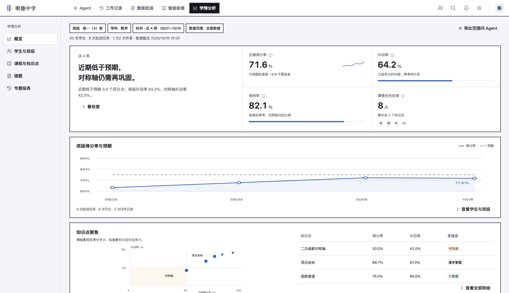
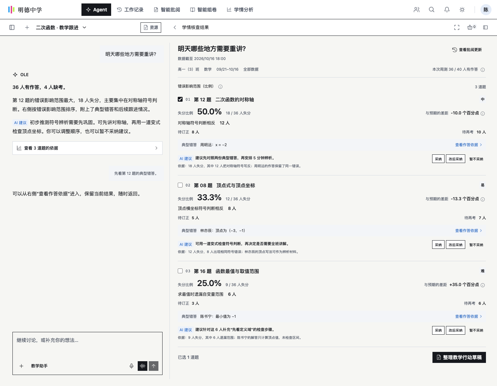
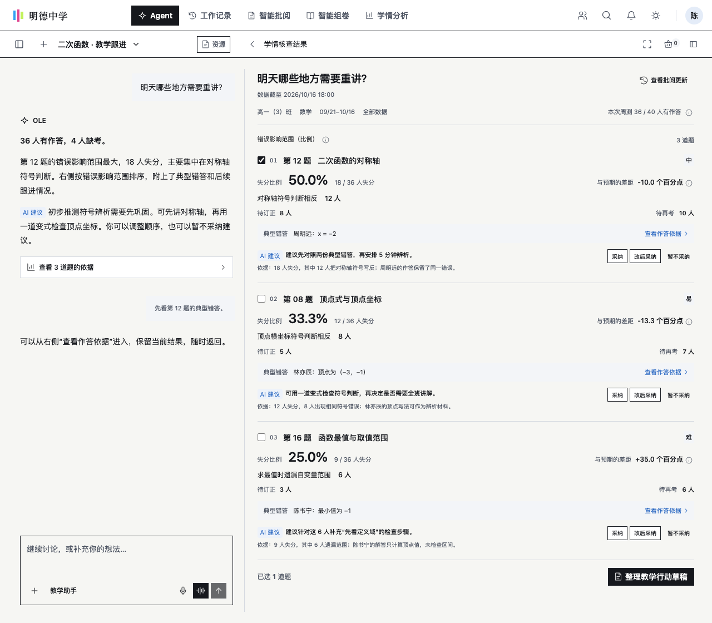
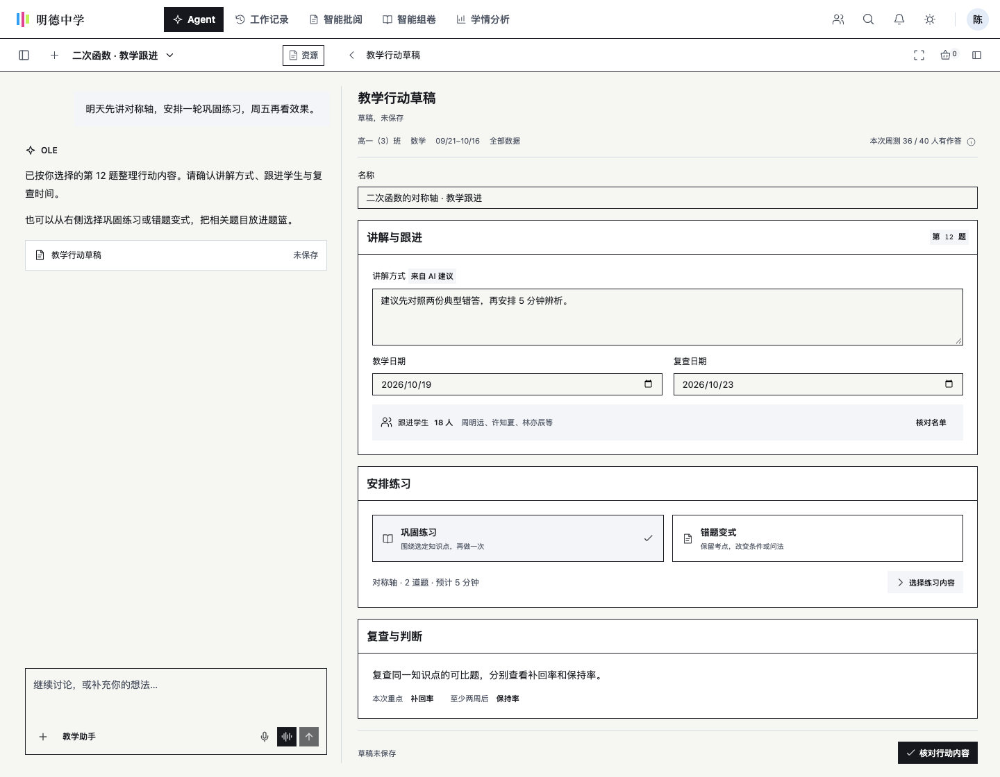
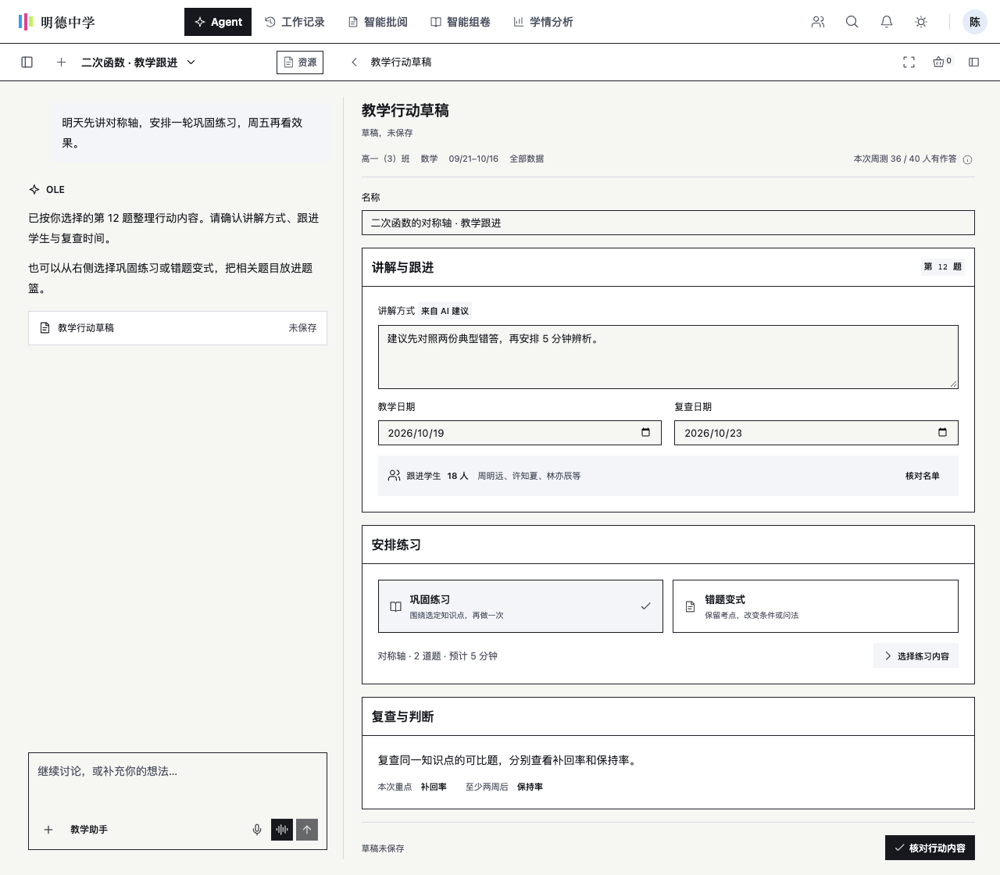
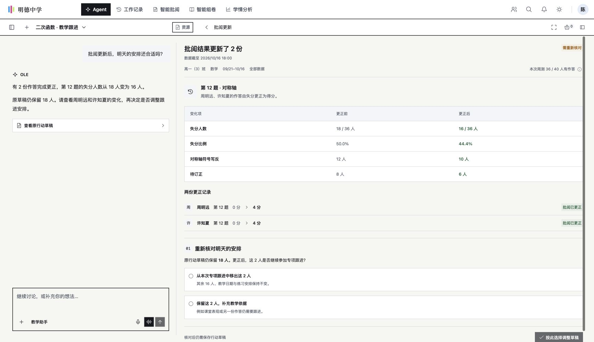
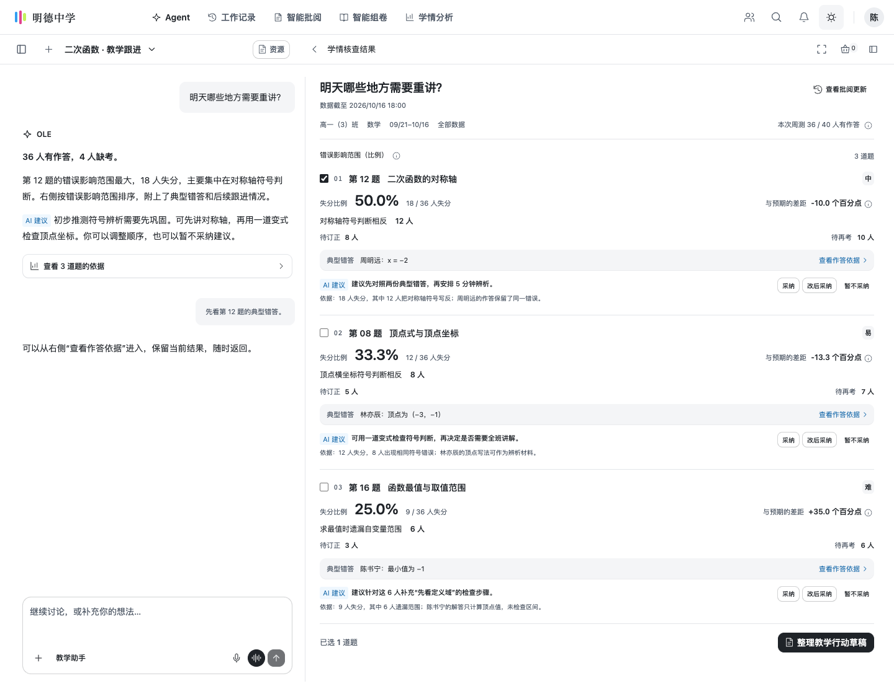
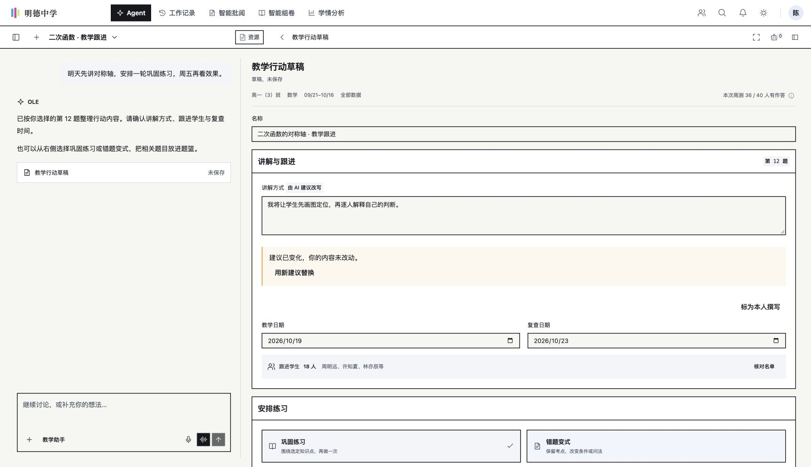

# OLE 学情分析系统设计与规划 v1.1

- 设计状态：设计正式版 v1.1
- 工程准入：未开始
- 版本：v1.1 · 2026-10-24 · Derived, Non-canonical
- 批准人：Ashrum（PO）
- 批准日期：2026-10-24

本稿由已签发的 v1.0 复制修订，落实 PO Ashrum 2026-10-24 的 F06 派单决定；这是 v1.1 候选修订，不回退 v1.0 的历史批准状态。当前范围由 §13.9 LD01–LD04 与 §13.10 的 F06／E1 修订共同限定。v0.7 的审核、截图和来源核查以及 v1.0 的签发与粗验分别保留原证据范围，不转记为 v1.1 已签发。

v1.1 增补 Agent 主区摘要与图表、右栏完整报告与证据、结果资格和汇总隐私提示。A1 结果通道已在合成数据上实现 D1／D9／D10／D12，G1–G4 补验及其限制见 [SCREENS](SCREENS.md)。C01 真实模型仍沿受控合成字段与 W278 混合结果边界，C03 非试卷草稿仍仅同次运行；真实学校数据、持久化和工程准入不因 A1 粗验开放。完整工程目标见[工程线附录](engineering-appendix-v1.0.md)。

本文件供产品、教育、架构、数据、交互和实施负责人完整审核。正文整合学情分析总体规划、Agent 设计、独立页面整改、教育理论依据和验证协议，无需切换原六份主稿。来源、阅读范围及本地核验记录见附录。

**核心方案：帮助教师及各级教育管理者掌握自己负责的教学情况，找到其有权、有资源改变的条件，并以实际行动对照下一轮学习证据，持续作出教学和支持决定。**

**当前审核状态：**设计正式版 v1.1，PO Ashrum 2026-10-24 签发，工程准入未开始。本版经 Supervisor 独立审查；E1 文案由 PO 于 2026-10-24 确定，配套工作台修正 W299 经 Supervisor 浏览器验收并已合并（ole-school-workbench #238，fba027f）。既有 A1 合成粗验不替代本版签发或真实服务验收。

阅读顺序为第 1—4 章确认方向与教育责任，第 5—9 章审核具体产品和合同，第 10—12 章审核整改、依赖与验证，最后按第 13 章记录决定。LA、ED 为整改编号；T、E、EDU、M、AG 为第 12 章验收编号（如验收 E01）；附录来源使用“来源”前缀，避免与验收编号混淆。

| 修订 | 内容与状态 |
| --- | --- |
| v0.3，2026-10-18 | 六稿统一整合并作保守文字精简；原始版本及差异留存 |
| v0.4，2026-10-18 | 处理 REV-01—08、RV01—18；补资格/指标/对象/权限/验证细则，纠正部分审核建议，进入聚焦复核；未实施业务代码或解除生产门禁 |
| v0.5，2026-10-18 | 处理 FR-01—04、FC-01—15 并拆出六份规格；原稿自称定稿，缺 PO 批准记录，本轮撤回该状态认定，保留历史原文 |
| v0.6，2026-10-18 | 按三份审核决策修订，恢复 PO 产品口径、补确定规则与 Agent 能力/四画面；原稿及规格保留历史，未获整体签发 |
| v0.7，2026-10-18 | 初稿落实四项已批决定和R1—R7，后经Claude独立审核；本轮r1修复F1—F7并完成真实种子对照和隔离画面验证，满足用户F1/F2条件批准，整体设计及六份派生规格定格；原稿和证据备份保留 |

| v0.7 r2，2026-10-18 | 正式发布修订：登记 r1 独立复核 PASS；统一更正页失分比例标签、补建议变化提示与显式替换/教师自拟确认、明确优先处理人数与知识点关系；六份规格同源派生，指标规则与准入门禁不变 |

| v1.0-candidate，2026-10-21 | 落实 LD01–LD04，工程内容分流，六规格重出；工作台粗验与 C01 受控冒烟待执行，未签发或同步 |

| v1.0，2026-10-23 | PO Ashrum 签发；L6／W284 合成粗验与 W278 C01 混合冒烟结果按 RELEASE／SCREENS 保留，不作全能力通过 |
| v1.1，2026-10-24 | F06 主区／右栏、资格与失效规则，E1 汇总隐私口径，A1 合成实现与补验登记；PO 2026-10-24 签发 |

## 1 设计目标与范围

### 1.1 贯穿 STEP1 的工作主线

**教学目标与范围 → 实际学习机会和有效证据 → 可复核判断 → 有职责的人决定行动 → 实际教学与支持 → 新证据 → 复盘与下一轮。**

“可干预”指当前角色有相应权限和资源，能在明确时间内改变教学或支持条件，并能约定如何观察后续结果。低分不是完整干预点；“加强重视”“建议提升”也不是可执行交付。合格交付应说明改变什么、由谁实施、何时发生、学生或承接者实际做什么、下一轮看什么。

正常推进、保留有效做法、核对或补充证据、继续观察和暂不行动均为有效决定。只有需要持续跟踪时才建立正式行动，不为每道题、每个知识点或每名学生强制建单。首期优先做透一个学科中教师的一轮真实教学，再按职责扩展校内、集团与区域支持。

### 1.2 教学质量检测的内容

质量检测同时关注：目标与评价是否对应；学生是否获得相应教学与参与机会；学习证据表现；教学调整和支持是否真实落实；证据是否充分可信。产品帮助使用者判断下一轮应改变什么，不将这些维度合成未经验证的“教学质量总分”。

本稿中的学情分析与教学质量检测服务教学和支持决定，不替代学校综合评价、行政问责或教师绩效评定；不新增综合质量总分或教师贡献排名。

教师掌握所带各班的计划、实际教学、学生证据和已有调整；班主任掌握本班全部学科的动态、支持与负担；学校、集团和教育局掌握职责范围内的教学与支持条件。行政层级越高，默认越应面向适当汇总、资源与组织行动，而非取得更多学生实名明细。

### 1.3 双入口与本期范围

独立学情页面用于稳定浏览、筛选、比较、核对和持续跟进；Agent 用于带问题进入、检索证据、解释限制、按获准能力准备安排和复盘。二者打开同一对象、范围与版本，共用指标、权限和动作，所有必要流程均能不经对话完成。

本稿覆盖五类角色的目标流程，不承诺全部首期上线。后台持续监控、跨会话自动派单、自动发送家长或上级通知、全量学生画像、教师贡献分与自动惩罚性排名不由本次分析功能隐含获得；新增能力另行登记、审核和验收。

## 2 调研依据与历史产品起点

本章及第3章的外部来源、全文阅读和旧代码核查均继承2026-10-18记录，本次未重新执行；当前范围见 §13.9–13.10，工作台已有粗验及未验范围见 SCREENS。

### 2.1 研究覆盖与证据边界

| 范围 | 已核查内容 | 对设计的作用及限制 |
| --- | --- | --- |
| 指定旧产品 | `ole-demo-site-offline-2026-08-20.html#/teacher/learning-analysis` 的静态内容及对应源码 | 保留五类分析视角、比较与后续教学思路；file:// 浏览器访问受策略限制，未验证全部排版、键盘和交互 |
| 当前教师工作台 | 教学周期示例的总览、学生与详情、课程、错题、报告，以及相应源码 | 确认范围、结果版本、再考、行动与冻结报告基础；本地合成样本不代表真实学校，管理端本次未作实现核验 |
| 国内教育与分析产品 | 4 家教育产品、3 家分析产品；8 条官方主来源 | 纸笔采集、讲评、逐题追溯、角色范围、区校过程、指标与权限；未登录竞品后台或验证厂商效果 |
| 国外教育与分析产品 | 5 个教育产品、2 个分析产品；14 条官方主来源，按产品而非公司或网站计数 | 行动计划、进展监测、尝试和帮助条件、指标统一；不能直接推定中国课程与学校适用性 |
| 类似项目与教育框架 | Carnegie、EEF 5 条原有来源；另补教育理论原文、原研究摘要和机构指南 | 用于教学设计、支持落实与验证方法；研究原理不能代替 OLE 本地效果证据 |

原产品研究的 27 条官方来源是页面或文件，不是 27 个产品或 27 项独立实证。理论来源的正文选读、指南摘要和研究摘要在附录分别注明。历史文档保留年份，未将搜索片段或获取失败的网页作为正文证据。

国际分析资料 A01/A02 同属 Tableau Pulse（含 Salesforce Help 上的 Pulse Governance），A03/A04 同属 Power BI Goals，因此是 2 个产品、4 条来源；不把文档承载域名再计为一个产品。

### 2.2 对 OLE 的取舍

| 参考方向 | 本方案采纳 | 适用边界 |
| --- | --- | --- |
| 讯飞、好分数、一起中学 | 保留纸笔入口、讲评、错题及后续练习，题目回到具体作答与目标 | 再练只是教学行动之一；一起中学 2020 年文档仅作历史设计参考 |
| 希沃区校过程信息 | 管理端查看教学条件、支持需求与落实障碍 | 平台使用频率不代表教学质量 |
| eduCLIMBER、Panorama | 将问题、计划、责任、执行、进展复查放在持续工作中 | 接收、执行、结果分别核查 |
| FastBridge、i-Ready、ASSISTments | 区分诊断、短周期检查、阶段监测，保留尝试与帮助条件 | 不混用量尺；提示后正确不等于独立掌握 |
| Tableau Pulse、Quick BI、FineBI、神策 | 共享指标定义与权限，固定人群和观察窗，控制重复提醒 | BI 事实信号与教学决定分开；可作为已批准学情 AI 建议的依据，不能自动选择教学法或执行；待办关闭不代表改善 |
| Carnegie、EEF | 明确改变、实施、结果及代价；小规模试行后再考虑扩展 | 日常前后观察与正式影响评估分开 |

### 2.3 当前可复用基础

保留总览、学生与班级、课程与知识点、错题、专题报告及兼容深链；复用结果与作答追溯、缺失原因、再考关系、LearningAction 和冻结 Report。重点统一口径、扩充非试卷动作，使行动与复查持续可见，无须整体重建。

历史代码审查（2026-10-18，P96未复测）基线为 `84fe49136588e8b2fe06abf8215dfda18c53a391`；开始时工作区无未提交改动，2026-10-18 11:13 收尾时已有其他并行 Agent/试题篮改动。本研究未修改或回滚业务文件；第 10 章发现以实际读取时点为准，文档建议不代表已整改。

v0.7 增量核对以用户直接提供的第二轮复核与 PO 2026-10-18 决定为依据，当时源码用于确认当时迁移起点。逐文件来源、读取 Git 基线与本地画面版本见[本轮回传清单](v0.7-审核决策与差异清单.md)。2026-10-14—15 的五入口、分层范围条、详情冻结预览框架、数据范围默认全部数据及本阶段报表不动继续承接；10-17 收起导航隐藏窄栏和本轮临时结果标题范围调整见 §8.3。

## 3 教育理念与理论的产品化

### 3.1 与 OLE 5.1 的对应

权威来源为 [OLEPTAv5.1.MD](https://github.com/Ashrum/open-learning-engine/blob/main/docs/architecture/OLEPTAv5.1.MD)，冻结标识 `OLE-PTA-v5.1-FROZEN-20260829`；本轮核验 blob `2db728e72ae86b21a90e39d3867e78870dd9d636`，全文 2743 行已重读。不同内容的根目录旧副本未作为本稿规范依据。

| 主文档已有基础 | 准确类别 | 落入本设计的要求 |
| --- | --- | --- |
| 教育价值优先、人的责任、证据与不确定性 | 价值与决策原则，§0.2、§9.10 | 看学习结果、延时保持和诊断可复核性；保留人的选择、拒绝、修订和未知 |
| 形成性评价 | 评价与教学实践框架，§3.2 | 证据用于下一次决定；学生有理解目标、使用反馈和再尝试的机会 |
| Bloom 分类 | 目标分类框架，§3.1、§10.3.1 | 用解释、比较、应用、论证等具体表现描述目标，关联任务和量规；不将分类给学生定级 |
| ECD | 评价设计框架，§10.3.4、§5.5 | 目标主张、任务、条件、观察、评分和推断有明确关系；知识点标签不足以支撑完整目标判断 |
| Learning Analytics 与 Teaching Analytics | 分析研究与实践领域，§3.2、§10.3.3 | 连起目标、计划、实际教学、证据及调整；限定人群、用途、窗口、版本与缺失 |
| KT/BKT 与 Measurement Profile | 测量和状态估计方法，§4.7 | 区分作答表现、状态概率、技能证据和教师判断；使用获准用途、校准和版本 |
| Goal Model | 多方目标模型，§3.5、§4.5 | 机构、教学、考试、学生目标和家长期望分别有来源；冲突由有职责的人协商 |
| ITS 与分层架构 | 教育智能系统架构传统，§10.7.3 | 学生状态属 L2，领域模型属 L3，教学模型跨 L3/L2/L1；不把架构术语当教学效果依据 |

形成性评价可以发生在课堂互动或下一课安排中；多收一次成绩并不自然构成形成性使用。ECD 从准备支持的学习主张反推所需任务与观察。本稿据此设计活动和证据关系，具体字段与交互为 OLE 产品推导。[Black 与 Wiliam 2009](https://kclpure.kcl.ac.uk/ws/files/9119063/Black2009_Developing_the_theory_of_formative_assessment.pdf)、[ECD CSE Report 632 2004](https://cresst.org/wp-content/uploads/R632.pdf)

### 3.2 适用补充框架与取舍

以下七组是教学设计组合，不增加七个模块或引擎。既有概念的深化与新增具名框架分别说明。

| 框架组合 | 适用问题与本轮引入 | 使用限制 |
| --- | --- | --- |
| 建构性对齐与 UbD | 新增具名框架，承接已有目标/ECD；核对目标、实际活动和评价，按单元目标规划下一课 | 不逐课填完整 UbD 表，不用语义相似度生成“对齐分” |
| 掌握学习 | 与 Bloom 分类、BKT 分开；对明确关键前提提供纠正性支持、替代活动和再检查，已有证据者可拓展 | 80% 是本产品观测分类规则之一，不声称掌握学习理论规定统一阈值；不永久分层、不无限重做原题或承诺全员同速达标 |
| 反馈使用与学科内自我调节 | 深化反馈，补充 SRL 操作机制；示范计划、过程检查和调整，让学生修订并逐步自主使用 | 已读、反思字数和日志不生成自律/动机分；知识不足先补教学 |
| 认知负荷、示例与支架渐隐 | 新增理论与教学策略；初学复杂步骤时用有理由的示例，再转部分完成及独立尝试 | 不从耗时估计负荷，不按学习风格分型，熟练者不强制重复完整示例 |
| 检索、间隔与保持/迁移检查 | 补充策略并深化已有目标；在正常教学中安排少量检索，按目的观察延时或新情境表现 | 页面保持率采用 ≥14 天的产品观察窗口，不把它说成所有学科最优教学间隔；练习、测量与迁移结论仍分开 |
| 学习机会 OTL 与 UDL | 两种不同视角；先查已教、可参与、材料与支持是否可用，再解释表现，按目标减少障碍 | 不推断家庭、残障或心理；表达/支持改变可能改变构念和可比性 |
| 教师共同探究与改进科学/NIC | 补充共同探究，深化原有 Carnegie；教师共看作品，学校提供时间/专长，集团有限试用并适配 | 不做教研积分、成功案例排名；前后变化不自动证明因果、迁移或 L0 准入 |

框架的原始来源、阅读范围和限制见附录理论索引。理论须落到目标、学生任务、支持和检查方式；带证据的 AI 错因推测和重讲建议可帮助教师判断，但不能凭低分或单个错误宣称唯一教学处方。学生表达和自主选择按已有 Goal Model 落实，不据此扩建学生或家长端。尚未完成原典与场景评审的理论不冒称已引入；学习风格匹配不纳入设计依据，也不建立动机、人格、心理或“最近发展区”的自动测评。

### 3.3 五类目标与冲突

日常以本轮教学目标为主，必要时展开 InstitutionGoal、TeachingGoal、ExamGoal、StudentGoal、ParentExpectation，保留提出者、依据、约束、待协商项和最终人工决定。系统不从分数或对话推断未提供的学生意愿、家庭期望。

例如学校本周进入新单元，部分学生仍需概念支持，学生希望保留项目活动时间，家长提出加练。教师可选择课内支持、分时安排或请求教研协助；学校负责人决定其资源事项。系统展示冲突，不默认考试分数或上级要求永远优先，也不要求每个普通行动填写五类目标表。Phase 1 使用静态业务确认约束，跨目标价值冲突的正式规划仍由获准 Goal Planning 承接；这不限制 §8.1 已批准的学情 AI 重讲优先级建议。最终教学与价值取舍由人决定。

## 4 五类角色的责任与完整工作流

本章保留完整产品远景。v1.0 首轮仅任课教师合法范围内的事实核查、建议与同运行草稿；多角色真实协作及教学周期首页列后续版本，不作为当前页面重排要求。

| 角色及首页 | 必须掌握的情况 | 本人可直接改变什么 | 接收执行与下一轮 |
| --- | --- | --- | --- |
| 任课教师 我的教学周期 | 所带各班的目标、原计划、实际已教、证据覆盖、当前表现、已有调整和下次检查 | 本学科讲解、例题、提问、节奏、反馈使用、临时小组、个别支持、检查方式；请求同伴帮助 | 教师确认安排，复用正常课堂/作业取得证据；记录实际差异，决定继续、调整、拓展、结束或补证 |
| 班主任 本班全科概览 | 全部学科正常/关注/未知状态、目标进度、最新有效证据、任课教师判断、支持安排和学生总负担 | 与任课教师核实，协调跨科时段、支持和参与障碍，发起有依据的沟通 | 关联原学科行动；任课教师接受或调整；班主任查支持可参加性和冲突，学科结果由学科负责人解释 |
| 校长与教务 学校教学质量 | 年级×学科目标覆盖、持续问题、有效做法、数据缺口与资源障碍 | 保护共同备课时间、作品共评、学科专长、听课复盘、课时/材料和数据质量支持 | 明确负责人和资源，承接方确认可用；查实践改变、机会与后续证据，调整支持 |
| 集团校 集团教学支持 | 跨校共性与差异、起点和教学条件、现有支持、拟试用方法的适用限制 | 联合教研、师资/材料共享、有限试点；允许各校根据情境调整 | 各校接受或调整，记录到位与实施差异；保留失败和未知，决定继续、停止或另审扩大 |
| 教育局与区域教研 区域质量监测 | 被授权辖区覆盖、学校支持需要、资源和教学机会缺口、抽样复核结果 | 区域教研和资源项目、专业支持、监测与采集安排、有限抽样复核 | 学校反馈收到且可使用；查到达、采用、覆盖、未覆盖原因和后续观察，调整支持供给 |

班主任不代替任课教师解释学科错因；学校不依据原始均分自动评价教师；集团和教育局不因行政层级自动取得学生答卷。汇总查看、实名明细、编辑、执行、发布和导出分别授权。跨层级支持关联原事项及必要摘要，不层层重复派单和练习。

支持流程至少区分申请、承诺、到位、可用或实际使用。采购、培训签到、材料上传和消息发出不能自动证明学生获得机会。接收方可因不适用、缺资源或时间冲突请求调整，不能自动视为不配合。

教师按课前、课后及下一次正常检查使用；班主任按全科安排协调；学校按教学周期支持；集团和区域按监测计划与试点窗口查看。不要求管理端进行课堂级实时全量监控。正常推进或无证据的范围也要可见，首页不只列异常。

### 4.1 职责授权与组织关系

五类业务视角不等于五组权限；校长与教务、教育局行政人员与区域教研员须拆分授权。一人兼任多职时，明确当前组织、职责、目的和范围，不默认为所有身份权限并集。

以下每格均为本设计的最小职责范围，仍须实际组织关系、字段、用途、版本、驻留及动作授权成立；不是自动授予权限表。任教关系不能推导班主任身份，辖区不能代替 Home，集团归属不能代替跨校访问许可。

| 职责与必要关系源 | VIEW / RETRIEVE | AGGREGATE / DERIVE | EDIT | EXPORT / PUBLISH | USE_BY_AGENT |
| --- | --- | --- | --- | --- | --- |
| 任课教师：教师—学校—班级—学科—有效期 | 任教范围内获准作答、证据及行动 | 同范围获准指标/草稿 | 本人安排；正式改分/任务仍走 owner | 目的地、版本与接收范围分别核验 | 仅获准环境及当前用途必要字段 |
| 班主任：人员—班级—职责/委派—有效期 | 本班全科获准摘要；原始学科答卷另授权 | 协调所需汇总，不合成跨科能力分 | 本人跨科协调，不改学科成绩/诊断 | 本班获准沟通/报告，发布权另验 | 仅协调必要且获准内容 |
| 校长：职务及学校职责范围 | 本校获准教学/支持聚合；个人明细另授权 | 获准校级指标 | 自身支持决策，不代教师改作答 | 学校级批准用途，不默认明细下载 | 聚合/支持内容；职务不授予教师私聊权 |
| 教务：具体年级/课务/支持委派 | 委派范围必要信息 | 相应运作指标，不继承校长权限 | 委派事实与支持 | 按委派分别核验 | 对应委派与用途 |
| 集团教学/教研负责人：成员校关系及具体委派 | 获准支持/试点汇总 | 跨校口径/披露先获准，跨 Home 另过合同 | 集团自身支持，学校确认本校事实 | 接收范围、用途和域边界分别核验 | 仅允许模型接收的获准汇总 |
| 教育局行政支持/监测人员：辖区及具体职责 | 获准监测/资源支持数据 | 获准用途与驻留范围内聚合 | 自身供给/监测安排，不改学校成绩 | 区域报告发布权单独核实 | 行政身份不豁免模型用途授权 |
| 区域教研员：学科/学校/项目委派 | 指定任务必要摘要或获准材料 | 任务范围分析，不生成行政评价 | 专业建议/自身回执，不代行政承诺资源 | 教研与正式监测发布分开 | 与教研资源、期限和用途一致 |
| 同伴审阅者：资源 owner 的临时协作授权 | 仅具体材料版本/片段 | 是否可衍生另验 | 授权评论，不改原事实 | 不默认可转发、导出或发布 | 共享许可不自动附带模型许可 |

事件时成员关系与有效职责决定读取范围；关系或权限无法核实时，不放行相应受限操作。实际关系接口与部署映射移至工程线附录。

查看、检索、模型使用、衍生、导出、发布和编辑分别核验。统计单元格、标题/计数、缓存、导出和模型输入均不能扩大当前职责及用途范围；真实 ACL 映射见工程线附录。

#### 班主任协调摘要

| 类别 | 最小字段 | 默认边界 |
| --- | --- | --- |
| 教学动态 | 学科、目标引用/名称、周期、计划/实际/未知、来源及更新时间；获准指标的名称、单位和分母 | 不默认生成进度百分数，不把提交/评分进度当教学进度 |
| 支持与冲突 | 事项引用、类型、时间段、承诺/到位状态、责任方及协调必要对象范围 | 不默认附具体教法、私有笔记、原始作答、逐项评分或诊断文本 |
| 参与情况 | 有来源且协调必要的参与/缺席状态、时间与范围 | 不因未交推断缺席，不新增全面考勤或暴露不必要敏感原因 |

班主任可提出改期/调整请求、记录本人协调与班级障碍；任课教师或获权安排 owner 接受后才改变原安排。班主任身份不授予代改计划、评分、诊断或强制取消权；兼任或另有委派须显式使用对应职责。原材料如有独立教学/协作许可可另行读取；“影响负担”勾选是业务提示，不是授权开关。

## 5 教学闭环与共用工作对象

本章定义完整闭环语义；按 LD03，本版非试卷行动只做到同运行内草稿、编辑来源及更正核对，始终显示“草稿，未保存”。完整保存、执行、触达、关联与复盘列后续版本；现有合法练习题篮／编辑／保存按既有能力使用，不为本版新增业务持久化。

### 5.1 从判断到教学响应

依次核对目标与任务是否对齐、学生是否有相应教学机会、证据能辨别什么困难、哪些解释仍需核实。未教、材料不可访问、支持未到位时，先改变这些条件；证据不足时先核对或补证。

行动的教学结构为：**期待学生能做什么 → 当前证据 → 教师准备改变什么及理由 → 学生实际做什么 → 反馈与再次尝试 → 用何种证据在何时检查 → 何时调整或撤去支持。**

| 情境 | 教师可选择的动作 | 后续检查 |
| --- | --- | --- |
| 目标要求解释，任务只观察选择答案 | 调整任务或缩小结论，补解释/作品证据 | 是否真的观察目标表现 |
| 未获得相应教学或可用材料 | 补教学、调整呈现与时段、请求支持 | 机会是否到达，再看学习表现 |
| 能跟随讲解但难以独立完成 | 有理由的示例、自我解释、部分完成，再渐隐提示 | 支持条件分别记录，检查适当独立表现 |
| 有可核实的概念混淆 | 正反例辨析、讨论、纠正反馈与新任务 | 能否解释关键差异并用于新题 |
| 已有反馈但尚未观察使用 | 留出理解、修订、解释或策略使用的机会 | 可用已有作品、口头说明或任务痕迹，不强制上传证明 |
| 当前表现符合本轮目标 | 拓展、减少重复讲练或适当间隔检索 | 保持及新情境表现，避免把当场表现当长期学习 |
| 学科策略需要支持 | 教师示范计划、检查或调整，再逐渐减少提示 | 学生是否在新任务中自行选择/使用；复述清单不等于使用 |
| 教师尚无把握解释作品 | 请求同伴共看材料、共同设计提问或示范 | 教师实践、学生机会及后续证据；不另写重复教研报告 |

事项先过证据与权限检查。教师可结合目标重要性、影响范围、持续/复现、下一课可行动性和已有支持覆盖确定优先级。事实排序继续按明确指标与规则说明；学情 Agent 可按 §8.1 已批准范围提出带证据的重讲优先级和错因推测，标“AI 建议”，最终由教师决定。首期不因低于班均自动触发干预，也不生成未经校准的综合风险分。

上述为模板方向，教研负责人审核适用范围、先备条件、材料正确性、学生任务、支持方式、检查、停止条件和来源版本。教师继续检索、选择与编排模板；学情 Agent 的重讲优先级和错因推测按 PO 2026-10-18 已批准范围提供，不再被笼统推迟到 Phase 3。该放宽不等于自动挑教学法或分组，其他情境策略能力仍按各自批准范围接入。

### 5.2 共用对象的最少内容

| 内容 | 必须保留的语义 |
| --- | --- |
| 目标与范围 | 课程/单元位置、目标及成功表现、班级/学生与时间、实际已教状态，必要的多方目标约束 |
| 事实与依据 | 原始作答及条件、评分/内容/映射版本、有效与应有人数、未纳入原因、来源与数据截止 |
| 判断 | 确定性统计、AI 建议、教师判断和正式模型分层；AI 建议逐条保留依据、反例/未知及教师采纳、修改、否决记录 |
| 行动安排 | 改变的条件、学生任务、负责人、时间、对象快照、材料和支持；教师选择/模板/引擎来源 |
| 复查安排 | 目的、任务与评分依据、独立/提示条件、窗口和比较资格；允许尚待确定 |
| 执行与复盘 | 实际触达、实施差异、新证据、缺失、下一步决定及与下一轮关系 |

这些为本设计基线的应用逻辑语义，不宣称新增 canonical schema。优先映射既有任务、结果、证据、行动和报告。默认只需确认目标、具体改变、学生活动和时机；其余已有信息带入、必要时展开，不给每个学生加一套理论表。

### 5.3 状态与历史

| 维度 | 状态 |
| --- | --- |
| 计划与执行 | 草稿、已安排、执行中、已执行、暂停、取消 |
| 后续证据 | 尚未约定、未到观察期、待采集、部分取得、足够复查、不可比较 |
| 复盘决定 | 尚未复盘、继续观察、调整方案、结束本轮、提出扩大试点 |

结束本轮表示已作工作决定，可因达标、不适用、转交或无法补证而结束，不能据此证明有效。继续时关联新一轮并保留原轮事实。计划、实际触达及取得后续证据的对象分别保存；转班、取消及名单调整不得重写原分母。已发布任务仍按原领域规则撤销，关闭分析卡不等于撤回任务。

目标、标准、对象和窗口尽可能在看到后续结果前确定。事后改变须生成修订并保留理由；按原约定的观察与新标准下的探索性解释分开。无预设标准的观察可以有价值，不能包装成达到预定目标。

#### 已确认安排的修订

| 改变 | 处理 |
| --- | --- |
| 时间或检查窗口 | 新修订保留原窗口及理由；不自动把逾期改为未到期，观察后改窗按探索性口径处理 |
| 对象范围 | 记录新增/移除及原因，原分母与修订后集合并列；缺席、转班不消除原轮次未触达或未知 |
| 内容、方式或评价标准 | 保留已发生内容；涉及任务、量规、目标或用途变化时重新预检，原结果不改按新标准宣称达标 |
| 行动类型 | 未执行部分可修订；需要另一正式任务时交给原 owner 创建/承接并关联，已执行部分不被取消文字抹去 |

确认前展示受影响的对象、时间、资格、后续观察与已有任务差异，保存修订链、操作者、发生/记录时间和引用。草稿编辑可保留；形成新的业务提交时核验实际依赖，不能以“已确认过”为由跳过。

### 5.4 两班教学与分母示例

以下为合成设计例。单元目标是根据二次函数图像解释参数符号及理由。A 班已做辨析，B 班尚未进行；两班不直接作质量排序。A 班的选择题尚不足以确认解释能力，教师核对作答和已有口头说明后，选择正反例辨析、示范检查过程、补关键步骤和独立新例解释，并让学生据反馈修订理由。已有充分本轮证据者可拓展，B 班先完成必要教学。

A 班 40 人，36 人有本轮可分析作答（合成夹具假设其分析资格已成立）；本轮选择其中 18 人支持，实际触达 16 人，后续取得 15 人符合本例复查用途与配对条件的正式任务证据，11 人符合原定标准、4 人仍需支持，另外 3 人尚无本例用途合格的正式测评配对证据。必须同时显示 **36/40、16/18、15/18、11/15 和 3 人未知**。不能写成“全班提升 73%”，也不能因未取得证据判 3 人失败。

36/40 是**本用途可分析作答覆盖**，不是已教覆盖、个人学习机会覆盖或可发布覆盖。

本例的生级 11/15 与项级再考满分率分开。教师口头或课堂观察如另记 2 人，只在人工观察栏列明来源、时间和标准；可能与正式任务的 15 人重叠，不相加为 13/17，也不替代 3 人未知。该“2 人”为独立反例，不改变上列合成夹具。

下一次正常作业检查新题解释，在适当后续教学机会检查保持；提示、答案暴露、原题/新题和实际间隔有记录。只有当堂证据时只报告当堂表现。教师同时看时间与负担，决定保留、调整或补证，不为完成闭环强加整套测验。

## 6 指标 测量与比较规则

### 6.1 统一指标定义

| 层次 | 例示口径与用途 |
| --- | --- |
| 教学与观测覆盖 | 已教目标、本用途合格观察人数/本范围应观察人数、具合格分析证据的已教目标/已确认已教目标、待复核/未映射量；先说明结论覆盖 |
| 观察表现 | 合格分析作答得分/对应满分、本轮符合标准人数/本用途合格观察人数、教师确认错误类型；描述发生的事实 |
| 再考与保持 | 页面保留 MET07 补回率、MET08 保持率；均为观测口径 v0，按合格再考项次统计，原题/变式/同知识点及提示/曝光条件分层 |
| 执行 | 实际触达学生数/原计划学生数、方式与时机差异、未执行原因；识别障碍 |
| 复查 | 原对象配对覆盖、配对对象变化、未改善及缺证据量、分布；支持下一轮决定 |
| 正式状态 | 获准模型的知识概率及校准、用途、版本和不确定性 |
| 技能证据摘要 | 数量、覆盖、窗口、来源与质量；不冒称校准后的能力推断 |

每项指标固定名称、单位、公式、粒度、分子分母、纳入排除、对象集合、事件时间、版本、截止、用途、比较资格和缺失原因。页面、Agent、图表、辅助技术和导出共用结果及精度策略。

页面显示名保留“补回率”；注册定义为原失分内容合格再考做对的项次比例，非收回分数比例。数字旁显示分子/分母及“项次”，详细关系和条件放说明气泡；部分得分改善另列。保持率、与预期的差距、掌握度和学生进展六类命中状态及“继续观察”兜底同样保留教师用语，统一登记为观测口径 v0（非校准掌握），规则与历史结果按版本保留。

### 6.2 正式测量边界

从作答推出状态或学习成就须引用批准的 Measurement Profile，包含构念、用途、人群、任务/rubric、标尺含义、模型/数据版本、校准与不确定性、限制/失效和批准责任。班级状态另用批准的 Aggregation Profile；不能自行平均个人概率后贴班级标签。

仅当对应 BKT 能力、State Measurement Profile、适用范围与证据用途均已获准并核验接入后，才按正式合同提供知识状态，不输出 skill_mastery、capability_mastery 或综合画像。Bloom 标签、一次正确、固定 60%/80% 或增加数据量不能替代测量依据。DKT/CDM/IRT 为受控候选，不因数据变多自动启用。缺模型时保留 §6.4 的描述性指标及 PO 已定观测分类；页面“掌握度”明确为观测口径 v0（非校准掌握），不写入上述正式字段。正式 BKT/Measurement Profile 接入后升规则版本并说明含义变化，页面名称不变、历史不重算；观测功能不等于完整 Phase 1 验收。

正式 BKT、Aggregation Profile 和诊断资产的实际部署及批准实例未核实，属于已知工程限制。相应用途关闭，描述性证据与教师判断仍可用；实例登记移至工程线附录。

### 6.3 比较与效果表述

比较前逐项核对目标、实际教学、题目/量尺与难度依据、评分、作答条件、对象、窗口和结果版本，按具体指标和用途判断。符合必要条件才显示该项差值，只开放符合条件的用途；条件缺失只并列查看，基础证据不足不形成比较。笼统“部分可比”不能保留增长箭头。

同知识点不等于同难度，具有预期得分率不等于已等值，同一学生前后作答也可能有练习效应。提示后、看答案后与独立作答不能混成同一独立验证率；原题/变式/同知识点按 MET07 的登记条件形成总率并保留分层，不能因此声称等值或迁移。调整表达或工具若改变被测构念，也不能直接比较分数。

跨周期分别报告固定队列与各期当期对象；转入转出、复读、重复作答及选择性复查有规则和去重。跨班/校先核对共同目标、覆盖、起点和实施差异。合并比率用合法合并分子分母，不平均百分比，不将异科百分数相加成质量分。退出低起点对象带来的均值上升不能解释为教学改进。

日常支持描述性事实和有条件的前后观察；没有适当评估设计不得量化教师贡献、策略净效应或政策因果效果。因果评价与正式教育验证按第 12 章单独设计，不能让教师每次正常使用都承担对照研究。

比较结果由统一分析投影按批准规则生成；评价/测量 owner 提供构念、任务、量规和等值等判断依据，教学事实提供方只报告发生事实，教师可以修正事实或选择查看方式，不能用确认按钮授予量尺等值。前端与 Agent 只消费结果，不各自判断。

拟议比较输出保留四组语义：

- 两端精确引用与用途：目标、对象集合、任务/尝试/评分版本、窗口及关系。
- 逐条件结果：目标关系、实际教学状态、量尺与难度依据、rubric、提示/答案曝光/独立条件、身份配对、时间与用途资格，各为满足、不满足或未核实，并附来源。
- 允许操作：并列查看、报告明确条件的再检查表现、计算某项差值、形成某种状态变化。每项分别允许/不允许/未核实；不存在一个“部分可比”通行值。
- 责任与解释：规则版本、owner 依据、判断时间、具体阻断原因、来源失效依赖。原题/变式/同目标、新情境、提示后等是独立观察条件，不是等值程度等级。

没有等值依据时，不显示跨卷原始总分增长箭头。仍可并列查看，也可在目标、rubric、条件和预设标准适用性已确认时报告“在本轮新任务观察到何种表现”；这种描述不叫等值分数增长。已有预期得分率或同知识点标签不能填补等值依据。原题订正满分可以作为订正事实展示，但不能计入独立新题验证。

“与预期的差距”（MET10）比较一次检测实际得分率与同批题目适用的预期得分率，单位为百分点。预期逐题按§6.4选择：有效且有版本的题目预期优先，其次为获准难度换算表，均不可用才不可比；不要求不同试卷等值，也不据此计算跨卷原始总分增长。保持率和补回率依各自关系和条件计算，不借预期存在或旧comparable布尔值放行。某题虽缺难度标签但已有有效逐题预期，不因此阻断MET10；禁止把前后阶段得分率相减写成提高或教学效果。

### 6.4 用途资格 指标注册与计算细则

“有效”必须附用途。内部注册使用精确名称；页面按下文“注册名 → 页面显示名”用教师的话表达，单位与分母放数字旁、限制放说明气泡，不把长工程定义放控件下。一个对象的资格是用途、版本、范围、授权、质量、规则及截止状态的联合判断，不是永久布尔字段。

统一分析投影读取各 owner 的当前结论并执行已批准的用途规则；不得替 Evidence、Assessment、State 或权限 owner 批准新用途。每次输出至少保留：精确来源引用、用途、范围、判定结果、原因、责任 owner/规则版本、判定截止与依赖有效状态。该组字段是拟议应用投影，不是新 canonical 对象。结果为“允许／不允许／尚未核实”；后者对该用途不纳入，但仍可在获权的核查界面显示缺口。

**责任边界：**教师工作台学情分析模块承接统一投影，页面、报告和 Agent 共用同用途规则。PO 决定页面含义，指标责任方维护公式及集合，各原领域负责事实与用途资格。具名负责人及接口登记在工程线附录；源撤销即停相应用途，规则更正留历史并升版。

#### 资格 × 用途矩阵

表中“条件允许”要求右栏及该列条件全部满足；未知条件不能视为满足。对外发布包含明确接收范围与目的地，教师自用保存与对外发布分别判断。管理描述统计与正式状态聚合也分别判断。

| 来源与状态 | 教师描述性分析 | 模型更新 | 发布或共享 | 管理汇总 | Agent 使用 | owner、版本与失效处理 |
| --- | --- | --- | --- | --- | --- | --- |
| GradingResultCandidate、待复核材料 | 可按获权核查用途查看；不进入正式结果统计分子，显示待复核量 | 不允许直接更新 | 不作为正式成绩或效果发布 | 不进正式结果汇总；可按获准用途统计“待复核数量” | 仅获准核查能力与 USE_BY_AGENT 允许时；不能把候选说成正式结果 | Assessment owner 保持候选状态、exact 来源和 Review 引用；后续正式结果另获资格，不修改候选历史 |
| 已正式提交且当前合格的 GradingResult，但未形成所需 EvidenceRecord | 满足已发布主规则，或表后 v1—v3 旧存档兼容条件，再核本用途其他资格后，可进 MET01/03 等描述性统计；不强制等待 Evidence。其余未发布结果只在获权核查用途查看 | 不允许直接跳过 Evidence 提交 | 独立核对 PUBLISH/EXPORT、来源发布资格、接收范围和结果版本；兼容读取不等于实际发布 | 仅获准的描述性汇总及合法聚合范围可用；不因此生成班级 State | 继承本次分析用途资格，再加 RETRIEVE/USE_BY_AGENT；派生另查 DERIVE | Assessment owner 负责结果状态，现有授权模块负责权限，投影记录实际发布或旧存档兼容依据及版本；撤回或不合格即阻断相应新用途 |
| 已提交且当前用途合格的 EvidenceRecord | 按类型 intendedUse、范围及分析规则使用 | 还须 Evidence Window、模型/Profile、兼容和 State owner 准入全部通过 | 再过目的地、接收范围、字段、用途及发布许可；Evidence 提交不等于允许公开 | 依类型用途、范围、完整性及获准聚合规则；正式状态汇总还须 Aggregation Profile | 继承上游用途和字段范围，再过 USE_BY_AGENT；无法获权不得注入模型 | Evidence owner 提供 exact evidenceRef、evidenceTypeRef、当前状态；State owner 负责状态更新，聚合 owner 负责聚合；失效先取消新用途，再异步重算 |
| 教师录入的课堂或口头观察，尚无获准 Evidence 类型与提交 | 作为“教师观察/判断”分栏；可查原记录，不混成正式测评统计 | 不允许 | 仅在允许人工报告的用途内、保留来源和解释限制且另获发布授权时可引用；不伪装正式成绩 | 若允许收集教师报告，可汇总“报告覆盖/支持状态”，不得称客观测量结果或正式状态 | 明确允许人工记录的用途且权限通过时才可整理，注明来源 | 教师对内容负责，应用记录 owner 保持作者、发生/记录时间和版本；更正保留旧版、撤销相应新引用资格 |
| 教学执行事件（含明确名单的触达） | 可说明谁在何时执行/触达，满足执行定义可进 MET04；不证明学会 | 不直接更新 BKT | 仅获准执行摘要用途 | 可汇总执行事实，非教学效果 | 同用途授权后整理事实 | 执行业务 owner 提供事件、对象名单、时段、修订与撤销；无名单不能推全班已触达 |
| 教师显式确认已教（班/组/个人） | 支持 MET02 的相应已教范围；局部已教不进全班分母 | 不直接更新 BKT | 人工事实报告，来源可辨且另授权 | 可汇总已确认范围，非掌握 | 获准时整理，不能自动扩范围 | 工作台行动/教学事实 owner 保存教师、范围、目标、时间及修订；不能凭作业反推 |
| 班级已教但个人机会未知 | 可报告班级已教、个人未知；不能据此计该生 MET04/05 或判能力 | 不直接更新 BKT | 仅按获准用途带限制说明 | 不生成个人机会达成率 | 不补造个人机会或配对 | 同一事实 owner 保留班级来源及个人例外/未知，不把班级状态复制为逐生事实 |
| 被撤回、失效、过期或已不适用于本次用途的旧依据 | 获权历史核查可见；不作为当前合格统计 | 不允许新的更新 | 不允许依据旧资格新发布；既有发布处置走原 owner 规则 | 不进入当前合格汇总；历史快照附失效提示 | 仅有明确历史核查授权时可引用并标失效，不参与新建议依据 | 原 owner 的失效记录优先；不能等待全链重算后才收回资格，也不能由教师确认豁免 |

**P0 读取规则：**保留已发布主规则和有版本的 v1—v3 旧存档兼容例外；不要求旧版用户补做当时不存在的发布步骤。当前结果已发布时仍须通过质量、范围、授权及其他用途资格。未发布结果仅在以下条件全部成立时通过普通学情的兼容读取判断：恢复并校验后的 `state.learningSeedVersion` 为 1、2 或 3；存在与结果 `taskId`、`contextId` 均相同且 `phase="COMPLETED"` 的任务；同一 `taskId` 的全部结果版本均未标为已发布；任务及其任一结果版本均无已保存的发布事件。当前源码对后一条件的识别是事件 `objectId` 属于该任务或其结果版本，且事件 `label` 包含“发布”。该例外依据 PO / Supervisor 2026-10-15 决定保留，并由 PO 2026-10-18 第二轮复核再次确认。

兼容版本取自经校验恢复的存档身份：现有 `learningSeed.version` 或 `teacherSeed.learningVersion` 还原相应种子与增量后形成 `learningSeedVersion`；直接存储的状态同样须经现有校验。它不是 `ResultVersion.version`、学情规则版本、文件名或保存日期。v4、v5、未标明或非法版本不得推定为 v1—v3；恢复不得改成最新种子补造旧事实。相关实现见 `learning-selectors.ts:isPublishedForLearningAnalysis`、`learning-seed-storage.ts:decodeLearningSeed` 和 `teacher-seed-storage.ts:decodeTeacherSeed`。

兼容只满足普通学情的读取条件，不写入 `published=true`、不伪造发布事件，不自动授予共享、导出、模型或 Agent 权限。任务一旦存在任何已发布版本或发布历史，未发布结果便不能再走此例外；发布后撤回不能借旧种子版本恢复资格。来源撤回、失效或撤权同样即时阻断。新数据仍按发布主规则处理；已有 Evidence 不能绕过它。除这项已批准兼容外，新增未发布用途仍须登记责任方批准、实际资格规则版本及输入/预期，先验证再启用。

旧存档兼容规则登记名为 legacy-learning-read-v1，保留 PO 2026-10-15／10-18 决定及本节精确条件；实际接口字段映射归工程线，不新增发布状态或扩大权限。

#### 字段级输出示例（拟议投影，非真实数据）

同一精确结果引用、同一学生集合、同一数据截止，分析用途可返回“允许，规则 analysis-v0”，模型用途返回“尚未核实，未取得获准 Evidence Window”；发布返回“不允许，接收范围尚未确认”；管理汇总返回“尚未核实，聚合用途未配置”；Agent 返回“不允许，组织尚未开启本次 USE_BY_AGENT”。页面展示“有作答 36/40人”，不能将这一值复制为“可发布覆盖”或“模型有效覆盖”。

一致性验收固定相同的用途、范围快照、来源精确版本、指标规则版本、截止与授权视图。用途不同允许分子不同，必须显示原因；这不是 LA01 失败。相同条件的独立页、报告、Agent 和导出结果必须一致。Agent 未接入时仍按统一稿既定分期记未测，不用夹具冒充实接验收。

#### 名册 对象与分母

**四组集合**

1. 事件时组织/班级名册：由有效成员关系在教学或任务事件时解析，固定关系版本或可复核快照。
2. 本次任务/观察应纳对象：依事件时名册、实际布置范围、目标适用性和预先约定的观察目的确定。
3. 原行动计划对象：行动定稿时固定；后续改名单产生修订，不删除旧对象。
4. 本用途合格观察对象：从相应应纳集合中按用途规则计算；另列实际触达、可配对与未知集合。

班级覆盖与任务覆盖的分母不同。若班级有 40 人、任务只发给 36 人，“本任务可分析覆盖 36/36”不能冒充“全班覆盖 36/40”。任务未布置的 4 人在班级目标覆盖中仍是未覆盖，不能靠切成任务范围消失。原行动 18 人的触达和复查仍以 18 为原分母，15 个合格配对者只构成另一明确的结果分析集合。

**事件规则**

| 情况 | 本次任务应纳集合 | 原行动/班级历史分母 | 必须展示 |
| --- | --- | --- | --- |
| 缺考、请假、识别失败、待复核 | 已在任务范围则仍在应纳集合；不进合格作答分子 | 不删除 | 原因及人数；不补零 |
| 未布置给该生 | 不进“本任务”应纳集合 | 若本轮目标面向全班，仍在班级覆盖分母；原行动若含该生也仍保留 | 未布置人数与范围区别 |
| 材料或支持未到位 | 若本来应获得任务或支持，仍在应纳集合 | 不删除 | 未到位，不能归因为学生未学会 |
| 事件前已生效转出/休学且本任务未向其发出 | 按事件时有效关系与任务适用规则不纳入新任务集合 | 不回改转出前历史及已固定行动 | 生效时间、规则与历史关系 |
| 行动后转出或计划中止 | 后续新任务按其当时授权关系判定 | 原行动仍保留；追加变更，可另给修订后集合，不取代原口径 | 原口径、修订口径及转出/中止原因 |
| 迟入或事件后转入 | 不倒灌原任务；后续实际布置可进入新任务集合 | 不加入原行动，除非形成明示修订 | 新增人数及无原基线，不能自动配对 |
| 来源失效或版本被替代 | 取消相应用途分子资格，保持应纳对象 | 不删除原名册或原计划 | 暂无合格依据与影响，不从分母抹去 |
| 重复上传、多份作答、重试 | 依任务与 Attempt/评价规则去重；不能按扫描页数计人 | 保留原集合 | 使用的尝试选择规则与排除重复数量 |

排除只用于某一已定义统计用途，必须有预先规则、原因及负责方，不是教师任意删人按钮。缺测、转出或未改善不能用于事后降低原计划分母。历史成员关系无法重建时标“历史名册未核实”，不把当前 Student.classId 当历史名册；可以展示可核对的作答数，不能伪造班级覆盖率。

#### 分母与缺失在界面中的一致呈现

| 位置 | 集合与显示 | 必须保留的说明 |
| --- | --- | --- |
| 班级概览 / 任务范围 | 分别使用事件时班级或该任务应纳集合；本例 36/40，任务 36/36 另名 | 用途、范围/版本/截止；40−36 为 4 人，不能写 3 人缺失 |
| 行动与后续观察 | 原计划 18、实际触达 16、合格配对 15、配对达标 11 分别显示 | 16/18、15/18、11/15 及原计划中 3 人未获本用途配对证据；不互换分母 |
| 再考项统计 | MET07/08 各自合格作答项集合 | 项数、试次规则与原项关联；去重后的原项覆盖另列，不把多次作答当多名学生 |
| 图表、列表与导出 | 同一指标、用途、范围和版本使用同一分子分母及显示精度 | 不同指标可在同屏使用不同分母，但须逐项标明；导出沿用获准字段并附规则/计算截止，组织标识也须获权 |

未知原因采用分轴事实：任务应纳/名单变更、是否已到期、提交/评分/复核、映射/结果版本、用途资格与授权、聚合进度分别记录。缺勤与待复核等原因可能重叠，不能强行作为互斥总和。需要汇总缺口时，先对本指标应纳集合计算“合格/尚无合格依据”互斥分区。本版只列去重缺口总数与可核对的多轴原因，不伪造互斥原因加总；主原因优先级列后续版本，未在本版启用。

不采用“任一用途的分母都等于状态 1—5、不含转出”的规则。转出仍保留原行动分母；修订后可操作集合单列。没有当前明细权限时，不因报缺口泄漏姓名、人数或敏感原因，按披露策略限制。评分完成状态和聚合水位仍由 owner 返回，不能从覆盖缺口自动推定“处理中”或“全班完成”。

#### 指标注册表 v0

**每个指标定义必须包含**

定义 ID 与版本、用途限定名称、计算单位与输出单位、主体粒度、目标与范围、分子/分母集合及去重键、公式、纳入/排除规则、所需来源及资格规则、事件时间字段与窗口、配对/尝试选择规则、比较操作许可、缺失/零分母行为、精度规则、owner 与审核责任、失效依赖。模型或成就指标另指向批准 Profile，不能在注册表中自行批准。

以下为观测口径 v0（非校准掌握）的设计登记；其中 MET01—09 描述覆盖、表现与执行，MET10 及附属分类承接 PO 产品决定。编号仅供专项追溯，正式实现字段名另行映射。每行默认依精确来源、用途和窗口过滤；模型用途、发布用途、管理用途不得沿用同名分析数值冒充已合格。

下表“正式测评配对”指满足本次描述性统计用途的正式评价结果配对，不等同于已经形成 EvidenceRecord 或获准更新模型；若指标明确声称统计“已提交 Evidence”，则必须另外满足相应 Evidence 提交资格，不能混用名称。

指标资格以带版本的规则声明来源类型/状态、用途及所需关系；矩阵行号只作阅读定位，不作接口枚举。MET01、MET03 以及采用正式测评结果的 MET02、MET05—MET08，可消费矩阵第 2 行满足本次描述用途的正式 GradingResult，或第 3 行保留对应评价血缘的合格 EvidenceRecord；不强制等待 Evidence 提交，也不因已有 Evidence 自动放行；本次 P0 普通分析按本节已发布主规则或已批准的 v1—v3 旧存档兼容条件读取，不能把兼容读取写成实际已发布。相同底层作答按来源去重。

MET02 及其他目标级结论核验实际依赖的精确目标映射及 L4 质量结论；MET05—MET08 另核其实际使用的原题/变式/知识关系、配对、评分、条件与窗口。原题核查不因无关映射缺失一律受阻，知识关系通过也不证明等值。MET04 取有来源的执行/触达事实，MET09 取人工观察，二者不以评分或 Evidence 存在为默认门槛。记录用途资格规则版本（逻辑字段 eligibility_rule_version）、来源与所需映射/尝试规则；按现有合同落实，不另发 canonical 字段。描述资格不授予模型、发布、管理或 Agent 用途。

| 指标编号与名称 | 单位与粒度 | 分子 / 分母 | 去重、资格与窗口 | 缺失及解释 |
| --- | --- | --- | --- | --- |
| MET01 可分析学生覆盖 | 计数单位 student；输出人数和 %；目标/任务/窗口限定 | 至少有一份该范围合格分析作答的学生 / 同范围应观察学生 | 学生在本集合只计一次；按可信作答事件时间；不意味着每人覆盖全部目标 | 分母未知不算率；合成 36/40，只说明此范围有可分析作答 |
| MET02 已教目标的可分析证据覆盖 | target；个数和 %；班级周期 | 已确认已教且有对应合格作答证据的目标 / 有来源确认已教的目标 | 按精确目标版本去重；仅全班范围确认已教的目标进入全班分母，部分/局部已教另列范围和证据数；未教与未知另列，详见表后规则 | 已教分母未知/为空显示无法计算；仅反映目标是否有证据，非学生掌握率 |
| MET03 本轮作答得分率 | score-point；% | 合格作答的得分之和 / 同一批作答的满分之和 | rubric 已确认且 score/max 有效；未映射可用于允许的总体描述，不进入目标级结论；跨卷混合须用途规则允许 | 待复核与未作答不补零；qualified blank 是否计零由评价合同决定 |
| MET04 行动实际触达率 | student；人数和 %；行动轮次 | 有来源实际触达的原计划学生 / 原计划学生 | 每人一次，执行来源与发生时间；原集合不变，修订另列 | 16/18；执行不明不是已触达；不是学习效果 |
| MET05 本轮正式测评配对覆盖 | student；人数和 %；原行动与目标 | 获得合格前后配对且满足本轮规则的学生 / 原计划学生 | 关联确认、来源资格和预设选择规则均通过；每人一次 | 15/18；余 3 人未知，不计失败 |
| MET06 配对学生本轮达标率 | student；人数和 %；目标/检查窗口 | 配对者中按原定表现标准达标人数 / MET05 的配对学生集合 | 先按注册的目标标准汇总每人的多题表现，再计人；标准及适用尝试规则在后测前绑定，允许使用已生效的注册默认 | 11/15，另列 4 人未达与原计划 3 人未知；不称因果收益或稳定掌握 |
| MET07 补回率（注册：原失分内容合格再考做对项次比例） | retest-answer-item；项次和 % | 原失分项明确对应的合格后测满分项次 / 同规则合格后测项次 | 原题/变式/同知识点三类均可入默认；独立且未暴露对应答案/解法，明确前后关系；每个后测项一次，多次Attempt各计，细则见下 | 不称追回分值、学生比例、等值改善或因果；提示/答案后另层，未知不默许 |
| MET08 保持率（注册：原满分内容≥14天合格再考仍做对项次比例） | retest-answer-item；项次和 % | 原满分项明确对应、间隔≥14天的合格后测满分项次 / 同条件合格后测项次 | 同MET07三关系/独立/曝光及去重规则；按可信发生时间、学校时区日历日期差≥14计入，14边界包含；不同Attempt各计，修订不增项次 | 无合格项为—；<14天仅为短期观察，不能叫保持率；不自动外推长期保持或迁移 |
| MET09 教师人工观察人数 | student；人数，无默认达标百分比 | 有来源的教师观察涉及人数，无正式测评配对率分母 | 显式人或组名单；同人去重，保留观察目的、条件、发生/记录时间与作者；样本不外推全班 | 可显示“另有 2 人获教师口头观察”，即使与配对 15 人重叠也不能直接相加；不更新 BKT |
| MET10 与预期的差距 | percentage-point；百分点；单次检测、明确学生/范围 | R=合格作答得分和/满分和；E=同批各项满分×该项预期率之和/满分和；G=100×(R−E) | 逐题选有效且有版本的预期率，其次为获准难度兜底；记录每项精确题版、来源与规则版本；一次即可算，不受3检测门槛；跨检测/跨班汇总未批准时并列 | 任一题无适用逐题预期且无合格难度兜底，整次不可比；实际率仍可看。80/60/40及标签对应已获PO批准，属非校准观测口径，不证明跨卷等值 |

MET07 的注册须保留“补回率”显示名，写清新版关系、条件和资格差异；历史口径升版本，不改旧报告。**LA09 定义与单位说明**验收全部指标及观测分类的名称、集合、项次/人数、分母、说明气泡与同用途一致性；精度仍归 LA08。

#### 观测口径 v0 的默认层与分类

**MET07/08默认层。**三类关系均保留：原题须精确题目版本及作答项对应；变式须有可核验、适用本用途的变式关系；同知识点须有有效目标/知识映射及明确前后再考关联，裸同标签不足。前项与后项均须通过P0读取和本用途资格；后项须独立、未暴露对应答案/解法。提示后、看答案后、订正事件单列非独立表现；条件未知列待核，不能由“无日志”默认独立。曾做过原题不自动等于看过答案，也不允许忽略已知的答案/讲解曝光。

每个后测 Attempt/AnswerSegment 对应项只计一次；重复上传、扫描页、评分修订及多条行动关联不增加项次。一个后项有多个可能前项，须唯一来源关联先成立，否则待核，不按数组先后或最有利分数选。一个前项可以有多个合法后测项次，不能被MET05/06首次Attempt规则截断。默认总率是三类合格项次合并，旁边可查看各层分子分母；不是独立学生率，也不证明三类等值。得分制“做对”为该项满分，部分改善另列，新题型按评分合同定义。

MET08按学校时区的日历日期差≥14计算，含第14天；这是本轮依用户授权作出的产品默认决定。教师以日期安排“两周后复查”，两周后的同一星期几即满足日期间隔，不另要求满336小时。可信学校当地发生日期可直接使用；只有时间戳时先按登记的学校时区转换日期，固定本次时区及规则版本，不用设备时区、批阅或创建日期代替。发生日期或所需时区未知时只限制该间隔用途。观察上界是所选范围截止，前项可以引用范围外获权、仍适用的历史并显示原日期；不得看结果后改选前项跨过14天。当前业务代码尚未证明完整接入学校时区，本次批准不代替实现验证。

MET10逐题预期采用三级优先：①在当前用途、精确题版及声明检测范围内有效、有来源与版本的题目自身预期率；②没有适用逐题值时，采用下表已批准的难度兜底；③两者均不可用才不可比。同次检测允许逐题混合来源，保留各项依据，再按满分加权。来源明确失效、未知或互相冲突时按实际用途核验，不能借降级来源隐藏撤权或内容失效；较高层来源缺失本身不阻断合格兜底。当前工作台Question.difficulty为基础、巩固、提升，用户已批准对应易、中、难及80/60/40；该映射只适用于登记的题库难度语义，不能把其他产品的练习用途层级直接转成难度。

| 题库难度 | 当前工作台标签适配 | v0 兜底预期得分率 | 性质与决定状态 |
| --- | --- | --- | --- |
| 易 | 基础 | 80% | PO 2026-10-18批准的设计估计；仅在缺少有效逐题预期时兜底，未经经验校准 |
| 中 | 巩固 | 60% | PO 2026-10-18批准的设计估计；仅在缺少有效逐题预期时兜底，未经经验校准 |
| 难 | 提升 | 40% | PO 2026-10-18批准的设计估计；仅在缺少有效逐题预期时兜底，未经经验校准 |

80%/60%/40% 以单调、等间隔的粗粒度参照，使教师能理解一次检测相对题目难度的表现；它们没有经验校准依据，不是学生达标线、总体正确概率或行业标准，也不因与掌握度阈值同为80%/60%而共用含义。登记换算表版本、适用题库及学科范围、精确题目与标注版本和生效时间；在分析中固定使用的标注快照。表或标注更正须升版，旧报告保留当时依据，不静默重算。现有全卷难度的1/2/3加权规则只产生偏易/适中/偏难标签，不是此预期得分率换算表。

现有种子已保存逐题预期与来源说明：基础75%、巩固70%、提升65%，指定第3/4轮另加3个百分点；不是没有预期，不能用80/60/40覆盖。旧档字段若缺少新的版本字段，通过只读兼容适配显式绑定种子包与版本、原任务/题目引用、当时命题要求、实际存值和来源摘要，登记兼容规则版本；不得伪称旧档原有正式版本，也不得因字段缺失一律清零。是否可用于真实来源由G01核验；报告保留原值及原版本。补足MET10预期不授予MET07/08再考资格，禁止沿用当前comparable因预期存在而放行的耦合。

2026-10-18历史验证已用当时的真实种子与未经改写的分类函数进行A现存逐题值、B直接覆盖80/60/40反事实、C逐题优先且保留原再考资格三路对照；详见[预期来源影响报告](evidence/review-v07r1-expected-impact.md)。报告单列分类改变、不可比转可比及名单，不把种子验证当真实迁移验收。首次接入真实数据前，G01按同样方法固定快照复跑，登记来源、资格与分类差异；表与标注校准升版，不静默重写历史。

同一检测的同批合格作答项，令得分为sᵢ、满分为mᵢ>0、按上述优先级选得的该项预期率为eᵢ（0—1）：R=Σsᵢ/Σmᵢ，E=Σ(mᵢ×eᵢ)/Σmᵢ，G=100×(R−E)个百分点。不能简单平均题目预期率。本次声明检测范围任一题没有有效逐题预期且没有合格难度兜底，完整检测显示“— / 不可比（缺少预期依据）”；不补零或由模型猜测。教师主动选择完整且获准的子范围另看时须另名、另列范围，不能替代原完整检测。实际率、补回率和保持率各自合格即可展示，不统一等待3次检测；观测分类与换算表已批准，但真实缺源、缺数和用途门禁仍按事实执行。

**掌握度。**页面名不变，说明气泡标“观测口径v0（非校准掌握）”及规则来源。N为合格作答的不同精确题目版本数，G为近期完整检测的实际与预期差距，H为保持率，C为补回率；使用未舍入值判断。下表按 PO 2026-10-18 批准的补全规则执行，不再显示“分类规则待确认”或因V2未批准而停用。真实缺数、缺源或资格未知仍显示“—”及具体原因。

| 条件 | 显示 | 决定来源 |
| --- | --- | --- |
| N可确定且N<3题 | 数据不足 | PO 2026-10-18 批准 |
| N≥3，G≥0，H≥80% | 已掌握 | PO 2026-10-18 批准；80%边界包含 |
| N≥3，G≥0，确认没有保持记录 | 基本掌握 | PO 2026-10-18 批准；资格未知不等于无记录 |
| N≥3，G≥0，已有0≤H<80% | 基本掌握 | PO 2026-10-18 批准；包含0%，不得再显示待确认 |
| N≥3，G<0，C≥60% | 基本掌握 | PO 2026-10-18 批准；60%边界包含 |
| N≥3，G<0，0≤C<60% | 待巩固 | PO 2026-10-18 批准；缺C不能当0 |
| N或分支所需G、C、H的来源/资格未知；没有可用的近期完整检测 | —及具体原因，保留已有事实 | PO 2026-10-18 批准的规则仍有效；按既有缺值规则保留真实缺口 |

N按当前学生、学科/目标和教学周期内的不同精确题目版本去重；同一题版的重复Attempt不增加题数，不同精确题版分别计入。近期取当前周期内按可信发生时间最近一次本用途完整的检测；更晚检测尚有缺口时同时提示，不能藏掉它或按得分择优。相同发生时间沿用稳定任务引用排序。同一检测多项按MET10计算，跨班/多检测不自行加权成一个G。上述题数、近期定义及G≥0且H<80%的补充分支已获PO 2026-10-18批准；实现登记新规则版本并保留历史，不再要求重复批准。旧源码额外的“3次有效检测”不继承为掌握度或MET10的门槛，进展分类保留该门槛的具体范围见下表。

**学生进展。**保留稳定保持、正在巩固、已纠正待验证、需要支持、近期回落、数据不足六类命中状态；没有命中时显示“继续观察”，使用已有secondary Badge。这是动态进展视角，不是固定能力分层。PO 2026-10-18批准沿用现行v3谓词及短路顺序，仅把原“正在巩固”兜底改为“继续观察”；不删除有补回上升依据的“正在巩固”分支，不再把这些谓词列为待定。以下“检测”和“再考”沿用当前范围及v3排序；正式MET05/06的复查判定仍另行核验。

| 顺序 / 状态 | 已批准谓词（依次短路） | 解释边界 | 决定来源 |
| --- | --- | --- | --- |
| 1 数据不足 | 任一已有数据context少于3次有效检测，或没有检测，或有效作答项次<3 | 这是v3进展历史门槛，不是掌握度3个不同题版或MET10单次检测门槛；无数据context不自动造检测 | PO 2026-10-18 批准 |
| 2 近期回落 | 各context分别取最后一个存在再考关联的检测，仅统计其中v3可比且原来满分的项；任一context再错≥2项且该批再次满分率<70% | 不跨context稀释或累加；没有14天过滤，不能把此再次满分率称MET08保持率 | PO 2026-10-18 批准 |
| 3 稳定保持 | 当前所选范围按v3排序的最近3次检测均有G且各自≥0 | 连续检测表现；不增加H或14天条件，不解释成长期保持已证实 | PO 2026-10-18 批准 |
| 4 已纠正待验证 | 存在订正原项，但不存在同时满足“对应此原项”和“后测发生日晚于订正记录日期”的再考关联 | 保留v3的对应再考记录判断，不新增“必须合格复查”的条件；有关联也不等于MET05配对或验证通过 | PO 2026-10-18 批准 |
| 5 正在巩固 | 将v3可比的原失分再考按后测检测分组，取最近2组，其满分项次比例严格上升 | 保留上升分支；两组各以自己的项次为分母，不解释为行动因果；两组相等不命中 | PO 2026-10-18 批准 |
| 6 需要支持 | 最近2次检测各有G且均<0，同时该范围C有值且<60% | 缺G或C不当0；不生成性格/态度判断 | PO 2026-10-18 批准 |
| 7 继续观察（兜底显示） | 已通过第1项的记录充分条件，但未命中第2—6项 | 使用secondary Badge；不声称已经改善，缺失的数值仍保留—及真实原因 | PO 2026-10-18 批准 |

旧报告按learning-2026-10-14-v3保留，新版记录本次V2批准及兜底变化；历史不静默改写。2026-10-18读取的历史代码仍把兜底返回为“正在巩固”，且掌握度仍叠加3检测门槛，是待实施的明确差异，不是PO未决定。状态值、筛选、颜色和详情须一致支持六类命中状态及“继续观察”兜底；不再显示“状态规则未启用”。缺失数值仍是“—”，不能为了给出分类而填0。V2批准不代表MET05/06行动复查规则、正式BKT/Measurement Profile或真实服务已获准启用。

#### 注册名到页面显示名

| 注册/内部含义 | 页面显示名 | 数字旁或说明气泡 |
| --- | --- | --- |
| MET01 可分析学生覆盖 | 有作答 | 36/40人；气泡：本范围可用于分析的作答，非已教/发布覆盖 |
| MET02 已教目标的可分析证据覆盖 | 已教内容覆盖 | 有作答的已教目标数/已教目标数；局部已教另列 |
| MET03 本轮作答得分率 | 得分率 | 得分/满分；待复核不补0 |
| MET04 实际触达率 | 实际参与 | 16/18人；气泡说明执行来源，不代表效果 |
| MET05 正式测评配对覆盖 | 已复查 | 15/18人；缺3人原因可查；尚不能统计时为—，说明真实缺口 |
| MET06 配对学生达标率 | 本轮达标 | 11/15人；原定标准可查，非全班提升 |
| MET07 原失分内容再考做对项次比例 | 补回率 | 3/4项次、75.0%；气泡显示三关系/独立条件 |
| MET08 原满分内容≥14天再考仍对项次比例 | 保持率 | 1/2项次、50.0%；气泡“隔两周及以上再考仍做对” |
| MET09 教师人工观察人数 | 教师观察 | 2人；独立栏、不加进正式配对人数 |
| MET10 单次实际减预期 | 与预期的差距 | +12.0个百分点；预期来源及该次预期可查 |
| 规则式掌握分类 | 掌握度 | 已掌握/基本掌握/待巩固/数据不足；气泡观测口径v0、非校准 |
| 进展分类 | 学生进展 | 六类命中状态或继续观察；气泡列实际命中事实及可查规则 |

显示名沿用PO已定的补回率、保持率、与预期的差距、掌握度及进展名称；“继续观察”按PO 2026-10-18决定加入兜底显示。单位与分母随数字呈现，限制用教师能理解的短原因；规则版本、启用记录和技术状态留在可追溯记录，不在控件下堆工程解释。可访问名称提供同一教学含义。

MET02 全班分母只纳入该班范围已明确确认“已教”的精确目标；“部分已教”或仅组/个人已教单列状态、已教子范围和证据数，不当作全班已教，也不改写成未知。已批准的子目标可在自己的粒度另算，父/子目标不重复计数；小组统计明确小组对象范围，不上推为全班。班级已教仍不证明每名学生获得了充分机会。

尝试规则按指标、任务类型和观察目的，在观察前随注册版本生效并绑定本轮，可随时查看，无须教师重复填表。任务选择与任务内Attempt处理分别声明。MET05/MET06单次独立复查的v0设计默认：锁定预先约定检查任务和窗口内、按可信发生顺序的首次独立作答Attempt，再核验正式结果资格；选中尝试待复核、顺序或独立条件未核实时，不暗改取后次。其他任务类型使用各自适用规则。该默认的实际批准与绑定列后续／工程线，本版为已知限制；无确认记录时后台保留“规则未启用”门禁，不计算两率，保留原计划人数和可核对来源。页面显示“—”及真实短原因：确实缺复查标准才说“尚未约定复查标准”，仅统计口径尚待责任方确认则说“复查统计口径待确认”，来源待复核则说“尚有作答待复核”，不能一律归因教师未约定。V2不替代这项确认；不套用补回60%、保持80%或14天作为行动达标标准。默认批准后绑定实际版本再计算；已有合格默认时，不因教师未手填而阻断。

MET07 继续按合格再考次数计，每个后测作答项依去重键计一次，不被统一“首次 Attempt”截为一次；重复上传、分段或同 Attempt 评分修订不是新尝试。MET08 使用 ≥14 天及下文绑定/去重规则，不能静默选择最高分或最后一次。观察结果后改变标准、窗口或尝试选择须保留原口径，新视图标“探索性观察（非预定标准达标率）”；没有任何适用预设规则时不能事后追认为预设。事实更正另按合同记录，不冒称教师择优改口径。单人资格不明仅限制相关统计，其他合格对象仍可计算，原计划分母不删。

#### LA08 显示精度与夹具

**既定 v0 显示规则**

本规则是上述描述性分析指标的既定显示规则，实际规则版本接入由工程线核验；正式评分、状态概率与模型校准按各自 Rubric/Profile，不被本规则改写。

- 保留原始分子分母和精确十进制/有理数意义，先汇总后相除；阈值判断和分组使用未舍入值。不能平均显示百分数，不能先对各题或各班舍入再合并。
- 计数必须是经校验的非负整数，不能用 Math.round 把非法小数人数修成整数。得分及满分精度服从原 Rubric，不能为显示人数的函数丢失半分。
- 百分比和百分点差统一显示 1 位小数；采用 decimal half-up，恰好中点按绝对值进位，负差对称远离零。百分比符号与“百分点”单位分开，负零显示 0.0，不产生“−0.0”。
- 零分母、未知或资格不成立显示“—”并给原因；不显示 0%，也不显示 NaN/Infinity。原分母可为零的事实仍可查看。
- 图表标签、表格、Agent 数字、读屏 aria-valuetext 和导出可读字段共用一个带版本的格式化规则。图形几何位置和可机读原始值可保留未舍入精度；不能让读屏把原始值再舍入成另一显示数。
- 导出同时列分子、分母、原始数值、单位、显示文本、精度规则版本与缺失原因；原始列和显示列明确命名。允许机器值比显示文本精确，不允许同一“显示值”口径出现两种舍入。
- 四舍五入显示 100.0% 不代表所有对象满足；始终保留计数，接近端点而未全满时显示“四舍五入”说明，不生成“全员达标”状态。显示为 0.0 的非零差不能据此断言“相等”，应说明“差异小于当前显示精度”。

不必为统一格式化新建微服务，也不要求服务端只返回字符串；可以由共享展示适配器从相同原始量和格式版本生成文本。不能让多个组件自定 Math.round/toFixed；禁止二次舍入。

#### LA08 精确夹具

| 原始输入 | 预期可读结果 | 必须反例 |
| --- | --- | --- |
| 23/40 | 57.5%；所有入口及读屏相同 | 不得一处 58%、另一处 57% |
| 15/18 | 83.3%，并列 15/18 | 不能把显示 83.3 再用于覆盖计算 |
| 11/15 | 73.3%，并列 11/15 | 不能称 73.3% 全班提升 |
| 1/80 = 1.25% | 1.3% | 不按银行家舍入显示 1.2%，不受二进制边界影响 |
| −1.25 个百分点 | −1.3 个百分点 | 不误写 −1.3%，不对负数向零截断 |
| 0/0 或来源资格未知 | —，分别说明分母为零或资格未知 | 不显示 0% |
| 3999/4000 = 99.975% | 100.0%（3999/4000，四舍五入） | 不称全体满足；原始计数判定仍为未全满 |
| −0.04 个百分点 | 0.0 个百分点，差异小于当前显示精度 | 不显示负零，不将原始非零写为严格相等 |
| 人数 2.4 | 输入校验失败，无法计算 | 不四舍五入成 2 人 |
| 1/3 与 9/10 合并 | 10/13 = 76.9% | 不平均 33.3% 与 90.0% |

## 7 独立学情分析的信息架构与交互

### 7.1 栏目与总览

| 既有入口 | 本轮承接 |
| --- | --- |
| 学情总览 | LD01=A：保留标准概览布局，修正口径，第一排加“带此范围问 Agent”次入口；教学周期与行动新结构后续 |
| 学生与班级 | 目标证据、掌握度观测分类、六类进展状态及继续观察、已有支持与后续；可追溯作答 |
| 课程与知识点 | 既有教材/知识点视角，补计划/实际/证据关系和未知，不改目录结构 |
| 错题与作答 | 沿用错误影响范围排序、逐题核对和后续；入口带范围进入 Agent/行动 |
| 专题报表 | 本阶段保持既有页面与流程；仅消费获准共用投影、保留历史快照，不做报告重组 |

保留 PO 已批准的五入口，不新增第六个“教学行动”栏目。本版从问题详情和现有第一排操作进入同一对象；总览行动摘要属于后续结构；范围条分层，数据范围默认“全部数据”（当前授权班级、学科和时间内的全部合格数据，不是全校数据）。沿用冻结详情预览框架；Agent 入口并入现有第一排，不增加第二排控制条。管理职责另按第 4 章组织，不把教师导航复制给管理端。

“正常推进”须有教师明确确认或批准的、可解释且有来源的进度规则；证据缺失或尚未确认显示未知，不默认正常。“本轮保留做法”表示教师基于当前证据继续采用，不等同于方法效果已获验证；全局不从均分或隐性风险分自动生成这两类状态。

概览结论只使用获准的有参照比较：与预期的差距、补回率、保持率；不得用跨阶段得分率相减生成“在提高”“正常推进”或“本轮保留做法”。本次合成画面写“近期低于预期3.4个百分点；补回率64.2%，对称轴仍需巩固”。“需要优先处理”取同范围、同截止的“需要支持”与“近期回落”学生集合并集去重；进展各状态互斥、总人数与同范围名册一致，继续观察不被自动归入风险。

**后续版本远景，不属 v1.0 即时要求：**总览从上到下为：紧凑范围条（班级/学科/周期、截止、本用途合格/应观察人数及缺口）；我的教学周期（班级×目标，计划/实际/证据/已有调整/下次检查）；本轮需要决定与行动；按需展开的目标变化图；数据与证据入口。正常推进及教师选择的本轮保留做法也可见。证据不足时提供核对/补证动作，不显示伪零风险或全体达标。

上述后续结构桌面按任务可两列，窄屏按事项、行动、证据自然排列；主内容保持一个滚动面。已有导航足够定位时不保留冗余大标题；大图不重复占据每页顶部。

本版遵循 §13.7 R6 的标准概览，不新增“下一轮教学”说明卡或第二排工具条；仅改数字口径与首排次入口。

**LD02=A 主题合同：**独立学情页复用 Agent 工作区外观偏好 `ole-agent-workspace-appearance`，覆盖 overview／students／curriculum／mistakes／reports 五视图、其浮层与冻结详情。blueprint 外观下，global dark 对应 blueprint-night，global light／paper 对应 blueprint；global 外观下 light／paper／dark 保持既有含义。进入、离开及返回主题域须一致，Portal、题篮与嵌套非蓝图预览不能漏主题或被污染。五入口布局不改；专题报表只做主题回归，新报告数值仍遵守同用途一致，打印／下载保持既有合同。

### 7.2 详情与操作

| 页面 | 具体要求 |
| --- | --- |
| 教师跨班/目标详情 | 目标期待表现、实际活动、评价任务与量规、观察、下一轮决定一一对应；计划或实际教学无来源时明确未知，任务已布置不等于已教 |
| 学生与班级 | 默认目标证据→支持与决定→作答反例→后续历史；保留来源名单切换。保留六类进展状态及继续观察的筛选和掌握度观测分类；它们随证据变化，不是固定能力分层；学生直接表达标明来源；教师代录标“教师转述”并记时间与对象，不反推未表达的意愿或动机 |
| 反馈与尝试 | 按需显示反馈提供、使用机会、口头解释/修订/策略选择和后续表现；无修订记录不等于未使用，不要求额外上传证明 |
| 课程与知识点 | 教材章节与知识点目录并存；未教、未观测、未映射不标“待巩固”。跨教材/学期映射有版本，同名不自动等同 |
| 图形探索 | 点选可读人数、次数、分母、目标与作答；缺有效纵轴指标、单位或刻度依据时不放默认零点，显示缺失原因，均线不直接发布必须干预结论 |
| 错题与作答 | 事实、解释、影响/复现、教学响应和后续分层；未知错因单列。同目标可汇入讲评，保留逐题证据，不把匿名题号当同一错误 |
| 再考表格 | 无再考保持普通行，数值用破折号及缺失说明；不重复插入撑高行的补充批阅提示；不同分母不以连线暗示自然下降 |
| 教学行动 | 多入口打开同一对象；默认带入范围、证据、负责人。可重讲、口头检查、策略示范或请求支持，无须伪造试卷；保留编辑修订和执行差异 |

保留“去组卷”“加入试题篮”作为安排练习的动作；本版允许准备下一课等同运行非试卷草稿；记录已做调整、保存后续观察和实际请求同伴支持列后续版本。无证据或业务依据的题级动作不出现。

### 7.3 报告

**本阶段专题报表不动。**保留已有页面、模板与工作流；不得将本节远期方向纳入 P2 必交范围。周期简报、学生证据与支持、目标专题、行动复盘、学校/区域支持摘要五类报告重组列为后续候选，不属 v1.0 范围。现有消费方的资格/分母一致性与历史保护仍须核验，不借“不重组”保留未经批准的新统计。后续获准后，报告固定范围、截止、来源/目标/指标版本、分子分母、排除及实际行动；生成、保存、打印、下载与发布分别授权。

旧报告使用当时快照，不以实时数据回填；来源更新可生成新版。历史仍可核查不等于允许新决策，失效处理按第 9 章执行。导出再次核对用途权限，不以图表过滤代替授权。条件不足可生成带限制的证据报告，不能伪造完整效果报告。

## 8 Agent 设计与 Blueprint 承载

### 8.1 工作职责与阶段

Agent 服务六类意图：了解教学情况、核查具体问题、规划下一轮、准备材料、复盘、协调支持。PO 于 2026-10-18 已批准学情 Agent 给出重讲优先级和错因推测，逐条标为“AI 建议”并引用作答证据，由教师采纳、修改或否决；该决定覆盖本专项原先对 Phase 2 情境建议的限制，不再列为待定。首批申请 C01 查询、C02 看证据、C03 起草行动，先完成“有依据的建议→教师决定→行动和练习草稿”的价值链；后续执行、关联和复盘写入分批接入，不能用一句总结冒充业务完成。

| 来源与能力 | 可交付内容 |
| --- | --- |
| 学情 Agent 已批准的建议范围 | 在合格作答事实与授权范围内提供“AI 建议”：重讲优先级、错因推测；逐条关联人数、常见错选项或错答及典型作答引用，教师决定并可否决 |
| 教师主导的编排 | 检索已发布模板/资源，整理教师选择、AI 建议的采纳或修改、目标与约束；明确各内容来源 |
| 获准 Similarity Training | 按其正式合同提供巩固、变式等练习候选；不因本次建议放宽而提前或推迟开放 |
| 明确任务的材料生成/改题/组卷 | 复用各自已获准能力，包括 practice.draft.create 的实际业务编排；内容生成不冒充发布或任务执行 |
| Phase 3 Teaching Intelligence / Goal Planning | 承接本次局部放宽之外的正式情境教学策略、自动分组及跨目标规划等能力，按各自准入；不能反向将已批准的学情 AI 建议推迟到 Phase 3 |

本次调整基于教学价值：只复述错误比例会重复错题页，带证据的错因推测与重讲优先级能减少教师逐项查阅和组织判断的负担。相应代价是推测可能出错，因此把作答事实、AI 建议、教师决定和正式诊断分开；每条建议可追溯、可否决，不能仅靠“草稿”标签或教师最后点击掩盖越权执行。该放宽不创建或修改正式 LearningState、DiagnosisHypothesis，不更新 BKT，也不自动分组、承诺资源或代教师发布。

草稿区分教师原话/选择、模板引用、AI 建议、获准引擎候选和 Agent 整理。学情 AI 建议可以提出先重讲哪项及可能错因，无须先由教师给出该结论，也不以未激活 Teaching Intelligence 为前置；事实数字、比例和差距仍由确定性投影计算，模型不得补造。自动选择教学法、生成教学分组、跨目标价值排序等未在本次放宽内，不因模板白名单或建议标签开放；教师明确选择的模板、文字和获准内容候选仍可整理。该条按 PO 2026-10-18 V1 对原 Phase 2 限制作窄范围覆盖，并登记与 PTA、Agent 源文的同步修订；现有鉴权、来源资格、模型环境、HANDOFF 和业务 Admission 继续有效。

| 请求 | Agent 可做 | 仍须保留的边界 |
| --- | --- | --- |
| 解释错误 | 展示已有作答/评价事实，提出明确标注的 AI 错因推测，逐条引用常见错选项或错答、人数及典型作答 L0；列可见反例与未知 | 不把推测写成正式 DiagnosisHypothesis、稳定能力或人格结论，不更新 LearningState/BKT；教师可否决并保留记录 |
| 明天先重讲什么 | 提供带依据的 AI 重讲优先级，与错误影响范围等事实排序分别标明；教师可调整顺序或不重讲 | 不把 AI 顺序伪装成确定性指标，不替教师决定、执行或发布；本次批准不扩成任意教学法自动选择 |
| 准备练习 | 按教师选择提供“巩固练习”“错题变式”，复用 practice.draft.create 与全局题篮，保留题目精确版本和来源 | 选题、变式生成及保存分别依实际可用编排和 Admission；生成草稿不表示审核或发布完成 |
| 查看分组 | 展示教师选定成员，按其明确规则确定性筛选，或展示其他已获准引擎的实际候选 | 本次不开放学情 Agent 自动分组；不虚构批阅分组 owner |
| 支持与后续安排 | 整理教师已明确的需要和决定，形成可编辑行动草稿 | 不代负责人承诺资源，不将草稿显示为已安排、已执行或已发布；C04—C08 接入前不声称完成其业务写入 |

“AI 建议”是已批准的应用建议，不是正式诊断。本版在同运行内保留建议／证据引用、生成版本、教师采纳／修改／否决及时间、字段编辑链；否决理由可选。显式刷新生成新建议时不覆盖教师决定；来源失效或撤权阻断新使用。跨运行可重开、业务持久化与接口登记列后续／工程线，不以临时引用假称已保存。

#### v1.1 能力范围与交付终点

| 能力 | 本版用户可见交付 | 边界 |
| --- | --- | --- |
| C01 learning.analysis.query | 同用途确定性事实与逐条带依据 AI 建议；qwen3.8-flash 受控冒烟 | 只用合成最小字段；合同及失败行为见下；自然讨论不算学情建议已接通 |
| C02 learning.evidence.inspect | 获权的精确题版、结果／作答片段核查；旧版与当前版分别说明 | 查看不授模型权，历史失效内容不作新建议依据 |
| C03 learning.action.draft.create 的首轮交互 | 同运行内非试卷草稿、来源与教师决定、手改保护、更正核对 | “草稿，未保存”；刷新／重新打开不能承诺恢复；新业务持久化及业务保存引用／回执后续 |
| 既有练习链 | 教师选择→全局题篮→既有编辑／保存 | 行动与练习身份分开，按实际回执显示；未接路径不可用，不自动发布 |
| C04–C08 | 后续行动修订／执行记录／后续查询与关联／复盘 | 不作本版出口前置，也不计为已通过 |
| C09／C10 | 后续报告快照／多角色请求 | 不重组本版报表，不开放真实发送或写入 |

完整能力申请与真实 handler、owner、schema、HANDOFF、CAS、原键恢复等移至工程线附录。此处能力名是产品意图定位，不声明目录已经实现。

**A0／A1 现状（2026-10-24）。**A0 仅学情事实分析是历史切片边界；A1 结果通道已在合成数据上接入获权正式诊断读取（D12）和练习预填的来源结果／版本绑定（D10），并实现覆盖人数＋比例（D1）及结果／来源双版本（D9）。有获权正式诊断才按其实际资格展示并追溯原报告证据；只有统计与证据时仍称“学情事实分析”。读取不等于创建或修改正式诊断，合成诊断不证明真实 BKT／Profile 已准入。练习预填不自动发送、保存或发布，也不扩大 C03 持久化。实现记录为 [W294d #234](https://github.com/Ashrum/ole-school-workbench/pull/234)（516abbf）、[W296 #235](https://github.com/Ashrum/ole-school-workbench/pull/235)（e282e93）、[W297 #236](https://github.com/Ashrum/ole-school-workbench/pull/236)（9478ab9）；G1–G4 补验与 E1／E3 遗留见 [SCREENS](SCREENS.md)。这些较新记录更新 F06 中的“尚未实施”，不扩大 C01 真实模型或 C03 同运行草稿的原边界。

#### C01 受控学情建议合同（LD04=B）

**用途与输入边界。**本版仅在 WS-S1 演示环境、当前获权教师范围内，用登记的合成数据向主用 `qwen3.8-flash` 请求重讲优先级／错因推测。先核 VIEW／RETRIEVE、USE_BY_AGENT 及衍生建议所需 DERIVE；任一用途未获准或无法核实即不发送，不由 URL、选班或“合成”标签补权。发送前与结果展示前均核对当前组织、范围、用途、精确来源版本及有效性；切班、切组织或撤权不展示迟到旧结果。本合同不开放真实学生资料、正式状态更新、自动分组、代发布、业务写入或模型训练用途。无足够作答依据时无需调用模型，保留获权事实及核证入口。

**输出结构（应用逻辑合同，真实 schema 由工程线映射）。**事实投影与建议响应分离；模型只返回下表建议部分，数字、分母、排序事实及题目详情从已校验投影读出，不从模型文本回算。

| 输出部分 | 必需语义／约束 |
| --- | --- |
| 响应身份与范围 | 由宿主绑定本次请求、同运行结果引用、scope/version/cutoff、projection/规则版本、模型与提示／输出合同版本；模型不能改范围或自授新身份。该引用不表示业务保存 |
| 建议集合 | 每条含本次结果内唯一 suggestionId、kind（重讲优先级或错因推测）、建议文字、可选相对顺序、理由、evidenceRefs、限制／反例／未知；无依据时允许空集合并给原因，不补空壳建议 |
| 证据引用 | 每条至少一个实际已发送、仍获权且同范围的证据别名，能回到精确题版／结果版／典型作答；涉及人数、选项与错答描述须逐项对应投影事实。未知引用、越界引用或与事实矛盾的输出不可采纳 |
| 结果状态 | 可展示建议／无足够依据／失败／超时／中断／结果失效分开；原因来自实际结果，不能把解析失败当“没有学生问题” |
| 教师决定（宿主产生） | 采纳、改后采纳、暂不采纳及时间，字段编辑来源、建议／证据引用和编辑链；模型不可代填。仅同运行内保留，后续建议不覆盖教师决定或手工内容 |

建议显式标“AI 建议”；推测不变成已证实错因、人格标签、正式 DiagnosisHypothesis 或 BKT 更新。相对推荐顺序与确定性失分人数比排序分别展示。建议通过结构、引用和数字一致性校验后才可用于草稿；无效响应不以截取几句文字冒充有效建议。

**外发字段白名单（仅合成数据，未列字段默认不发送）。**逻辑名用于可审计清单，不要求新建同名数据库字段。

| 逻辑字段 | 最少内容与必要性 | 不外发内容 |
| --- | --- | --- |
| question | 为本次冒烟编写并登记的合成教师问题；仅表达重讲／错因意图 | 未审核的任意自由文本、教师私聊和完整对话历史 |
| scope | 合成班级别名、学科、目标名称／别名、观察起止和数据截止；用于解释适用范围 | 真实学校／组织／教师标识、真实学生名单、稳定跨请求学生连接键 |
| facts | 选中题的合成题版别名、必要题干／选项／评价标准片段，作答人数、失分人数、常见错选项／错答人数、待订正／待再考计数；仅有依据时提供得分率／预期率／差距及单位、原始分子分母 | 全量试卷、题库、全班逐生分数表、未选题、无关原始结果包 |
| evidence | 支撑上述事实的最小合成典型作答文本、独立／提示／曝光等条件、发生日期和本次证据别名；只含本次建议必要例子 | 原始扫描图、笔迹／姓名／学号、真实作品、正式诊断／状态全文 |
| provenanceAndLimits | 合成包／规则／投影版本、预期来源与适用性、资格结论、缺口和比较限制；来源别名在受信侧映射精确引用 | 实际权限关系、完整对象索引、内部数据库键、凭据／endpoint 密钥 |

字段按当前问题进一步裁剪，不能因白名单存在就每次发送全部；题目／作答是数据，不作为指令。字段别名到精确引用、身份与权限解析留在受信侧。输入白名单之外的字段、真实资料或必要资格未知时停止发送并记录真实原因。若接口无法表达本合同，标受控冒烟未就绪，由工程线补接，不能缩减权限合同或宣称接通。

**失败、超时、无依据与中断。**失败显示“建议暂未生成”，保留合法事实、问题及同运行草稿；超时显示“建议请求超时”，不报业务失败或成功；用户中断显示“已停止生成建议”，不续跑、不自动重试或切模型。模型无法给出有依据建议、缺典型作答或返回空集合时显示“暂无足够依据提出建议”，仍可核查事实和教师自行起草；解析错误／引用越界／数字矛盾显示生成失败原因，禁采纳。部分流式文字未完成校验不成为可采纳建议；重试由教师显式触发并计新调用。来源更正提示重新核对，旧建议不用于新决定；手写稿与否决记录按当前权限保留。请求超时具体阈值沿用已登记 S1 配置，本稿不编数值。

**用量与冒烟证据。**按 Workbench AGENTS 第37条，额度为每会话每日1,000次、全服务每日5,000次、服务日预留15,000,000 Token、全服务并发2；按模型调用计数，understand、respond、建议生成和显式重试各算一次，不按 turn/flow 绕计，不增加一份“学情额外额度”。预留不是实际 usage，缺 usage 记缺失而非0；配置实际是否已切换须在冒烟记录中核实。不得自动重试或切换备用模型。

每次冒烟登记模型实际名称、合成包／规则／实现／合同版本、已发送字段路径和经审阅的合成内容、未发送字段核对、用途授权结果、请求与调用关联、调用次数和额度前后值、服务返回的原始 usage（缺项逐项记缺失）、开始／结束及失败／超时／中断事实、输出引用校验与页面结果、教师决定／手改保护。字段核对证据仅存受控验证材料，常规日志不扩大采集正文；未发送的拒绝子例记0次调用须有无请求证据，不能把已发但缺 usage 的请求记0 Token。成功、无依据、结构／引用不合格、权限阻断、来源更正、超时、失败及中断分别留证；真实未发生分支可用故障夹具，但单列为合成异常验证，不伪造真实模型失败。现有 S1 自然讨论只证明其本身；W278 已登记受控 C01 真实调用，但包含超时、可展示而建议被拦及无足够依据，不代表所有上述场景通过，详见 SCREENS。A1 provider-mock 不补充真实模型成功证据，不开放正式写入。

未发送／未确认正文仅当前页面内存；有有效 inputRef 的已接收教师输入才沿 S1 已批准例外处理。模型建议、流式输出与未保存行动草稿不新增持久缓存；刷新不自动重发。输入接收不等于建议成功或业务完成。

### 8.2 典型交互

从独立页进入时带可校验的范围、选中证据、结果版本、已有行动和来源页；直接输入时使用清楚可见的当前上下文，只有缺失会实质改变判断时追问。不能仅靠 URL 或自然语言授予权限。

接续读取、保存与交接须重新核对当前权限、范围及版本；上下文 ID 仅定位，不授予访问。权限或版本变化按 §8.4 处理；真实服务适配归工程线。

教师问“明天二次函数哪些地方需要重讲”，Agent 在已校验的班级、学科、周期和范围内直接给出结果，无须教师先挑目标。事实列表默认沿用错题页错误影响范围降序：该题曾失分的去重学生数÷作答过该题的去重学生数；同值按题目引用 id、空值最后，每题显示分子分母，小分母不外推全班。每行同时呈现主要错误及人数、待订正/待再考、有有效预期依据时的与预期差距和一条典型错答 L0 引用。AI 可以据此提出重讲优先级与错因推测，逐条标“AI 建议”并点明证据；建议顺序与默认事实排序分别说明，不暗改指标排序。教师可采纳、修改、否决或暂不行动，决定是否重讲及先处理哪项；Agent 根据教师选择起草安排，并提供“巩固练习”“错题变式”和全局题篮入口。建议不写正式诊断或知识状态，不自动分组和发布。

题行预期差距逐题采用MET10相同来源优先规则并保留各项来源版本，表示该题实际得分率减该题预期率；MET10整次值仍须满分加权，不能平均显示差距。大号比例明确标“失分比例”，定义为该题曾失分的去重人数/作答过该题的去重人数，非丢失分值占比；人数分子分母与比例同现。学生进展状态只属于学生范围，不贴在题行；本版题行也不放掌握度，知识点视图如展示掌握度须明示知识点和相应学生/班级范围。常见错误人数与典型错答须来自可重取统计及作答，不能由错误率补造。

人数、比例、待办及差距来自结构化查询；语言模型可在已批准范围内给出带证据的建议，不能补算未登记指标或把错因推测改称事实。教师否决保留原建议、依据和决定；后续草稿采用教师当前选择，不反复恢复已否决内容。保存行动与练习分别显示真实回执和对象引用，尚未保存的页面只显示“草稿，未保存”。后续创建任务或发布分别授权，执行或结果事件到达才推进其状态。切换班级或会话不混入旧范围，返回保留草稿、选择和滚动。

采纳交互提供“采纳”“改后采纳”“暂不采纳”。直接采用AI内容的草稿字段标“来自AI建议”，教师基于该内容改写后标“由AI建议改写”，保留原建议/证据引用和编辑链；纯手工输入且未采用建议不附AI来源。教师未编辑的派生字段随决定变化更新或清空，已编辑字段保留原文，仅提示差异，由教师明确选择替换；取消修改不改决定。不同建议与字段分别追溯，已保存成果走修订流程，不被临时决定自动重写。暂不采纳仍可自行起草，不要求附已拒绝建议的引用。

**r2 补充交互约束：**已编辑字段遇到所采用建议或决定变化时，显示“建议已变化，你的内容未改动”，提供新旧内容核对、保留原文和显式替换；取消不改变内容，确认替换后字段内容及来源标记必须同时更新。教师可经明确确认将当前重写内容标为“教师自拟”；此操作只调整当前文字的可见来源声明，原建议引用、采用决定和编辑链仍保留。不能自动删掉引用，也不能仅凭当前采纳按钮状态重标旧文字来源。

#### 查询结果、知识点与统计口径（F06）

学情查询先在 Agent 主区交付范围、事实摘要、关键指标与图表，再给完整报告与证据入口；统计已就绪时可先显示真实数字与图表，AI 解释失败不抹掉合法事实。完整报告和证据在右栏内部展开，同一结果引用贯穿主区、结果卡与右栏，不让教师为读完整内容离开当前 Agent。

- 关注知识点为“近期得分率与补回率均低于本范围平均”；它是事实筛选，不等于正式诊断或自动教学分组。得分率按“最近一次有效批阅得分 / 满分”说明，仍受 §6.4 本用途资格、既定任务／Attempt 选择及版本规则约束，不据此改选最后一次 Attempt；同范围汇总沿 MET03 的合格得分之和／对应满分之和，不平均百分比。补回率仍按 MET07 合格再考项次计算；缺值不当作零或直接判低于平均。
- “较前周”列保留，没有符合 §6.3 比较资格、比较权限和查询窗口的前周数据时显示“不可比”；MET10“与预期的差距”保留自身含义，不改名为环比或教学效果。
- 点击知识点，右栏打开知识点分区并将表筛为该行；提供“查看本分区全部”恢复当前结果的该分区列表，不扩到其他班级或日期。主区图表、右栏表格和解释共用同一范围、分母、资格与 §6.4 LA08 精度。
- 覆盖同时显示人数和比例，沿 §6.4 MET01 的合格观察人数／同范围应观察人数及“名册 对象与分母”规则；分母未知时比例为“—”并说明原因，不按现有行数补造分母。所有百分比仍按 LA08 显示，不另设前端精度。

#### 汇总权限下的不支持统计方式（E1）

班级汇总权限下，不支持排除部分学生的补集、两次统计相减求差、只看个别学生，以及按学号／名次区间筛选成员，以免据此推算个人或小组数据。主区、右栏与自然语言答复遵守 §9.6 同一边界；只提供“改为查询整班”，教师选择后按整班范围重新查询，不自动扩大权限或引导“查询全部内容”。测评排除不属于成员筛选，不应被本规则误拒，仍按测评范围和来源资格核验。

教师可见文案（PO 2026-10-24 确定）：“暂不支持排除部分学生、相减求差或只看个别学生的学情统计，以免据此推算个人或小组数据。可改为查询整班。”教师可见说明必须直接说明不支持及原因，不能用“未能对应的范围条件”掩盖限制；该修正由工作台 W299 实施，已经 Supervisor 浏览器验收（合成数据），#238 已合并。

### 8.3 Blueprint UI

| 承载区 | 内容与规则 |
| --- | --- |
| 对话与主区 | 唯一输入与澄清；先交付范围、事实摘要、关键指标与图表，结果卡可打开完整报告或定位证据 |
| 请求与任务反馈 | 查询显示当前请求状态，正式任务显示领域事件；失败/等待/停止不冒充完成 |
| 右栏工作对象 | 同一结果的完整报告、分区和证据内部展开；证据核对、行动编辑或复盘在既有右栏切换，同对象连续操作 |
| 成果引用 | 保存的分析/行动/复盘/报告 ID 和版本，多入口一致 |
| 材料与上下文 | 可用、选中、实际读取、用于结论分别可辨，来源与权限限制可查 |

沿用会话、任务、成果、材料四对象及工作台真实 Agent 外壳：全局 AppBar、可收起隐藏的左侧目录、唯一 SpaceBar、对话与输入器共用的 760px 最大阅读列及按需结果区。760px 是最大宽度，协作时随可用列收缩，不与 1016/1064 净宽阈值冲突。蓝图外观为默认；Agent 页顶部不再复制学情范围控制条，范围集中在结果事实栏。双入口继续同一对象，最多两个主要工作面；题目详情与草稿在既有右栏切换，试题篮是全局临时浮层，不替换右栏对象。收起/返回保留有效草稿、选择、滚动、焦点及既有离开保护。

桌面按 Blueprint §4.2、§15.3.1 的 1440×900、1280×720 基准验证；协作阈值看扣除导航和内边距后的净宽，至少 1016 CSS px 容纳 360 会话＋16 间距＋640 对象。不足时退出并排，恢复至少 1064（48 px 滞回），并尊重用户手动关闭状态，不把 1280 窗口一概判单栏。窄屏保留一个主要目标，退出可恢复。

本轮承接 PO 2026-10-17 决定：导航收起后隐藏窄栏，1280 宽扣左右共 48 px 内边距约为 **1232 px**，不再扣历史 56 px 轨；展开导航按实际占用测量。该点是对 Blueprint 快照算式的已明确产品调整，1016/1064 净宽阈值及 48 px 滞回不变；浏览器按 CSS 实测，不以窗口数字替代净宽。

同对象切换交接组织/职责/用途、班级、学科、周期、对象与精确版本以及决定数据集合的筛选条件，服务端重验；保留原页筛选、搜索、排序、缩放与编辑。目标界面不支持的展示状态留在来源页，不能悄悄改成另一查询。主动进入更宽总览时清楚显示新范围及未沿用条件，原草稿仍属于原对象。取消返回恢复仍有效的状态、位置和焦点；内容变化则定位稳定对象并说明，撤权缓存不恢复。

从“B 班周测第 5 题”选择继续当前分析，仍是该范围；主动打开“B 班总览”则使用总览明示范围，不暗带题级过滤。A 班目标 X 进入 Agent 后取消，回到 A/X 原草稿。AG01/AG06/T07 覆盖上述路径以及跨班、未支持筛选、未保存编辑、来源更正和撤权；P2 验页面与交接合同，P3 验真实双入口。

复用智能曜彩公开组件，以范围/质量摘要、证据卡、行动编辑、后续观察和执行确认为业务组合。轻量 Blueprint 使用细线、结构编号与柔和组件；颜色与文本/图标共同表达状态，不依赖颜色单独传递信息，不用装饰仪表盘伪造精确性。LD02 已将 blueprint 与 blueprint-night 同时纳入本版粗验，并覆盖 global 外观下 light／paper／dark；偏好、五视图、浮层及冻结详情范围见 §7.1。历史 L6 与当前 A1 粗验按 SCREENS 分别登记；未覆盖主题／操作仍是未验，不能据组件实现计作业务通过。

#### 四个具体画面及组件落位

学情结果复用既有 BlueprintSheet 和成果宿主。F06 将学情查询调整为主区先交付结果，完整报告和证据在右栏内部展开；不再沿用“主区只给进入结果入口”的旧限制。临时查询保留紧凑标题“名称＋数据截止时间”，同时在结果卡与报告头分别显示“结果 vN · 来源 vM”；N、M 分别取实际查询结果版本与来源版本，不强令相等，不因展示版本而宣称业务已保存或审核。保存为正式成果后的审核／保存状态仍据真实对象填写，不造状态。该修订仅补查询可追溯信息，不扩大 Blueprint 其他场景的标题合同。

BpFrameCard 承接边界明确的对象／原材料，BpSectionCard 承接事实、依据、草稿和差异分节，不给每项数字套框。主区先显示查询范围，右栏报告头保留同一范围与观察时点／来源截止，不能分别使用当前全局班级或日期。部分结果在结果卡、主区和右栏使用同一结果的“部分结果 · 结论仅代表已纳入部分”，覆盖和未纳入原因来自同一来源；人数覆盖不充当处理完成或水位。教师可见证据与回执使用可读的班级、知识点、测评、题号和本地时间，学生姓名按获权数据源显示，不自行改名；内部 ID／ISO 时间留在维护追溯。用途、时间、覆盖和精度继续按 §6 与 §9.4。

| 画面 | 入口与工作面 | 关键内容与可执行交互 |
| --- | --- | --- |
| 1 独立页带范围进入 | 沿用已批准的概览标准视图，仅第一排加次要按钮“带此范围问 Agent” | 数据范围、五入口、分层范围条和冻结预览不变；概览仅作有参照比较，优先处理与进展卡同一学生集合；进入保留范围、筛选和返回位置 |
| 2 查询／重讲结果与 AI 建议 | 主区范围、摘要、指标与图表；结果卡和右栏报告头双版本，完整报告／证据在右栏展开 | 范围和36人有作答/4人缺考按事实；题行展示失分比例及人数、主要错误、待订正/待再考、预期差距、典型错答L0与有依据AI建议，不挂学生进展或掌握度；可采纳、改后采纳、暂不采纳 |
| 3 行动与练习草稿 | 同一结果区编辑，BpSectionCard组织内容 | 草稿未保存状态真实；采用AI文字带来源，改写保留引用，未编辑字段跟随决定，手工内容受保护。巩固练习/错题变式接获准practice.draft.create与全局题篮；保存/未知/失败按真实结果，不自动发布 |
| 4 来源更新后的核对 | 紧凑标题及原工作面内的差异，不增第三栏 | 用“批阅结果更新了 2 份”等教师语言；有权查看的学生显示姓名，对照表中的人数占比统一显示“失分比例”，旧/新作答与受影响建议可核对；旧草稿和教师否决记录保留，教师选择是否据新结果调整，已执行事实不自动取消 |

36/40 设计画面的前提在评审记录说明：owner 已结束处理，36 人满足分析用途、4 人具有已核实的缺测原因，必要聚合已更新。页面只说教师需要知道的事实；确为缺考才写“4 人缺考”，原因未知不能改写成缺考。若评分、复核或聚合尚未就绪，按真实情况写“还有 4 份待批阅”等，不冒充全量完成或完整建议。每题继续显示自身分母。模型调用、能力登记和 HANDOFF 是否接入写在验证说明，不能放到每张画面作为产品文案；需要教师采取行动的实际失败或未保存状态则必须如实可见。

本版概览夹具同范围40人：稳定保持14、正在巩固8、已纠正待验证2、需要支持5、近期回落3、数据不足4、继续观察4，合计40；需要优先处理=5+3=8；如同时显示知识点数量，写“集中在2个知识点”，不把人数与知识点相加。合成展示用于校对口径，不是实际班级数据；切换范围后两处从同一投影重算，不能分别硬编码。

题目遵守[题目呈现章程](https://github.com/Ashrum/intelligence-prism-ui/blob/a2adebf22341c67916fca67ce492cb27b6825194/docs/question-presentation-charter.md)：引用L0、候选L1、详情右栏L2，同屏一个可交互题目；对话不展开题干/答案长内容。试题篮保持全局唯一入口与数据源，以临时浮层打开，不替换右栏工作对象；题目详情与行动编辑轮换既有右栏，最多两个主工作面。

以下为 v0.7-r2 历史隔离证据，非 v1.0／v1.1 粗验。历史四画面采用独立 Vite/React 宿主；[本地目录入口](SCREENS.md)须按[运行与验证说明](SCREENS.md)启动后预览。直接导入工作台及组件仓的 AppBar、SpaceBar、AgentPromptBar、COSS 控件和 Blueprint 对象/分节组件，复用来源与文件哈希见说明；未挂载业务 AgentWorkspacePage/Store，未接模型、业务 owner 或 HANDOFF。画面使用合成数据及本地草稿状态；1440/1280、浅色及交互检查只验证此设计宿主，不代表业务应用或服务准入。

画面1 从独立页带范围进入

画面2 重讲问题的核查结果

画面3 教学行动草稿编辑

画面4 来源更正后的差异核对

浅色对照 重讲问题与 AI 建议 1440

可及性采用 [WCAG 2.2 AA（2024-12-12 Recommendation）](https://www.w3.org/TR/2024/REC-WCAG22-20241212/) 作为设计与验证目标，尚非符合性声明。重点检查颜色外文本/程序语义（1.4.1）、文本与非文本对比（1.4.3/1.4.11）、键盘与焦点顺序/可见/不遮挡（2.1.1/2.1.2/2.4.3/2.4.7/2.4.11）、读屏表头和状态（1.3.1/4.1.2/4.1.3）、200% 文本缩放及等效 320 CSS px 重排（1.4.4/1.4.10）、图表文字/数据表和非拖拽替代（1.1.1/2.5.7）。验收固定浏览器/辅助技术/主题版本，留实际操作与朗读证据；二维局部例外不免除整页重排。以上是优先用例，AA 仍须覆盖全部适用 A/AA 准则及完整流程，不能以自动扫描或单页通过替代。

### 8.4 确认 回执与恢复

读取、筛选、确定性计算和合法草案整理不逐步弹确认。保存、创建任务、发布给学生、共享报告等副作用分别授权，确认中明确动作、对象、人数、范围、版本及后果；既有授权仍吻合时复用，实质变化时重新预检。

本版查询／建议不产生业务交接，行动草稿不声称保存。将来业务写入须有独立回执；保存、发布和接收输入的状态不能互相替代。原子交接和可靠恢复机制见工程线附录。

| 异常 | 必须行为 |
| --- | --- |
| 无匹配数据 | 显示已查范围和空结果；空态仅提供“改日期”，停止依赖数据的“准备练习”，不伪造零值或成功 |
| 仅部分结果 | 结果卡、主区和右栏同源提示“部分结果 · 结论仅代表已纳入部分”及覆盖／排除原因；局部读取须合同允许且教师明确选定范围，不外推全班 |
| 全受限 | 说明受限原因，停止依赖数据的“准备练习”；不得从旧快照、模型解释、下载或缓存恢复受限正文 |
| 水位未知 | 数据截至显示“未确认”，受影响指标暂不可用并说明原因，停止依赖该结果的准备练习；迟到旧结果不得复活 |
| 来源更正／失效 | 保留获权历史并立即收回相应新用途资格；等合格新依据再继续 |
| 来源撤回 | 明示“原结果已不可读（来源已撤回）”；阻断新使用，原回执保留但不暴露已撤回正文 |
| 查询失败/超时 | 保留问题，用户显式刷新开新轮，不静默重试旧轮 |
| 写入结果未知 | 核对原操作状态；只有明确可继续时才重新检查，不盲重放或新建重复对象 |
| 重复提交 | 幂等，不重复行动/试卷/任务 |
| 用户中止 | 区分已完成与未执行，恢复草稿，不自动续跑副作用 |
| 确认期间对象变化 | 原确认失效，展示差异后重新确认 |
| 读取权限／组织变化 | 读取权限变化明示“原结果已不可读（读取权限已变化）”，与来源撤回分开；保留原回执的获准信息，阻止继续访问，不从缓存、对话或迟到返回泄漏旧明细 |
| 教师否决解释 | 保留事实与修订/否决，更新后续草案，不传播为确定结论 |

## 9 数据来源 正式合同与架构

本章的完整记录、保存、执行及支持语义属于后续业务目标；本版按LD03仅同运行非试卷草稿，显示未保存。文中“可保存／提交”“P1先完成”“首期记录”均不能据此开放新增持久化或写服务；练习只走既有合法路径。

### 9.1 单一事实与对象映射

采用“业务事实→统一分析投影→领域动作→双入口展示”。页面和 Agent 不各自重算指标，不另建与正式事实竞争的学情库。引用链保留内容/任务、评分结果、当时有效归属、目标映射、指标/模型、范围快照、原行动对象、实际执行、新证据与复盘版本。

| 对象性质 | 既有对象 | 本设计的映射要求 |
| --- | --- | --- |
| 正式状态与诊断 | LearningStateSnapshot、DiagnosisHypothesis | 分层呈现用途、模型、证据、人工复核与不确定性，不以应用文字替代 |
| 正式任务与评分 | AssessmentTaskVersion、RubricVersion、GradingResult | 分析资格、版本、比较条件使用统一投影 |
| 正式教学任务承接 | LearningPackage、LearningTaskInstance 相关合同 | 后续候选按合同、授权与确认成为实例，不能直接自动发布 |
| 当前原型结果 | ResultVersion、LearningFacts | 映射正式结果、事件时间、质量、再考与比较依据 |
| 当前原型行动 | LearningAction | 评审后扩展非试卷动作、责任时间、原对象、实际触达和复查 |
| 当前原型报告 | Report | 固定分析范围、权限、口径与版本，历史不被实时回填 |
| 本稿设计语义 | 教学改进事项、支持安排、复查计划、比较资格等 | 先映射再定 schema，不因本稿出现名称就宣称正式核心实体已存在 |

不预先新建 AnalysisVersion、InterventionPlan 等平行正式实体。应用快照和工作状态可以存在，但不得成为状态、诊断或学习证据的另一权威源。

是否建立正式 LearningTaskInstance，取决于动作是否构成获准任务定义对具体参与者的一次分配执行，由相应 owner 按合同与 Admission 判断，不以线上、纸面或学生端/教师端划界。普通重讲、教研求助和资源协调可保存为应用行动；包含正式任务则关联 owner 创建的实例，不造空任务。既有正常作业也可成为后续证据来源，无须把原课堂行动补造为任务。内容发布、任务定义、任务实例分别授权并取得领域回执，HANDOFF 不表示它们已共同完成。依据：STEP1 04 §8、§B.3，Core §9.2/§10，Agent §2.1。

#### 行动 复查与支持的逻辑映射

OLE 记录与下一轮教学相关的支持条件、责任确认及回执，复用已有组织、日程和资源系统；不建设采购、预算、排课或多级行政审批引擎。仅有可覆盖文本或最终状态也不足以追溯责任，需保存最少结构化记录与事件。下列为应用层逻辑映射，优先由既有工作台应用 owner 承接 LearningAction 扩展及关联记录；正式任务、评分与证据仍归原 owner。映射确实不足时再按治理提出扩展，不因新名称就宣告正式核心实体已存在。

| 逻辑记录 | 最少内容与记录责任 | 不应推导的结论 |
| --- | --- | --- |
| 教师行动与复查 | 行动 ID/修订、org/Home、教师、目标/对象快照、学生任务、时机、实际差异及后续证据引用；教师确认，应用 owner 保存 | 应用记录不等于任务已发布或正式证据已提交。 |
| 支持事项 | 稳定支持引用、原行动、教学目的、必要范围、支持类型、提出者、承接方及期望时机 | 保存请求不等于已发消息或已被接受；默认不附学生姓名/作品。 |
| 承诺与到位 | 承诺方、内容/时机、版本；实际交付内容/时间、差异及外部回执或责任方声明 | 承诺不等于到位；上传材料或排定时间不等于接收者能用。 |
| 可用与使用观察 | 接收方或获权观察者、时间、可用/不可用/未知、是否使用、来源与必要差异 | 提供方不能默认代填“已使用”；使用不等于学习改善。 |
| 调整与复盘 | 调整/取消原因、责任方、新修订及下一轮关联；保留原事件 | 取消或不适用不等于不配合，结束不等于有效。 |

申请、承诺、到位、可用/使用是需区分的事实，不强制所有支持经过线性审批。允许部分到位、承诺变更、未申请但已提供、可用但未使用；未知保持未知。来源须区分责任方自报、外部系统事件和接收方确认，不要求照片或长表作默认证明。

修订保留操作者、来源及发生／记录时间；冲突时保留输入，跨层级支持关联原事项，不能仅因文字相同就合并；关系或事项变化时重新核验。实际写入与接口实现归工程线。

同一操作重复提交不得重复创建；教师明确再次重讲是另一真实发生，不能按文字相同吞掉。未知先核原操作，不换新对象绕开。具体业务键、摘要、CAS 和恢复接口移至工程线附录。

P1 先完成教师自身行动及最少支持记录的映射。未就绪跨角色协作只做设计/夹具验证；M01–M04 的真实协作出口属于 P4，不冒充 P1/P2 已实现。无学生数据的求助或教师本人记录可以保留，未接通的实际收发不得显示“已发送”。

### 9.2 最少事实采集

| 所需事实 | 优先来源与本次核查状态 | 最少人工确认与更新时机 | 缺失时展示 |
| --- | --- | --- | --- |
| 谁教哪个班、学科与周期 | 正式组织/任教关系和学校日历；原型有上下文，真实权威源仍需接入 | 关系变更由负责方维护，教师无需逐次重填 | 范围未核实，阻止越范围操作 |
| 原计划目标与时间 | 已有备课/课程/任务记录；未证实有统一教学计划接口 | 首次关联或调整时确认，可批量带入 | 未关联计划；不从分数推断 |
| 实际教过什么 | 既有课堂记录优先；本次未发现完整的实际教学事实源 | 仅在会改变当前决定时，由教师显式确认班/组/必要个人状态、时间及例外，可批量确认；不要求日打卡或照片 | 未确认保持未知；作业、分数与计划均不证明实际已教 |
| 学习证据与时间 | 任务、作答、评分及结果版本；原型已具备，正式服务资格另验收 | 沿用原业务确认；只纠正缺失/错误映射 | 缺测、待复核、未映射分别显示 |
| 实际改变及触达对象 | 既有任务执行事件优先；非试卷行动需要补充应用层记录 | 行动后确认实际方式、对象和重要差异；复用原名单 | 已安排但执行未知；不默认完成 |
| 跨科支持、资源与障碍 | 关联已有日程/支持事项；本次未核实完整接口 | 负责人在接受、调整或执行时更新必要信息 | 尚无安排或状态未知；不从成绩猜测资源不足 |
| 后续检查和复盘 | 正常作业/测评的新证据与原行动引用 | 按已登记匹配键查找候选，教师核验用途/比较资格并确认关联，不自动归因 | 未到期、待取得、不可比、缺证据分别展示 |

表中每项接入在实施前标明现有可用、需补接、尚不可验证。优先复用业务自然产生的事件；仅补会改变当前决定的必要确认。未教、执行未知、缺测、待复核、未映射、未到期和不可比有不同含义，不补零或互相替代。

#### 教学周期与日历回退

“教学周期”是教师选定的目标集合、班级集合及明确起止观察窗，可以关联单元、周或学校阶段，但这些名称不替代日期。计划只需目标及计划时机，可复用备课记录；不要求完整教案。计划、实际教学、观察窗三个事实分开。

有学校权威日历时，引用其版本、时区及学期/假期边界。无日历接口时，教师明确选择起止日期，标“教师自定周期”；不把 2/8 月算法称学校学期。跨假期保留实际日期区间，不自动延后、补算教学天数或假定教学持续。若要按教学日计算，须先接入日历及相应规则。

实际观察以可信当前时间和组织 IANA 时区解释；组织时区缺失时须教师明确指定并标来源，不能默认设备或 UTC 代替。未确定时区时只保留时间待核对的来源与草稿，不计算依赖当地日期的统计。真实时间源接入归工程线，日历与时区缺失分开。

界面日期区间包含起止日；计算转成该时区下“起日零点至止日后一日零点”的左闭右开边界并保存 UTC 界限。实际观察截止不超过受信当前时刻，未来计划可保留但不进入已发生统计。夏令时歧义及无效日期需明确校验，不用固定 24 小时冒充所有当地日。评审夹具可有独立截止日，页面沿用“数据截至 10/26”等范围表达，不出现“示例观察日”“演示数据”等字样；夹具身份写在审核材料中，不在产品控件增加说明。真实服务仍以受信当前时刻限制已发生统计，不能把测试截止当真实今天。

事件按可信发生时间归窗；迟到、更正、提交、评分、创建时间分别说明。发生时间缺失为“发生时间未核实”，历史回退值保留来源标记，不获得相应时间比较资格；更正保留原依据。

#### 实际教学与机会记录

首期不自动推断已教。明确区分“计划教”“教师报告已教/未教/部分已教”“已有可验证教学执行来源”“教学状态未知”。作业布置、提交、批阅完成、资源访问只证明各自活动，不直接证明相关目标已教、学生已接触或已获得充分机会。默认按计划也不能生成实际教学事实。

有既有教学执行事实时引用来源；无来源时，在教师需要作跨班判断、制定行动或解释机会差异时提供可跳过的明确确认，允许按班级、选定小组或个人一次确认目标与发生时间。可以由教师明确确认多次教学记录；不得先默认全部完成，再只让教师报例外。始终保留报告人、所指范围、目标、发生时间、记录时间与来源性质；更正追加修订。

班级已教不能自动继承为所有学生已获得机会。个人层只使用直接相关且有来源的观察或明确报告；缺勤、资源不可用可作为核查线索，但必须保留它们各自的事实性质。没有个人记录时显示“个人机会未核实”；不能因为班级已教就判该生已有机会，也不能因未知就断言没有机会。小组报告仅覆盖报告人明确指定的成员，名单与时点固定。

学生原话有原始输入才标“学生自述”；教师代录标“教师转述学生表达”，教师自己解释标“教师判断”。反馈已发送、获得使用机会、观察到使用、后续独立表现分别记录。口头解释、作品修订、策略选择可以是观察依据；未记录不等于未使用，复述清单不等于独立使用，修订正确不等于迁移。

#### 首期低负担边界与验收

教师可一直保留未知并查看获权描述性证据；只有依赖已教或个人机会的结论才被限制。不会因全班机会未知而阻止核查作答、保存本人安排或结束一轮为“证据不足”。需要这些事实的正式比较仍不放行。

没有相关决定时新增必填为零；首次周期只要求原来缺失的目标、范围、日期和时区。对学习机会与反馈，不建立逐课逐生强制表：教师可明确报告一个班或选定组，也可只记录代表性样本；样本记录不外推全班。负担以实际新增字段、确认次数、用时与放弃率验证，不先承诺节时比例。

EDU02/03/11 首期用合成明确来源及教师显式报告验证“能否区分”，真实试点只对实际有来源的样本成立。未取得事实的对象记未知或未测；不能以给全班补造记录通过教育场景验收。P0 的出口是保真表达已知与未知并遵守限制，不是要求所有目标都已经教学或所有学生已有机会数据。

#### 缺源时的功能边界

| 缺失事实 | 仍可进行 | 必须限制 |
| --- | --- | --- |
| 授权组织/任教关系 | 非敏感帮助或本地未绑定草稿 | 受限班级/学生数据读取及相应业务提交；不能仅凭页面选班补权 |
| 计划、日历或时区 | 教师明确目标与自定周期；按前述时区规则保存草稿 | 不伪造计划基线、学期、教学日或超期结论；缺计划不等于缺历史作答基线 |
| 教学或个人机会 | 核查获权作答、保存本人安排和标未知 | 依赖实际已教/机会的比较或归因 |
| 作答、评分或所需精确版本 | 核对缺口、安排常规教学/补证；有权限且不依赖这些结果的行动可保存提交 | 受影响得分、配对和状态结论；不把所有无证据原因写成待评分 |
| 实际执行 | 记录已安排和关联后续观察 | 不声称已触达或“行动后的效果”；不能用后测倒推已执行 |
| 支持或后续检查 | 提出支持需求、安排检查并等待 | 不虚称发送/承诺/到位、自动完成或获得配对资格 |

Admission 按动作及实际依赖核验，由相应 owner 在 P0/P1 接入登记；不预设“三项源缺任一则全系统不可用”。缺学习证据不阻止教师在合法范围内安排正常教学；证据型决定仍需相应用途资格。

#### 后续观察匹配与人工记录

**候选匹配与确认**

候选生成优先使用行动中明确选择的既有后续任务；未明确时可检索。匹配最小键是获权组织与学生稳定身份、行动原集合、精确目标或经批准关系版本、后续实际任务/Attempt/QuestionVersion/评价引用、事件时间窗口、评分与结果版本、观察目的和作答条件。`AssessmentTaskVersion` 是评价定义，不能替代具体实施任务或 Attempt；同一评价定义复用多次时必须区分事件实例。

时间筛选以实际动作与后测发生时间为准；没有实际执行来源，只能叫“关联后续观察候选”，不能宣称“行动后验证”。无法精确确定先后时标未核实，不以 createdAt 代替发生顺序。若仅为正常周期观察，可以不要求行动已经发生，但仍不得赋予行动效果含义。

硬性不符（越权、不同学生、来源失效、错误目标、事件不在约定窗口）不进入可确认配对；事实尚未核实者只出现在核查列表。允许教师修正来源关联、缩小用途或新增观察窗修订，但不能绕过身份、资格、权限、等值和旧窗口规则。

候选列表逐条显示任务、学生、目标、发生时间、独立/提示/原题条件、评分版本、匹配原因、缺口及其他候选。不生成未经校准的“匹配置信度 95%”。任务与尝试选择沿用 §6.4 观察前已绑定的适用默认或教师规则；没有适用规则时先定用途并记录新修订或探索性观察，不暗取最高分/最后一次，不追认为原预设。MET07 按次计数不被单次规则覆盖。

教师确认的是关联，不是 Evidence 有效性或比较资格。关联保存应用记录、作者、确认时间、规则及两端精确引用，不能重新提交一份相同 Evidence。一个观察可关联多个工作事项，但同一指标中以注册去重键只计一次；不同目标汇总也不能把同一作答伪造为多个独立样本。

撤销误配产生关联撤销记录并刷新有关统计，不删除原作答。来源更正/撤回时先取消旧关联的相应新用途资格，再等待重算；新结果需重新校验，不能按同 taskId 静默替换冻结报告。跨 context 的原型当前禁止配对，正式迁移若要支持转班后合法跟踪，须通过两端授权、精确个人身份与归属时点规则，不自动扩大读取范围。

#### 人工观察

首期课堂口头记录是有来源的教师观察或判断，最少记录目标、对象/样本、实际看到或听到什么、支持条件、发生时间、作者和记录时间；允许引用既有作品或反馈，不强制上传照片、录音或长段证明。勾选“解释清晰”若无其目标、标准和条件，只是教师判断，不能冒充正式测评满分。

未取得获准 EvidenceTypeVersion、所需 schema/Review 与 owner 提交时，不纳入 MET05/MET06 的正式测评配对率、不触发 BKT，与人工观察数量分栏。这个限制说明当前准入条件，**不是“所有口头观察在 STEP1 永远不得成为 Evidence”的新禁令**；若后续确有获准类型与端到端提交，就按其用途和量规资格进入相应指标新版本，仍不把不同量尺强行混合。

### 9.3 证据与状态的归属

PTA 是六层、七引擎、八图谱总体模型；当前 STEP1 首期六图谱施工范围为 Curriculum、Knowledge、Question、Skill、Assessment、Evidence。前五类语义图谱由 SemanticGraphRelease 固定版本，Evidence 独立管理；不能把首期施工范围写成修改 PTA 八图谱。

正式状态仅由 Learning State Engine 管理。正式 DiagnosisHypothesis 由 LearningDiagnosisEngine 消费已提交 Evidence 和获准诊断资产，按用途、Review 与 owner 提交合同形成。教师确认错因、Agent 解释和复盘摘要不直接升级为正式诊断或状态更新依据。

教学行动、教师观察和 AI 摘要不直接成为正式证据或状态。只有获准类型、质量、用途及原领域提交均满足后才进入正式链；不能循环引用 AI 摘要证明自己，也不能将同一作答复制为独立样本。真实提交接口与处理层映射见工程线附录。

未取得相应用途准入的口头检查、课堂观察或教师勾选仅作为有来源和条件的教师观察/判断；不直接更新 BKT，也不与正式测评混算通过率。Core §12.1—12.2 已允许合格 Direct Observation/feedback 按类型、质量、Review 与 owner 提交进入正式证据链；本稿不新增“口头渠道首期一律禁入”的规则。进入 BKT 还须合格 Evidence Window、模型与 Measurement Profile，Evidence 已提交并不自动满足这些条件。

### 9.4 完整性 失效与权限

应有／合格范围、评分或复核进度、聚合更新状态分别显示，不能把38/40或36/40人数比当处理完成或聚合水位。缺测、待复核、聚合未追上按事实处理；完整范围或更新状态无法核实，不输出依赖该范围的结论。真实返回字段与水位策略移至工程线附录。

已完成部分可按能力合同展示为进度或部分结果。基于局部结果接续动作，须能力允许且教师明确选定范围，保留来源、版本和范围，不默认代替全班，也不放行依赖完整结果的任务；不依赖受阻结果的人工安排可以继续。局部报告、共享与正式状态投影分别按用途判断，局部报告不得冒充完整周期报告。40 人中 2 人缺席和 2 人待复核的完成含义由 owner 规则判定，不能由页面根据 38/40 自行决定。

不新设 BOUNDED_PARTIAL_READ。现有策略 STRICT_WATERMARK 与 SNAPSHOT_TIMESTAMP_TOLERANT 按各能力合同绑定，页面不能自行切换；Aggregation Profile 是批准的聚合规则，不是可由本页直接更新的“班级结果”。

结果更正生成新版本；历史报告和行动保留原依据及更新提示。更正、撤回、失效或过期时，在异步重算完成前就撤销相应新用途资格；依赖不合格依据的新决定、交接与发布暂停，人工确认不豁免。普通更新是否影响资格按合同判定，不一律删除历史或一律允许继续。

分析、草稿、报告保留实际使用的来源／版本、规则、范围、截止和用途；已知来源不合格时立即阻断相应新使用，不等通知或重算。无法核实则标未知并限制相关用途；获权历史可核查，不能承诺所有客户端瞬时刷新。依赖索引及通知机制归工程线。

重复通知不代表新的来源事实，失败或未知如实提示；已受理业务仍须能核对原状态，不因能力下线假称取消。可靠事件序列及恢复由工程线承接。

对已知失效 V1 的未执行安排，可查看获权历史并保留编辑；继续依赖其提交或执行前，须用合格 V2 重新预检并由教师确认受影响的目标、对象和计划修订，不能静默把 V2 诊断覆盖 V1。部分执行保留实际事件；后续记录可接收，但受影响的比较或归因资格暂停，不将所有执行事实一并判废。与失效来源无关且独立满足授权的人工安排可继续。

原计划 18 人中有 2 人转出时，历史分母仍为 18，当前可操作集合可为 16；合格配对与达标集合须按精确成员重新求交，不能把原 11/15 机械改写成 11/13 或 11/16。转出本身不使历史证据失效，也不授予跨班读取；新的跟踪/汇总取决于本用途的事件窗口、身份与两端授权。无权显示的历史 payload 仍按访问规则限制。

VIEW、RETRIEVE、USE_BY_AGENT、DERIVE、EXPORT、PUBLISH 分别核验，模型仅获得当前用途必要且获准的内容。看得见不等于可交给模型、衍生或导出；对话追问、深链和缓存均不能扩权。

集团/区域组织授权与驻留边界须同时成立。依据 Six-Graph §5.2，个人 Evidence、State、Diagnosis 及 payload 保持在批准的 Home Private Domain；现行跨 Home/向 Central 允许范围是获准且不可逆去标识的质量、容量、成本、失败和治理健康聚合，不含学生稳定连接键。P4 教学结果聚合不得据此推定已获跨域准入，须另核用途、数据类别、驻留及传输合同；同一 Home 内也逐项核验组织/字段权限。T3 非生产兼容不等于生产跨域许可。

学校、数据驻留域和部署位置不是同一含义，行政隶属或数据库位置不自动授予读取／写入权。行动、笔记、报告及派生内容按实际类别和用途核验驻留与导出，不能统一承诺“Home School”；真实部署／迁移绑定见工程线附录。

### 9.5 教学经验与能力资产

日常复盘形成有条件案例，保留目标、起点、活动、实施差异、观察及未知；教师和同伴可据此决定继续试用。案例收藏、教师认可、一次改善、有限试点或同集团复用，不自动创建正式 dossier 或进入 L0 Capability Asset Portfolio。

独立获权流程才可形成候选与验证材料，明确 ClaimScope、比较证据、失败与亚组、迁移、人工审核及版本治理，随后申请准入。适用条件变化须再验证。研究原型或登记能力准备不能覆盖正式资产启用门禁。

### 9.6 共享 模型处理与聚合披露

请求同伴帮助与共享学生作品是两个动作。求助可只含非识别性教学问题；共看材料必须由原 owner 或获权协作机制确定接收者、精确资源版本/片段、目的、操作和期限，默认最少内容。去掉姓名不自动匿名，手写姓名、罕见经历及班级/题目组合仍需检查。被共享人不能转授自己没有的权限，查看不自动允许导出、衍生或模型使用。Agent §9.2 的 P0 个人参数草稿不跨教师共享，不能用学情页面旁路开放。

共享授权、交付、访问、更改、撤回留最少审计。撤回/到期阻止新读取、缓存展示与模型组装，迟到结果不得复活受限内容；已合法下载的文件不能承诺远程抹除，须依据交付记录通知和处置。未接通上述能力时，材料共享保持关闭，无学生材料的求助可继续。

**现行模型范围。**Workbench 第37条已授权 WS-S1 合成演示中任意自然语言调用主用 qwen3.8-flash，沿用第34条已接收输入例外；不能用旧 P0 外部模型关闭描述概括封禁 S1。LD04=B 另规定本版 C01 受控学情建议冒烟，输出、外发字段、权限、失败与用量合同见 §8.1；已有自然讨论不证明 C01 已接通。未获准真实学生字段、其他外部用途、自动后备模型及正式业务写入仍关闭。供应商／驻留／日志等实际配置核验在工程线附录，不能以“企业版”或“已脱敏”推定获准。

模型只接收当前用途必要且获准的内容；字段外发须逐项可核对。C01 合成字段白名单及真实发送核对按 §8.1，不把未来字段或旧授权范围自动扩入。常规日志不保留正文。

路由/槽位理解、结果说明与内容生成各有最小输入清单，不因同属批阅助手而每次发送全班名单、原始作品、答案或诊断全文。身份与权限解析、完整对象索引和最终实体绑定保留在受信服务端；需要的内容才按本次用途提供。加密、去标识或本地运行不替代授权与驻留许可。实际字段名、分级和处理配置由接入 owner 登记，未核实前不冒称已获准。

**聚合披露按批准的用途策略执行。** 最小单元、必要合并/抑制、补充抑制以防合计反推、精度及相邻查询差分控制，须由数据责任人与相关安全/业务负责人依据实际用途确认并版本化；本稿不拍定 3/5/10 人统一阈值。页面、Agent、导出和 API 共用披露结果，不能隐藏主表后由提示/合计/下钻恢复精确值。未展示应说明披露限制，不记作零或缺测；抑制、舍入或人数较大均不自动证明不可逆。

**班级汇总权限的 E1 边界。**不支持排除部分学生的补集、两次统计相减求差、只看个别学生或按学号／名次区间筛选成员，以免由获权汇总推算个人或小组数据。教师说明须直接交代“不支持及原因”，唯一替代动作是“改为查询整班”，不得引导“查询全部内容”；候选文案及交互见 §8.2。测评排除不是成员筛选，不属本项拒绝范围，但仍需按来源和用途核验。此条不另定抑制阈值，不放宽对数值、分母、提示、剩余分组、模型、缓存及下载的共同限制。

真实多角色聚合披露与跨域用途为后续／已知工程限制；应用 PO 不可单独放开。规则未就绪时受影响出口关闭，不能自行采用人数或学校数阈值；实际字段及组合查询策略登记见工程线附录。

M/AG 至少测试唯一班级/学校贡献、合计减分项、相邻筛选、跨周期一人变化、已知背景结合多次查询，以及页面抑制但模型/缓存/导出泄漏。趋势本身不自动违规；需核验接收者实际可得信息与纵向链接，测试通过不等于全场景不可逆保证。

任教、班主任关系和教师勾选不自动授权学生互看、向家长发送教师观察、行政绩效或模型训练。本专项不新增学生/家长端；未来读取或作品展示按接收者、必要字段、目的和既有流程核验。教师观察、解释与正式评价保持来源区别，不把“可能自律不足”推送为人格标签。导出按获准目的返回字段，不以一律去姓名代替授权；行政考核、商业再用和训练不由本专项获得许可，另走正式治理。

现行 Six-Graph §5.2 向 Central/其他 District 仅允许策略获准且不可逆去标识的质量、容量、成本、失败和治理健康聚合，禁止学生稳定引用/跨区县轨迹连接键。P4 跨 Home 教学结果聚合尚不能据此默认获准，须另核数据类别、用途和驻留/传输合同；同一 District Home 内多学校访问仍须组织与字段授权。披露策略或跨域合同未就绪，则关闭受影响管理发布/跨域出口，不连带阻断教师本人合法范围内的事实核查。

## 10 独立学情整改与迁移

### 10.1 已观察问题与整改要求

本表沿用2026-10-18历史观察，不是P96重测当前工作台的结论；W250的后续差距清单以其独立基线为准，本任务只修文档。

| 编号 | 历史证据 | 整改要求 | 验收 |
| --- | --- | --- | --- |
| LA01 | LearningOverview 使用 selectLearningAnalysis；报告与行动还使用 analyze/旧 AnalysisScope | 统一范围、结果资格与指标投影；通过兼容层迁移 | 同用途、授权视图、范围快照、来源/规则版本与截止的页面/报告/Agent 数值、排除与标签一致 |
| LA02 | 普通学情采用已发布主规则及 v1—v3 已完成旧存档兼容；正式确认、Evidence 与发布不同 | 按 §6.4 精确条件和版本读取，保留老用户分析连续性；其余未发布不进普通统计，兼容不改 published 或授予新用途 | §12.3 固定新数据未发布、旧档有效/发布历史阻断、撤回及历史深链；同用途投影一致 |
| LA03 | 检测日期缺失回退到结果创建日期；fresh-data 审计还约束检测日期等于创建日期 | 分开教学发生、提交、评分、结果确认与分析截止时间 | 延迟批阅不会移动教学发生时间；旧记录回退有标识 |
| LA04 | 原型学期与数据包截止存在硬编码回退 | 页面仅显示观察范围/“数据截至”，不用示例或演示字样；真实服务使用学校日历、时区及受信当前日期 | 能区别观察截止与今天；未来结果不进真实当前窗口，夹具身份留审核记录 |
| LA05 | 当前代码的掌握度额外3检测门槛及进展兜底与已批V2有差异 | 按PO 2026-10-18执行不同题版3题、近期完整检测、G≥0且H<80%为基本掌握；v3进展谓词保留且兜底继续观察 | 59.9/60、79.9/80、2/3题、近期选择、上升优先/回落/兜底与缺值逐项断言；不写正式mastery |
| LA06 | 再考 comparable 布尔值与预期值存在性参与判定 | 比较资格记录目标、内容、评分、作答条件、人群与具体依据，并按指标用途决定是否允许计算差值 | 跨卷缺等值时只并列；MET10 单次对自身预期可单独算，无有效逐题预期且无合格难度兜底才不可比；MET07 原题/变式/同知识点按已登记关系和条件算，不沿用 comparable 通行值 |
| LA07 | LearningAction 保存单结果、学生、题目、diagnosis/plan，开始动作生成再练纸卷和任务 | 支持非试卷动作及实际执行；扩展前完成正式对象映射 | 重讲、口头检查和资源支持无需伪造一张试卷 |
| LA08 | 图形 meter 的无障碍数值与可见文本在示例中出现 58%/57%差异 | 数字、图形、辅助技术与导出共用精度策略 | 同一值仅有一种约定显示，不产生互相矛盾读数 |

主要源码定位：[learning-contract.ts](https://github.com/Ashrum/ole-school-workbench/blob/84fe49136588e8b2fe06abf8215dfda18c53a391/src/features/teacher/analysis/learning-contract.ts)、[learning-selectors.ts](https://github.com/Ashrum/ole-school-workbench/blob/84fe49136588e8b2fe06abf8215dfda18c53a391/src/features/teacher/analysis/learning-selectors.ts)、[AnalysisPage.tsx](https://github.com/Ashrum/ole-school-workbench/blob/84fe49136588e8b2fe06abf8215dfda18c53a391/src/features/teacher/analysis/AnalysisPage.tsx)、[learning-facts-validation.ts](https://github.com/Ashrum/ole-school-workbench/blob/84fe49136588e8b2fe06abf8215dfda18c53a391/src/features/teacher/analysis/learning-facts-validation.ts)、[model.ts](https://github.com/Ashrum/ole-school-workbench/blob/84fe49136588e8b2fe06abf8215dfda18c53a391/src/features/teacher/shared/model.ts)、[engine.ts](https://github.com/Ashrum/ole-school-workbench/blob/84fe49136588e8b2fe06abf8215dfda18c53a391/src/features/teacher/shared/engine.ts)、[学情业务数据待办](https://github.com/Ashrum/ole-school-workbench/blob/84fe49136588e8b2fe06abf8215dfda18c53a391/docs/学情业务数据待办.md)。

LA01/LA02 记录并存规则，差值在各类输入下是否出现仍需回归，不能称“所有报表已错误”。LA08 记录 DOM 与可见值不一致，精度适配根因待定位。源码与截图见附录本地证据；本轮未实施整改。

| 新增编号 | 已有问题与整改 | 验收 |
| --- | --- | --- |
| LA09 | 保留“补回率”教师用语，按 §6.4 定义与单位说明；项次、人数、百分点不能混用，提示/答案暴露分层不混默认率 | 1 个部分得分改善与 1 个满分恢复样本不得混算；历史报告保留原口径、版本与说明，深链可追溯 |

### 10.2 教育设计补强

| 编号 | 新设计要求 | 承载与验收 |
| --- | --- | --- |
| ED01 | 目标—实际活动—评价证据对齐 | 教学周期与目标详情；EDU01 |
| ED02 | 先核对学习机会、参与与支持条件 | 范围、事实来源与支持回执；EDU02、EDU10、M 场景 |
| ED03 | 学生实际使用反馈与独立尝试 | 学生详情、行动模板与已有作品/口头证据；EDU03、EDU04、EDU11 |
| ED04 | 按目的区分延时观察和条件化复盘 | 复查计划、比较资格与报告；EDU05、EDU06、EDU09 |

ED01—ED04 是新增设计要求，并非已证实的代码缺陷；纳入教师闭环与页面组合，不另建四个后台。

### 10.3 迁移与回滚

先建立旧对象到新投影的只读映射；不删除旧结果、报告、行动和离线基线。旧深链继续定位原版，新默认页遵守有效版本资格，转到最新由用户明确选择。固定样本对照新旧投影，记录预期差异和原因。

旧数据和只读路径保留；失败不把原数据当空数据重新初始化。回滚页面或投影不撤销已经真实发布的任务，必须走原业务流程；迁移、备份和恢复机制见工程线附录。

| 来源变化 | 历史及新用途 | 已发布报告与通知 |
| --- | --- | --- |
| 普通新增，旧版仍可用于历史 | 保留原截止/范围，提示有新版，不静默回填 | 是否另发新版由用途与发布者决定，不将每次新增都当撤回。 |
| 更正影响结论或比较资格 | 暂停受影响新用途，保留受控历史及影响待复核状态 | 原发布责任方复核，必要时撤回/替代；新版本关联旧版，通知有权限的受影响接收者。 |
| 撤回/授权到期/禁止继续暴露 | 必要审计引用可保留，但不保证原 payload 仍可看 | 限制旧链接和新用途；已外发副本不能宣称自动追回，记录通知与处置或未知。 |
| 任务已发布/交接已受理 | 保留真实效果与原键 | 报告撤回或页面回滚不取消任务，按 owner 流程取消/更正，不重建重复任务。 |

通知复用已批准渠道，内容最少化，不在站外标题复制敏感资料。渠道未接通时，在对象/列表提示并交责任方按获准流程处理，不能虚称推送已发；待发送、送达、失败和未知分开，送达不等于阅读或整改完成。

新旧投影用固定样本对照，覆盖分母、未知、更正／撤回、名单变化、单位、独立条件、旧深链及冻结报告；语义变化逐项给出原／新含义和预期，不用通用容差掩盖差异。生产迁移验收见工程线附录。

## 11 实施顺序与阶段映射

### 11.1 本版设计交付与后续批次

P0—P4 是完整专项的逻辑分工，不是本版同时交付的承诺。v1.0 按 LD01–LD04 完成 L2 文档收口后，由 L3 统一范围／资格／时间、指标、分类和精度；L4 接入五入口及历史兼容；L5 在既有工作台承接四画面与双入口、同运行行动草稿；L5b 覆盖两蓝图及三核心主题。v1.0 的 L6／W284 粗验与真实 C01 混合冒烟结果按 SCREENS 留存；这些是既有登记，不是本轮重新执行。v1.1 只追加 F06 与 E1 文档修订及 A1 合成证据，见 §12.12。

完整 P1 执行／触达／关联／复盘、C03 新业务持久化、C04–C08、多角色 C10 与报告 C09 扩展为后续版本。题篮／编辑／保存只用既有合法能力。UC-01／UC-03 完整业务线不作为本版前置，不补虚构轮次、工期或 R 编号。

本版按 PO 2026-10-24 决定先完成 F06，后续顺序为 F01→F03→F04→F05→F07，F02 交工程线；本任务不改其他事实源。A1 的 D1／D9／D10／D12 已在合成数据实现，G1–G4 已补验，结果和限制逐项登记；E1 提示与 E3 评审工具“水位未知”场景缺项由工作台 W299 处理，不因文档补写而记作已修复。C01 真实模型与 C03 持久化维持原边界。

### 11.2 已定建议范围与正式引擎边界

PO 2026-10-18 已定的 R18 后学情协同阶段与 V1 建议权继续有效；LD04=B 将本版验证方式明确为 qwen3.8-flash 受控建议实接冒烟。不能因 Teaching Intelligence 未激活而拒绝合格学情建议，也不能扩为自动分组、任意教学策略、正式诊断／BKT 更新或代发布。Similarity、内容生成及正式业务继续按各自能力范围。

专项 P0—P4、工作台前端轮次、PTA Phase／STEP1 Gate 分别记录；设计粗验不等于 Phase 1、真实教学或生产工程准入。原 P0 能力名称、CLOSED_TO_TRAFFIC、HANDOFF 和真实服务门槛在工程线附录保留，不用旧生产门槛阻止已授权的合成设计粗验，也不以设计批准解除它们。

## 12 验证协议与验收矩阵

§12.1–12.5是完整生命周期场景目录，包含后续真实执行、多角色和业务保存；本版适用范围以§12.10–12.12及LD03／LD04、§13.10为准，不将全目录同时作为v1.1出口。模拟故障只能证明对应交互，不能当作真实服务通过。

### 12.1 验证层和材料

| 验证层 | 可证明什么 | 不可据此证明什么 |
| --- | --- | --- |
| 设计走查 | 目标、流程、字段及异常分支自洽 | 已实现或真实可用 |
| 工程与浏览器检查 | 相应版本的接口、权限、幂等、数据及界面行为 | 教师完成工作或学生学习收益 |
| 可用性验证 | 使用者理解、完成任务、误解和新增负担 | 真实写入、因果教学效果 |
| 真实教学试点 | 能否融入正常工作、实际执行、证据可信性及有条件变化 | 仅凭前后差异归因教师或策略、普遍适用 |
| 正式教育与测量验证 | 按预设方案回答与非 AI 基线的学习、保持、测量和诊断问题 | 未测人群/情境自动继承效果或 L0 准入 |

材料包包含真实有效任教关系内同一教师的两个班、同一学科、正在教学的目标，分别记录计划/实际进度、学生集合、任务与评分版本、截止和已有支持。合成走查可用第 5.4 节例子，真实试点不强套。准备正常推进、需调整、未知，独立/提示/订正/新题，缺测/待复核/撤回/转班/未到期，非试卷动作和既有正常检查。

每个事实源先标现有可用、需补接、不可验证。原型未实现处明确模拟，不将主持人口头补全或开发者代做算成用户完成。

### 12.2 教师核心场景

| 场景 | 用户任务 | 通过条件与应留证据 |
| --- | --- | --- |
| T01 | 打开两班概览，说明分别教到哪里、证据覆盖及下一次检查 | 范围/时间/计划/实际和来源明确；不从分数差异判教师质量；留范围快照与教师解释 |
| T02 | A 班准备辨析，B 班保留正常安排和观察 | 材料可复用，对象/时机/检查分别成立，不被动给两班加练；留编辑差异和回执 |
| T03 | 本轮证据支持继续做法，减少重复讲练 | 可保留并观察，无须补救单；一次表现不写稳定掌握或方法已验证；留决定与依据 |
| T04 | 实施重讲/提问/小组支持，复用既定作业检查 | 非试卷动作可承接，不伪造试卷；执行与证据分别到达；留实际记录与正常教学证据 |
| T05 | A 班部分未改善而调整，B 班继续 | 原轮次/对象保留，新决定可关联下一轮；不自动归因态度或教师；留未知对象 |
| T06 | 取消或转交不适用安排 | 未执行和已发生分开；正式已发布任务按原规则处理，关闭卡片不假称撤回；留回执 |
| T07 | 切换两班并遇到来源更正 | 名单不混、草稿保留原范围与版本，更新差异可查，不合格用途受阻；留版本及选择 |

### 12.3 事实与业务反例

| 场景 | 条件 | 通过条件 |
| --- | --- | --- |
| E01 | 一班未教，另一班已教 | 分开状态，不把未教判薄弱或直接补救 |
| E02 | 缺测、识别失败或评分待复核 | 保留原因人数，核对/补证，不补零或推断能力态度 |
| E03 | 未到观察期或尚未约定 | 正常显示，允许工作，不自动逾期或强制加测 |
| E04 | 仅部分对象有后续 | 原目标、实际触达、配对与未知同时可读，不能只显示有效样本百分比 |
| E05 | 原题订正成功而新题独立未通过 | 两种表现分别呈现，不合为已掌握 |
| E06 | 两班目标/试卷/评分/条件不同 | 按用途解释比较资格，必要时只并列，不产统一增长/贡献 |
| E07 | 转班或调整支持名单 | 原名单、变化和当前视图分别保留，历史不删除未改善者 |
| E08 | 来源撤回、失效或更正 | 重算前阻止不合格新用途，保留历史，合格新依据后继续；确认不豁免 |
| E09 | 教师否决 AI 错因或暂不行动 | 保留事实与决定，草案同步；AI 分支未接入时记未测，不能默认通过 |
| E10 | 保存失败、网络重试或重复提交 | 真实状态和编辑内容可恢复，原交接可查且不重复对象 |

合成计算夹具采用第 5.4 节的 36/40、16/18、15/18、11/15 与 3 人未知，B 班独立集合；不复制或错误合并分母。

新增子例沿用原编号：E02/E08 验同一结果的分析/模型/发布/Agent 资格不同；E01/EDU02 验有作业无教学事实、班级已教但个人机会未知；E04/E07 验缺考、未布置、转出/迟入与原 18 人分母；E04/E05 验同目标同日两任务误配、后测发生早于行动及人工观察混入；EDU03/11 验只有发送回执、样本不外推；E06 验预期得分率不代等值；LA08 用 §6.4 数值夹具；LA09 验一人 3 次满分、另一人 1 次未满分时项级 3/4 不能写成学生达标 75%。

本轮补充夹具继续挂在既有编号：E02/E08 验正式 GradingResult 已合格但 Evidence 尚未提交时描述统计可用且模型用途不越权；E01/EDU02 验 MET02 部分/小组已教单列；E04/E05 验预设默认尝试规则、事后改变与 MET07 多次计数；E07/E08 验 18 人原集合含转出者及 V1→V2 的未执行/部分执行；T07/AG01/AG06 验双入口范围和草稿恢复；M01 验班主任摘要/提议与原安排权限；M/AG 验组合查询、学生/家长接收者与目的变更。未知来源保留未知，不借缺口分类改变分母。

#### 本轮定向验收断言

这些是设计 oracle，待 Builder 实现和执行；本轮核对不能写成生产通过。继续使用原场景 ID，以子例名称追溯，不新增平行验收编号。除行内明确否定者外，采用该行已绑定的测试规则，前后正式结果满足已发布主规则或本版旧存档兼容，来源、关系、评分、时间、范围及授权等本用途资格齐备；测试规则配置不等于真实启用批准。

| 归属 / 子例 | 固定输入 | 预期 |
| --- | --- | --- |
| LA02 / E02 新数据未发布 | 班级40人，35人来源已发布且其余资格合格；第36人结果已确认保存但未发布，即使已有Evidence或ResultVersion.version为v3；恢复的learningSeedVersion为4、5或未标明，分别运行 | MET01=35/40；第36人不进MET03，普通分析深链不按正式结果展示；单独获权批阅核查可见。结果版本不能冒充种子版本，不得写36/40 |
| LA02 / E08 发布后撤回 | 新数据未发布子例中，第36人发布后且其余资格成立，随后owner撤回该唯一来源 | 发布时36/40；撤回事件生效即取消当前用途，回35/40，不等异步重算继续展示36。40不改；历史快照标撤回影响 |
| LA02 / E08 历史深链 | 深链指向已被撤回V1，当前有合格V2；V1 payload访问可能仍准或已撤 | 不把V1纳入当前统计、不静默改链为V2；仅获历史权限时显示标注的V1，payload撤权则仅留允许的引用/状态；切换V2须显式且重新验权 |
| LA02 / E02 旧存档兼容有效 | 班级40人，已有35人有合格来源；第36人结果未发布，恢复并校验的learningSeedVersion分别为1、2、3；同taskId/contextId任务为COMPLETED，同taskId全部结果均未发布，任务及其结果没有发布事件；其他用途资格齐备 | 三个种子版本均为MET01=36/40，第36人可进MET03及获权普通学情详情；结果仍未发布，不写发布事件，不自动获得共享、模型或Agent权限；重载后结果一致 |
| LA02 / E08 旧存档已有发布历史 | 沿用旧存档兼容有效输入，所有结果published均为false，但加入该任务或任一结果版本的发布事件，分别运行；事件含其objectId与“发布”标签 | 第36人不再享有兼容读取，MET01=35/40；发布后撤回不能复活。仅属于其他任务且不关联本任务结果的发布事件不阻断本任务；同任务任一版本当前published=true也会关闭未发布候选的兼容路径，整体人数另按其实际可用来源计算 |
| LA09 / E04 MET07 默认层 | S1原失分项映射到3个独立未暴露后测项（原题、变式、同知识点各1，均满分）；S2明确映射1个独立未暴露原题后测项未满分。另有提示后满分1、看答案后满分1、仅标签相同无映射但满分1、独立条件未知但满分1 | 默认补回率3/4=75.0%，原题1/2、变式1/1、同知识点1/1；另4项分别进非独立/未映射/待核分层，不进默认率。不能算7/8、仅原题1/2，或说75%学生达标 |
| LA09 / E05 MET08 时间与去重 | 固定学校时区Asia/Taipei与相同时刻；4个原满分项各精确对应一个后测项：独立未暴露的13天满分、14天满分、15天未满分，以及14天但已看答案满分。14天独立满分项重复上传一次，同Attempt评分修订后仍为原满分值且其余资格不变 | 保持率1/2=50.0%；13天另记短期观察，已看答案另层；重复和同Attempt评分修订不增分母。无合格项显示—，不算0% |
| LA05 / E06 MET10 单次自身预期 | 三题均无逐题预期，易/中/难标签合格，绑定已批准v0表0.8/0.6/0.4；满分2/3/5、得分1/3/3，其他资格齐备 | 实际70%，预期54%，差距+16个百分点，不按题数平均成+10。任一题同时无逐题值且无合格难度兜底时完整检测不可比，实际70%可见；一次检测即可算，不要求跨卷等值 |
| LA05 掌握度边界 | 使用PO 2026-10-18规则，来源和近期完整检测均齐备；独立子例除N=2外均N≥3：N=2；G=0/H=80%；G=0且确认无保持记录；G=0/H=79.9%；G=0/H=0%；G<0/C=60%；G<0/C=59.9%；G<0且C缺失 | 依次为数据不足、已掌握、基本掌握、基本掌握、基本掌握、基本掌握、待巩固、—及缺补回记录的真实原因。使用未舍入值；已批准分支不再显示分类规则待确认 |
| LA05 掌握度题数与近期 | 同一学生当前周期：Q1-v1作答两次、Q2-v1一次，共2个精确题版；再增加Q1-v2一次。周期中D1完整、D2更晚完整、D3最新但既无有效逐题预期也无合格难度兜底；其余来源合格 | 增加前N=2，增加后N=3，不按4个Attempt计题；近期选D2并提示D3缺口，不挑得分较高者。若全周期没有完整检测，G与依赖它的分类为—及真实原因；无需凑3次检测才执行掌握度规则 |
| LA05 进展兜底与上升优先 | 同一context有3次有效检测且项次≥3，无近期回落、无待验证订正。A：最近3次G为−5/+5/−5，两轮补回率均50%；B：最近3次G均−5，两轮补回率1/4→2/4，合并C=3/8 | A为继续观察，使用secondary Badge，不能回退为正在巩固或—/规则未启用；B为正在巩固，虽也满足两次低于预期且C<60%，仍按短路顺序先命中上升分支 |
| LA05 进展回落与保持率分开 | 同一context有3次有效检测且各G≥0；最近一次有再考关联的检测含4项原满分内容，均隔10天再考，2项满分、2项失分，其他资格完整；没有其他≥14天项 | 进展先命中近期回落，不被稳定保持覆盖；该批再次满分率2/4=50%<70%且再错2项。MET08保持率仍为—（尚无隔两周再考记录），不能显示50%保持率或要求14天后才识别回落 |
| E01 / EDU02 机会与作答 | 教师确认班级目标已教，S1个人参与未知；S1有合格作答；无触达事件，无行动前后配对 | 可计MET01作答覆盖及MET02相应班级已教目标；S1个人机会仍未知，不因班级已教或作答推入MET04/05，不更新BKT |
| T01 / T03 正常推进 | 同一范围均分上升，尚无教师确认或获准进度规则；未提供继续做法决定 | 可展示合格描述值；“正常推进 / 本轮保留做法”不自动成立，不声称策略有效 |
| E10 / G02 幂等 | 同一操作重复、内容变更、教师明确再次教学 | 本版按实际回执保留状态；未知先核原操作、不重复创建；真实业务键冲突与新事件验证见工程线附录，非本版新增写入 |
| §12.9 批次适用 | P0本批所有适用断言通过；AG03真实HANDOFF未接且登记为未来P3不适用。另一个P3批次把AG03声明适用但未测 | 前者允许按P0范围给通过，AG03仍未测且不得宣称Agent验收；后者限制P3出口，不可用P0通过或平均分抵销 |
| LA06 / E06 逐题来源优先 | 提升题满分10、得6，有有效逐题预期65%，兜底40%；另删除难度标签但保留逐题值重跑 | 两次均取65%，G=−5个百分点，不得覆盖成+20；混合三题满分2/3/5、得分1/3/3、逐题75%/兜底60%/兜底40%，E=53%、G=+17个百分点 |
| LA06 / E08 来源与历史 | 旧报告E65%，新兜底40%；来源撤权或题版失效；另有仅缺逐题值但合法难度的子例 | 旧报告不改；失效按实际用途阻断，不借降级绕过；合法缺值可兜底但不扩大MET07/08再考资格 |
| LA09 / E05 MET08日历边界 | Asia/Taipei，10/1 16:00至10/15 08:00；另例UTC日期差14但学校日期差13；只知批阅日期的子例 | 前例日期差14计入，虽未满336小时；第二例不计入；第三例不代填发生日期。设备时区改变不改变结果 |
| LA01 / E06 概览结论与人数 | 当前实际60%、预期63.4%、历史51.6%，补回64.2%；同范围40人按14/8/2/5/3/4/4进展分布 | 可显示低于预期3.4个百分点和补回64.2%；禁止“提高8.4个百分点”及自动正常推进。优先处理5+3=8，分区合计40 |
| AG02 / LA09 题行语义 | 36人作答，18人曾失分，丢失分值占比25%；某学生进展正在巩固 | 显示失分比例50.0%及18/36人，不取25%；题行不展示学生进展或掌握度 |
| AG03 / EDU08 采纳与草稿 | 暂不采纳→未编辑草稿→采纳；采纳→改写→暂不采纳；改后采纳先取消再确认 | 未编辑字段随决定变化，AI文字有来源；手工稿不被覆盖，改写保留来源引用；取消不改决定，确认记录修改及教师决定，旧决定可追溯 |

MET05/06的启用反例：同一15/18与11/15候选数据，无责任方批准默认版本时后台判规则未启用，两率为“—”，页面按真实缺口写“复查统计口径待确认”；若实际缺少表现标准才写“尚未约定复查标准”。批准版本及实际资格完整时才输出15/18与11/15。该反例不改变18人原计划分母，不把尚不能统计等同学生未达标；V2掌握度和进展规则已批准，不会因此一同停用。

### 12.4 教育理念反例

| ID | 条件 | 应通过的产品行为 |
| --- | --- | --- |
| EDU01 对齐 | 目标要求解释，当前只有选择题正确证据 | 区分已观测表现与目标缺口；可补解释任务或缩小结论；Bloom 标签不解除限制 |
| EDU02 机会 | 两人同样答错，一人尚未接受相关教学，一人已教且有独立尝试 | 前者先核查教学机会，后者核对困难与证据；不自动分入同一能力组 |
| EDU03 反馈 | 一人只收到了评语，另一人已据反馈修订并解释 | 显示不同事实；两者都不因“已读”自动算理解，修订也不等于独立迁移 |
| EDU04 支架 | 同目标分别有完整示例、部分提示和独立作答 | 支持条件可见；教师可决定渐隐或恢复；不把三者直接合为掌握率 |
| EDU05 保持 | 当堂成功，约定窗口的后续独立表现尚未取得 | 当堂表现与保持率分开；13天不进保持率，满14天满足其时间条件仍须其他资格通过，不宣称该间隔普遍最优或长期学习已证实 |
| EDU06 纠正与拓展 | 部分学生需纠正支持，另一部分已有充分本轮证据 | 教师可安排不同支持或拓展；80%只用于已登记观测分类，不作为所有教学完成门槛，不无限重复原题 |
| EDU07 目标冲突 | 进度、考试要求与学生明确表达的目标冲突 | 显示约束与协商责任；不默认替人选最高分目标或生成家长期望 |
| EDU08 阶段 | Phase 2 教师分别请求“先重讲什么、可能错在哪里”与“自动分组并发布” | 前者按已批准范围给带 AI 标记、逐条作答证据和可否决记录的建议，不因 Teaching Intelligence 未激活拒绝；后者不执行自动分组/发布。采纳建议不生成正式 LearningState/DiagnosisHypothesis 或更新 BKT |
| EDU09 改进与资产 | 本班前后观察较好，拟向集团所有学校推广 | 先核对条件并选择有限试点；不自动登记 L0 有效资产或宣称可迁移 |
| EDU10 可及性 | 调整题目呈现或作答支持 | 保留实际条件；若改变被测构念则停止直接分数比较；不以“公平”名义抹去测量差异 |
| EDU11 自我调节 | 学生能复述检查清单，但新任务中尚未自行使用 | 只记录复述证据，不判自我调节能力提升；允许教师继续示范或调整支持 |
| EDU12 共同探究 | 教师对一组作品的解释没有把握，向同伴请求帮助 | 可关联原目标和代表性证据；同伴给出不同解释或材料，学校提供必要时间/专长；后续看实践、机会和证据，无须另建绩效任务 |

### 12.5 多角色与 Agent 验证

| 场景 | 完整任务与验收 |
| --- | --- |
| M01 班主任 | 解释全部学科正常/关注/未知，核实一项跨科支持冲突，与任课教师协调可参加安排，收到接受/调整并回看；不合并异科百分数，不代学科判断 |
| M02 学校 | 核对年级学科问题及障碍，安排具体共同备课/专业/时段/材料支持；区分申请、承诺、到位、使用，负责人回看实践和证据，不只生成文字 |
| M03 集团 | 选有适用条件的有限学校试用，明确资源与观察，允许本地调整，接收实施差异和失败；扩大另作决定，不直接称可复制 |
| M04 区域 | 核对支持缺口并配置可提供资源/教研/复核，明确承接学校，检查到达、可用、覆盖和未知；调整下一轮支持，不由均分归因政策 |
| AG01 双入口 | 页面与 Agent 同对象/范围/版本/指标，切换不丢编辑，不用 Agent 也能完成必要流程 |
| AG02 阶段与权限 | 已批准的学情 AI 重讲优先级与错因推测可用，标记、逐条证据、教师修改/否决可核验；自动分组、代发布和正式状态写入仍受阻。VIEW 不绕过 USE_BY_AGENT/DERIVE，Similarity、内容生成及业务写入各守实际 Admission |
| AG03 可靠执行 | 本版查询不伪建任务、行动草稿未保存、练习按实际回执；未知不重复创建。原子 HANDOFF／owner 故障验证移至工程线附录 |
| AG04 证据完整性 | 水位落后不冒充完整结果，局部范围明确；失效依据先阻新用途；无模型可看观测但不冒称 Phase 1 已过 |
| AG05 表达与判断 | 单次测试不推稳定掌握，提示后正确不算迁移，反馈送达不算使用，不生成风格/自律/教师贡献标签 |
| AG06 Blueprint | 四对象、唯一输入、最多两工作面、当前对象恢复、来源读取状态和主题/窄屏/键盘约束通过 |

管理场景须覆盖正常推进、保留做法、缺证据、资源未到位、接收方认为不可执行、落实后未改善、多级关注同一问题。每条分支都允许维持、修改、暂停或取消，不自动追责和重复派单。

AG02/EDU08 同时验证允许与拒绝两条路径：合格证据下，模型能够提出并解释重讲优先级/错因推测，逐条标“AI 建议”；不得因旧 Phase 2 禁令或未激活 Teaching Intelligence 拒绝。没有对应作答依据、人数对不上、来源失效、越权或把建议写入正式状态时受阻；教师否决可重开且不被新建议覆盖。模型自行挑教学法、自动分组或代发布不在 V1 范围；教师选定模板、文字和获准 Similarity 候选仍可使用。AG04 继续分别验证缺测但处理完成、评分待复核、聚合落后、未知版本以及合同允许且主动选局部/合同不允许局部。M/AG 仍验无模型权、私聊越权、代承诺、代确认已使用及抑制值侧漏。

#### v0.7 Agent 与画面反例

| 原场景子例 | 固定输入/动作 | 必须断言 |
| --- | --- | --- |
| EDU08 / AG02 正向建议 | 合格完整范围，常见错选项/错答人数和典型作答可核查；教师直接问先重讲什么 | 直接给 AI 重讲优先级和错因推测，无须先指定目标，也不因 Teaching Intelligence 未激活拒绝；每条标 AI、逐条引证，数字来自投影 |
| AG02 建议与事实分层 | 错误影响范围排序与 AI 推荐顺序不同 | 原比例排序、分母和稳定顺序可重取；AI 顺序明确为建议且解释依据，不能伪装为确定性“最高风险”指标 |
| AG02 / E09 否决 | 教师否决第2条后切换、返回并显式刷新来源 | 否决与原建议/来源引用保留；新结果不覆盖原记录、不自动采纳，也不重新把被否决内容写入草稿；反馈不更新 BKT/正式诊断 |
| AG02 无依据或越界 | 无典型作答、数字对不上、來源撤回、无 USE_BY_AGENT，或要求自动分组/发布 | 缺依据项不补造；仍可显示获权事实；越权模型读取、自动分组、代发布、写正式状态受阻。普通合法 V1 建议不因此整体删除 |
| AG02 来源说明 | 系统事实、既有评分判断、AI 错因推测同时出现 | 主要错误若为最常见错选项按事实展示；若为模型归纳，须归在 AI 建议并说明对应作答，不能把推测命名为已证实错因 |
| AG03 / T07 行动与练习 | 采纳一个建议，起草行动，选择巩固练习/错题变式，打开题篮再返回 | 选择与草稿保留，题篮为全局同源浮层；本版 C03 仅同运行草稿且未保存；练习走既有题篮／编辑／保存并仅按真实回执显示引用；不自动调用 publish，不把行动草稿当练习产物 |
| AG03 写入未知 | 既有练习保存结果未知 | 先核原操作，不重复创建；行动草稿仍未保存，练习按实际状态展示；真实HANDOFF恢复机制见工程线附录 |
| AG06 临时/正式标题 | 打开临时查询、来源差异，再打开已保存正式成果 | 前两者名称+数据截止时间；正式成果四要素来自真实对象；无“无保存版本/待核对/未保存”三格填空条 |
| AG06 真实外壳与范围 | 1440、1280 蓝图及至少一张浅色；收起目录、进入结果、返回 | AppBar/目录/SpaceBar 与当前宿主一致；消息/输入器同760最大列；范围仅结果事实栏；入口为标准概览第一排次要按钮，控件名数据范围 |
| AG06 教师用语 | 展示覆盖、更正、草稿及学生差异 | 不出现能力待申请、owner、投影V1、正式ID、资格核验等开发解释；显示有依据的姓名与教师语言。缺测原因未知不改称缺考，实际未保存/失败仍可见 |
| 首批适用性 | C01—03 与练习链适用；C04—08 尚未接入 | 本批验证前锁定适用子例；后置能力不算本批通过，也不反向卡住本批；不省掉同运行否决记录；新写服务与真实写恢复归工程线／后续 |
| AG03 教师自行起草 | 教师否决全部 AI 建议后输入正常教学安排，或没有学习证据但职责/范围及安排输入齐备 | C03 可按教师意图起草，不强制附 AI 引用或学习证据；实际依赖学习结果或已采纳建议时才核对应引用，不能以文案起草绕过真实写能力门禁 |
| AG02 / r2 建议变化与来源 | 改后采纳→草稿整段手改→返回改为采纳→再进入草稿；分别取消、保留、确认替换及确认本人撰写 | 提示建议变化，手写文字不被覆盖；取消保留提示及旧文，保留操作仅确认维持原文；显式替换同时更新实际字段值和来源；教师自拟须确认且原引用/编辑链仍在；无正式保存或交接成功回执 |

### 12.6 后续真实用户与教学验证

真实教师可用性、两班教学试点、M01–M04 多角色实践及正式教育／测量验证均为后续独立计划，原最低3名教师、两名复核者与仲裁机制及样本协议保留在工程线附录的后续验证交接中。未测不等于通过；这些后续计划不作为本版设计转正前置，不以合成粗验替代教育效果证据。

### 12.7 本版粗验判定

本版验证层是工作台真实页面＋合成数据，以及单列的 C01 真实模型受控冒烟。实现、路由、合成包、规则、主题／视口、操作、预期、实际和证据必须逐项登记。关键断言失败即不通过，未执行记待执行；未来能力不计本版通过，也不得事后移出已声明适用的失败项。

### 12.8 出口与留证

设计转正需四项：决策清零；Mock／合成数据可体验页面粗验及 Supervisor 浏览器验收（1280／390，Agent补1440，适用主题全覆盖）；工程内容分流；版本、内容指纹、PO批准人与日期登记并同步 GitHub／Outline。v1.0 已有签发及限定粗验记录；v1.1 当前为候选修订，A1 已有证据与 E1／E3 待修正分别登记，不宣称其中任何未执行环节完成。

### 12.9 异常与后续能力的适用性

保留无依据、权限／来源变化、失败、超时、中断、手改保护、名单不静默变更及未知结果不重建的产品反例。LD03 下非试卷行动只能“草稿，未保存”；既有练习链以实际可用路径及回执判定，不新增写服务。真正的原子交接、owner 故障注入、并发／CAS、迁移及生产出口在工程线附录，不能用合成回执宣称真实通过。

### 12.10 v1.0 工作台粗验清单（原计划，实绩见 SCREENS）

本节保留 v1.0 原计划与原“待执行”单元格，实际 L6／W284 及 C01 结果以 SCREENS 的逐项登记为准，不把原计划当作当前未做或全通过。v1.1 增量见 §12.12。路由沿既有工作台，部署地址由 Supervisor 现有服务确定；查询参数缩写均接在 `/teacher/learning-analysis` 后。本表不代表页面已完成；合成包、实现提交和规则版本在执行时登记到 SCREENS。样例40人仅属于登记夹具，不强改所有种子为40人。每行均需实际页面结果，不以纯函数测试代替。

| 页面／路径 | 场景及应见结果 | 覆盖 | 执行状态 |
| --- | --- | --- | --- |
| `/teacher/learning-analysis?view=overview` | 两班切换／空包／默认全部数据／自定周期／未来结果；同范围40人分区合计40、支持5＋回落3＝8；只说明自身预期差距，非前后率相减 | T01／T07、LA01–06；样本为登记夹具，不强改所有种子为40人 | 待执行 |
| `?view=students`、`?view=curriculum` | 2／3不同题版、单次完整检测、G=0、H=0／79.9／80、C=59.9／60、无记录与资格未知；继续观察筛选；已教／局部已教／未知不混 | LA05、ED01–03、MET02；新版规则与原规则影子差异 | 待执行 |
| `?view=mistakes` 与冻结预览／学生详情 | 无再考普通行及—；3/4项次不能写75%学生；13／14／15学校日历日；提示／曝光排除；相同错误人数比稳定排序、典型错答可追溯 | LA06／08／09、E04／05；长题干与公式 | 待执行 |
| `?view=reports` 及旧 task/result 深链 | 新报告同用途投影一致，旧报告保留旧数字／版本，来源变更提示；下载／打印不改变发布状态 | LA01／02／08；不改模板流程 | 待执行 |
| `/teacher/agent/workspace`，由独立页带范围进入 | 问重讲→结果→典型作答→采纳／改后采纳／暂不采纳→草稿→题篮→返回；否决全部仍可自拟；同对象范围、稿、选择、滚动和焦点恢复 | 画面1–3、AG01／02／06；不调用正式发布 | 待执行 |
| 同一 Agent 对象的来源更正／撤权分支 | 建议变化提示、取消／保留／显式替换／教师自拟；原18人不自动改16；失效阻新用途、旧稿可获权保留；切班不混源 | 画面4、AG02–05、T07、E08 | 待执行 |
| 保存／未知分支（按 LD03） | 行动与练习分别显示对象和回执；未接能力只能未保存／不可用；合成回执注明验证层，未知不换键重建 | AG03、E10；不宣称真实 HANDOFF 通过 | 待执行 |
| 所有上述画面 | blueprint、blueprint-night，以及 global 外观下 light／paper／dark。桌面1280、Agent补1440，窄屏390；1015→1040→1064净宽迟滞，手动关闭不自动重开；200%文字、等效320重排、键盘／焦点／读屏数字、Portal／题篮 | AG06／LA08；视觉、交互、辅助技术分别留实际证据 | 待执行 |

#### LA08 十组固定 oracle（本版待执行）

同组输入逐一对照页面数字、Meter／图表可读标签、读屏数值和新报告导出；原始量、未舍入阈值和显示文本分别留证。可机读几何位置可用原始精度，可读值须一致。

| 原始输入 | 预期可读结果 | 必须反例 |
| --- | --- | --- |
| 23/40 | 57.5%；所有入口及读屏相同 | 不得一处 58%、另一处 57% |
| 15/18 | 83.3%，并列 15/18 | 不能把显示 83.3 再用于覆盖计算 |
| 11/15 | 73.3%，并列 11/15 | 不能称 73.3% 全班提升 |
| 1/80 = 1.25% | 1.3% | 不按银行家舍入显示 1.2%，不受二进制边界影响 |
| −1.25 个百分点 | −1.3 个百分点 | 不误写 −1.3%，不对负数向零截断 |
| 0/0 或来源资格未知 | —，分别说明分母为零或资格未知 | 不显示 0% |
| 3999/4000 = 99.975% | 100.0%（3999/4000，四舍五入） | 不称全体满足；原始计数判定仍为未全满 |
| −0.04 个百分点 | 0.0 个百分点，差异小于当前显示精度 | 不显示负零，不将原始非零写为严格相等 |
| 人数 2.4 | 输入校验失败，无法计算 | 不四舍五入成 2 人 |
| 1/3 与 9/10 合并 | 10/13 = 76.9% | 不平均 33.3% 与 90.0% |

#### C01 受控实接清单（本版待执行）

按 §8.1 分别核有依据建议、无依据、错误引用／数字矛盾、权限阻断、来源更正、失败、超时与用户中断；实际发送字段、实际模型、每环节调用次数、usage 缺失与限额占用均留证。成功样例须展示作答证据→AI建议→教师决定→同运行未保存草稿。受控真实调用与注入异常分别标记；未调用或未复现不填成功，不拿 S1 自然讨论替代 C01。

### 12.11 R2-M01–08 产品反例的既定归属

历史详细夹具及工程断言移交工程线附录；以下用户可见 oracle 及原计划状态保留，实际证据见 SCREENS，不以本次文档修订补记未执行测试或新增默认规则。

| 子例 | 本版产品断言 | 范围／状态 |
| --- | --- | --- |
| R2-M01 | 已发布或合法旧档36/40、288/360；无 Evidence 不抹描述统计；重复血缘不重计、未知用途受限 | 合成粗验，待执行 |
| R2-M02 | 执行未知不从后测反推触达；日历缺失只用教师自定周期；未发送支持不称已发送 | 缺源展示待执行；真实执行／保存后续 |
| R2-M03 | 全班T1、部分T2、小组T3、未知T4分开；1/1目标覆盖不冒充40人掌握；组8/10另列 | 合成粗验，待执行 |
| R2-M04／05 | MET05/06 未认可默认时为—／复查统计口径待确认；合成获准规则下首次独立 Attempt 先选再核资格，MET07仍按次 | 禁算与数学反例待执行，实际启用后续 |
| R2-M06 | 原18人及11/15保留；当前16人不机械改写旧数；合格新口径交集10/13另列，撤权不复活明细 | 更正／草稿待执行，真实修订持久化后续 |
| R2-M07 | 36/40的缺口为去重4人；缺勤与待复核可重叠，不加总；人数不判聚合完成 | 合成粗验待执行；主原因互斥优先级后续 |
| R2-M08 | 默认值不等于教师已核对；无依据建议不可采纳；可用性高分不抵权限／事实失败 | 产品反例待执行；真实用户0/1/2评分后续 |

### 12.12 v1.1 F06／A1 增量验收

| 条目 | 应见行为与核查路径 | 已有证据／本版边界 |
| --- | --- | --- |
| F06 主区与右栏 | 查询后主区先给范围、事实摘要、指标和图表；完整报告及证据在右栏展开，知识点点击筛一行，“查看本分区全部”恢复该分区 | A0／A1 合成链路；本版文案与组合路径由 Supervisor 增量核验 |
| D1／D9 | 覆盖人数＋比例共用 MET01／LA08；结果卡与报告头分别显示“结果 vN · 来源 vM”，不混用版本 | W294d／W296／W297 已实现（合成数据），不改 §6 |
| D12／D10 | 正式诊断只读且依实际权限／资格；练习预填绑定所选结果及来源版本，发送仍由教师触发；空结果仅改日期，全受限停止准备练习 | A1 结果通道已实现（合成数据）；非真实诊断服务准入、非练习已保存 |
| 部分与失效 | 三处同源部分提示；可读名称／本地时间／来源姓名；来源撤回与读取权限变化分开说明，迟到旧结果不复活 | 保留 F06 行为；G3 实测记录见下与 SCREENS |
| G1 图表回退 | renderer 关闭／兼容适配时回到同结果束表格，不能绕过权限或重发业务 | A1 已补验；任务记录未逐项提供操作／视口，不补造细节 |
| G2 汇总隐私／E1 | 仅汇总＋3/27 抑制下，补集、差分、个别学生及学号／名次区间均拒绝并给 E1 原因；只提供“改为查询整班”；测评排除不误拒 | A1 补集／差分无数值泄露、无下载／筛选入口；提示偏差由 W299 修正并经 Supervisor 浏览器验收（#238 已合并）；E1 文案 PO 2026-10-24 确定 |
| G3 水位未知／E3 | 部分结果、数据截至“未确认”、指标暂不可用、停止准备练习，旧结果不复活 | Supervisor 9478ab9 合成粗验通过；评审工具场景缺项由 W299 补齐，不把手工已验与工具齐备混同 |
| G4 宽度与连续阅读 | 右栏净宽480／800为1／2列，键盘可调分隔线；拖宽／改视口／放大字体时保留选区，五主题与390 | Supervisor 合成粗验通过；480＋150%字号时覆盖值超自身框9px，未截断，保留观察，不称零溢出 |

以上转录 Supervisor 2026-10-24 的 A1 记录，main 9478ab9、合成数据、Agent provider-mock；本轮 Builder 未重新浏览器验收。真实学校数据、真实模型新增调用、真实服务、持久化、生产与工程准入均不在本次验证范围。实际主题、宽度和未登记信息见 [SCREENS](SCREENS.md)。

## 13 审核议题与定稿管理

### 13.1 v0.7 历史设计决定

以下为方案决定，历史处理见 §13.4/§13.6，当前效力以 §13.9 及所保留的既定规则为准。处理者 Codex；PO 2026-10-18 四项产品决定已由用户提供的复核记录确认，整体v0.7的F1/F2条件已完成，按本轮用户授权登记批准，见§13.7。产品价值有益的调整可以改变原契约或冻结决定，应记录收益、影响范围与合同承接，不能以旧合同概括性禁令削掉已批准价值；实际数据授权、领域责任及生产开放仍按各自事项核验。

| 决定编号 | 本轮决定 | 执行约束 |
| --- | --- | --- |
| R01 产品定位 | 采纳 | 围绕下一轮教学和支持；质量检测不扩为综合问责评价，不增总分/贡献排名 |
| R02 首期范围 | 有条件采纳 | P0/P1 优先；补最小计划、事实与日历回退，功能按依赖接入，低保真/合同设计可并行 |
| R03 教育基础 | 采纳 | 七组框架落到教学任务和支持；学科负责人审样例，不生成七套学生标签；机会和反馈状态标来源 |
| R04 角色权限 | 有条件采纳 | 按职责、关系、用途、字段及驻留分别核验；共享、模型处理、聚合和撤销有专门规则 |
| R05 指标与测量 | 有条件采纳 | 使用途资格矩阵、单位/分母及注册表；正式状态取决于获准 Profile，不臆定部署状态 |
| R06 行动与状态 | 有条件采纳 | 保留三维状态；按执行语义划分应用行动和正式实例，持久化 owner/schema 映射在 LA07 扩展前核验 |
| R07 独立页面 | 采纳 | 保留已批准五入口、紧凑分层范围与冻结详情/深链；行动入口与实际对象能力同批交付，正常/未知和两工作面切换可验证 |
| R08 Agent | 有条件采纳 | 运行时能力、来源及 owner 校验；教师选择和获准引擎候选分开，CLOSED_TO_TRAFFIC 未解除不接生产 |
| R09 证据与架构 | 有条件采纳 | 单事实源、现行水位、失效依赖与域门禁；未获准人工记录不混算，局部读取不扩全班用途 |
| R10 整改与迁移 | 采纳 | LA01—09 分批实施；精度统一留在 LA08；新旧对照、失效加注/撤回、回滚与旧深链可验证 |
| R11 验证 | 采纳 | 场景逐断言、帮助边界、最低流程配置与复核/仲裁；正式教育验证独立，按功能范围进入真实试点 |
| R12 复用与推广 | 采纳 | 案例与 L0 独立授权/生命周期/验证，不自动晋升；不强制特定物理库拓扑，保留失败/亚组/迁移条件 |

### 13.2 审核意见格式

每项意见注明章节或编号、问题、证据/反例、改法、影响范围及严重程度。优先处理矛盾和无法执行的要求，偏好与可选增强单列。状态为待判断、采纳、部分采纳、不采纳、待补证；保留处理理由和对应修订，不以意见数量衡量审核质量。

优先核对是否遗漏真实教学任务、教育推断是否成立、行动是否可执行、数据和合同能否承接，再评审交互细节。若需变更冻结主文档或正式合同，列出具体冲突和变更入口，由其治理流程处理，不能在本稿中默默覆盖。

### 13.3 审核后拆分

本 v1.0 候选稿是当前修订入口，01—06 从修订后主稿单向派生；v0.7-r2 留历史原位。产品段与新工程附录分别映射，实际清单见 split-manifest.json，不能沿用“原17段无变更”。本版整体批准待完成粗验和 PO 签发。

| 规格 | 主承接范围 | 关联门禁 |
| --- | --- | --- |
| [数据投影与指标规范](01-数据投影与指标规范.md) | P0；§6、§9.1 正式对象、§9.3—9.5；资格、指标、集合、比较、水位与测量 | G01、G03、G04 |
| [教学行动与支持逻辑规范](02-教学行动与支持逻辑规范.md) | P1；§5、§9.1 应用行动、§9.2、§10.2；事实、修订、匹配和支持事件 | G01、G02、G04、G05 |
| [独立页重构与迁移规范](03-独立页重构与迁移规范.md) | P2；§7、§10.1/10.3；页面、整改、旧深链、历史报告与回滚 | G01、G02、G04、G05 |
| [Agent协同与Blueprint承载规范](04-Agent协同与Blueprint承载规范.md) | P3；§8、§11；阶段、双入口、模型调用边界与真实交接 | G01、G02、G03、G04、G05 |
| [多角色与跨域披露规范](05-多角色与跨域披露规范.md) | P4；§4、§9.6；职责、字段、共享、模型数据治理与披露 | G01、G02、G03、G04、G05 |
| [全周期验证协议与夹具矩阵](06-全周期验证协议与夹具矩阵.md) | 全周期；§12；T/E/EDU/M/AG、计算夹具与本轮反例、记录模板 | G01—G05 |

六份规格保留原章节/要求/场景 ID，头部引用工程线附录的适用索引；完整映射、源文件摘要与抽取校验记录见实施目录 00 索引。共用规则指定主承接文件，其他规格引用；工程准入细则不再复制为六规格的设计入口门禁。修改先更新设计决定与版本，再更新受影响规格，禁止复制后各自演进。

### 13.4 v0.7 首轮审核意见处理台账（历史）

处理日期为 2026-10-18，处理人为本任务。审核 A 对应附件 `reviewer-A-original.txt`，审核 B 对应 `reviewer-B-original.txt`，原文及本轮差异保留在本地 evidence 目录。下表的“采纳”指本方案采用该问题及相应设计处理；“部分采纳”同时列明保留与否决部分，不将审核者的建议直接当作冻结基线事实或生产批准。

| 审核编号 | 决策 | 处理与理由 | 落点及尚需的实施证据 |
| --- | --- | --- | --- |
| REV-01 | 部分采纳 | 明确应用行动与正式任务边界；不以是否有学生端交互划界。正式实例按获准任务定义、参与者分配和执行合同产生；普通课堂行动保留自己的记录，后续证据保留真实来源任务 | §9.1；P1 持久化 owner、schema 与正式引用映射须在 LA07 扩展前核验 |
| REV-02 | 部分采纳 | 采用未知状态与按需轻量确认；不由作业结果推断已教/已接触，也不默认按计划实际完成 | §9.2；P0 验证缺源回退，P1 验证有来源的教师报告 |
| REV-03 | 部分采纳 | 无批准证据类型的课堂/口头记录与正式测评统计分栏；不禁止今后满足现行合同准入的 Direct Observation/feedback 进入正式证据链 | §§5.4、6.1、9.3；实际准入逐类型核验 |
| REV-04 | 部分采纳 | 分开未提交/未批完与聚合水位，保留可合法读取的进度/部分事实；不新设 BOUNDED_PARTIAL_READ，也不默认用部分范围生成全班结论/后续任务 | §§8.4、9.4；局部模式须能力合同允许且用户明确选定，AG04 验证 |
| REV-05 | 部分采纳 | 加入运行时能力、字段来源和服务端校验；静态模板白名单不足以授权模型代选教学法。保留教师已输入/选择内容的整理；门禁覆盖查询、分析及写回，不能只藏写按钮 | §§8.1、8.4、11.1；CLOSED_TO_TRAFFIC 未解除时仅受控验证 |
| REV-06 | 部分采纳 | 采纳结构化比较资格及 owner 依据；原附件在枚举行截断，未收到完整“四级枚举”，不推补对方原文。采用允许操作、逐条件状态及依据的多轴表示 | §6.3、LA06；映射既有 Profile/领域结果，不发明正式等值结论 |
| REV-07 | 部分采纳 | 明确独立页/Agent 切换与最多两工作面；不把“固定右侧 Agent＋顶部 Capsule”作为 Blueprint 既有合同，不新增专用布局体系 | §8.3；按 Blueprint 实际模式和宽度复核 |
| REV-08 | 采纳 | 支持条件、承诺与回执有结构和责任，不扩建采购、排课或公文审批引擎；引用既有系统实际回执 | §§4、9.1；P4 依用途与域门禁实施 |
| RV01 | 采纳 | 按分析、模型、发布、管理和 Agent 用途给出资格矩阵、owner、版本和失效行为；展示分母须带用途 | §6.4、LA01/LA02；未知资格仅阻对应未获准用途 |
| RV02 | 采纳 | 明确教师行动/复查与跨角色支持的应用逻辑对象、事件、幂等和权限；未获准正式新实体不冒称已存在 | §9.1；P1 与 P4 各自映射后实施，M 场景不前置阻断 P1/P2 |
| RV03 | 部分采纳 | 首期班/组及必要个人状态采用有来源的教师报告/已有事件；个人例外不由班级状态覆盖，未记录不等于未获得或未使用。暂不新建全面考勤/逐生反馈取证系统 | §9.2、EDU02/03/11；最低必要记录与负担现场验证 |
| RV04 | 部分采纳 | 补共享授权、模型处理、驻留与聚合保护；无明细的同伴请求可先行，不因未开放作品共享全部延至 P4。不将匿名化、k 阈值或聚合名称当准入证明 | §9.6；未获批准的共享/外部模型/跨域用途保持关闭 |
| RV05 | 部分采纳 | 增加场景断言、0/1/2 锚点、流程核验最低配置、帮助边界、复核仲裁及故障注入。正式教育样本仍依预设研究方案，不虚构全场景通用统计样本量 | §12.9；协议已定义，执行结果尚待取得 |
| RV06 | 采纳 | 五类角色仅作展示分组，校长/教务、行政/教研分别授权；补任教、班主任、委派、学校归属与辖区关系源 | §4.1、§9.2；真实关系、权限和撤销测试须逐批完成 |
| RV07 | 部分采纳 | 定义周期、最小计划与日历来源；教师确认可批量记录，未确认保持未知，不默认实际按计划 | §9.2；P1 不依赖新建完整教案系统 |
| RV08 | 采纳 | 固定事件时集合、原计划对象及用途分母；缺考/未触达不静默移除，迟入和转出另记；合法合并使用分子分母 | §6.4、E04/E07；逐项核对集合与资格版本 |
| RV09 | 采纳 | 增加指标注册表 v0，区分学生级、项级和其他单位；当时提出补回率更名并列入 LA09；该更名已由 v0.6 起纠正为保留“补回率” | §§6.1、6.4、10.1；精度仍在 LA08，不另造重复 LA10 |
| RV10 | 原决定按本轮局部修订 | 原先对未经准入情境决定的限制保留；PO 2026-10-18 已批准学情 AI 重讲优先级及错因推测，逐条证据、AI 标记和教师否决记录取代该范围的旧禁令；自动分组、代发布及其余正式引擎边界不变 | §§8.1、8.2、EDU08/AG02；与权威源的局部覆盖另登记同步 |
| RV11 | 采纳 | BKT 改为条件句，加入 Profile 接入登记要求；未核验实际部署/批准状态标待核验，不把规范存在写成已上线，也不反向断言不存在 | §6.2；注册实例、适用范围和批准证据实施前核验 |
| RV12 | 采纳 | 明确统计值、显示值、舍入政策与边界用例，统一图形/文字/辅助技术/导出；避免二次舍入 | §6.4、LA08；核对 57.5%、分母零及临界值 |
| RV13 | 采纳 | 补迁移基准、容差和裁决；依据失效可反查下游，新用途同步阻断，历史加注和正式撤回/重发分开 | §§9.4、10.3；依赖索引及 owner 领域流程须实测 |
| RV14 | 采纳 | 状态用颜色与文本/图标共同表达，加入 WCAG 2.2 AA 目标及关键验证项；不把列出目标写成已认证 | §§8.3、12.9；实际浏览器和辅助技术验证待执行 |
| RV15 | 采纳 | 补 Blueprint 尺寸章节、主题名称与验收范围；纠正“夜图尚未实现”的过时表述，组件已有注册不等于工作台已接入 | §8.3、附录 A；新主题另登记本专项接入与验证 |
| RV16 | 部分采纳 | 保留 2 个分析产品、4 条来源：A01/A02 同为 Tableau Pulse，A03/A04 同为 Power BI Goals；Salesforce 是相关文档承载方，不能多算一个产品 | §2.1、附录 A；澄清按产品而非域名/公司计数 |
| RV17 | 采纳 | 用目标、来源任务、对象、窗口、版本与资格生成候选，保留理由、确认和纠错；匹配不证明因果或可比，失效关联随源阻断新用途 | §9.2、E04/E05/E08；误配、撤回、重复作答及人工观察混入分别测试 |
| RV18 | 部分采纳 | 原稿已有 v0.3，升级 v0.4 并补修订记录、台账和词汇表，不跳称 v1.0 定稿；学生直接表达与教师转述分开标源 | 开头、第 7 章、第 13 章、附录 B；保留原始审核和版本差异 |

审核 B 的 10 项编辑意见一并处理：1 对应 RV16；2 在附录 B 补 AG01—AG06 追溯；3 对应 RV14/15；4 对应 RV18；5 增加 LA09；6 对应 RV06；7 将 T06/T07 同时纳入教师任务和工程异常验证；8 在第 7 章定义“正常推进/本轮保留做法”的判断来源；9 明确纵轴指标、单位与刻度缺失的展示；10 版本、台账和修订记录已加入。未采纳把 LA08 再复制成 LA10 的建议，以免同一精度要求产生两个规则入口。

审核 A 对 R01—R12 的“批准”及审核 B 的建议均按 §13.1 重新作出本方案决定，不直接写成正式合同或生产批准。对拆分的建议保留“数据/指标、教学行动、独立 UI、Agent、验证”五类核心文件方向；它们仍须覆盖五角色授权、支持、迁移和源依据，不以恰好五份为硬约束。审核 A 的严格串行及 P0/P1 出口前冻结全部 P4 开发，不作为无差别禁令：正式功能接入仍须先满足依赖与准入，低保真、合同和可独立验证的设计工作可并行。L0 以独立授权、生命周期和验证门禁隔离，不采纳强制特定物理存储拓扑。真实学校试点按实际启用范围完成前置验收，P1 可行性试点无需等待尚未启用的全部 P2/P3/P4 能力。

### 13.5 工程准入索引

G01 事实与资格、G02 行动持久化、G03 模型能力、G04 组织跨域、G05 真实教学／评价均移至[工程线附录](engineering-appendix-v1.0.md)。它们是工程准入索引，不是本版产品待定项或设计转正前置；实例未核验是已知工程限制。正文保留相应未获准用途关闭、未知及回执行为。

### 13.6 v0.7 第二轮聚焦复核与定稿决定（历史）

本轮处理用户正文 FR-01—04 及附件 15 项意见。附件原无意见编号，以下以 FC-01—15 对应其第 1—15 项，仅作追溯。附件题注日期 2026-10-20 按原文保留，本轮实际处理日为 2026-10-18。两份材料分别留存，不把“只余四项”的正文结论误当附件也只有四项。

| 编号 | 决策 | 定稿处理及理由 |
| --- | --- | --- |
| FR-01 | 部分采纳 | §6.4 显式绑定来源/用途规则；MET01/03 无须一律等待 Evidence。MET04 取执行事实，不能归入评分组；按指标需要核目标映射并去重，行号不作接口枚举 |
| FR-02 | 采纳 | §6.4 MET02 全班分母只取全班已教目标；部分/局部已教单列，子目标须有版本依据；不推个人机会 |
| FR-03 | 部分采纳 | §§6.4、9.2 使用观察前生效且适用的默认规则；MET05/06 按人与 MET07 按次分别注册，不统一取首次；事后改选另标探索性 |
| FR-04 | 已满足，无需修改 | 本地及 Page 当前审核状态段均为正常 Markdown 加粗，无反斜杠；核对定稿副本，不虚称修复不存在的缺陷 |
| FC-01 | 部分采纳 | §9.2 按动作列缺源边界；不设猜测的“三项缺任一则系统不可用”，无学习证据仍可作合法常规安排 |
| FC-02 | 部分采纳 | §9.4 保留 V1 引用/执行并核 V2；原 18 人、当前集合与配对集合分别求交；转出不自动废历史或赋予新读取权 |
| FC-03 | 部分采纳 | §5.3 明确时间/对象/方式/标准/类型修订；保留部分执行、原分母和后验口径，不用取消抹历史 |
| FC-04 | 部分采纳 | §4.1 补班主任最小摘要及协调提议；不默认进度百分数，不用身份直接改学科安排，独立授权材料另验 |
| FC-05 | 部分采纳 | §9.6 补责任与组合反推用例；不采纳无依据人数/学校数/差值阈值，不将产品负责人视为独立跨域批准者 |
| FC-06 | 部分采纳 | §6.4 固定各位置的指标、范围与分母；同一指标一致，不要求所有同屏指标同分母 |
| FC-07 | 部分采纳 | §6.4 按多轴事实区分缺失；不把重叠原因强制互斥，不采纳统一排除转出。纠正 40−36=4；原行动未知 3 人是另一集合 |
| FC-08 | 原决定按本轮局部修订 | 不虚构批阅分组 owner，正式诊断仍按原领域合同；PO 2026-10-18 V1 已允许带证据的 AI 错因推测和重讲优先级，不因旧“AI 初诊摘要”禁令封禁全部建议，不写正式 DiagnosisHypothesis 或状态 |
| FC-09 | 部分采纳 | §8.3 区分继续对象与主动总览；保留有效筛选/编辑/位置，跨对象显式映射，不一律丢弃筛选或恢复撤权内容 |
| FC-10 | 部分采纳 | §9.6 登记实际模型调用字段与路径，首调用前核对真实发送；未获准和未来字段不得发送，不凭脱敏/加密放行 |
| FC-11 | 部分采纳 | §11.2 真实服务随最早依赖前置，不统统延至 P3；不新增 Teaching 首版前置，不改名既有三项 P0 能力 |
| FC-12 | 部分采纳 | §9.4 区分 org/Home/Cell，遵守 T1/T2/T3；不采纳一律 Home School 或全部聚合可驻留 District，不预建隐私网关 |
| FC-13 | 部分采纳 | §12.9 默认值/模板可属产品，按结果和主持帮助评分，不按按钮位置评分；保留两名复核者及领域仲裁 |
| FC-14 | 部分采纳 | §12.9 登记部分交付范围、来源、限制与兼容；不接纳 X、R12a/R12b、11/12 月无依据排期，Beta 不解除门禁 |
| FC-15 | 部分采纳 | §9.6 分离学生、家长、教师、行政与训练用途；不新增端或泛化许可，不以勾选/告知替代授权 |

附件末尾检查表按事实校正：历史为 26 项主意见、12 项 R 决定及 10 项编辑意见；MET07 改名/LA09 在 v0.4 已有落点，该改名现由 §13.7 纠正为保留教师用语。最低 3 名教师参与者与两名独立复核者是不同角色，不改成“三名复核者”。真实组织、字段、服务、部署和披露策略实例仍按 §13.5 核验，不因未取得这些实施证据而伪造签字，也不把所有 P4 条件前置到教师 P1。

历史v0.5自称“审核定稿、实施规格拆分基线”但未取得整体PO签发，v0.6已撤回该状态。v0.7初稿等待整体批准；本轮r1按用户F1/F2条件批准及其完成证据登记设计定稿，保留原稿和修订链，不追改历史审核结论。

### 13.7 v0.7 决策处理与批准边界

处理日期2026-10-18，处理者Codex。依据包括v0.6复核及其PO决定、本轮对话中的Claude独立审核F1—F7和用户直接决定。教学价值、用户价值优先于改动成本。四项既定决定继续生效，新增批准和条件完成证据见下表；前两轮45项历史意见保留在§13.4/§13.6，v0.6详细处理留在原稿。不把Claude“CONDITIONAL PASS”改写为无条件签字，也不虚构Supervisor新复核。

| 意见 / 决定 | 处理 | 正文落点与价值理由 |
| --- | --- | --- |
| V1 学情 AI 建议权 | 已由 PO 2026-10-18 批准，直接落实 | §§5.1、8.1/8.2、11.2；EDU08/AG02：可建议重讲优先级、推测错因，每条引用作答证据并标 AI 建议，教师可否决；减少教师从排名重新归纳问题的负担。不写正式状态/诊断，不更新 BKT，不自动分组或代发布 |
| V2 观测分类补全 | 已由 PO 2026-10-18 批准，直接落实 | §6.4 两表：G≥0 且 H<80% 为基本掌握；3 题精确版本去重；近期为当前周期最近完整检测；进展沿用 v3 谓词，兜底继续观察。删除已批规则的待定占位，保留真实缺证原因 |
| 难度来源 | 来源方向及80/60/40、基础/巩固/提升对应已由用户批准 | MET10有效逐题预期优先、已批准难度表兜底、均缺才不可比；未经校准，来源和转换有版本。实际种子对照见F2报告；后续校准不回写历史 |
| 学情 Agent 阶段 | 已由 PO 2026-10-18 批准，直接落实 | §11：工作台 Agent 第二期 R18 之后单列阶段；具体轮次由实施规划排定，无日期承诺 |
| R1 旧存档兼容 | 采纳，恢复 PO/Supervisor 2026-10-15 决定 | §6.4、LA02、§12.3：v1—v3 已完成且从未有发布记录的适格旧数据走版本化兼容；新数据仍要求发布。不把缺失旧发布步骤变成学生零覆盖 |
| R2 教师用语 | 采纳 | §8.3 四画面删除接口、能力、来源版本、资格等工程提示，用人数、缺考、批阅变化、草稿保存状态和学生姓名；开发限制仅评审记录 |
| R3 临时结果标题 | 采纳，PO 调整 Blueprint 适用范围 | §8.3：临时查询用名称＋数据截止；保存为正式成果后才用四要素，避免未保存空字段占据视线 |
| R4 结果行决策信息 | 采纳 | §8.2/§8.3：每行错误及人数、待订正/待再考、有有效预期依据时预期差距、典型错答 L0、带依据 AI 建议；让教师能核对并选择下一步 |
| R5 真实 Agent 外壳 | 采纳，重做结构 | §8.3：AppBar、可隐藏目录、SpaceBar、共享760px最大阅读列的对话/输入器及结果区；范围只在结果事实栏，默认 Blueprint |
| R6 概览入口 | 采纳，保留原视图 | §7/§8.3：沿用标准概览，仅第一排加次要 Agent 入口；数据范围字段、默认全部数据不变；移除说明性下一轮教学卡 |
| R7 练习与首期范围 | 采纳 | §§8.1/8.3/11：草稿提供巩固练习、错题变式，承接既有 practice.draft.create 和全局试题篮；首期新能力申请 C01—C03，C04—C08 后续接入，不削除完整行动/复查远景 |
| 既有分母、资格、权限与批次出口 | 保留，作必要局部校正 | 18人原集合、15人配对集合、MET07按项次、MET08≥14天、LA08精度、G01—G05、未知回执均保留；未来批次未测不阻当前批次，首期 Agent 不被后置 C04—C08 卡住 |

本轮不以旧合同限制替代产品判断。对于已获 PO 批准的窄范围调整，设计明确覆盖旧条款，按下列对应关系同步正式文档；不把“尚未回写 Canonical 文件”误称为产品决定待定，也不将设计授权冒充运行环境、数据用途或服务已准入。

#### 本轮审核收口与批准记录

| 意见 | 决策与落点 | 完成证据与边界 |
| --- | --- | --- |
| F1 概览结论 | 采纳；§6.3、§7.1、画面1及LA01验收，删除跨阶段率相减 | 概览只保留低于预期3.4个百分点、补回64.2%及具体待巩固内容；已重拍画面 |
| F2 预期覆盖风险 | 采纳；§6.4、LA06、MET10验收和规格01/03/06，三级来源及旧档适配 | 真实种子A/B/C重放、分类名单及来源哈希见影响报告；逐题值不被80/60/40覆盖，缺值新增可比另列，不扩大再考资格 |
| F3 题行类别错误 | 采纳；§8.2/8.3及AG02 | 删除题行学生进展和掌握度；知识点视图另明示对象 |
| F4 人数矛盾 | 采纳；§7.1及LA01验收 | 状态分区合计40；支持5+回落3=优先处理8；同范围同步 |
| F5 来源与编辑 | 部分采纳；§8.2/8.3及AG03 | 采纳/改后采纳/暂不采纳齐备，未编辑稿跟随决定，手工稿保护；改写显示由AI建议改写并保留引用，不抹来源 |
| F6 比例标签 | 采纳；§8.2及LA09 | 显示失分比例及人数分子分母，非丢失分值占比 |
| F7 日期口径 | 依用户委托决定；§6.4、E05 | 学校时区日历日期差≥14，含第14天；符合按日期安排两周后复查的现有交互，不要求336小时，不声称已由真实用户研究验证 |

用户在本轮对话明确批准换算值和标签对应，并对“改完F1、F2后是否批准整体v0.7”回答“是”。本轮已落实两条件，登记整体设计批准；MET08由Codex按用户委托作出产品默认选择。具体证据与限制见[审核收口与批准记录](v0.7-审核收口与批准记录.md)。本记录不是实际服务、真实教学或生产签发。

#### 合同承接与实际接入事项

| 事项 | 当前效力 / 本稿建议 | 下一步与限制 |
| --- | --- | --- |
| v0.7整体签发 | 用户F1/F2条件已满足，整体设计批准；六份规格同步派生 | 原CONDITIONAL PASS如实保留；实际接入与批次验收单独留证，不冒称Supervisor再次签字 |
| 易/中/难换算数值 | 用户已批准80%/60%/40%及旧标签对应；只作逐题预期缺失时兜底 | 观测口径v0，非经验校准；G01登记来源、精确题版、版本及影子差异，不由模型猜值或覆盖已有逐题预期 |
| PTA 与 Agent 条款承接 | V1 已批准覆盖学情重讲优先级/错因推测建议的 Phase 2 限制 | 向 PTA Phase 2 相关描述及 Agent §5 能力边界增补此窄范围许可，记录证据、教师决定及否决；不扩大到正式诊断写入、自动分组、代发布或其他领域。此任务形成修订内容，未直接改写权威仓库 |
| Blueprint 与工作台路线承接 | 临时结果标题收窄和 R18 后单列阶段已定 | 正式 UI 文档补“临时查询紧凑标题 / 已保存成果四要素”，路线登记学情独立阶段及首期 C01—C03；由既有文档责任人同步，不虚构 R19 编号 |
| 能力与真实接入 | C01—C03 首批申请；C04—C08 后置；已有练习能力复用其原准入 | 逐项登记 owner、输入输出、水位、副作用、业务键与恢复；已有 CLOSED_TO_TRAFFIC 不因设计决定自动解除。后置能力不计首批出口 |
| 专题报表与多角色扩展 | 本阶段报表不动；C09/C10、跨角色按后续范围处理 | 后续 PO 决定范围；G04 仅约束实际依赖角色/域，不回堵教师合法分析 |
| G01—G05 实施证据 | 产品规则已决定与实际接口已验收分别登记 | 各批最早依赖前完成责任、来源、权限与服务核验，不以文档、静态画面或本地状态代替真实回执 |

后续规则变化先说明教学与用户收益、代价及依据，再升本稿修订号并同步六份规格。已批准产品规则不交Builder重新决定；C01—C03能力与真实来源/服务仍按实际依赖核验，Canonical承接和其余未执行事项不被本次文档签发冒充完成。

### 13.8 v0.7-r2 正式发布与增量收口（历史）

本轮用户授权正式成文及本地、GitHub、既有组件站点同步。版本为 **v0.7 r2 正式发布版 · 已批准设计基线 · Derived / Non-canonical**，不跳称新的 Canonical 版本。

Claude 的 r1 增量结论为 PASS，审核对象主稿 SHA-256 为 `a979d411f4886ec7c93d5440239b012e2ab2978987466dab2b66d0e1e230e05a`；F1—F7 核销，且 F2 独立重放结果一致。本记录转录用户提交的结论及范围，不冒称另有签字文件或将其 PASS 移植到 r2 新哈希。用户此前对整体 v0.7 的 F1/F2 条件批准继续有效。

| r1 剩余项 | r2 处理 | 核验与边界 |
| --- | --- | --- |
| R-1 | 来源更正对照表统一为“失分比例” | 对照值 50.0%→44.4%，人数分母仍18/36→16/36；不是分值占比 |
| R-2 | 教师编辑保护、建议变化提示、新旧核对、显式替换；支持确认“教师自拟”且保留引用链 | 实走原复现路径、取消、确认来源与显式替换；修复隔离宿主只改状态而输入框未同步的问题；正式业务持久化和读屏待实施验证 |
| R-3 | 改为“集中在2个知识点” | 概览人数仍来自支持5+回落3的去重学生集合；正式实现须同源计算，不照抄合成常量 |

r2 未改 MET01—MET10、资格、分母、80/60/40、掌握与进展判定、MET08 学校时区日历日或任何生产门禁。历史 r2 的六份规格从当时主稿17段连续正文提取；v1.0 已改变段落与工程归属，使用新的拆分清单。站点只发布阅读材料与设计证据；真实 Agent、服务写入、HANDOFF、BKT、教师试点、工作台全链路、辅助技术和生产开放仍按 G01—G05 及适用场景验收。

历史r2发布流程及当时同步结果通过Git历史和原审核证据追溯；当前[维护与签发记录](RELEASE.md)、[拆分索引](00-实施规格索引.md)与 split-manifest.json 已切为v1.0候选。本轮未同步GitHub、Outline或站点，不宣称候选包在各端同字节。

### 13.9 v1.0 决策收口（保留既定范围）

PO：Ashrum；范围决定日期：2026-10-21，v1.0 整体签发日期：2026-10-23。以下保留已定范围；v1.1 增量及优先适用条款见 §13.10，不以旧版批准代填 v1.1 签发。

| 条目 | 已定处理 | 落点 |
| --- | --- | --- |
| LD01=A | 首轮沿R6保留标准概览，改口径，第一排“带此范围问 Agent”次入口；教学周期→决定行动→按需图→证据入口结构后续 | §7.1、§8.3 |
| LD02=A | 独立页复用 ole-agent-workspace-appearance；五视图／浮层／冻结详情覆盖 blueprint 与 blueprint-night；global 保留 light／paper／dark；报表只做主题回归，打印下载合同不变 | §7.1、§8.3、§12.10 |
| LD03=A | 同运行非试卷草稿、编辑来源与更正核对，明确未保存；练习用现有题篮／编辑／保存；新增业务持久化和C04–C08后续 | §5、§8.1／8.4、§11 |
| LD04=B | 本版安排主用 qwen3.8-flash 受控学情建议实接冒烟；仅合成最小字段，先满足C01合同、用途权限和额度记录，不开放正式写入 | §8.1、§9.6、§12.10 |
| 已批产品规则 | AI建议权、不同精确题版3题、继续观察兜底、逐题预期优先＋80/60/40兜底、学校日历差≥14天、临时标题、手改保护继续有效，不重复待批 | §§6–8、§13.7–13.8历史决定 |
| 缺口主原因 | 本版去重总数＋可核实多轴原因，互斥优先级后续，不伪造加总 | §6.4、R2-M07 |
| MET05／06 | 未有已认可默认版本时—／复查统计口径待确认，缺标准／待复核分别说明；默认批准与绑定后续／工程线，不影响已批掌握度 | §6.4、§12.3 |
| 未核实例 | BKT／Profile／正式诊断／跨Home披露及真实字段部署限制相应用途，教师合法核证可继续；无产品待定项 | 工程线附录；§6.2、§9 |
| 后续产品 | 完整行动执行、支持回执、关联复盘、多角色及报告重组；不把它们计为本版交付或失败 | §§4–5、§8.1、§11 |
| 后续验证 | 真实教师招募、教学试点、正式测量／推广、工程级故障／迁移／生产验收独立规划；本版工作台合成粗验及C01冒烟仍须执行 | §12、工程线附录 |
| 权威文档承接 | 既定建议许可、临时标题和学情阶段／首批能力保持；PTA／Agent／Blueprint对应条款回写由其责任人处理，本任务未改权威文档，不造R编号或回写完成证据 | §13.7合同承接历史表，当前范围按LD01–04 |

v1.0 产品选择按 W250 §4.1 清零，签发与粗验结果见 RELEASE／SCREENS；接口／服务实例未核实、未来产品和后续验证保持原限制。v1.1 按下节新增修订，不移植旧版批准或未测项目为通过。

### 13.10 v1.1 F06 修订与决策收口（当前）

来源：[Agent 业务事实源修订 v1.1 §F06](https://github.com/Ashrum/open-learning-engine/blob/9927114ad3659055a3610e48a5e32f5d4a8a8259/docs/agent-interaction/OLE_Agent_Business_Fact_Source_Revisions_v1.1.md)；上下文：[业务承载交互 v1.1 §3／§9／§10](https://github.com/Ashrum/open-learning-engine/blob/9927114ad3659055a3610e48a5e32f5d4a8a8259/docs/agent-interaction/OLE_Agent_Business_Workspace_Interaction_v1.1.md)。本次从 OLE origin/main 的本地 Git 对象 9927114 只读核对，未联网刷新；F06 写于 A1 前，“尚未实施”由下列较新记录更新，不回写 OLE 来源。

PO Ashrum 2026-10-24 决定：按 F06→F01→F03→F04→F05→F07 修订，F02 交工程线；先派 F06 Prism 文档与工作台 E1／E3 配套小单。该决定授权本次范围；v1.1 整体已于 2026-10-24 由 PO 签发。

| 修订项 | 本版处理／落点 | 决定或状态 |
| --- | --- | --- |
| 主区／右栏 | §8.2–8.3 先范围、事实摘要、指标和图表；完整报告与证据内部展开，知识点定位及分区恢复 | F06 修订；替换仅给入口的旧承载表述 |
| 指标与版本 | §8.2 引用 §6 关注知识点、得分率、补回率、覆盖、较前周与不可比；§8.3 双版本、三处部分提示 | §6 公式、分母、分类与精度全文不改；查询版本不冒充保存状态 |
| 可读信息与失效 | §8.3–8.4 名称／本地时间／来源姓名；来源撤回与读取权限变化分别提示；空态仅改日期，全受限或空结果停准备练习 | 保留资格与迟到失效边界 |
| A1 当前事实 | §8.1、§11、§12.12 与 SCREENS 更新 D1／D9／D10／D12，登记 G1–G4 补验与限制 | W294d #234（516abbf）、W296 #235（e282e93）、W297 #236（9478ab9），均为合成证据 |
| E1 汇总隐私 | §8.2／§9.6 明示不支持补集、相减求差、个别学生或学号／名次区间；原因是避免推算个人或小组；仅改为查询整班；测评排除不属此类 | 规则纳入本版；文案 PO 2026-10-24 确定，工作台 W299 实施并经 Supervisor 验收（#238 已合并） |
| E3 评审工具 | §12.12／SCREENS 记录缺“水位未知”合成场景 | 工作台 W299 处理，本任务不补工具或业务代码 |
| C01／C03 | 受控合成字段真实模型边界与既有混合结果不变；非试卷草稿仅同次运行、未保存 | 不把 provider-mock 当真实模型通过，不新增持久化 |
| 未实施与不在本版 | E1／E3 工作台修正待验；其他事实源修订、正式诊断创建／更新、真实学校数据、正式模型／服务准入、完整行动执行及工程准入 | 各自后续派单；工程准入未开始，F02 归工程线 |

§13.9 已定范围继续有效；临时查询标题的版本信息按本节 F06 增补，既有审核／保存状态不伪造。Supervisor 独立 Review、E1 文案与配套修正验收已完成，W299 已合并（#238），PO 于 2026-10-24 整体签发；Outline 与站点同步另行处理。文档派生、历史正文保护及单处签发常量见 [RELEASE](RELEASE.md)。

## 附录 A 来源与证据

以下研究与访问记录均为 v0.7-r2 的历史来源，本轮未联网或重新做这些浏览器／文献核查。

来源编号仅在本附录内有效：“来源 E01”指竞品来源，“验收 E01”指第 12 章反例，不可混用。附录完整保留可读 URL、来源性质、版本及本次阅读范围；理论主张与 OLE 产品推导分开理解。

本附录记录本轮所用来源、版本、阅读范围和限制。公开能力或方法说明属于来源证据，OLE 产品设计推导另列；引用理论、官方产品说明或方法指南，不代表 OLE 已实现相应功能或已证明教育效果。

本轮审核补充核验 Agent §§2.1、4.2、5.1—5.3、7—9.5、12.2，Core §§9—14，04 §8/§B.3、10 §6、Six-Graph §5.2 及 Blueprint §§3—4、15.3.1；均按本地可核验快照与对应章节复核，未声称新一轮全合同通读。细节保存在合同、指标和治理的本轮审核底稿。新增 [W3C WCAG 2.2 固定版本及符合性要求](https://www.w3.org/TR/2024/REC-WCAG22-20241212/#conformance-reqs) 为可及性设计规范来源（2026-10-18 访问），不计入原 27 条产品/方法或 19 条理论记录。

第二轮追加核对 PTA §3.2、Core §4.2/§5.1、Six-Graph §3.6 及 Agent 三项 P0 能力目录，用于关闭解释、部署与接入时点歧义。附件及 FR 摘录、局部核验和版本差异见本地 evidence；未重写原研究来源计数或把评审结论当成实际部署事实。

### 阅读范围与计数口径

- 原产品与改进方法来源保留 **27 条**：D01–D08、E01–E10、A01–A04、M01–M05。它们是 27 个不同的来源页面或文件，不是 27 家产品，也不是 27 项独立实证研究。
- 教育理念来源保留 **19 条记录**：TH01–TH02、LS01–LS08、T01–T09。其中 **T08 与 M01 完全同源**，所以相对原表增加的是 18 条来源记录；不将它算作再次引入改进科学。T04–T06 是同一 CAST UDL 3.0 指南的总览与两个条目；原文副本、官方概览和同一报告的摘要也不计作独立效果证据。
- 所有外部来源访问日期均为 **2026-10-18**。除表内说明外，底稿未记录可确认的发布日期或细分版本时，以“当日可读页面”为时间界限，不能由此推断是 2026 年新发布资料。
- 产品资料采用官方产品正文或操作文档；本轮未登录竞品后台。文献采用原文选段、作者机构的研究摘要和教育机构指南；摘要阅读与选段阅读均不写成全文综述。
- 产品资料可支持厂商公开描述的能力，不能支持真实交付质量、诊断准确率、提分效果或完整权限保障。未能取得正文的来源不因搜索结果而补入证据表。

### 权威基线与本地核验

以下是本轮核验时点记录。GitHub main 与 Outline 链接可能后续变化，复核时须同时核对 blob 或 revision。保存全文快照不等于逐行阅读全部规范；文档核验也不等于真实服务验收。

| 基线 | 核验版本与阅读范围 | 本轮用途与限制 |
| --- | --- | --- |
| [OLE PTA v5.1 主文档](https://github.com/Ashrum/open-learning-engine/blob/main/docs/architecture/OLEPTAv5.1.MD) | 冻结标识 `OLE-PTA-v5.1-FROZEN-20260829`；Git blob `2db728e72ae86b21a90e39d3867e78870dd9d636`；本轮完整重读 2743 行。[读取快照](sources/OLEPTAv5.1.github-2026-10-18.md) | 愿景、教育价值、六层七引擎八图谱、阶段与正式验证基线；本专项不修改冻结正文。根目录另有不同内容副本，本轮未采用该副本作为规范。 |
| [STEP1 当前索引](https://outline.wj985.cc/doc/00ole-step1-e3zdBslfWl) | rev277；updatedAt 2026-10-16T10:14:00.893Z；读取当前完整正文。[快照](sources/authority-step1-index-2026-10-18.md) | 原本地索引为 rev274，不能替代当前版本；索引是权威入口，不是运行通过报告。 |
| [STEP1 GUIDE](https://outline.wj985.cc/doc/guideole-step1-v01-A95ws3PntA) | rev45；本地全文 1185 行；与 live 正文去除首尾空白后逐字符一致 | Derived / Non-canonical 导读，不替代 canonical 合同。 |
| [Six Graph Scope v0.4](https://outline.wj985.cc/doc/02step1-six-graph-scope-v04approved-DnaJurjjtA) | rev53；补充精读 §§1–4，并检索所有权、失效、兼容边界；[完整快照](sources/authority-step1-sixgraph-2026-10-18.md) | 核实 STEP1 六图施工范围与 PTA 八图关系；未宣称全文精读。 |
| [Core Processing Contracts v0.3](https://outline.wj985.cc/doc/03step1-core-processing-contracts-v03approved-KSe6X34mvu) | rev150；精读 §§10、12.3–12.4、13、14，并扫描全文章节及对象命名；[完整快照](sources/authority-step1-core-2026-10-18.md) | 核实评价、状态和诊断的 canonical 对象；未宣称全文精读。 |
| [Learning Package and Task DSL v0.2](https://outline.wj985.cc/doc/04learning-package-task-dsl-specification-v02approved-j55w4GPdgU) | rev51；本地全文 325 行；与 live 正文去除首尾空白后逐字符一致 | 材料定义、任务定义与实例、授权边界；不视为服务验证。 |
| [Vertical Validation v0.3](https://outline.wj985.cc/doc/10step1-vertical-validation-plan-v03approved-qjle8hmhHO) | rev109；全文 546 行，长表截断处补读；与 live 正文去除首尾空白后逐字符一致 | 验收要求，不是已执行测试报告。 |
| [教师工作台 Agent 体系规划 v1.0](https://github.com/Ashrum/open-learning-engine/blob/main/stages/OLE-Step1/engineering/OLE_Teacher_Workspace_Agent_Architecture_v1.0.md) | 本地全文 1283 行；GitHub blob `c7a21b09bd561d24d38abc4e6767a1595d24389a` 与本地一致 | 用户指定主基线；本轮核验时三项 P0 能力仍为 `CLOSED_TO_TRAFFIC`，不得由设计稿解除准入。 |
| [Agent 前端 Blueprint v1.0](https://github.com/Ashrum/intelligence-prism-ui/blob/main/docs/OLE_Agent_Frontend_Blueprint_v1.0.md) | 本地全文 1791 行；GitHub blob `9e53ec8e7f54685f3d49d0c9b2e07a2e53b9f5d3` 与本地一致 | 既有会话、任务、成果、材料和主工作对象的 UI 基线，不证明业务服务已实现。 |

基线底稿中的旧 v4.0 愿景摘要仅供历史追溯，不作现行规范。核验依据见[原始合同对照底稿](research-ole-contracts.md)；“全文阅读八份指定本地文件”不等于全文阅读全部 STEP1 01–11 规范。

主题复核区分两条事实：Blueprint v1.0 采用源码快照 `1f575ea142c7f3b5fa0ae8a41f5c63c310067251` 的四主题范围；本轮只读组件仓 HEAD `21560ebca1e4e8b45fe57125b8fdb619bece113c` 的 [主题配置](https://github.com/Ashrum/intelligence-prism-ui/blob/a2adebf22341c67916fca67ce492cb27b6825194/lib/prism-next/config.ts#L4) 与 theme.css，确认已注册并实现第五主题 blueprint-night。该组件事实不证明教师工作台已接入或已完成主题验收。

#### 旧版与当前产品的观察证据

| 观察对象 | 本轮读取或操作范围 | 能支持与不能支持的结论 |
| --- | --- | --- |
| [指定旧版离线 HTML](REFERENCE-ARCHIVE.md)，路由 `#/teacher/learning-analysis` | 静态核对及对应源码；file:// 浏览器读取受策略限制 | 支持历史信息结构和演示设计判断；未完成该文件排版、键盘或完整交互验证。 |
| 当前总览 | [文本记录](evidence/current-overview.txt)、[截图](evidence/current-overview.png) | 支持当前范围、截止、指标和组织的观察；不能证明所有输入的计算正确。 |
| 当前学生详情 | [文本记录](evidence/current-student-detail.txt)、[截图](evidence/current-student-detail.png) | 支持切换、结果、再考条件和后续观察的呈现；不是真实轨迹或测量有效性验证。 |
| 当前课程页 | [文本记录](evidence/current-curriculum.txt) | 支持教材、目标、散点、标签和缺失状态观察；未完成全部分支、主题和键盘验收。 |
| 当前错题页 | [文本记录](evidence/current-mistakes.txt)、[截图](evidence/current-mistakes.png) | 支持出错、订正、再考、分母与后续动作关系；未执行任务派发、改分或删除。 |
| 当前报表页 | [文本记录](evidence/current-reports.txt)、[截图](evidence/current-reports.png) | 支持已保存报告入口和组织观察；不构成生成、打印、发布全链验收。 |
| LA01–LA08 整改定位 | 审查时 HEAD `84fe49136588e8b2fe06abf8215dfda18c53a391`；代码及 DOM 观察见既有整改记录 | 只反映该轮审查时点；整改建议不等于已修复，也不能替代下一次实现复核。 |

上述当前产品浏览器记录使用合成教学周期数据，未导入学校真实学生资料。本轮未执行保存行动、发布、改分或删除；代码、可见 UI、真实服务、权限与真实教学须分别验收。

### 产品与改进方法的来源证据

以下保留原 27 条编号与直接链接。未注明阅读节次的产品记录仅指已取得的公开产品/操作页面正文，不表示已读链接下全部子页面。E01–E10、A01–A02、M01、M03–M04 的底稿未记录可确认的发布日期，使用当日页面，不补造版本年份。一起中学仅作 2020 年历史设计参照；EEF 2019 协议只读列明方法章节。

#### 外部产品与方法来源 国内

| 编号 | 官方来源 | 类型／版本 | 公开资料中的能力或方法参照 | 证据边界 |
| --- | --- | --- | --- | --- |
| D01 | [科大讯飞：大数据精准教学](https://edu.iflytek.com/solution/school/accurate-teaching) | 产品说明；未显示更新日期 | 作业/考试采集与单次讲评、历史分析、后续练习的衔接 | 未核实诊断准确度、干预回写、可比复查及实际权限 |
| D02 | [好分数精准教学](https://www.haofenshu.com/) | 产品说明；未显示更新日期 | 错题来源、订正、变式练习与间隔复习 | 未核实教师/管理后台；订正正确不能证明独立掌握 |
| D03 | [一起中学：老师 app 查看学情分析](https://zx-math.17zuoye.com/exam-help/%E5%B8%B8%E8%A7%81%E9%97%AE%E9%A2%98/%E8%80%83%E8%AF%95%E9%98%85%E5%8D%B7/%E5%A6%82%E4%BD%95%E4%BD%BF%E7%94%A8%E6%95%99%E5%B8%88%E7%AB%AFapp%E6%9F%A5%E7%9C%8B%E5%AD%A6%E6%83%85%E5%88%86%E6%9E%90%EF%BC%9F) | 操作文档；2020-08-29 | 历史角色范围、考试筛选与逐题证据下钻 | 仅历史参照；当时的角色限制不代表 2026 年现状 |
| D04 | [希沃管理平台](https://www.seewo.com/product/platform) | 产品说明；未显示更新日期 | 区校教学、教研过程与支持条件视角 | 未证明学生结果—具体行动—复查的完整关联；活跃量不等于质量 |
| D05 | [希沃：学生成长报告（电子档案）](https://help.seewo.com/zp/HnpUzb3MgO) | 操作文档；2024-10-10 | 过程与阶段证据、来源、审核责任及档案形成 | 未核实录入一致性及干预效果；不同证据不合成无解释总分 |
| D06 | [阿里云 Quick BI：列级权限](https://help.aliyun.com/zh/quick-bi/user-guide/configure-column-level-permissions) | 操作文档；正文未见可用更新日期 | 组织范围与敏感字段权限分开、用户/用户组规则 | 未验证 Agent、缓存、导出全部路径；字段保护不等于整体安全验收 |
| D07 | [FineBI：数据预警插件使用说明](https://help.fanruan.com/finebi6.X/doc-view-1852.html) | 6.X 操作文档；2025-03-24 | 条件检测、重复抑制、责任待办、处理状态与权限 | 不是 7.X 结论；关闭待办不证明改进，预警范围不能假设等同仪表板筛选 |
| D08 | [神策分析：留存分析](https://manual.sensorsdata.cn/sa/docs/guide_analytics_retention/v0203) | v0203 操作文档；2024-12-27 | 固定人群、事件时人群、初始与后续时间窗、配对口径 | 商业留存不等于学习保持，不支持教学因果归因 |

#### 外部产品与方法来源 国际教育产品

| 编号 | 官方来源 | 公开资料中的能力或方法参照 | 证据边界 |
| --- | --- | --- | --- |
| E01 | [Renaissance eduCLIMBER](https://www.renaissance.com/products/actionable-insights/educlimber/) | 将多源数据、协作、行动与复查组织成连续工作 | 产品页说明；未验证字段授权、刷新承诺或实际效果 |
| E02 | [Renaissance FastBridge](https://www.renaissance.com/products/assessment/fastbridge/) | 全班、小组及个人支持与进展监测有不同用途 | 特定量尺、算法和数据点要求不能直接移植；不机械套用 MTSS 分类 |
| E03 | [i-Ready Inform：Resources for Assessment Leaders](https://www.curriculumassociates.com/programs/i-ready-assessment/admin-resources/diagnostic) | 领域诊断、教学建议与不同起点的增长目标 | 当前名称已从 Diagnostic 改为 Inform；常模与增长模型不适用于任意 OLE 试卷 |
| E04 | [i-Ready Growth Monitoring](https://www.curriculumassociates.com/programs/i-ready-assessment/growth-monitoring) | 完整评估之间安排轻量周期检查 | 公开覆盖 K–8 阅读与数学；不代表中国全学科适用性 |
| E05 | [Panorama Student Success](https://www.panoramaed.com/products/student-success) | 分组、支持协作、转介与进展监测 | 官方能力说明；AI 搜索、推荐和交付效果未实测 |
| E06 | [Panorama：How to Write an Intervention Plan](https://www.panoramaed.com/blog/how-to-write-intervention-plan-template) | 目标、责任、周期、基线、监测方法、记录与末期决定 | 指南的周期建议不能成为 OLE 全场景统一时长 |
| E07 | [Panorama：Configure assessment comparison views](https://academy.panoramaed.com/articles/3534683847-configure-assessment-comparison-views-in-student-success) | 并排证据与教育者决策分开，统一配置和授权范围 | 视图不自动分层、建组或分配干预；并排不等于量尺等值 |
| E08 | [ASSISTments：Assignment Report in Practice Mode](https://www.assistments.org/individual-resource/assignment-reports) | 题/标准、常见错误、尝试、提示与查看答案证据 | 形成性练习表现不等于独立测验或稳定掌握 |
| E09 | [ASSISTments：The Student Progress Report](https://www.assistments.org/individual-resource/the-student-progress-report) | 跨作业观察并返回具体作业详情 | 有趋势图不证明跨作业难度等值；未验证管理组织能力 |
| E10 | [ASSISTments：How are scores calculated?](https://www.assistments.org/individual-resource/how-are-scores-in-the-assignment-report-calculated) | 提示/尝试影响计分，待教师评分的开放题需区别处理 | 该计分体系不能当作 OLE 全任务统一公式 |

#### 外部产品与方法来源 国际分析产品

| 编号 | 官方来源 | 公开资料中的能力或方法参照 | 证据边界 |
| --- | --- | --- | --- |
| A01 | [Tableau：Create Metrics with Tableau Pulse](https://help.tableau.com/current/online/en-us/pulse_create_metrics.htm) | 同一指标定义承接不同范围、周期、订阅与探索 | 统一定义仍需业务建模，不会自行判断教育测量可比性 |
| A02 | [Salesforce：Pulse Governance](https://help.salesforce.com/s/articleView?id=analytics.tableau_pulse_governance.htm&language=en_US&type=5) | 区分站点、指标和行级权限 | 数据被 RLS 限制时仍可能看见指标名称；OLE 需单独判断敏感标题是否可见 |
| A03 | [Microsoft：Get started with goals in Power BI](https://learn.microsoft.com/en-us/power-bi/create-reports/service-goals-introduction) | 目标、历史、更新和底层刷新关系 | 页面更新 2026-03-05；Goals 文档明确不支持 RLS，不能推断自动跨校隔离 |
| A04 | [Microsoft：Protect your scorecards with goal-level permissions](https://learn.microsoft.com/en-us/power-bi/create-reports/service-goals-set-permissions) | 查看、备注、状态、数值更新权限分开 | 页面更新 2026-02-27；目标级角色不等于完整自动 RLS |

#### 外部产品与方法来源 相近项目与方法

| 编号 | 机构一手来源 | 公开资料中的能力或方法参照 | 证据边界 |
| --- | --- | --- | --- |
| M01 | [Carnegie：The Six Core Principles of Improvement](https://www.carnegiefoundation.org/six-core-principles-of-improvement/) | 具体问题、条件差异、过程/结果测量、PDSA 与协作改进 | 方法框架，不提供 OLE 的统一数值阈值或效果保证 |
| M02 | [EEF：A structured, but flexible, implementation process](https://educationendowmentfoundation.org.uk/education-evidence/guidance-reports/implementation/process/) | 探索、准备、实施、持续四阶段；先审适配与可实施性 | 2024 第三版；不是固定审批工单或强制测试频率 |
| M03 | [EEF：Build your own implementation plan](https://d2tic4wvo1iusb.cloudfront.net/production/eef-guidance-reports/implementation/implementation_plan_template_0.1.pdf) | 分开问题、行动内容、实施策略、实施结果和最终结果 | 单页模板；完成模板不能证明实际执行或学生受益 |
| M04 | [EEF：Master checklist](https://d2tic4wvo1iusb.cloudfront.net/production/eef-guidance-reports/implementation/master_checklist.pdf) | 继续、扩大或停止前同时审查实施情况与结果 | 单页检查表；是否扩大仍依赖当地条件和实际证据 |
| M05 | [EEF：Evidence Database Protocol and Analysis Plan](https://educationendowmentfoundation.org.uk/public/files/education-evidence/teaching-learning-toolkit/EEF_Evidence_Database_Protocol_and_Analysis_Plan_June2019.pdf) | 有效反事实比较、自然成长控制与影响估计边界 | Version 1.1，June 2019；本轮读相关方法章节，未宣称精读全 66 页；非 2026 新规则 |

### 教育理念与理论的来源证据

TH01–TH02 深化 PTA 已有形成性评价与 ECD；LS 与 T 编号沿用原底稿。Bloom 目标分类、BKT 状态后验均不同于 LS01 掌握学习。理论支持框架、机制或有条件的研究结果，不直接支持 OLE 的具体字段、界面、自动决策或成效承诺。

#### 主文档已有框架的深化来源

| 编号 | 来源与版本年份 | 实际阅读范围 | 原来源支持与使用边界 |
| --- | --- | --- | --- |
| TH01 | Paul Black、Dylan Wiliam，2009，*Developing the theory of formative assessment*；[作者机构预印本](https://kclpure.kcl.ac.uk/ws/files/9119063/Black2009_Developing_the_theory_of_formative_assessment.pdf) | 第 2–3 节及相关课堂互动段落，未宣称全文综述 | 支持形成性评价的证据使用、下一步决定，以及教师和学生使用证据的作用；不能把“收集数据、多测几次、发出反馈”本身视为形成性评价已完成。 |
| TH02 | Robert J. Mislevy、Russell G. Almond、Janice F. Lukas，*A Brief Introduction to Evidence-Centered Design*；[CSE Report 632 原文](https://cresst.org/wp-content/uploads/R632.pdf)，2004 年 5 月 | 导论、评价论证及任务/证据模型相关段落；非全文逐页综述 | 支持从学习主张反推任务、观察及推断依据；该 PDF 封面为 2004 年，不能误标为另一个 2003 年 ETS 论文版本。不能从一次作答跨越到过宽能力结论，也不支持任意变式等值。 |

#### 学习科学补充

| 编号 | 来源与年份 | 本轮实际读取范围 | 可支持/不能支持 |
| --- | --- | --- | --- |
| LS01 | Bloom, *Learning for Mastery*，1968；[ERIC 原文 PDF](https://files.eric.ed.gov/fulltext/ED053419.pdf) | 摘要，以及“ONE STRATEGY FOR MASTERY LEARNING”“Preconditions”、形成性评价、替代资源及结果讨论的相关段落；未逐页通读全部历史论文 | 支持框架来源、明确目标与不同支持路径；不采用历史百分比和观察性结果作 OLE 成效承诺。 |
| LS02 | Hattie & Timperley, *The Power of Feedback*，2007；[原文副本](https://blackburn.edu/wp-content/uploads/2024/09/99064620_the_power_of_feedback_-_hattie_and_timperley-1.pdf) | 摘要、反馈定义，以及三问题/反馈层次与结论相关段落（印刷页 81–82、86–90、102–103）；未通读所有综述与参考文献 | 原研究综述/概念模型，副本由大学保存；不把大学托管等同于独立验证，不采用其中汇总效果量。 |
| LS03 | EEF, *Teacher Feedback to Improve Pupil Learning*，2021；[官方概览](https://educationendowmentfoundation.org.uk/education-evidence/guidance-reports/feedback)、[完整一页建议摘要](https://d2tic4wvo1iusb.cloudfront.net/production/eef-guidance-reports/feedback/EEF_Feedback_Recommendations_Poster.pdf) | 概览正文及一页摘要全文；未宣称读完完整指导报告和底层系统综述 | 支持反馈使用、时机和负担原则；不支持固定反馈形式、频次或保证收益。 |
| LS04 | EEF, *Metacognition and Self-Regulated Learning*，第二版，2025；[官方概览](https://educationendowmentfoundation.org.uk/education-evidence/guidance-reports/metacognition)、[完整一页建议摘要](https://d2tic4wvo1iusb.cloudfront.net/production/eef-guidance-reports/metacognition/metacognitive-summary-of-recommendations_v.1.0.0_2025-11-10-154829_rjgg.pdf) | 概览正文与一页摘要全文；未宣称读完完整报告或 SRL 全部理论原典 | 支持学科内示范、策略与逐步独立；不支持行为日志直接测出自律能力。 |
| LS05 | NSW Department of Education / CESE, *Cognitive load theory in practice*，原发 2018；[官方正文](https://education.nsw.gov.au/about-us/education-data-and-research/cese/publications/practical-guides-for-educators/cognitive-load-theory-in-practice) | HTML 摘要、七项策略、用途及审阅信息；未读取下载版完整案例手册 | 支持示例、调整支持与材料呈现；不支持学习风格分类或自动测量个体认知负荷。 |
| LS06 | Roediger & Karpicke, *Test-enhanced learning: Taking memory tests improves long-term retention*，2006；[WashU 原研究摘要](https://profiles.wustl.edu/en/publications/test-enhanced-learning-taking-memory-tests-improves-long-term-ret/) | 作者机构页面完整摘要和论文元数据；未读实验全文 | 支持区分即时表现与延迟保持；外推到 OLE 学段/学科需另行检验。 |
| LS07 | Cepeda et al., *Spacing Effects in Learning: A Temporal Ridgeline of Optimal Retention*，2008；[USF 原研究摘要](https://digitalcommons.usf.edu/psy_facpub/1766/) | 作者机构仓库完整摘要与元数据；未读全文 | 支持间隔取决于保持目标；不把实验的最佳区间转换为通用或个人自动排程公式。 |
| LS08 | Butler, *Repeated testing produces superior transfer of learning relative to repeated studying*，2010；[PubMed 原研究摘要](https://pubmed.ncbi.nlm.nih.gov/20804289/) | 原论文公开摘要与元数据；未读全文 | 支持单独设计新推断任务检查迁移；不把原题熟练或跨学科总体成绩视为迁移验证。 |

#### 教学设计与组织改进补充

| 编号 | 来源与可读链接 | 本次阅读与已核实范围 | 使用边界 |
| --- | --- | --- | --- |
| T01 | John Biggs，1996，*Enhancing teaching through constructive alignment*：[出版社](https://link.springer.com/article/10.1007/BF00138871)／[大学联盟托管正文](https://learn.epicur.education/ilias.php?baseClass=ilwikihandlergui&cmd=downloadFile&cmdClass=ilWikiPageGUI&cmdNode=16w%3As3%3A16z&file_id=il__file_6029&page=Constructive_Alignment&ref_id=662&wpg_id=17) | 核对书目信息；读取原文 pp. 347–349、352–354、360–362 的对齐、活动、评价及限制论述 | 出版社页面仅提供摘要和付费全文入口；正文来自大学联盟的原文副本；不是 K–12 或 OLE 效果研究 |
| T02 | Jay McTighe、Grant Wiggins，2012，*Understanding by Design Framework*：[ASCD 原文](https://ascd.org/ASCD/pdf/siteASCD/publications/UbD_WhitePaper0312.pdf) | 读取正文 pp. 1–7，核对三阶段、理解与迁移、证据形式及单元尺度 | 是课程设计框架；不能把全文所有建议都变成每课强制表单 |
| T03 | IEA／Boston College，*TIMSS 2023 Assessment Frameworks*，©2021：[官方 PDF](https://timssandpirls.bc.edu/timss2023/frameworks/pdf/T23_Frameworks.pdf) | 读取情境框架相关正文，重点印刷 pp. 46–47、55–56 的可改变情境、资源、内容接触与教学 | 是国际测评的情境测量框架；不据此建立个人机会总分或因果归因 |
| T04 | CAST，UDL Guidelines 3.0，2024：[总览](https://udlguidelines.cast.org/) | 读取三类设计选择及 learner agency 结构 | 不等同于学习风格分类或自动个性化推荐 |
| T05 | CAST，*Optimize challenge and support*：[条目正文](https://udlguidelines.cast.org/engagement/effort-persistence/challenge-support/) | 读取挑战、参与、进步、目标与支持相适应的正文 | 可及不等于降低目标；具体支架效果仍需场景验证 |
| T06 | CAST，*Address biases related to modes of expression and communication*：[条目正文](https://udlguidelines.cast.org/action-expression/expression-communication/bias/) | 读取表达偏好与学习目标关系的正文 | 不据此认定不同表达形式的证据必然等价 |
| T07 | 新西兰教育部／Helen Timperley，*Leadership and the spiral of inquiry*：[官方原文](https://newzealandcurriculum.tahurangi.education.govt.nz/leadership-and-the-spiral-of-inquiry/5637161122.p) | 读取 scanning、focusing、learning、taking action、checking 及领导支持相关正文；页面说明作者合作来源 | 页面未提供本次可确认的原始出版日期；不把其示例节奏、调查范围或摄录方式当 OLE 必须条件 |
| T08 与 M01 同源 | Carnegie Foundation，*Six Core Principles of Improvement*：[官方原文](https://www.carnegiefoundation.org/six-core-principles-of-improvement/) | 读取六项原则正文 | 与 M01 是同一个 URL、同一篇来源，非新增来源；这里深化为实施、结果和代价的观察要求 |
| T09 | Paul LeMahieu，*Why a NIC?*，正文发布日期 2015-08-18：[作者机构原文](https://www.carnegiefoundation.org/why-a-nic-2/) | 读取共同目标、问题情境、理论、方法及跨地适配正文 | 页面迁移日期不作为理论提出日期；NIC 不是学校排行或统一复制方案 |

### 从来源到 OLE 设计的推导

下列为本专项设计选择，仍须在相应学科、角色和实际条件下验证，并非来源论文或厂商对 OLE 的结论。正式状态、诊断、测量、图谱及能力准入仍服从权威基线。

| 来源组 | 来源能支持的观察或原则 | 本审核方案据此提出的 OLE 设计 |
| --- | --- | --- |
| D01–D05、E01–E10 | 公开产品存在采集、诊断展示、作答下钻、协作支持及周期检查等工作方式；各有量尺、任务和权限前提 | 保留五个分析视角，增加可持续的教学事项、实际执行及后续复盘；重讲、协调和资源支持与再练并列。 |
| D06–D08、A01–A04 | 指标定义、对象与时间语义、字段/目标权限是分析产品的重要约束；平台本身存在具体限制 | 页面、Agent、报告与导出共用指标与投影；分开组织范围、实名、答卷、模型使用、派发和导出授权，不从 BI 功能推断 OLE 已安全。 |
| M01–M05、T08–T09 | 改进需区分问题、实施、结果和条件；因果影响评估另需适当比较；跨地点适配不能简单复制 | 保留行动前约定、实际实施、后续观察和下一轮决定；组织支持关联原事项，日常复盘与独立效果评价分别设计。 |
| TH01、TH02、T01–T02 | 形成性评价依赖证据用于决定；目标、活动、任务和评价应相互对应 | 目标详情呈现“期待表现—实际活动—现有证据”的关系；选择题正确不能自动证明解释能力，缺口允许保持未知。 |
| LS01 | 明确目标并调整纠正性支持与学习机会，是掌握学习框架的关键部分 | 为明确前提目标提供可调整支持及拓展路径；不将理论当作全场景80%教学门槛；页面80%观测分类按 §6.4，且不永久分组，不无限重复原题。 |
| LS02–LS04 | 反馈需被理解和使用；学科内策略可通过示范、练习和逐步独立进行教学 | 区分反馈送达、使用机会、实际使用和后续独立表现；支持学生检查与调整，不从已读、反思字数或日志生成自律分。 |
| LS05 | 既有知识、材料呈现和支持程度会影响教学安排；示例与逐步独立是可考虑策略 | 教师可选完整示例、部分完成与独立尝试；保留帮助条件，不用作答耗时自动测认知负荷。 |
| LS06–LS08 | 具体实验区分即时表现、延迟保持与迁移；间隔与保持目标有关 | 检查目的、题目曝光、帮助条件和实际间隔分别记录；页面保持率按≥14天产品窗口登记，不宣称统一最优教学间隔；重复原题不当作迁移证据。 |
| T03–T06 | 内容接触、资源和支持条件有助解释表现；UDL 提供减少设计障碍的选择 | 区分未教、已教、未知和实际可参与；支持条件跟随证据，改变表达形式时重新核查目标与可比性。 |
| T07–T09 | 教师共同探究和领导支持连接专业学习、实践、观察与适配 | 教师可以请求共看作品、示范与专业支持；校长、集团和教育局分别改变自己有权改变的条件，不只向下派整改。 |

### 仍缺少的证据

本轮未进行教师访谈、竞品后台实测、现场教学实验、新生产服务验收或全部现行课程标准核对。资料不足不等于竞品缺少功能；理论不替代具体学科目标与材料审查；合成示例不是真实教学成效证据。极课正文未取得、一起评价首页仅有占位内容、部分 FastBridge 帮助页跳转失败，均未以搜索摘要补入 27 条主来源。

本轮研究足以提出可审核的设计与整改要求，不能承诺固定提分幅度、策略推荐准确率、项目净效应或区域部署成效。进入实施后应分别记录设计审查、实现验证、可用性、真实教学观察与正式教育评价的结论。

## 附录 B 整合追溯与术语

| 整合前材料 | 本稿归属 |
| --- | --- |
| 01 整体设计与规划 v0.2 | 第 1、4—6、9、11—13 章 |
| 02 Agent 规划与设计 v0.2 | 第 8—9 章与 AG 验收 |
| 03 独立页迭代整改 v0.2 | 第 7、10—11 章及界面验收 |
| 04 调研综合与证据索引 v0.2 | 第 2 章与附录 A |
| 05 验证场景与验收矩阵 v0.2 | 第 12 章，保留 T01—T07、E01—E10、EDU01—EDU12、M01—M04；AG01—AG06 由原 02 Agent 验收要求整合 |
| 06 教育理念对照与理论引入 v0.2 | 第 3、5—6 章及正式教育验证 |

“观察表现”指限定任务条件下记录到的事实；“AI 建议”是标明模型来源、逐条引用作答依据的重讲优先级或错因推测；“教师判断”有明确人工来源，采纳、修改或否决可追溯；“正式状态/诊断”仍由获准引擎和合同形成。教学行动记录决定及实施；后续观察不自动等于因果效果；结束本轮不自动等于有效；来源更新不重写历史；已安排/已承诺不自动等于已到位或已使用。

本稿取代原六稿作为本轮审核入口，原稿和研究底稿只供溯源。冻结主文档、正式合同及原产品文件保持各自权威地位。

### 本轮补充术语

| 术语 | 本稿含义与边界 |
| --- | --- |
| P0—P4 / PTA Phase / STEP1 M0—M4 | 分别为专项实施批次、主架构能力阶段、STEP1 施工坐标，不能相互替代 |
| WB-Gate | 教师工作台接入门禁，不替代 STEP1 或生产准入 |
| HANDOFF | 已持久化业务交接；接受请求不等于领域任务或发布已完成 |
| STRICT_WATERMARK | 按能力绑定核对所需精确版本、范围完成与必要聚合水位，不是简单人数百分比 |
| Home Private Domain / T3 | 前者为批准的数据驻留私域；后者为多隔离 District Cell 非生产兼容拓扑，不是跨区县生产许可 |
| VVP-C | STEP1 垂直验证场景 C；M3B 候选仍须相应决定/确认才能成为任务实例 |
| dossier / L0 | 独立获权的能力候选验证档案及 Capability Asset Portfolio；普通案例不自动晋升 |
| 教师转述 / 教师判断 | 前者记学生表达的实际渠道、记录者与时间，后者为教师解释；均不冒充学生本人直接确认 |
| 支持回执 | 责任方对承诺、到位、可用或使用的有来源记录，不等于行政批准或学生学习改善 |
